# Rev3.0 Filament Dryer Controller — EMI / Signal-Integrity Analysis

Scope: ESP32-WROOM-32E to SSD1963 8-bit 8080 bus, SSD1963 to 7" TFT RGB interface, 400 kHz I2C (ADS1115, GT911), K-type thermocouple front end on ADS1115, and the 5 V / 3.3 V / 9.6 V power rails. Targets: CISPR 32 / EN 55032 Class B emissions, EN 61000-4-2/-4/-5 immunity, 85 °C ambient.

All numbers below are either closed-form calculations (section 2) or SPICE results (section 3). Scripts, JSON result files and plots are in `sim/` next to this file. Nothing in the KiCad or firmware trees was modified.

## 1. Method and tools

| Item | Used |
|---|---|
| Analytic calculations | `sim/analytic.py` (numpy); results in `sim/results_analytic.json` |
| Circuit simulator | **ngspice 46 shared library shipped with KiCad 10** (`C:\Program Files\KiCad\10.0\bin\ngspice.dll`), driven in-process through **PySpice 1.5** (`NgSpiceShared.LIBRARY_PATH` pointed at the DLL, `SPICE_LIB_DIR` at `KiCad\10.0\lib\ngspice` for the code models). No `ngspice.exe` exists on the machine; no fallback solver was needed. Wrapper: `sim/ngspice_helper.py`. |
| Simulations | `sim/sim_8080_bus.py` (a), `sim/sim_i2c.py` (b), `sim/sim_thermocouple.py` (c), `sim/sim_power.py` (d) |
| Plots | `sim/plots/*.png` (linked below) |

Re-run everything with `python analytic.py && python sim_8080_bus.py && python sim_i2c.py && python sim_thermocouple.py && python sim_power.py` from `sim/` (the power script takes ~5 min because of the 2 ms / 10 ns transients).

Fixed hardware assumptions (from the brief): ESP32 output impedance 35 Ω at the 20 mA drive setting, tr = tf = 1.5 ns; SSD1963 inputs 8 pF, VIH = 0.8·VDDIO = 2.64 V, VIL = 0.2·VDDIO = 0.66 V, absolute maximum VDDIO + 0.5 V = 3.8 V; WR# and data at 20 MHz; bus traces 40–90 mm (60 mm simulated); FR4 εr = 4.3 (2-layer core) / 4.4 (4-layer prepreg); propagation delay **6.5 ps/mm** used for the simulations (conservative; Hammerstad gives 5.7–6.0 ps/mm, table 2.1), i.e. TD = 390 ps for 60 mm.

## 2. Analytic results

### 2.1 Microstrip impedance

Hammerstad–Jensen with thickness correction (w_eff = w + t/π·(1 + ln(2h/t)), u = w_eff/h):

- ε_eff = (εr+1)/2 + (εr−1)/2 · (1 + 12/u)^−1/2  (+ 0.04·(1−u)² term for u ≤ 1)
- u ≤ 1: Z0 = 60/√ε_eff · ln(8/u + 0.25u); u > 1: Z0 = 120π / (√ε_eff · (u + 1.393 + 0.667·ln(u + 1.444)))
- IPC-2141 cross-check: Z0 = 87/√(εr + 1.41) · ln(5.98h / (0.8w + t))
- t_pd = √ε_eff / c

| Stackup | w (mm) | h (mm) | Z0 Hammerstad (Ω) | Z0 IPC-2141 (Ω) | ε_eff | t_pd (ps/mm) | C' (pF/mm) | L' (nH/mm) |
|---|---|---|---|---|---|---|---|---|
| 2-layer 1.6 mm, ground pour on bottom | 0.25 | 1.50 | **128.6** | 132.6 | 2.91 | 5.69 | 0.044 | 0.73 |
| 2-layer, wider trace | 0.60 | 1.50 | 101.0 | 104.0 | 2.98 | 5.76 | 0.057 | 0.58 |
| 4-layer, L1 over L2 ground, 0.20 mm prepreg | 0.25 | 0.20 | **59.0** | 58.7 | 3.26 | 6.02 | 0.102 | 0.36 |
| 4-layer, wider trace | 0.30 | 0.20 | 54.0 | 53.1 | 3.30 | 6.06 | 0.112 | 0.33 |

Note: the "100–110 Ω" figure quoted for the 2-layer board holds for a ≈0.6 mm trace. A 0.25 mm trace over a 1.5 mm core is ≈130 Ω. Both 105 Ω and 130 Ω were therefore simulated for the 2-layer case; 55 Ω for the 4-layer case.

### 2.2 Critical length vs edge rate (t_pd = 6.5 ps/mm)

| tr (ns) | knee freq 0.5/tr (MHz) | "long" if TD > tr/6 → l (mm) | TD > tr/4 → l (mm) | round trip 2·TD > tr → l (mm) |
|---|---|---|---|---|
| 1 | 500 | 25.6 | 38.5 | 76.9 |
| 2 | 250 | 51.3 | 76.9 | 153.8 |
| 4 | 125 | 102.6 | 153.8 | 307.7 |

With the ESP32's 1–2 ns edges a 60–90 mm bus (TD = 390–585 ps) is beyond the tr/6 criterion: the lines must be treated as transmission lines and terminated. Rule adopted: **bus traces ≤ 80 mm** and series-terminated at the driver; with tr slowed to ≈2 ns by the series resistor the 80 mm line sits at the tr/4 boundary.

### 2.3 Harmonic envelope of the 20 MHz, 0–3.3 V trapezoid

Envelope of the Fourier coefficients: |c_n| ≤ 2·A·d · |sinc(π f d T)| · |sinc(π f tr)| with A = 3.3 V, d = 0.5, T = 50 ns. Corner 1 at f1 = 1/(π·d·T) = **12.7 MHz** (−20 dB/dec above), corner 2 at f2 = 1/(π·tr) (−40 dB/dec above): **318 MHz (tr = 1 ns), 159 MHz (2 ns), 80 MHz (4 ns)**.

| Envelope level (dBµV, peak) | 20 MHz | 60 MHz | 100 MHz | 200 MHz | 300 MHz | 500 MHz | 1 GHz |
|---|---|---|---|---|---|---|---|
| tr = 1 ns | 126.4 | 116.9 | 112.5 | 106.4 | 102.9 | 94.6 | 82.5 |
| tr = 2 ns | 126.4 | 116.9 | 112.5 | 104.5 | 97.4 | 88.5 | 76.5 |
| tr = 4 ns | 126.4 | 116.9 | 110.5 | 98.4 | 91.4 | 82.5 | 70.5 |

Slowing the edge from 1 ns to 4 ns buys 8 dB at 200 MHz, 11.5 dB at 300 MHz and 12 dB at 1 GHz; it buys nothing below 80 MHz. Plot: 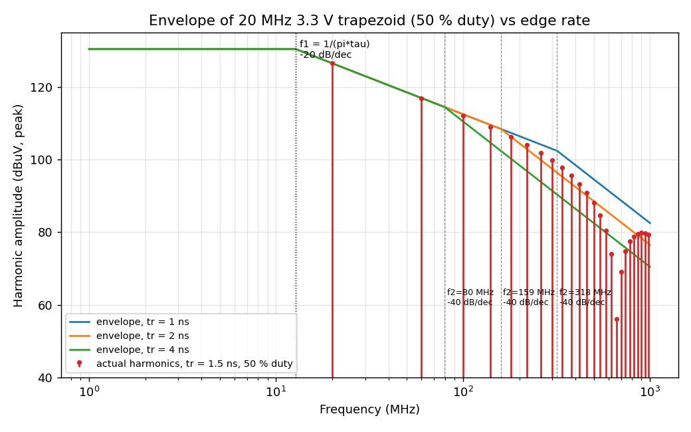

### 2.4 Radiated E-field estimate at 3 m

Models (Ott): differential-mode loop E_dm = 263·10⁻¹⁶ · f² · A · I / r; common-mode wire E_cm = 12.6·10⁻⁷ · f · I_cm · L / r (V/m, Hz, m², A, m). Class B limits at 3 m (10 m limits + 10.5 dB): **40 dBµV/m (30–230 MHz), 47 dBµV/m (230–1000 MHz)**, quasi-peak.

Assumptions: 9 lines (D0–D7 + WR#) switch simultaneously and in phase (worst case); harmonic current per line = V_harm/(Rout + Rs + Z0) with the edge slowed by (Rout+Rs)·(8 pF + 3.6 pF trace); loop area = 60 mm × dielectric height (90 mm² 2-layer, 12 mm² 4-layer); common mode is generated by ground-return inductance L_g (0.5 nH solid plane, 10 nH for a 2-layer board where the return is a pour with cut-outs) driving a 150 mm antenna (FPC + board edge) through 150 Ω; free space, no ground-plane reflection gain (+6 dB in a real OATS/SAC measurement should be added for margin).

| Rs (Ω) | f (MHz) | I_harm total (mA pk) | E_dm 2-layer (dBµV/m) | E_dm 4-layer (dBµV/m) | V_gb solid plane (mV) | E_cm solid plane (dBµV/m) | E_cm 10 nH return (dBµV/m) |
|---|---|---|---|---|---|---|---|
| 0 | 100 | 27.0 | **46.6** | 29.1 | 8.5 | **51.0** | 77.1 |
| 0 | 200 | 12.3 | **51.8** | 34.3 | 7.7 | **56.3** | 82.3 |
| 0 | 300 | 5.5 | **51.8** | 34.3 | 5.2 | **56.3** | 82.3 |
| 33 | 100 | 21.9 | 44.7 | 27.2 | 6.9 | 49.2 | 75.2 |
| 33 | 200 | 7.6 | 47.6 | 30.1 | 4.8 | 52.0 | 78.1 |
| 33 | 300 | 3.4 | 47.6 | 30.1 | 3.2 | 52.0 | 78.1 |

Reading: on a 2-layer board the differential-mode loop alone sits 5–12 dB above the Class B limit if all nine lines switch together; a 4-layer stackup with a solid L2 ground takes the DM term 17 dB down (loop height 1.5 mm → 0.2 mm) and leaves >10 dB margin. The common-mode term is the dominant one in every case and is governed by ground-return inductance, not by the series resistor: a 10 nH return path (split/pour-with-cutouts) is 26 dB worse than a solid plane. The series resistor gives 2–4 dB. The order of effectiveness is therefore: (1) solid uninterrupted ground reference under the bus, (2) short traces / small loop height (4-layer), (3) series termination, (4) not switching all lines at once (the firmware cannot change this; the 8080 bus is what it is).

### 2.5 Series termination value

Ideal Rs = Z0 − Rout: 20 Ω (Z0 55), 70 Ω (Z0 105), 95 Ω (Z0 130). The 2-layer impedance cannot be matched with a sensible value without over-damping the 8 pF load and eating into the 20 MHz timing budget, so the resistor is chosen for damping and overshoot control (section 3.1), not for exact matching. RC edge-slowing from Rs with C_load + C_trace: t10-90 ≈ 2.2·(35 + Rs)·C:

| Rs (Ω) | t10-90 at Z0 = 55 (C = 15.1 pF) | t10-90 at Z0 = 105 (C = 11.7 pF) |
|---|---|---|
| 0 | 1.16 ns | 0.90 ns |
| 22 | 1.89 ns | 1.47 ns |
| 33 | 2.26 ns | 1.75 ns |
| 47 | 2.72 ns | 2.11 ns |

**Decision: 33 Ω on every ESP32 output of the bus (D0–D7, WR#, D/C#, CS#, RESET#)**, 0402 or 0603, placed within 5 mm of the ESP32 pad. Justification in 3.1: at 105–130 Ω it limits the peak to 3.5–3.7 V (inside the 3.8 V absolute maximum, which Rs = 0 and Rs = 22 violate), keeps a 0.6 V ring-back margin to VIH, and adds only 0.3 ns to the receiver edge; at 55 Ω (4-layer) it is slightly over-damped but still has 2.0 ns t10-90 and crosses VIH 2.3 ns after the driver edge — irrelevant against a 25 ns half-period. 47 Ω would be the choice if the board stays 2-layer with 0.25 mm traces (Z0 ≈ 130); 22 Ω if 4-layer is adopted. 33 Ω is the single value that is acceptable on both stackups. Firmware alternative with the same effect: set the ESP32 pad drive strength to 10 mA (Rout ≈ 70 Ω) — not relied on because the TFT library resets pad configuration.

### 2.6 I2C pull-ups (400 kHz Fast-mode)

tr(30 %→70 %) = 0.8473·Rp·Cb ≤ 300 ns → Rp ≤ 7.08 kΩ at 50 pF, **≤ 3.54 kΩ at 100 pF**. Rp ≥ (3.3 − 0.4 V)/3 mA = **967 Ω**.

| Rp | tr @ 50 pF | tr @ 100 pF | I_sink (mA) |
|---|---|---|---|
| 1.5 kΩ | 64 ns | 127 ns | 1.93 |
| **2.2 kΩ** | **93 ns** | **186 ns** | **1.32** |
| 2.7 kΩ | 114 ns | 229 ns | 1.07 |
| 3.3 kΩ | 140 ns | 280 ns | 0.88 |
| 4.7 kΩ | 199 ns | 398 ns (fail) | 0.62 |
| 10 kΩ | 424 ns (fail) | 847 ns (fail) | 0.29 |

**Decision: 2.2 kΩ to 3.3 V on SDA and SCL**, one pair only, located at the ESP32 end (the touch FPC adds capacitance at the far end). Disable the ESP32 internal 45 kΩ pull-ups in firmware (they are irrelevant electrically but mask a missing resistor). GT911 and ADS1115 both tolerate 1.3 mA sink. Add 100 Ω series resistors at the GT911 FPC connector pins (SDA, SCL, INT, RST) for ESD/ringing damping — 100 Ω adds 8 ns to tr, negligible.

### 2.7 Thermocouple front end

Topology (schematic order from the terminal inward): screw terminal → TVS (bidirectional 5 V SMAJ/SMF or PESD) → **10 MΩ bias to 3.3 V on TC+, 10 MΩ to GND on TC−** → 1 kΩ series on each lead → 100 nF differential (C0G/X7R) across AIN0/AIN1 → 10 nF each from AIN0 and AIN1 to analog ground → ADS1115 AIN0/AIN1, PGA ±256 mV.

- Differential corner: f_dm = 1/(2π·2R·(Cd + Ccm/2)) = **758 Hz**; common-mode corner f_cm = 1/(2π·R·Ccm) = **15.9 kHz** (Cd = 10·Ccm as required to keep CM→DM conversion from mismatch below the differential corner).
- Attenuation: differential 50 Hz −0.02 dB (none — 50 Hz on the thermocouple is a common-mode problem), 100 kHz **−42.4 dB**; common-mode 50 Hz 0 dB, 100 kHz −16 dB; at the ADS1115 modulator frequency (250 kHz) the differential attenuation is −50 dB, which is what prevents aliasing of triac spikes.
- CM→DM conversion from Ccm mismatch at 50 Hz: V_dm ≈ V_cm·2πf·R·ΔC = **314 µV/V for 10 % mismatch, 31 µV/V for 1 %**. This is the dominant 50 Hz mechanism (see 3.3) and is why the two 10 nF capacitors must be C0G 1–2 % (or the same reel) and the two 1 kΩ 0.1 %.
- ADS1115 CMRR 105 dB (DC–60 Hz) → 5.6 µV/V residual — negligible against the mismatch term.
- Thermal noise of the 2 kΩ: 217 nV rms over the filter noise bandwidth (1.19 kHz, 85 °C), 25 nV rms in the ADC's 16 Hz band. Negligible.
- LSB = 256 mV / 2¹⁵ = **7.8125 µV = 0.19 °C** (K-type 41 µV/°C). Full scale ±256 mV corresponds to ±6200 °C equivalent, so the gain could be raised only if the ADS1115 had a PGA > 16; it does not.
- ADS1115 noise: datasheet gives 16 noise-free bits at 16 SPS / ±256 mV, i.e. quantisation-limited. Taking LSB/√12 + 1.5 µV (conservative) = 3.8 µV rms = **0.09 °C rms per sample; after 1 s averaging 0.023 °C rms at 16 SPS (16 samples), 0.016 °C at 32 SPS (32 samples)**. Resolution is therefore quantisation-limited at 0.19 °C per sample; averaging 16 samples with the 50 Hz residual acting as dither gives ≈0.05 °C effective resolution.
- Open-thermocouple detection: bias current 3.3 V/20 MΩ = **165 nA**. With the bias resistors on the terminal side of the 1 kΩ filter resistors the current flows only through the thermocouple loop resistance (≈10 Ω): error **1.65 µV = 0.04 °C**. If the bias resistors were placed on the ADC side of the 1 kΩ resistors the same current would develop 332 µV = **8.1 °C** across the filter resistors — this is a schematic rule, not a layout detail. With the thermocouple open the inputs settle to V(AIN0) = 1.56 V, V(AIN1) = 1.44 V, **differential +113 mV = 14 430 LSB** (SPICE: 112.7 mV), far above any real K-type reading (54.9 mV at 1372 °C); firmware threshold: > 60 mV (7 680 LSB) for 3 consecutive samples = open. Time constant of the open-circuit drift: 5 MΩ · 105 nF ≈ 0.5 s. The same network biases the thermocouple common mode to 1.65 V so that negative EMF (cold junction warmer than tip) is readable with the single-supply ADS1115.
- ADS1115 differential input impedance at ±256 mV is 710 kΩ (datasheet); against the 2 kΩ + 10 Ω source this is a **−0.28 % gain error (−0.85 °C at 300 °C)** — calibrate out in firmware (multiply by 1.0028) or accept.
- Settling after a step (e.g. after the open-thermocouple condition clears): τ = 2R(Cd + Ccm/2) = 0.21 ms, 1 LSB in **1.55 ms** (SPICE) — irrelevant at 16 SPS.

### 2.8 Power rails (analytic)

TPS562201, 5 → 3.3 V, 580 kHz, 4.7 µH: D = 0.66, **ΔI_L = 0.41 A pp**. Ripple = ΔI_L/(8·f·C) + ΔI_L·ESR:

| C_out | capacitive term | ESR term (2.5 mΩ) | ESL term (0.3 nH) | total |
|---|---|---|---|---|
| 2 × 22 µF nominal | 2.0 mV | 1.0 mV | 0.2 mV | **≈3.1 mV pp** |
| 2 × 14 µF (X5R 0805 at 3.3 V bias, −35 %) | 3.2 mV | 1.0 mV | 0.2 mV | **≈4.2 mV pp** |

MIC2288, 5 → 9.6 V, 140 mA, 1.2 MHz, 10 µH: D = 0.48, **ΔI_L = 0.20 A pp** (continuous), I_L,avg = 0.32 A (η = 0.85), I_L,peak = 0.42 A. A boost draws its inductor current from the input, so the 5 V rail sees a 0.2 A pp triangle at 1.2 MHz plus — with PWM dimming via EN — **0.32 A load steps at the PWM rate**. Into a single 10 µF (7 µF effective) at the boost input: 4.0 mV pp at 1.2 MHz. Pi filter 10 µF | 2.2 µH | 10 µF: f_c = 1/(2π√(LC)) = 40.6 kHz, 40·log(1.2 MHz/40.6 kHz) = **59 dB** at the switching frequency; undamped Q with ceramic ESR ≈ 56, Z₀ = √(L/C) = 0.56 Ω → a damping element is mandatory (SPICE section 3.4).

## 3. SPICE results

### 3.1 (a) 8080 bus line — series termination

Netlist: `V1 PULSE(0 3.3 5n 1.5n 1.5n 21n 50n)` → 35 Ω → Rs → lossless `T Z0 TD=390p` → 8 pF ‖ 1 MΩ. 45 % duty was used (WR# high 22.5 ns) so that the 5th/10th/15th harmonics at 100/200/300 MHz are not nulled by the duty-cycle sinc. Receiver voltage 0–40 ns, step 2 ps:

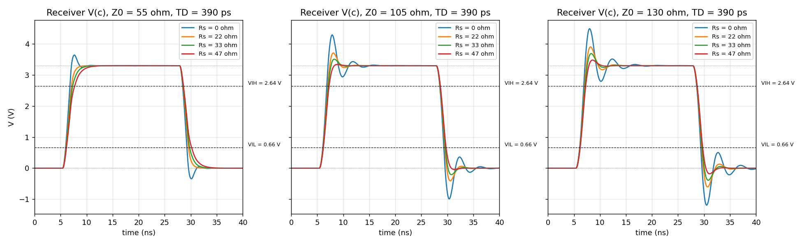
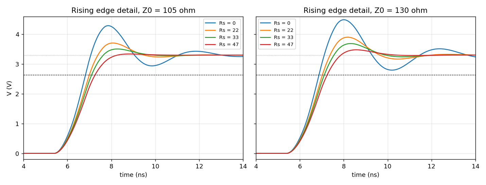

| Z0 (Ω) | Rs (Ω) | peak (V) | overshoot (V) | ring-back min (V) | VIH margin (V) | undershoot (V) | low ring-back max (V) | VIL margin (V) | t10-90 at receiver (ns) | VIH/VIL met | < 3.8 V abs max |
|---|---|---|---|---|---|---|---|---|---|---|---|
| 55 | 0 | 3.64 | 0.34 | 3.25 | 0.61 | −0.34 | 0.05 | 0.61 | 1.14 | yes | yes |
| 55 | 22 | 3.30 | 0.00 | 3.30 | 0.66 | 0.00 | 0.00 | 0.66 | 1.60 | yes | yes |
| 55 | **33** | 3.30 | 0.00 | 3.30 | 0.66 | 0.00 | 0.00 | 0.66 | 2.04 | yes | yes |
| 55 | 47 | 3.30 | 0.00 | 3.30 | 0.66 | 0.00 | 0.00 | 0.66 | 2.53 | yes | yes |
| 105 | 0 | **4.29** | 0.99 | 2.94 | 0.30 | **−0.99** | 0.36 | 0.30 | 1.10 | yes | **no** |
| 105 | 22 | 3.71 | 0.41 | 3.24 | 0.60 | −0.41 | 0.06 | 0.60 | 1.29 | yes | yes |
| 105 | **33** | 3.51 | 0.21 | 3.28 | 0.64 | −0.21 | 0.02 | 0.64 | 1.43 | yes | yes |
| 105 | 47 | 3.34 | 0.04 | 3.30 | 0.66 | −0.04 | 0.00 | 0.66 | 1.65 | yes | yes |
| 130 | 0 | **4.49** | 1.19 | 2.80 | 0.16 | **−1.19** | 0.50 | 0.16 | 1.12 | yes | **no** |
| 130 | 22 | **3.90** | 0.60 | 3.17 | 0.53 | −0.60 | 0.13 | 0.53 | 1.29 | yes | **no** |
| 130 | **33** | 3.69 | 0.39 | 3.25 | 0.61 | −0.39 | 0.06 | 0.61 | 1.39 | yes | yes |
| 130 | 47 | 3.48 | 0.18 | 3.29 | 0.65 | −0.18 | 0.01 | 0.65 | 1.56 | yes | yes |
| 105 | 33 + 22 pF at receiver | 3.30 | 0.00 | 3.30 | 0.66 | 0.00 | 0.00 | 0.66 | 3.93 | yes | yes |

Logic thresholds are met in every case (the ring-back never re-crosses VIH/VIL because TD is short against tr), so the failure mode of an unterminated line is not a logic error but **overshoot to 4.3–4.5 V and undershoot to −1.0/−1.2 V**, i.e. the SSD1963 input clamp diodes conduct on every edge (≈ 0.5–0.7 V beyond the rails, 390 ps round trip) — this injects current into the SSD1963 VDDIO/VSS rails, is a long-term reliability issue, and the clamp currents are themselves a common-mode noise source. 33 Ω brings the peaks within the absolute-maximum rating for both 105 and 130 Ω, 47 Ω is cleaner still on the 2-layer board. On the 4-layer board 22 Ω is the matched value and 33 Ω is mildly over-damped with no timing consequence (VIH is reached 2.3 ns after the driver edge; the SSD1963 needs ≥ 9 ns WR# low/high and 5 ns data setup, all of which the 20 MHz, 25 ns half-period provides).

FFT of the driver current (20 periods, uniform 5 ps grid, Hann window, bin = 1 MHz):

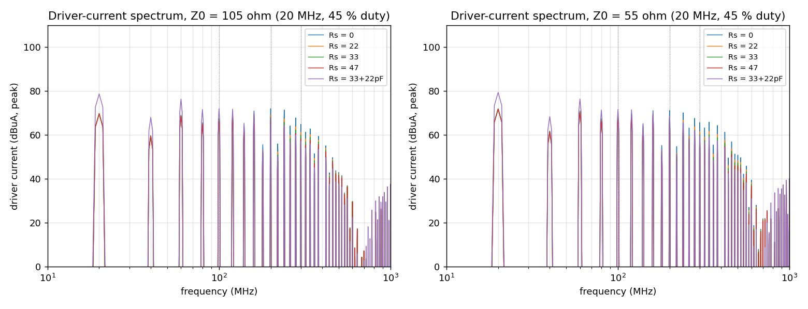

| Z0 (Ω) | harmonic | Rs = 0 (dBµA) | Rs = 22 | Rs = 33 | Rs = 47 | reduction 33 vs 0 (dB) | reduction 47 vs 0 (dB) |
|---|---|---|---|---|---|---|---|
| 105 | 100 MHz | 67.4 | 66.8 | 66.5 | 66.0 | **0.9** | 1.4 |
| 105 | 200 MHz | 72.0 | 69.0 | 67.8 | 66.3 | **4.2** | 5.7 |
| 105 | 300 MHz | 64.9 | 61.3 | 59.8 | 58.3 | **5.1** | 6.6 |
| 55 | 100 MHz | 68.8 | 68.1 | 67.6 | 67.0 | **1.2** | 1.8 |
| 55 | 200 MHz | 71.1 | 68.6 | 67.4 | 66.1 | **3.7** | 5.0 |
| 55 | 300 MHz | 65.7 | 61.6 | 60.1 | 58.5 | **5.6** | 7.2 |

The reduction is modest (1–6 dB) because the driver edge rate is fixed at 1.5 ns and Rs only adds a 0.3–0.5 ns RC roll-off; the resistor's job is overshoot control, the emission reduction is a side benefit. Adding 22 pF at the receiver with Rs = 33 (purposeful edge slowing to 3.9 ns) gives 7.7 dB at 300 MHz but **increases** the 100 MHz current by 4.6 dB (the capacitor draws more reactive current at the 5th harmonic) — not recommended. The lever on emissions is the return path and loop area (2.4), not the resistor value.

### 3.2 (b) I2C SCL rise time

Open-drain switch (Ron 50 Ω) at 400 kHz, Cb = 100 pF and 50 pF:

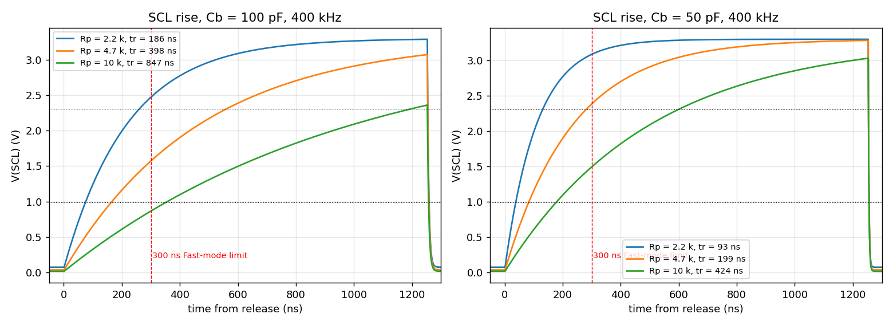

| Rp | Cb | tr 30→70 % (SPICE) | formula | tf (ns) | VOL (V) | time above 0.7·VDD in the 1.25 µs high phase | ≤ 300 ns |
|---|---|---|---|---|---|---|---|
| **2.2 kΩ** | 100 pF | **186 ns** | 186 ns | 5 | 0.073 | 988 ns | **pass** |
| 4.7 kΩ | 100 pF | 398 ns | 398 ns | 5 | 0.035 | 687 ns | fail |
| 10 kΩ | 100 pF | 847 ns | 847 ns | 5 | 0.016 | 49 ns | fail (barely reaches VIH) |
| 2.2 kΩ | 50 pF | 93 ns | 93 ns | 2 | 0.073 | 1118 ns | pass |
| 4.7 kΩ | 50 pF | 199 ns | 199 ns | 2 | 0.035 | 967 ns | pass |
| 10 kΩ | 50 pF | 424 ns | 424 ns | 2 | 0.016 | 648 ns | fail |

4.7 kΩ is only acceptable if the bus capacitance is proven ≤ 70 pF; with the GT911 FPC, the ADS1115, two ESP32 pads and ~150 mm of trace the 100 pF estimate is realistic. **2.2 kΩ** chosen.

### 3.3 (c) Thermocouple front end

Stimulus: 12.3 mV DC (300 °C) + 1 V / 50 Hz common mode applied to both leads as an ideal source around the 1.65 V bias point (worst case: grounded-junction probe at a 1 V ground offset) + 50 mV pp / 100 kHz differential burst between 20 and 30 ms. ADS1115 modelled as 710 kΩ differential ‖ 100 MΩ per input. 250 ms, 1 µs step.

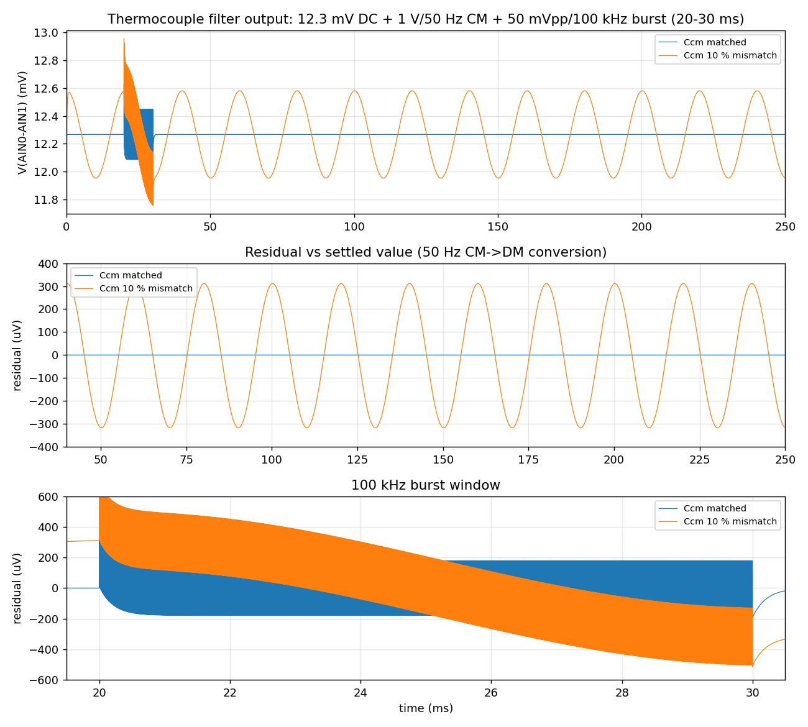
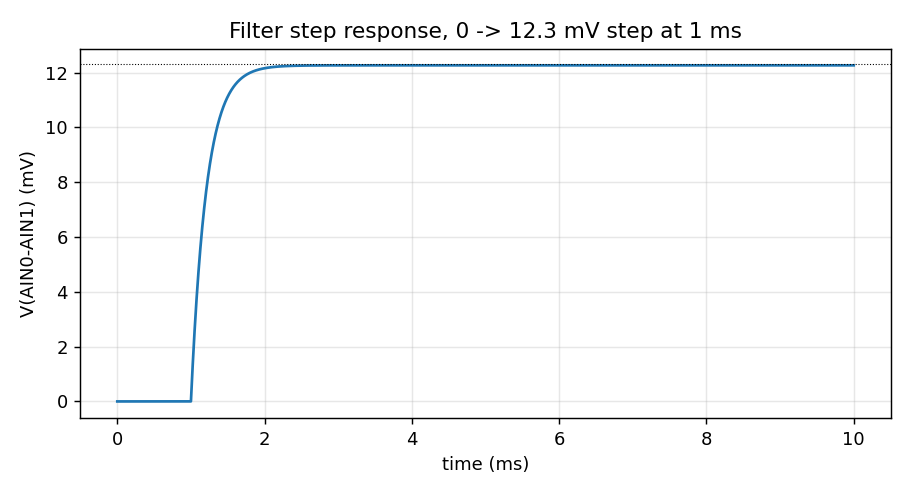
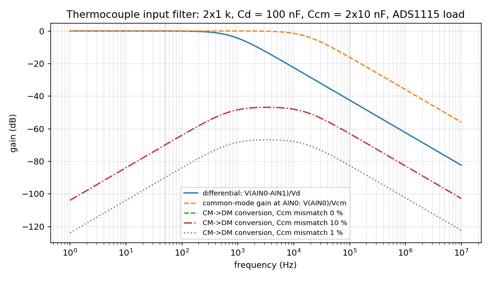

| Quantity | Ccm matched | Ccm 10 % mismatch |
|---|---|---|
| settled differential output | 12.267 mV (−0.27 % from the 710 kΩ load) | 12.270 mV |
| 50 Hz residual at the ADC pins | **0 µV** | **628 µV pp (= 15 °C pp)** |
| after ADS1115 16 SPS filter (62.5 ms box average, notch at 48/64 Hz) | 0 | **15.5 µV pp = 0.38 °C pp** |
| after ADS1115 32 SPS filter (31.25 ms average) | 0 | 123 µV pp = 3.0 °C pp |
| 100 kHz burst residual (50 mV pp in) | 359 µV pp (−42.9 dB) | 376 µV pp |
| step settling to 1 LSB | 1.55 ms | — |
| common-mode swing at AIN0 | 2.0 V pp (not attenuated at 50 Hz, as designed; stays within 0.65–2.65 V, inside the ADS1115 input range) | |

AC analysis: differential −3 dB at 794 Hz (758 Hz without the 710 kΩ load), −22.5 dB at 10 kHz, −42.5 dB at 100 kHz, −62.5 dB at 1 MHz; common-mode gain at AIN0 −3 dB at 15.9 kHz, −16 dB at 100 kHz; CM→DM conversion at 50 Hz: −∞ (matched), **−90 dB (1 % mismatch, 32 µV/V), −70 dB (10 %, 316 µV/V)**.

Conclusions for the thermocouple channel:
1. The 100 kHz triac burst is handled by the RC filter alone (−43 dB) and the remainder is removed by the ADS1115 digital filter; the 250 kHz alias band is 50 dB down.
2. 50 Hz is **not** removed by the RC filter and is not meant to be; it is removed by (i) the ADS1115 sinc filter — 16 SPS puts notches at 48 and 64 Hz and attenuates 50 Hz by ≈28 dB, 32 SPS only by 14 dB — **use 16 SPS (or 8 SPS), not 32 SPS**, and (ii) capacitor matching. With 1 % C0G capacitors and 16 SPS the worst-case 1 V CM residual is 1.6 µV pp = 0.04 °C — below 1 LSB.
3. Expected performance: resolution 0.19 °C/LSB, noise 0.09 °C rms per sample, **≈0.02–0.05 °C rms after 1 s averaging**, 50 Hz residual ≤ 0.04 °C with matched capacitors, systematic −0.28 % gain error (calibrate), open-circuit error 0.04 °C.

### 3.4 (d) Power rails

Buck output (inductor-current triangle into 2 × (C + 5 mΩ + 0.6 nH), 1 A load):

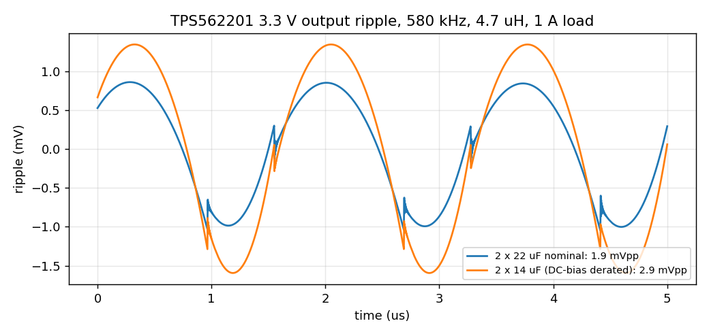

| C_out | SPICE ripple (mV pp) | analytic capacitive + ESR (mV) |
|---|---|---|
| 2 × 22 µF nominal | **1.9** | 2.0 + 1.0 |
| 2 × 14 µF (DC-bias derated) | **2.9** | 3.2 + 1.0 |

(The SPICE value is below the arithmetic sum because the capacitive and ESR terms peak at different instants.) 3.3 V ripple of ≤ 3 mV pp at 580 kHz is adequate for the ESP32 and the SSD1963 VDDIO; the ADS1115 is fed through a ferrite/10 Ω + 1 µF (rule 18), which attenuates 580 kHz by a further > 30 dB.

Boost input and 5 V rail (HLK-10M05 modelled as 5 V + 30 mΩ + 470 µF/0.15 Ω, 30 mΩ + 100 nH wiring to the board, 22 µF buck-input ceramic on the rail; boost input current = 0.32 A ± 0.1 A triangle at 1.2 MHz gated by 1 kHz / 50 % PWM dimming):

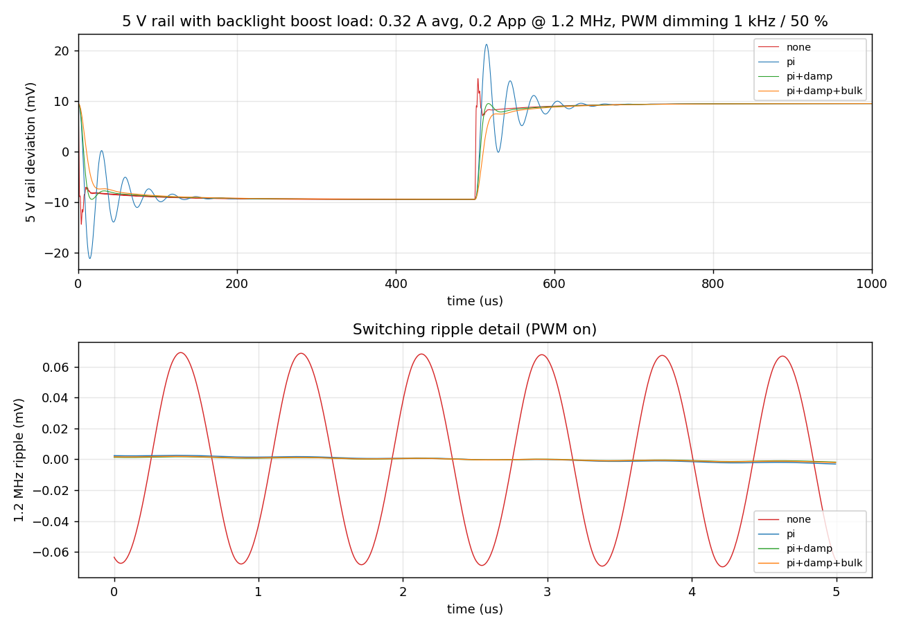
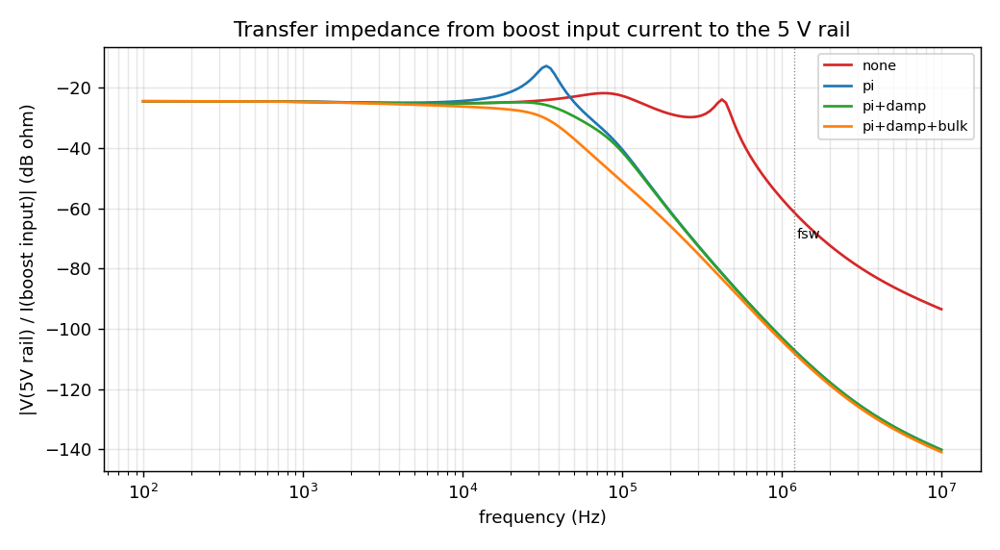

| Variant | 1.2 MHz ripple at boost input (mV pp) | 1.2 MHz ripple on 5 V rail (mV pp) | rail excursion from 0.32 A PWM step (mV pp) | of which LC ringing (mV) | Z_t rail peak (dBΩ @ Hz) | Z_t @ 1.2 MHz (dBΩ) |
|---|---|---|---|---|---|---|
| none: 10 µF at boost input, 20 nH trace | 2.1 | 0.12 | 28.9 | 9.9 | −21.8 @ 75 k | −61 |
| pi: 10 µF ‖ 2.2 µH ‖ 10 µF, undamped | 1.9 | 0.001 | **42.4** | **23.5** (Q ≈ 10 at 33 kHz) | −12.7 @ 33 k | −107 |
| **pi + damping: + 47 µF / 0.5 Ω electrolytic across the boost-side 10 µF** | 1.9 | **0.001** | **19.0** | **0.0** | −24.8 @ 22 k | −107 |
| pi + damping + 100 µF / 30 mΩ polymer bulk on the rail | 1.9 | 0.001 | 19.0 | 0.0 | −25.0 @ 2 k (flat) | −108 |

Reading:
- The 1.2 MHz switching ripple is not the problem: even without a filter the boost-input capacitor and the 20 nH of trace keep it at 0.12 mV pp on the rail; the pi filter takes it to ≈1 µV (−46 dB more, in line with the 59 dB analytic figure minus the parasitic floor). The "< 10 mV pp conducted switching noise" target is met by a factor of 100 with the pi filter.
- An **undamped** pi filter is worse than no filter: its 33 kHz resonance (Z₀ = 0.56 Ω, Q ≈ 10 with ceramic ESR) is excited by every PWM-dimming step and rings 23 mV on the rail. The 47 µF / 0.3–0.7 Ω electrolytic (R ≈ √(L/C)) across the boost-side capacitor removes the ringing completely; a low-ESR polymer would not (it needs the resistance).
- What remains — 19 mV pp at the PWM rate — is purely the resistive drop of the 0.32 A step across the HLK output resistance + wiring (0.32 A × 60 mΩ). No capacitor on the board fixes a 1 kHz, 0.32 A step through 60 mΩ (100 µF is 1.6 Ω at 1 kHz). It is a load-regulation step, not switching noise, and it is seen by every 5 V consumer (and, divided by the buck's PSRR, by the 3.3 V rail). To get it below 10 mV: **(a) dim the backlight by analog control** (RC-filtered PWM into the MIC2288 FB node — the input current then becomes DC), or **(b) raise the dimming PWM frequency to ≥ 20 kHz**, where the damped filter plus the 100 µF bulk give Z_t ≈ 23–40 mΩ (−33 … −28 dBΩ) → 7–13 mV pp, or (c) both. Option (a) is recommended; it also removes the PWM sidebands around the 1.2 MHz harmonics in the conducted-emission band.

Recommended boost input network (schematic): 5 V rail → 10 µF 0805 X7R → 2.2 µH (I_sat ≥ 0.8 A, DCR ≤ 80 mΩ, shielded) → 10 µF 0805 X7R + 47 µF/16 V aluminium electrolytic (ESR 0.3–0.7 Ω at 100 kHz, 105 °C rated for the 85 °C ambient) → MIC2288 VIN. Plus 100 µF polymer (or 220 µF electrolytic) on the 5 V rail at the HLK input connector.

## 4. PCB layout and schematic rules (Rev3.0)

### 4.1 Stackup and ground
1. **Preferred: 4-layer, L1 signal / L2 solid GND / L3 power (5 V, 3.3 V, 9.6 V islands) / L4 signal**, 0.2 mm prepreg L1–L2. This alone moves the differential-mode bus emission from ≈47–52 dBµV/m to ≈29–34 dBµV/m (section 2.4). If the board stays 2-layer: route the whole 8080 bus and the RGB bus on the top layer over an **uninterrupted bottom-layer ground** with no other traces under the buses; move every bottom-layer signal crossing elsewhere; stitch the pour to the top-layer ground with vias every ≤ 10 mm along the bus.
2. **No splits, slots or plane cut-outs under the 8080 bus, the RGB bus, the I2C lines or the crystal.** A 10 nH return detour is worth 26 dB of common-mode emission. Do not route the analog ground as a separate plane under digital signals.
3. One ground plane; analog "star" ground implemented as a **plane region**, not a separate net: ADS1115, its 10 nF capacitors, the 100 nF differential cap, the NTC divider and the thermocouple TVS all land on the same area of the GND plane, connected to the rest of the plane at the ADS1115's GND pin area, with no digital return currents (ESP32, SSD1963, buck) flowing through that region. Place the thermocouple terminal, filter and ADS1115 at a board edge away from the SSD1963 and the switchers (≥ 20 mm from the buck inductor, ≥ 30 mm from the triac and mains traces).

### 4.2 ESP32 ↔ SSD1963 8080 bus
4. **33 Ω series resistors (0402/0603, ±1 %) in D0–D7, WR#, D/C#, CS#, RESET#, within 5 mm of the ESP32 module pads** (source termination must be at the driver; a resistor near the SSD1963 does nothing for the reflection and little for the current). Use 4 × 33 Ω resistor arrays only if the array sits at the ESP32; otherwise discrete.
5. **Trace length ≤ 80 mm**, target 40–60 mm; match D0–D7 and WR# within 10 mm (not timing-critical, but keeps the loop areas equal). Width 0.25 mm on 4-layer (≈59 Ω), 0.5–0.6 mm on 2-layer (≈101–105 Ω). Spacing ≥ 2× width to adjacent signals; ≥ 0.5 mm from I2C and from any analog trace.
6. **Return vias**: wherever a bus trace changes layer, add a GND via within 1 mm of the signal via (one per 2 signals is acceptable for the data lines, one each for WR# and the RGB clock). Keep layer changes to at most one per line.
7. No stubs: the SSD1963 is the only receiver; do not break out test pads on the bus (if needed, use via-in-line test points at the SSD1963 end).
8. Tie RD# high with a 10 kΩ pull-up (already in the design) and keep the unused SSD1963 D8–D23 inputs tied to GND with 0 Ω or direct pour — unterminated CMOS inputs pick up bus noise.

### 4.3 SSD1963 power and decoupling
9. **One 100 nF 0402 X7R per VDDIO/VSS pin pair and per VDDCORE pin, placed on the pin side, via to the GND plane within 1 mm**; plus 1 × 10 µF per rail (VDDIO 3.3 V, VDDCORE 1.2 V from the LD1117-1.2, VDDPLL). The SSD1963 has about 12 VDD pins; budget 12 × 100 nF + 3 × 10 µF. PLL supply: 100 nF + a ferrite bead (600 Ω @ 100 MHz) from the 1.2 V rail, cap on the chip side.
10. LD1117-1.2: 10 µF ceramic at the output (ESR ≥ 0.3 Ω is not needed for the 1117 with ceramics only if a 10 µF tantalum/polymer is used — follow the datasheet: use a 10 µF X7R plus a 22 µF polymer or a 4.7 µF tantalum to guarantee stability at 85 °C).
11. RGB/TFT output side: 22–33 Ω series in the **pixel clock (DCLK, 33 MHz), HSYNC, VSYNC, DE** at the SSD1963 end — the 33 MHz clock harmonics up to the 15th fall in the 100–500 MHz band where the FPC radiates best. Data lines R/G/B[7:0] do not need series resistors if the trace length SSD1963 → FPC connector is ≤ 40 mm (they change only on DCLK edges, low activity factor), but keep a 0.25 mm/0.25 mm pitch over solid ground. Pixel clock trace routed between two ground traces or with a ground trace on each side where it leaves the plane region.
12. **FPC connector placement**: the 40-pin 0.5 mm connector sits at the board edge nearest the display, ≤ 40 mm from the SSD1963, with the connector's GND pins tied to the plane with ≥ 2 vias each and the FPC's ground pins used as return (every 4th–6th conductor in the 40-pin cable is GND on the standard 7" RGB panels — verify against the panel pinout; if not, add 1 nF 0402 from each supply pin to GND at the connector). Backlight LED+ (9.6 V) and LED− through the same FPC: add a 100 nF + ferrite at the connector so the 1.2 MHz boost ripple does not ride on the cable.
13. Touch FPC (6-pin GT911): 100 Ω series on SDA/SCL/INT/RST at the connector, 100 nF at the connector's 3.3 V pin, ESD diode array (e.g. 4-channel, 3.3 V, < 1 pF) at the connector.

### 4.4 I2C
14. 2.2 kΩ pull-ups at the ESP32 end; trace width 0.25 mm; total length ≤ 150 mm; run SDA and SCL together with GND between or beside them where they leave the plane region; no vias under the ADS1115 analog area.
15. The ADS1115 I2C pins are on the digital side of the chip — orient the package so the I2C side faces the ESP32 and the AIN side faces the terminal; no digital trace crosses the analog area.

### 4.5 Thermocouple input
16. Screw terminal at the board edge; **TC+ and TC− routed as a tightly coupled pair** (0.25 mm width, 0.2 mm gap) from the terminal to the 1 kΩ resistors to the ADS1115, over the analog ground region, ≥ 30 mm from the triac, snubber, mains traces and the heater/fan connectors; never parallel to a mains trace for more than 10 mm; no digital trace on any layer within 3 mm of the pair.
17. Component order from the terminal: TVS (bidirectional 5–6 V SMF, 1 per lead to analog GND, or a 2-channel array) → 10 MΩ bias resistors (TC+ to 3.3 V analog, TC− to analog GND; 0603, keep the 3.3 V stub short and decoupled with 100 nF at the resistor) → 1 kΩ 0.1 % 25 ppm (both from the same reel) → 100 nF C0G/X7R 5 % between AIN0 and AIN1 placed directly at the ADS1115 pins → 2 × 10 nF **C0G ±1–2 %** to the analog ground region, symmetrical placement (same via distance to GND). Put the two 10 nF physically adjacent so they track thermally.
18. ADS1115: 100 nF + 1 µF at VDD, directly at the pin; supply the ADS1115 from 3.3 V through a ferrite bead (600 Ω) or 10 Ω — the ADS1115 VDD is also its reference. Keep ADDR and ALERT/RDY away from the AIN pins.
19. NTC cold-junction sensor placed within 5 mm of the screw terminal on the same copper (thermal via pattern under the terminal to the NTC area); route its divider like the thermocouple pair (analog ground region).
20. Firmware: 16 SPS (or 8 SPS), PGA ±256 mV, average 16 samples, open-TC threshold > 60 mV, gain correction 1.0028.

### 4.6 Power
21. TPS562201: input 10 µF + 100 nF at VIN/GND pins, SW node copper minimum, inductor adjacent, output caps 2 × 22 µF 10 V X7R 1206 (not 0805 — DC-bias derating), feedback trace away from SW and the inductor, bootstrap cap next to the pin; GND of the input cap, output cap and IC on the same plane area with multiple vias. Keep the buck ≥ 20 mm from the ADS1115 and from the bus.
22. MIC2288: input pi filter per section 3.4 (10 µF ceramic rail side, 2.2 µH ≥ 0.8 A sat, 10 µF ceramic + 47 µF/16 V electrolytic (ESR 0.3–0.7 Ω) at the boost input), 100 µF polymer bulk on the 5 V rail near the HLK module input connector; output 10 µF/25 V + 100 nF; Schottky and inductor loop minimum; the 9.6 V trace to the FPC with 100 nF at the connector. Backlight dimming: prefer **PWM ≥ 20 kHz (above the LC resonance) or analog dimming through the FB pin** (filtered PWM into FB) instead of 1 kHz EN gating — see 3.4.
23. HLK-10M05 and mains: the existing X2 capacitor + common-mode choke + MOV at the mains input stay; add a 1 nF/Y1 (or 2.2 nF Y1) from the 5 V ground to protective earth only if the enclosure is earthed and the touch panel is not referenced to the user — if the chassis is Class II, leave the secondary floating and rely on the CM choke. Triac snubber (100 Ω + 100 nF X2) across the triac and the gate trace ≤ 20 mm; mains copper and the triac on the far side of the board from the thermocouple terminal, 8 mm creepage to the SELV area, slotted.
24. ESD/EFT: TVS on the thermocouple terminal (both leads), 5-channel ESD array at the touch FPC, 100 nF + 1 kΩ on EN/reset-type inputs that leave the board, ferrite + 100 nF on the fan and heater-control outputs; all connectors along one board edge with a continuous ground pour at that edge; the ESP32 antenna keep-out (per module datasheet) free of copper on all layers and at the board edge opposite the mains section.

## 5. Pre-compliance test plan

### 5.1 Near-field probe scan (bench, spectrum analyser 9 kHz–1 GHz, peak detector, 100 kHz RBW)
Magnetic-field probe (small loop, 10 mm) at ≤ 5 mm, with the display running a full-screen refresh loop (worst-case bus activity) and the heater at 50 % phase angle:

| Point | What to look for | Expected lines |
|---|---|---|
| 1. ESP32 end of the 8080 bus (over the 33 Ω resistors) | 20 MHz harmonics; compare with the resistor shorted on one spare line to verify the 4–6 dB at 200–300 MHz | 20, 60, 100, 140, 180, 220 MHz… (odd-dominant) |
| 2. SSD1963 package and its VDDIO decoupling | PLL and 33 MHz DCLK harmonics, 1.2 V core noise | 33, 66, 99, 132, 165, 198, 231, 264, 297, 330 MHz |
| 3. 40-pin FPC connector and along the 50 mm FPC | DCLK harmonics, the dominant external radiator | 33 MHz × n; 100–500 MHz |
| 4. ESP32 module (Wi-Fi off and on) | 40 MHz crystal, 80/160/240 MHz CPU clock harmonics | 40, 80, 160, 240, 480 MHz |
| 5. TPS562201 SW node and inductor | 580 kHz and harmonics to 30 MHz (conducted band) | 0.58, 1.16, 1.74 … MHz |
| 6. MIC2288 inductor / diode loop | 1.2 MHz harmonics to 30 MHz; PWM dimming sidebands | 1.2, 2.4, 3.6 … MHz ± 1 kHz |
| 7. Triac, snubber, heater wiring | broadband 100 kHz–30 MHz bursts at 100 Hz repetition | broadband, repetition 100 Hz |
| 8. Thermocouple terminal and cable | pickup of 5–7 (with the E-field probe) — should be below the noise floor at the ADS1115 input | — |
| 9. I2C lines at the GT911 FPC | 400 kHz harmonics (should be insignificant) and ringing at the SCL edges | 0.4 MHz × n; any > 50 MHz ringing indicates a missing 100 Ω |

Record a baseline with the display static, then with the refresh loop; the difference is the bus contribution. A 10 dB reduction when the four bus 33 Ω resistors are replaced by 0 Ω on one line confirms the model's direction (expect 4–6 dB at 200–300 MHz, less at 100 MHz).

### 5.2 Conducted emissions, LISN (CISPR 32 Class B, 150 kHz–30 MHz)
- 50 Ω/50 µH LISN on L and N, quasi-peak and average detectors, limits 66–56 dBµV QP / 56–46 dBµV AV (150–500 kHz, sloping), 56/46 dBµV (0.5–5 MHz), 60/50 dBµV (5–30 MHz).
- Operating modes: (i) heater 100 %, fan on, display refresh; (ii) heater at 50 % phase angle (worst for the triac spectrum); (iii) heater off, display at minimum backlight (PWM dimming at low duty — the boost restarts every PWM cycle and its input current steps are at maximum).
- Frequencies to inspect: **580 kHz and harmonics (buck)**; **1.2 MHz and harmonics (boost)** — these appear differential-mode through the HLK module's input filter; the HLK-10M05 itself has a 60–100 kHz switcher with harmonics into the 150 kHz–2 MHz band; triac broadband 150 kHz–5 MHz, which is normally the limiting item for phase-angle control — if it fails, the answer is burst (zero-cross) control in firmware for all but the final temperature-trim phase, or a larger X2 capacitor (0.22 → 0.47 µF) + a second CM choke stage.
- Margin target: ≥ 6 dB below the QP limit at the pre-compliance stage.

### 5.3 Radiated emissions (pre-compliance, 3 m or 1 m with distance correction, 30 MHz–1 GHz)
- Biconical/log-periodic antenna, horizontal and vertical, table rotation; display running the refresh loop; Wi-Fi association active (intentional-radiator emissions are assessed separately under RED/ETSI, but the 2.4 GHz TX must not be mistaken for a spurious).
- Expected critical frequencies: **100–330 MHz** (3rd–15th harmonics of the 33 MHz DCLK on the FPC, 5th–15th of the 20 MHz bus) and **240/480 MHz** (ESP32 CPU clock). The thermocouple cable and the heater/fan cables are common-mode antennas: test with the real cable lengths (≥ 1 m) and with ferrite sleeves on each cable to identify which cable radiates.
- Pass criterion: 6 dB margin to 40 dBµV/m (30–230 MHz) and 47 dBµV/m (230–1000 MHz) at 3 m.

### 5.4 Immunity (EN 61000-4-x)
- 4-2 ESD: ±4 kV contact to the enclosure, screw terminal, touch panel glass (through the panel), ±8 kV air to the display bezel/openings; criterion B (temporary disturbance, self-recovery, no false heater-on). The thermocouple channel must not latch into the "open" state — the 10 MΩ bias network recovers within 0.5 s, firmware debounce of 3 samples handles the transient.
- 4-4 EFT/burst: ±2 kV on mains (5 kHz and 100 kHz repetition), ±1 kV capacitive clamp on the thermocouple and fan cables if they are > 3 m; criterion B; watch for ADS1115 I2C lock-up (add an I2C bus-recovery routine and a watchdog on the temperature read).
- 4-5 surge: ±1 kV L–N (differential), ±2 kV L–PE if earthed; the MOV + X2 + HLK module input filter are the protection; verify the MOV energy rating and the fuse coordination.
- 4-6 conducted RF 3 V rms 150 kHz–80 MHz on mains and on the thermocouple cable (CDN or clamp): this is where the thermocouple RC filter and the capacitor matching are proven — criterion A requires the displayed temperature to stay within ±1 °C during the sweep.
- 4-11 dips/interruptions: HLK module hold-up; the ESP32 brown-out must not reset into a heater-on state.

## 6. Summary of decisions

| Item | Value | Basis |
|---|---|---|
| 8080 bus series resistors | **33 Ω** at the ESP32, all 12 lines | peak 3.5–3.7 V (< 3.8 V abs max) on 105–130 Ω, 0.6 V ring-back margin, 1.4–2.0 ns edge; 4–6 dB on 200–300 MHz driver current |
| Bus length / stackup | ≤ 80 mm; 4-layer preferred (Z0 ≈ 59 Ω) or 0.5–0.6 mm traces on 2-layer | critical length 51 mm at tr = 2 ns; DM emission 17 dB lower on 4-layer |
| I2C pull-ups | **2.2 kΩ** to 3.3 V | tr = 186 ns at 100 pF (limit 300 ns), 1.3 mA sink |
| Thermocouple filter | **2 × 1 kΩ 0.1 %, 100 nF differential, 2 × 10 nF C0G 1 %**, bias 10 MΩ to 3.3 V / 10 MΩ to GND on the terminal side | f_dm 758 Hz, f_cm 15.9 kHz, −42 dB at 100 kHz, −50 dB at 250 kHz; CM→DM 32 µV/V at 1 % mismatch; open-TC reads +113 mV |
| ADC settings | 16 SPS, PGA ±256 mV, 16-sample average | 50 Hz notch (−28 dB), 0.19 °C/LSB, ≈0.02–0.05 °C rms after 1 s |
| Buck output caps | 2 × 22 µF 1206 X7R 10 V | 3–4 mV pp ripple at 580 kHz |
| Boost input filter | 10 µF ‖ 2.2 µH ‖ 10 µF + 47 µF/0.5 Ω damper at the boost side; 100 µF bulk on the rail; analog (FB) dimming or PWM ≥ 20 kHz | 1.2 MHz ripple on the rail 0.001 mV pp (0.12 mV without filter); undamped filter rings 23 mV; 0.32 A PWM step gives 19 mV pp resistive drop at 1 kHz regardless of filtering |
