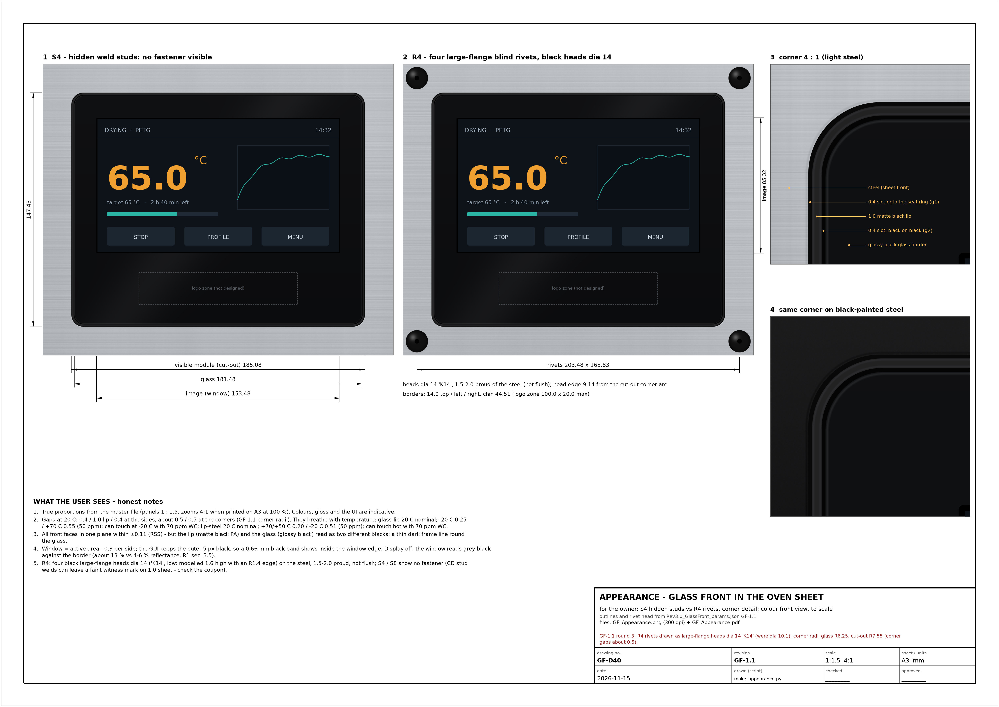
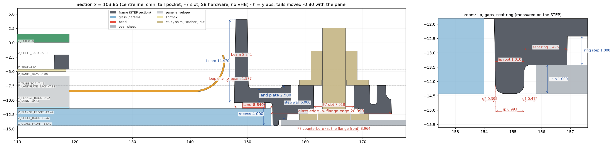
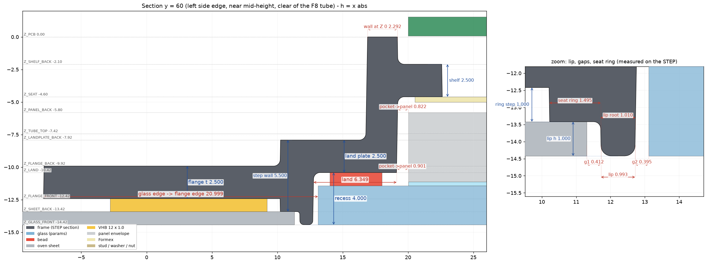
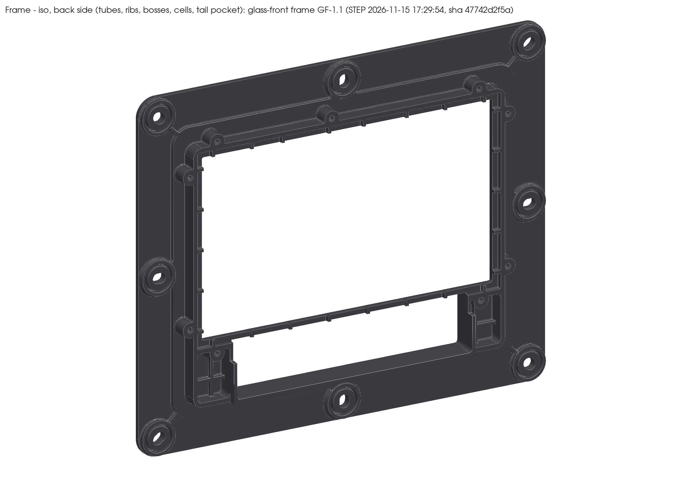
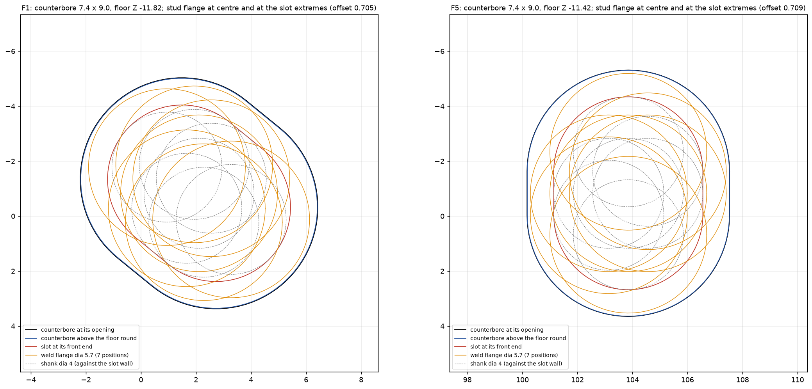
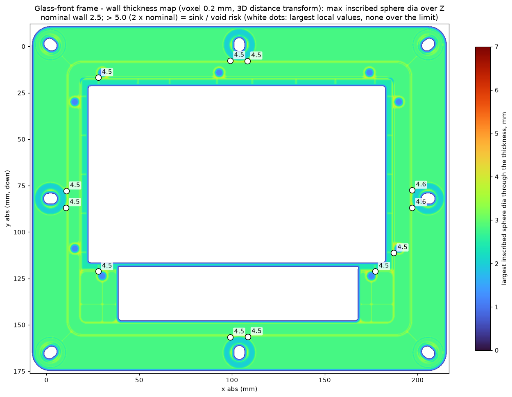

# Rev3.0 OVEN CONTROLLER — glass-front display module, revision GF-1.1 (2026-11-15)

Owner: Ömer Karaoğlu (READARK). Part family **GlassFront (GF)**: a printed, strengthened cover glass with the 7" SATOZ SAT070AT40D21 panel optically bonded behind it, bonded into a new moulded carrier frame that is fixed behind a plain laser-cut opening in the oven's steel front sheet, so that glass, frame lip and steel lie in one plane.

This is revision **GF-1.1, the design of record**. It is modelled in Fusion 360, exported, drawn (GF-D01 … GF-D50) and independently re-verified in CadQuery: 84 pass, 0 fail. §10.3 lists what changed from GF-1.0 and why.

Frame v2 (`Rev3.0_Frame_Design.md`, display recessed behind the sheet, ten studs) stays a valid alternative and is not touched. §3 compares the two.

- Master numbers: `Mechanical/Rev3.0_GlassFront/Rev3.0_GlassFront_params.json`, revision GF-1.1 with a `change_log`. It is the single source of truth; this document follows it wherever sources disagree.
- Reasoning and calculations: `Design Reports/Rev3.0/tools/glassfront/concept/` (`concept.md` §11 = the GF-1.0 frozen values, `concept_calc.py`, `concept_calc_out.txt`).
- Research: `tools/glassfront/research/R1_reference_touch_bonding.md` (reference product, touch, optical bonding) and `R2_manufacturing_turkey.md` (suppliers, processes, prices).
- CAD: Fusion 360 document "Rev3.0 GlassFront" (frame + fit assembly), exports in `Mechanical/Rev3.0_GlassFront/`.
- Verification: `tools/glassfront/verify/` (GF-1.1 results in `out/`, GF-1.0 results archived in `out/GF-1.0/`).
- Drawings GF-D01 … GF-D50: `Mechanical/Rev3.0_GlassFront/drawings/`. Full file list in §13.

---

## 0. Summary for the owner

### 0.1 What it is

A 181.48 × 143.83 mm cover glass sits flush in a 185.08 × 147.43 mm laser-cut opening of the oven front sheet. Behind the glass:

1. The 7" panel is **optically bonded** to the glass with a 0.30 mm silicone liquid adhesive (LOCA). This is done in-house in jig **J1**.
2. The glass is bonded to a moulded **PA6-GF30 FR frame** with an elastic 4.0 × 1.0 mm adhesive **bead**. This is done in-house in jig **J2**, a flat plate on which the glass front and the frame's lip top lie together, so they come out flush.
3. The frame is mounted **from behind** the sheet. Its 1.0 mm **lip** rises through the opening and fills the sheet thickness. Four strips of 3M VHB foam tape and four **hidden M4 weld studs** at the corners hold it.

The result is no press tool, one aluminium mould, glass printed and strengthened by a supplier, and bonding and assembly done in-house.

*GF-D40 at GF-1.1 (true proportions).*
- *Panel 1: the S4 variant, nothing visible.*
- *Panel 2: the R4 variant, four black large-flange rivet heads Ø14 ("K14") at the corners, 1.5–2.0 proud, head edge 9.14 from the cut-out corner arc (§2.3).*
- *Panels 3–4: the corner at 4:1 — steel | 0.4 shadow line | 1.0 matte black lip | 0.4 black-on-black line | glossy black glass.*
- *The UI is indicative. The title block notes the GF-1.1 corner radii (glass R6.25, cut-out R7.55, corner gaps about 0.5).*

### 0.2 What it looks like

The front shows painted steel, a 0.4 mm dark line, a 1.0 mm matte-black plastic lip, a second 0.4 mm black-on-black line, and then glossy black glass.

- The image window is 153.48 × 85.32 mm.
- The black border is 14.0 mm at the top, left and right.
- A **44.51 mm black "chin"** below the image carries a logo zone of at most 100 × 20 mm. The display's flexible cables force the chin (§2.2).
- The two lines are 0.4 mm wide on the sides and about 0.5 mm at the corners.
- With the S4 variant no fastener is visible.
- All front faces lie in one plane within ±0.11 mm (statistical, RSS) / ±0.25 mm (worst case, WC). This holds when the coated sheet is as thick as the lip is high. The sheet drawings now require that, but the sheet's finish is not yet chosen (§7.6).

### 0.3 What it costs (100 ovens, desk estimates, no supplier quoted)

| | low | likely | high |
|---|---:|---:|---:|
| total for 100 ovens, incl. the mould and jigs | 184 k TRY ($3.7 k) | **383 k TRY ($7.6 k)** | 716 k TRY ($14.2 k) |
| of which one-off (mould, print set-up, jigs, tests) | 126 k TRY | 244 k TRY | 448 k TRY |
| recurring per oven (glass, frame part, adhesives, fasteners, sheet delta) | 580 TRY ($12) | 1,390 TRY ($28) | 2,680 TRY ($53) |
| all-in per oven over the first 100 | 1,840 TRY | **3,830 TRY ($76)** | 7,160 TRY |

- In-house labour (about 1 h per unit, my estimate) is not included.
- Frame v2 also needs a mould. Without the mould, the glass-front-specific spend is 84 k / 208 k / 416 k TRY.
- Breakdown, sources and confidence: §11.4–11.5. TRY at 50.34 TRY/USD (14 Nov 2026).

### 0.4 What you must decide (details §4)

1. **Glass front or frame v2.**
2. **Glass thickness and type.** Decide this only after the touch bench test, and before the mould is cut: the thickness is built into the mould.
3. **Fixing variant:** S4 hidden studs (recommended), R4 visible rivets, or S8 tape-free serviceable.
4. **Sheet finish and its coated thickness.** The lip height must equal it, and the lip height is cut into the mould.
5. **Ink:** 2K organic (recommended) or fired enamel.
6. **Bead adhesive:** a ±50 % movement-class silicone for the 1.0 mm bead (recommended), or a 1.5 mm bead if only a ±25 % product is used. The bead thickness is also cut into the mould.
7. **Frame production:** aluminium mould (recommended) or printed.
8. **Optical bonding:** in-house (recommended) or bought from the panel maker as a custom laminated cover glass.

### 0.5 What to test first (details §5, §6)

1. **Touch through the glass (half a day, before any order).** Lay 2, 3 and 4 mm window glass on the running panel with oil, then retune the GT911 touch controller. The design stands or falls on this (§6.3).
2. **A painted sheet coupon with the real cut-out**, to measure the paint build on the faces and the edge (§7.6).
3. **Glass and ink samples**, for the adhesion and ageing coupons and the 0.5 J impact test (§5).

### 0.6 Terms used in this document

| term | meaning |
|---|---|
| **GF-1.0 / GF-1.1** | design revisions. GF-1.0 was the first model; GF-1.1 adds the changes of §10.3 and is the design of record |
| **frame** | the moulded PA6-GF30 FR carrier (Fusion component "Frame GF"); it replaces the v2 frame |
| **lip** | the 1.0 mm wide, 1.0 mm high plastic rim that rises through the sheet opening between the glass edge and the steel |
| **seat ring** | a 1.5 mm wide ring outside the lip, at the level of the sheet's back face. The sheet's cut edge rests on it, which gives a hard stop in depth exactly where flushness is seen. Seat ring and pads form **datum A** on GF-D50 |
| **step wall** | the 2.5 mm wall under the lip and seat ring that joins the flange to the land plate |
| **flange** | the 2.5 mm plate in the plane behind the sheet, 21 mm beyond the glass edge; the tape sits on it |
| **pad** | a Ø18 boss on the flange front at each corner fastener F1–F4, level with the seat ring (second hard stop) |
| **counterbore** | a 7.4 × 9.0 stadium recess round each fastener slot on the sheet side; it takes the weld-stud flange |
| **coring groove** | an annular groove round each fastener tube, cut from the back to keep the plastic thin enough to mould without sink |
| **land** | the flat floor of the glass recess on which the glass is bonded; 6.1–8.9 mm wide |
| **bead** | the elastic adhesive ring (black silicone or MS polymer) between glass and land, 4.0 wide × 1.0 thick |
| **pip** | one of 8 stand-off bumps Ø1.5 × 0.5 on the land; they guide the bead and never touch the glass |
| **chin** | the glass border below the image, 44.51 mm high, forced by the panel's FPC tails (§2.2) |
| **g1 / g2** | the visible gaps: g1 = lip outer face ↔ steel cut edge, g2 = glass edge ↔ lip inner face. Measured: g2 0.394 on the sides / 0.497 on the corner diagonal; g1 0.412 / 0.516 |
| **s** | distance measured outward from the glass edge (glass edge s = 0, lip s 0.4–1.4, cut edge s 1.8) |
| **flush plane** | the common plane of glass front, lip top and steel front (Z −14.42 for 3.0 mm glass) |
| **F1–F8** | fastener positions: F1–F4 at the corners (all variants), F5–F8 at the side middles (S8 only). F1 is top-left in KiCad coordinates, top-right seen from the front |
| **S4 / S8 / R4** | sheet variants. S4: 4 hidden weld studs + tape (recommended). S8: 8 studs + soft foam gasket, no tape (serviceable). R4: 4 visible large-flange blind rivets + tape |
| **CD weld stud** | capacitor-discharge stud welding (ISO 13918 type PT). A threaded stud is welded to the back of the sheet in milliseconds and leaves no hole in the front |
| **VHB** | 3M "Very High Bond" acrylic foam tape (5952 class, black, 1.1 mm) |
| **LOCA / OCA** | liquid / film optically clear adhesive |
| **CTP, LCM, AA, VA** | capacitive touch panel (Fannal FN070A133, G+G, 0.7 mm cover lens, GT911 controller); LCD module; the LCD's active area (154.08 × 85.92); the CTP's printed view area (155.08 × 86.92) |
| **print window** | the clear opening in the black print, 0.30 mm inside the AA on every side |
| **J1 / J2** | jig J1 = optical-bonding alignment fixture (GF-D31); jig J2 = flush plate for bonding glass to frame (GF-D30) |
| **GF-D50** | the frame inspection drawing (2 sheets): datums, critical dimensions, tolerances, sections and toolmaker notes; sent with the STEP |
| **CS glass** | chemically strengthened glass (ion exchange, EN 12337-1); thermally tempered = EN 12150-1 safety glass |
| **back-stop gap** | the 0.8 mm air gap between panel back and the Formex insulator; the panel hangs on the glass and only lands on the Formex if the optical bond fails |
| **RSS / WC** | statistical (root-sum-square) / worst-case tolerance stack |
| **CTF** | critical to function: a dimension that must be held for the part to work |
| **movement class** | a sealant's rated cyclic extension/compression of a butt joint in % (ISO 11600 up to 25; ASTM C920 classes 25, 35, 50, 100/50) |
| **[Q] [T] [E] [A] [P]** | source tags. [Q] = published on a page R2 opened; [T] = typical trade practice; [E] = R2's estimate; [A] = my own adjustment or estimate in this document; [P] = a tolerance proposed by the drafter on GF-D50, to be confirmed |

---

## 1. Your requests and how the design answers them

| request | how GF-1.1 answers it | honest limit |
|---|---|---|
| tempered cover glass | 181.48 × 143.83 mm. Default 3.0 mm; the CAD is valid for 1.1 / 2.0 / 3.0 / 4.0. Thermally tempered (EN 12150-1) or chemically strengthened (EN 12337-1) | the only page-verified small-part temperer (BYC, Kocaeli) starts thermal tempering at 3.2 mm. 3.0 will likely be CS glass in practice (§8.2) |
| black frame printed inside, only the active area shows | black ink on the inner face (face 2). The window is 0.30 mm inside the AA and is aligned to the lit pixels in J1 | the GUI must keep its outer 5 px black. With the display off, the window reads grey-black against the border (≈ 13 % against 4–6 % reflectance, R1 §3.5) |
| display optically bonded to the glass | silicone LOCA, 0.30 ± 0.03 mm, done in-house in J1 | the CTP-to-LCD air gap inside the bought module stays, so a true "dead front" is not reachable |
| glass bonded to a plastic frame | elastic bead 4.0 × 1.0 mm on the frame land; J2 sets the flushness | the bead is the only thing that keeps the glass from moving **forward** (§5, risk 2) |
| frame fixed to the oven sheet, glass truly flush in a cut-out | rear-mounted frame. The lip fills the sheet thickness and the sheet edge rests on the seat ring. VHB tape plus 4 corner studs | flush within ±0.11 RSS / ±0.25 WC, provided the coated sheet is as thick as the lip is high (§7.6) |
| no sharp edges | lip top edges R0.3; glass arris 0.3–0.5 × 45° front and back; steel cut edge rounded R0.2–0.5 before coating | |
| no gaps | two thin lines: 0.40 on the sides, about 0.50 at the corners. One is a shadow line onto the black seat ring, the other is black on black | a literal zero gap is not possible between rigid parts with different expansion: the lines breathe between about 0.1 and 0.8 mm over −20…+70 °C. A soft silicone profile instead of the lip (concept option I) closes the gap but needs an extrusion die |
| four fasteners at the corners, or none | S4: four hidden weld studs, nothing visible. R4: four black Ø14 large-flange rivet heads at the corners | four corner fasteners alone are too soft (0.58 mm sink at a mid-edge under 50 N); the tape strips carry the push between corners |
| first batch 100, cheap, local around Çerkezköy | aluminium mould; laser sheet from Çorlu / Kapaklı; glass from Kocaeli (BYC) or a quote from SCHOTT Çerkezköy | the panel stays imported (SATOZ is a Chinese maker; Özdisan is the Turkish distributor, R2) |
| no press tool or die for the sheet | laser cut + CD studs only | |
| in-house optical bonding and assembly | two bench jigs (J1, J2), UV LED lamp, two USB microscopes | about 1 h of labour per unit [A]; the bonding yield must be learned on a pilot run |

### 1.1 Can it just click into a plain rectangular slot?

**No, not flush and gap-free as one part.** The reasons:

1. A part pushed in from the front must be stopped at exactly flush depth. A plain laser cut offers only two things to bear on:
   - the sheet's front face, which puts a visible bezel 0.8–1.5 mm proud of the steel (concept option C1);
   - something behind the sheet that is itself fixed to the sheet, i.e. a second, rear-mounted part (option C2).
2. Snap hooks hold against pulling out, not against pushing in. A finger on a touch screen pushes in (50 N design load, 250 N strength case), so the push needs a hard stop, not a hook.
3. A 1.0 mm sheet has no edge thickness that a hidden hook could grip without showing in the gap.
4. A click-in module in a rear receiver (C2) works as a service feature. It costs:
   - a second mould;
   - a second tolerance chain (±0.16 RSS / ±0.40 WC instead of ±0.11 / ±0.25);
   - wider gaps for the snap travel (0.6–0.8 instead of 0.4).
5. A formed recess (a step pressed round the window) would give a front-inserted part a seat, but it needs a press tool. A press brake cannot fold a closed return flange round a window: that option (G) leaves open, leaking corners and ±0.2 / ±0.4 flushness.

**How GF gets flush from a plain cut instead.** The frame comes from behind. Its lip is exactly one (coated) sheet thickness high above the seat ring, so when the sheet's cut edge rests on the seat ring, lip top and steel front coincide. The glass is bonded to the frame in J2, where the glass front and the lip top lie on the same flat plate, so the glass-to-lip flushness does not depend on the glass thickness tolerance (±0.2). The only steel-side contributor left is the sheet's own thickness tolerance, including its paint (§7.6).

The other options studied (concept §2, scored out of 5):

| option | score |
|---|---:|
| A — rear frame + lip (this design) | 4.5 |
| B — no lip, glass edge facing the steel | 3.5 |
| D — rear push-on clips instead of nuts | 3.5 |
| F — tape only, no fasteners | 3.5 |
| I — soft silicone lip | 3 |
| H — stepped glass | 2.5 |
| C2 — click-in into a rear receiver | 2.5 |
| C1 — front bezel | 2 |
| E — three-layer sheet rebate | 1.5 |
| G — bent return flange | 1.5 |

### 1.2 The reference product, Samsung DA82-02711L

R1 found that DA82-02711L is Samsung's service replacement for the **refrigerator "Family Hub" cover display**. It is a ≈ 21.5" touchscreen with its own computer, not an oven-size display. No published source gives its glass thickness, bonding method or fixing; every parts site with photos refused access. It is therefore used as a styling reference only.

The documented 7" analogue that set the numbers is Riverdi uxTouch:
- 1.1 mm cover glass, R5 corners, 0.2 mm arris;
- the LCD air-bonded to the glass, not optically bonded;
- the glass tape-mounted to the housing.

If you have the Samsung part in hand, R1 §1 lists a 15-minute inspection that would answer the open construction questions.

---

## 2. What the front looks like

### 2.1 From outside in (20 °C, nominal)

| zone | width | finish |
|---|---|---|
| oven sheet front | — | the sheet's paint or brushed steel |
| g1 shadow line | 0.41–0.42 at the front face (0.40 at the lip root, 1° draft); 0.516 on the corner diagonal | you look onto the black seat ring 1 mm below |
| lip | 0.98 at the top (1.0175 at the root), R0.3 on both top edges, flat top 0.39 | matte black glass-filled PA |
| g2 line | 0.394; 0.497 on the corner diagonal | black on black, hardly visible |
| glass border | 14.0 top / left / right | glossy black print seen through 3 mm of glass |
| image window | 153.48 × 85.32, R0.5 | the display; its edge sits 1.6–1.7 px inside the outermost lit pixels |
| chin | 44.51 below the window | glossy black, logo zone ≤ 100 × 20 centred 22.26 above the glass bottom edge |

Overall:
- The visible module (cut-out) is 185.08 × 147.43 mm.
- The cut-out centre is the glass centre, 15.40 mm below the v2 window centre.
- The window centre is 15.26 mm above the glass centre.
- The glass (R6.25) and the cut-out (R7.55) corners are not concentric with the lip corners (R6.4 / R7.4), so both gaps widen by about 0.1 towards each corner diagonal. Corners move more with temperature than the sides; the extra width keeps them from becoming the tight spot.

**Two blacks.** The matte lip and the glossy glass read as two different blacks, i.e. a thin dark frame line round the glass. If that is unwanted, the lip can be textured (VDI 3400 Ref 24, a priced option on GF-D50), or the lip can be dropped (option B: one 0.35 line, steel edge facing the glass edge).

**Display off.** The window looks grey-black against the border. A body-tinted grey glass (transmission ≈ 60 %) would reduce the window reflectance from about 13 % to about 7 %, at the cost of brightness: 280 → ≈ 170 cd/m² (R1 §3.5, estimate).

**Print edge at the glass rim.** Screen ink does not lie on the 0.3–0.5 mm × 45° arris of face 2. The black therefore ends up to 0.5 mm inside the outline, and a thin clear rim can show in the dark g2 slot. GF-D10 asks for print to the edge on the flat face (setback 0–0.2), allows the unprinted rim on the arris (≤ 0.5 from the outline) and asks the supplier to confirm print-to-edge capability on the first samples. A smaller face-2 arris (0.1–0.2) would avoid the rim; the glass RFQ asks about it (§12.1).

### 2.2 The chin and why it is forced

The panel's two flexible printed circuit (FPC) tails leave the bottom edge face of the panel between x 39.2 and 167.4, at Z −8.40 (TFT) and −9.70 (CTP). Both heights are estimated from the panel model. The glass land would have to lie at Z −10.42, i.e. exactly where the tails come out. **No land is possible along 128 mm of the bottom edge**, and the PCB, the panel and its tails are fixed.

| | no chin: glass ends 12 mm below the window | **chin (chosen)**: glass to y 154.0, land beyond the tail loops |
|---|---|---|
| support | lands on 3 sides; a 128 mm free bottom edge | bonded on all four sides |
| 50 N at the bottom-edge middle | 0.35 mm (the glass sinks against the lip) | 0.07 mm |
| sealing | the bottom gap opens into the tail pocket | closed bead all round |

The chin also hides the tail pocket behind black glass, so the frame needs no floor there. Over the tail pocket the glass spans 128.8 × 28.7 mm with nothing behind it. The section below shows the CTP tail 1.57 mm behind the printed glass back.

*CadQuery section through the centreline (GF-1.1 STEP, glass from the params, tails moved −0.80 with the panel).*
- *From left to right: the panel, the CTP tail loop (orange) 1.58 from the bottom beam, the beam, the land with the bead (red), the step wall and lip, and the F7 slot drawn with S8 hardware and no tape.*
- *Under F7 the counterbore is 8.96 long at the flange front; the coring groove round the tube shows on both sides.*
- *The zoom on the right shows g2 0.395, lip 0.993 at Z −14.37, g1 0.412 and the seat ring 1.495.*

### 2.3 Hidden studs or visible rivets

- **S4 (recommended):** four M4 × 16 CD weld studs on the back of the sheet; nothing visible from the front. A CD weld on 1.0 mm sheet can leave a faint ring or dimple on the face side. Under a 60–80 µm powder coat it is normally invisible, on brushed stainless it can show [T, R2]. A test coupon from the sheet supplier settles it.
- **R4:** four Ø4.8 **large-flange** blind rivets (DIN 7337 large-flange type, head "K14") with black **Ø14 heads**, set from the front through Ø5.2 holes. The heads stand 1.5–2.0 mm proud of the steel (not flush; modelled 1.6 with an R1.4 edge).
  - The rivet centres sit 9.2 mm outside the cut-out's straight edges in x and y; each head edge is ≈ 9.1 mm from the cut-out's corner arc.
  - Why Ø14: the stud counterbore (§8.7) removed most of the pad face that a standard Ø10 head would clamp the sheet against. Only 23.7 mm² remain under a Ø10 head, against 99.1 mm² under a Ø14 head.
  - The blind side bears on a DIN 9021 M5 washer on the tube top. That washer sits on the Ø12.4 seat inside the coring groove (≈ 88 mm²); centred, it does not bridge the groove.
- **S8:** eight studs and a soft foam gasket instead of tape. It is serviceable (unscrew 8 nuts), but the gasket must be extra soft and in 8 pieces, leaving four extra leak paths (§8.6). The hard stops at F5–F8 are DIN 988 7 × 13 × 1.0 shim washers.

---

## 3. Glass front or frame v2

| | frame v2 (accepted 2026-11-13) | glass front GF-1.1 |
|---|---|---|
| look | the display is recessed: CTP lens front 1.70 mm behind the steel front, seen through a 156.08 × 87.92 R1 laser window in the steel. The CTP's own print edge shows 0.5 mm inside the window edge | flush glass across 185 × 147 mm, 14 mm black border, 44.5 mm chin with a logo |
| visible fixings | PEM FH-M4 studs show 10 flush heads Ø5.9 (CD weld studs would show none), plus 2 peg slots 3.2 × 3.9 unless the pegs are dropped | S4: none; R4: 4 large-flange rivet heads Ø14 |
| fixing | 10 × M4 studs + nyloc nuts, 1 mm silicone sponge gasket | 4 × M4 CD studs + 4 VHB strips (S4) |
| sheet work | laser window + 10 stud holes + 2 peg slots, PEM pressing | laser cut-out + 4 CD studs |
| parts | frame, gasket, Formex | frame, glass, LOCA, bead, VHB, Formex |
| in-house work | screw assembly | optical bonding (J1), flush bonding (J2), cure times, mounting with a pressure frame |
| touch | unchanged: factory GT911 tuning for its 0.7 mm lens | through 3.0 mm of extra glass: **marginal, must be tested** (§6) |
| impact (IEC 60335-1 cl. 21.1, 0.5 J) | not checked in the v2 document; the CTP datasheet rates its 0.7 mm lens for a 132 g ball from 25 cm (0.32 J) | 3.0 mm glass: safety factor ≈ 1.3 by estimate, must be tested |
| sealing | sponge gasket; compression spreads 0–64 % with the panel tolerance (v2 open question 1) | bead + tape, closed (sealant dabs at the corners) |
| frame | 198.4 × 165.45 mm, 55.06 cm³, 74.9 g, depth 15.07 behind the sheet | 223.48 × 185.83 mm, 82.19 cm³, 111.8 g, depth 17.47 behind the sheet |
| extra recurring cost per oven | — | glass 300–1,200 TRY [E] + adhesives ≈ 80–600 TRY [E] + ≈ 1 h labour [A] |
| extra one-off | — | jigs 15–90 k TRY, print set-up 5–25 k TRY [E]; both designs need one mould |
| service | unscrew 10 nuts; panel replaceable on its own | cut the tape (≈ 40 min); the spare is the bonded glass + panel + frame unit |
| main open risks | gasket compression spread; moisture over the 10-stud pattern | touch, adhesive ageing, impact, in-house yield, sheet coating |

**If v2 is chosen,** correct its sheet hole for PEM FH-M4 studs from Ø4.22 to **Ø4.0 +0.08/−0** (PEM catalogue; 4.22 mm belongs to the inch FH-832 stud; R2 and concept §11.6). The v2 files were deliberately not edited.

**My recommendation.** Run the touch bench test (§6.3) first. It takes half a day and decides most of this.
- If 3.0 mm passes with the factory or a mildly lowered threshold, go glass front.
- If only 2.0 or 1.1 mm passes, the glass front is still possible, but 1.1 mm is mechanically marginal (concept §11.7) and needs a support rib under the chin.
- If nothing passes, choose between a custom laminated cover glass from the panel maker (route B, §8.3) and frame v2.

---

## 4. Decisions for the owner

| # | decision | options | recommendation | what it changes downstream |
|---|---|---|---|---|
| D1 | which front | glass front / frame v2 / v2 now and GF later | GF if the touch test passes (§3) | GF: new mould, glass supply, jigs, in-house bonding. v2: fix its PEM hole |
| D2 | glass thickness and type | 3.0 thermal / 3.0 CS / 2.0 CS / 1.1 CS / custom CTP lens (route B) | decide from the bench test (§6.5). 3.0 if it passes at the factory or 60 % thresholds, otherwise 2.0 CS. Take CS if 3.0 thermal is not offered. **Do not accept 3.2 mm** unless the frame is rebuilt and re-verified for it | `glass_t` sets every level in front of the panel and is cut into the mould: freeze it before the tool. 1.1 needs a chin rib. The GT911 config goes into the firmware |
| D3 | fixing variant | S4 / S8 / R4 | **S4** | sheet drawing GF-D01 (S4), GF-D02 (S8) or GF-D03 (R4); CD welding at the sheet supplier; S8 needs a special gasket; R4 needs large-flange rivets |
| D4 | sheet finish and coated thickness | powder-coated DKP (cold-rolled mild steel) / brushed stainless / pre-painted | choose the finish, then **measure the coated thickness on sample sheets and set `t_sheet` to it before the tool is cut**. Alternatively, choose a steel gauge so that steel + both coats = 1.00 (§7.6) | the lip height in the mould. GF-D01…03 already say: dimensions after coating; coated thickness = lip height |
| D5 | sheet thickness tolerance | EN 10131 normal ±0.08 / restricted ±0.05 | ±0.05 | lip-to-steel step ±0.07 instead of ±0.09 RSS |
| D6 | ink | 2K organic, printed after strengthening / ceramic enamel fired during tempering | **2K organic** | enamel lowers tempered glass from 120 to 75 MPa, which takes the 0.5 J estimate below 1. Organic ink works on CS glass. The bead bonds onto the ink, so the coupon tests of §5 are mandatory |
| D7 | bead adhesive and bead thickness | movement class 50 + 1.0 mm bead (as built) / class 25 (most MS polymers, ISO 11600 25LM silicones [T]) + 1.5 mm bead / class 25 + 1.0 mm bead, accepting the bound case | **a class-50 neutral-cure silicone, 2-C if available** (§7.7) | `t_bond` sets the land depth and is cut into the mould. A 1.5 mm bead has not been rebuilt or verified; it moves the land 0.5 towards the PCB |
| D8 | frame production for the first 100 | aluminium mould / steel mould / printed (MJF, SLS) / machined | **aluminium mould**, after 2–3 printed fit samples | printed frames need wider gaps (≈ 0.6) and a thicker bond (≈ 1.5) because PA12 expands twice as much, plus an FR material and a glow-wire test on the part. That changes the glass or the cut-out (§11.3) |
| D9 | optical bonding route | in-house LOCA (J1) / route B: SATOZ supplies the panel with a custom printed lens fully laminated | in-house; ask SATOZ (via Özdisan) for a route-B quote in parallel | route B removes J1 and one glass layer (better touch), but makes the glass Chinese, 8–12 weeks, MOQ unknown |
| D10 | lip look | plain matte / textured / no lip (B) / soft silicone lip (I) | keep the lip; ask for the texture price (GF-D50) | B or I are different frames |
| D11 | logo | artwork in the 100 × 20 zone | release the artwork: strokes ≥ 0.5, ≥ 1 mm from the window, one colour | one more screen (≈ 1.5–4 k TRY [E]) |
| D12 | corner gaps at the 70 ppm/K bounds (my finding, §7.4) | accept / add line-profile tolerances on the glass and cut-out contours (they tie each corner radius to its edges) | GF-D10 requests glass ±0.1 (±0.2 fallback). With ±0.1 glass the g2 corners no longer touch at the cold bound. Accept the g1 corner case (−0.032, harmless), or add a profile tolerance to the cut-out if the sheet shop can inspect it (−0.014) | GF-D01…03 note; GF-D10 already done |
| D13 | service concept | bonded unit as the field spare | accept | spare part = glass + panel + frame; the PCB is reused |
| D14 | Formex grade (v2 open question 2, still open) | GK-10 0.25 / GK-17 0.43 / three layers | as v2 | the pocket takes 0.4 mm as modelled |

---

## 5. Risks and the tests that retire them (priority order)

| # | risk | why it matters | test that retires it | when |
|---|---|---|---|---|
| 1 | **touch through the glass** (GT911 rated for cover glass up to 2 mm; the stack would be 0.7 + 0.3 + 3.0) | the whole concept | bench test §6.3 with loose glass and oil; then repeat on 3 bonded samples per candidate thickness | before any glass or tool order |
| 2 | **glass retention depends on one adhesive path.** The glass is smaller than the cut-out, so if the bead lets go (most likely at the ink-to-glass interface after heat and humidity), glass and panel come forward and hang on the FPC tails. A hidden mechanical stop in front of a flush glass is not possible | safety and field failure | ink coupons per lot: cross-cut GT0–1 dry and after 1 h in boiling water; silicone bead peel ≥ 90 % cohesive after 7 days cure and again after 7 days at 70 °C / 95 % RH and 10 cycles −20/+70 °C. Assembled units: 250 N pull on the glass after 10 thermal cycles | with the glass samples, before the series |
| 3 | **0.5 J impact** (IEC 60335-1 cl. 21.1): SF ≈ 1.3 on 3.0 mm tempered glass by an order-of-magnitude estimate | product safety test | spring hammer 0.5 J on 3 bonded samples per candidate glass: window centre, chin over the tail pocket, near a corner and the edge | with the glass samples |
| 4 | **coating step and tape spring-back.** If the coated sheet is thicker than the lip height, the steel stands proud (0.12–0.16 for 60–80 µm on each face, §7.6). The 1.1 mm tape in a 1.0 mm gap pushes the sheet up to ≈ 0.1 off the seat ring until the foam relaxes | flushness limit ±0.15 | painted sheet coupon with the cut-out + a printed fit frame: coated thickness, then dial gauge at 12 points, at once and after 24 h | before the tool is cut |
| 5 | **in-house optical bond yield** (dust, bubbles, alignment) | cost and rework | pilot run of 5–10 units with the inspection limits of §9.7 | before the series |
| 6 | **mould filling, warp and sink.** Geometric thickness now ≤ 4.6 mm, but flow, the flatness of the 223 × 186 mm flange and the sink depth are not simulated | flatness, flushness, bead line | fill/warp simulation before the steel is cut; CMM on T1 (first shots) to GF-D50 | tool |
| 7 | **gap breathing.** At the 70 ppm/K bound with all tolerances at their limit the lines touch: g1 −0.018 sides / −0.032 corners at +70 °C. g2 at −20 °C touches only with the ±0.2 fallback glass (−0.027 / −0.064); with ±0.1 glass it keeps ≈ +0.07 [A] | scuffing, look | 2 assembled units, 10 cycles −20/+70 °C (sheet +50 °C): watch g1/g2, recheck flushness and both bonds | after T1 |
| 8 | **weld collar, flash and stud position.** The frame is frozen, so the stud is specified to fit it: after welding, flange incl. weld collar and flash within Ø5.8 × 1.4, stud axis within ±0.3 of nominal relative to the cut-out. That envelope clears the counterbore by only 0.053–0.074 at F1–F4 with the stud at its extreme position; real collars and flash are not modelled | frame must seat on the sheet | stud drawing from the supplier; weld coupon from the sheet supplier with the flange measured after welding and painting; trial fit on a T1 or printed frame | before the sheet series |
| 9 | **thick panel + thick glass**: back-stop gap worst case 0.08 mm | panel touching the Formex | measure the LCM+CTP thickness of 10 incoming panels; flag > 5.62 | incoming |
| 10 | **tail exit heights are estimates** (panel model) | ≥ 1.5 clearance (now 1.76 min) | trial fit of a real panel in a printed frame | fit samples |
| 11 | **glass flatness after tempering** and the print rim at the arris | bond voids, look | measure the 5 samples on a surface plate; inspect the rim | glass samples |
| 12 | **material rating at the thinnest walls.** IEC 60335-1 cl. 30.2.3 asks for GWFI ≥ 850 °C and GWIT ≥ 775 °C (the frame is 1.21 mm from mains copper). The lip is 1.0 mm and the tail wall beside the H6 cell 1.1 mm, while the spec reads "V-0 at ≤ 1.5 mm" | approval | UL Yellow Card / datasheet of the delivered grade: V-0 and GWIT must be listed at ≤ 1.0 mm, or the thin spots argued separately | before the resin order |
| 13 | **R4 only: rivet setting load.** Inside the 7.4 × 9.0 counterbore the sheet is unsupported under the head and can dish during setting | look, clamp | set 4 rivets on a sheet coupon over a T1 or printed frame; measure the dishing | only if R4 is chosen |

---

## 6. Touch through the cover glass

### 6.1 The risk

- The CTP (Fannal FN070A133) is glass on glass: a 0.7 mm soda-lime cover lens, 0.175 mm OCR and the 0.7 mm ITO sensor glass, run by a Goodix **GT911**.
- Goodix specifies the GT911 for cover glass **0.55–2 mm** (datasheet Rev.10).
- The plan adds 0.30 mm LOCA and 3.0 mm glass on top of the 0.7 mm lens: 4.0 mm of glass and adhesive over the sensor.

R1's parallel-plate model (signal ∝ 1/equivalent glass thickness; R1 calls it optimistic) gives the following. Confidence in the verdicts is 70–75 % (R1).

| stack over the sensor | equivalent glass (mm) | signal vs today | R1 verdict |
|---|---|---|---|
| module as delivered | 1.01 | 100 % | — |
| GT911 datasheet ceiling (2.0 lens) | 2.31 | 44 % | — |
| + 1.1 CS glass, 0.2 OCA | 2.46 | 41 % | likely fine, minor retune |
| + 2.0 glass, 0.3 LOCA | 3.71 | 27 % | marginal |
| **+ 3.0 glass, 0.3 LOCA (plan)** | **4.71** | **21 %** | **marginal, large targets only** |
| + 4.0 glass, 0.3 LOCA | 5.71 | 18 % | reject |
| + 3.0 glass with any air gap | 6.1–7.5 | 13–16 % | reject |
| custom CTP, 2–3 mm lens laminated to the sensor (route B) | 2.3–3.3 | 30–44 % | best option, needs the panel maker |

Field evidence (R1 §2.3): Riverdi report a design where an extra 3 mm glass over a consumer controller gave either ghost touches (gain up) or touch only with a hard press (gain down). That is the failure to look for.

### 6.2 What the CAD already allows

- `glass_t` is a driving parameter. The Fusion model rebuilds healthily at 1.1 / 2.0 / 3.0 / 4.0 mm (flex test, §10.2).
- `t_opt` (bond thickness) is a driving parameter up to 1.0 mm.
- The jig J2 references the glass front, so any of these thicknesses comes out flush.
- The independent CadQuery check covered glass 3.0 only.

**But once the mould is cut, the glass thickness is fixed:** the recess depth and every level in front of the panel follow it. A 3.2 mm glass in a frame built for 3.0 thins the bond line to 0.8 nominal (0.53–1.07 worst case) and leaves the pips only ≈ 0.3 mm below the glass nominally, about zero at worst case.

### 6.3 Bench test procedure (half a day; before ordering glass)

**Material**
- The running Rev3.0 board with the panel (or the panel on any board with I²C access to the GT911), with a way to read and write I²C registers and a finger-paint screen. The screen draws a dot at every reported coordinate and shows 9 targets 5 mm inside the view area.
- Clear float glass pieces ≥ 170 × 105 mm, 2, 3 and 4 mm, from any glazier, plus 1.1 mm if available. For capacitance, annealed float glass behaves like the strengthened glass [A].
- Mineral (baby) oil or silicone oil as optical coupling. **Not water:** it is conductive and gives false results. IPA and a lint-free cloth.
- A grounded steel ring that simulates the oven sheet: 1 mm sheet with a 185 × 147 mm hole, or 15 mm aluminium tape round the glass about 1.8 mm outside its edge, connected to the board GND / protective earth as the oven sheet will be.
- Optionally a Ø8 mm copper stick (the CTP maker's own function-test tool) for repeatable strokes.

**Steps**
1. **Back up (10 min).**
   - Read the product ID at 0x8140–0x8143 ("911").
   - Read and save all **186 config bytes from 0x8047** (I²C address 0x5D or 0x14, set by INT at reset). Commit the dump to the firmware repo; it is the only way back (R1 cites a user who lost his factory config).
   - Note the values at 0x8047 (version), 0x8053/0x8054, 0x806B/0x806C/0x806E and 0x8062–0x8064.
2. **Baseline, bare panel (10 min).** 20 light taps on each of the 9 points, slow edge-to-edge strokes, one two-finger tap.
3. **Each glass with oil (15 min per thickness).**
   - Put a few drops of oil on the CTP, lay the glass on and press the bubbles out.
   - **Pulse RST with hands off**: the GT911 takes its baseline in the first 200 ms after reset.
   - Repeat step 2.
   - Then test light taps, hover (finger held 5–10 mm above for 10 s must not report), a wet fingertip and a thin glove.
4. **Dry glass (2 min).** Wipe the oil off and tap again. This shows what an air gap would do.
5. **With the steel ring and the heater switching (10 min per thickness).** Repeat step 3 with the steel ring round the glass and the oven heater (triac) and the PSU working. This is the real noise case.
6. **Retune ladder.** For each thickness that fails at the factory config, step through the settings of §6.4, one write each, then repeat steps 3 and 5.
7. **Restore** the factory dump when done, unless you keep a tuned set.
8. Repeat the deciding thickness on a **second panel** (unit-to-unit spread).

### 6.4 GT911 settings to try (Goodix GT911 Programming Guide Rev.10, as summarised in R1 §2.4)

| register | name | role | what to try |
|---|---|---|---|
| 0x8047 | Config_Version | a config is accepted only if its version is newer, or equal with changed content; writing 0x00 resets it to 'A' | **keep the factory byte unchanged** in every write, so that the factory dump can always be written back. Never write 0x00 |
| 0x8053 | Screen_Touch_Level | touch threshold | ladder step L1: 60 % of factory; L2: 40 % |
| 0x8054 | Screen_Leave_Level | release threshold | same ratio as 0x8053; always below it |
| 0x806B | Pannel_Tx_Gain | drive output R + DAC gain (0 = max … 7 = min) | L3: L1 + DAC gain one or two steps toward 0 |
| 0x806C | Pannel_Rx_Gain | PGA gain (8 levels) | L3: one step up |
| 0x806E | Drv_Frame_Control | sub-frames / accumulation count (more = better signal-to-noise, slower) | L4: L3 + more accumulation |
| 0x8052 | Noise_Reduction | 0–15 | raise only if ghosts appear |
| 0x8057 / 0x8058 | x/y_threshold | coordinate-delta reporting thresholds, **not** sensitivity | leave |
| 0x80FF | Config_Chksum | two's complement of the 8-bit sum of 0x8047–0x80FE | recompute for every write |
| 0x8100 | Config_Fresh | write 1 to apply, then wait ≥ 10 ms | — |

Write mechanics: write 0x8047…0x80FF in one burst, then 0x8100 = 1, wait ≥ 10 ms and read back. The bit layout of 0x806B/0x806C is in the Programming Guide; the factory values are not known until step 1. The config lives in the chip's flash and its write endurance is not documented, so keep the number of writes small.

### 6.5 Pass criteria and what each outcome means

**Pass** (R1 §2.6, plus the ring and noise steps) needs all of:
- ≥ 19/20 light taps at each of the 9 points;
- strokes without breaks;
- no report in the hover test;
- no ghost touch during 2 min of normal use with a busy image, the steel ring fitted and the heater switching.

"Works only with a firm press" is a **fail** (Riverdi's symptom).

| result | decision |
|---|---|
| 3.0 passes at the factory config or L1 | `glass_t` 3.0. Store the config; the firmware rewrites it only if the checksum differs at boot |
| 3.0 needs L2–L4, or ghosts with the heater on | test 2.0 the same way. Note that 2.0 gains only ≈ 30 % signal over 3.0 by the model |
| 2.0 fails too | 1.1 CS glass (inside the GT911 envelope; mechanically marginal, needs the chin rib, concept §11.8) or route B, or frame v2 |

### 6.6 Rules that follow for firmware and GUI

- The firmware keeps the 186-byte factory dump, compares the checksum at boot and writes the tuned set only on mismatch.
- The GUI keeps the outer 5 px black.
- If 3.0 is chosen: touch targets ≥ 12 mm and nothing interactive within 5 mm of the view-area edge (R1).
- The grounded sheet edge lies about 14 mm outside the window. Some edge desensitising is expected; check it in the step-5 test.

---

## 7. The stack (reference)

### 7.1 Coordinates

As frame v2 (`Rev3.0_Frame_Design.md` §1):
- **X** = KiCad abs x.
- **Y** = −(KiCad abs y) in the 3D model.
- **Z** = 0 at the physical PCB back; −Z points to the oven front.
- Plan values in this document are KiCad abs (x, y down).
- **Front view** (what the user sees) mirrors X: u = −(x − 103.85), v = 82.085 − y, origin = glass centre = cut-out centre (abs 103.85, 82.085).
- **s** = distance outward from the glass edge.
- GF-D50 uses **datum A** = seat plane (seat ring + pads, Z −13.42) and **datum B** = centre of the recess wall = glass centre.

All levels below are for the default glass 3.0, LOCA 0.30, sheet 1.0, tape gap 1.0, bond 1.0.

### 7.2 Level table (Z, mm)

| level | Z | note |
|---|---|---|
| tail-pocket walls / bottom beam top | +4.05 | v2; outside the board only |
| PCB back = boss, support-rib and wall tops | 0.00 | v2 |
| shelf back | −2.10 | v2 |
| shelf front = Formex back (Formex PSA-bonded) | −4.60 | v2 |
| Formex front | −5.00 | = v2 panel back |
| panel back (nominal; floats −5.08 … −6.52) | −5.80 | back-stop gap 0.80, worst case 0.08–1.52 |
| fastener tube tops = washer / rivet seat | −7.42 | 6.0 behind datum A |
| land-plate back = step-wall back | −7.92 | corner-cell floors, PCB-boss bases |
| TFT tail exit (estimated) | −8.40 | panel model |
| CTP tail exit (estimated) / front of the tail loops | −9.70 / −9.85 | 1.57 behind the glass back |
| flange back | −9.92 | |
| land (recess floor; bead) | −10.42 | |
| coring groove floor | −10.72 | 3.3 below the tube top, 2.7 above the pad face |
| pip tops | −10.92 | 0.50 below the glass back |
| CTP lens front | −11.12 | |
| glass back (printed face) | −11.42 | LOCA 0.30 in front of the CTP |
| counterbore floor at F5–F8 | −11.42 | 2.0 behind datum A = 1.0 into the flange front |
| counterbore floor at F1–F4 | −11.82 | 1.6 behind datum A, in the pad |
| flange front (tape on it) | −12.42 | parting line on the flange outline |
| sheet back = seat-ring and pad tops (datum A) | −13.42 | hard stops; tape gap 1.0 to the flange |
| **flush plane: glass front = lip top = sheet front** | **−14.42** | |

Derived values:
- Recess depth, lip top to land: 4.00 (= glass + bond).
- Lip height above the seat ring: 1.00 (= sheet thickness, `t_sheet`).
- Frame depth behind the sheet back: 17.47 (v2: 15.07).

For other glass thicknesses only the levels from the flange outward move (concept §11.3):

| glass | glass front | flange back | frame depth behind the sheet |
|---|---|---|---|
| 1.1 | −12.52 | −7.92 (snaps to the land-plate back; flange 2.6) | 15.57 |
| 2.0 | −13.42 | −8.92 | 16.47 |
| 3.0 | −14.42 | −9.92 | 17.47 |
| 4.0 | −15.42 | −10.92 | 18.47 |

Everything at Z ≥ −5.0 is frame v2 geometry: Formex seat, shelf, 26 PCB support ribs, 9 PCB bosses H1–H9 with blind pilots, and the tail-pocket walls. The exceptions are the tail-pocket side walls, which moved out 0.3 each, and the re-cored H6 cell.

*CadQuery section of the GF-1.1 STEP at y 60 (left side edge), with glass, bead, tape, sheet, panel and Formex built from the params. The flange is 2.5, the step wall 5.5, the land plate 2.5, the recess 4.000 deep, the land 6.35 at this section, the panel 0.82 from the pocket wall. The zoom shows the lip 1.000 high above the seat ring, 0.993 wide at Z −14.37 and 1.010 near the root; g1 0.412 and g2 0.395.*

### 7.3 Plan (abs, y down)

| item | x | y | size | R |
|---|---|---|---|---|
| display active area AA | 26.81–180.89 | 23.87–109.79 | 154.08 × 85.92 | 0 |
| CTP view area VA | 26.31–181.39 | 23.23–110.15 | 155.08 × 86.92 | — |
| **print window** (AA − 0.30 per side) | 27.11–180.59 | 24.17–109.49 | 153.48 × 85.32 ±0.1 | 0.5 |
| **glass** | 13.11–194.59 | 10.17–154.00 | 181.48 × 143.83 ±0.1 requested (±0.2 accepted fallback) | **6.25 +0.2/−0** |
| lip inner face (at the lip top) | 12.71–194.99 | 9.77–154.40 | 182.28 × 144.63 | 6.4 |
| lip outer face (at the root) | 11.71–195.99 | 8.77–155.40 | 184.28 × 146.63 | 7.4 |
| **sheet cut-out** (after coating) | 11.31–196.39 | 8.37–155.80 | **185.08 × 147.43 ±0.1** | **7.55 +0/−0.2** |
| seat-ring outer edge | 10.21–197.49 | 7.27–156.90 | 187.28 × 149.63 | 8.9 |
| tape band | s 3.9 … 15.9 | | 4 straight strips | — |
| fastener lines | 2.11 / 103.85 / 205.59 | −0.83 / 82.085 / 165.00 | 203.48 × 165.83 | — |
| **flange** | −7.89–215.59 | −10.83–175.00 | **223.48 × 185.83** | 10 (centred on F1–F4) |
| clearance pocket (panel + 0.8), at the shelf front | 19.22–185.72 | 18.20–119.80 | 166.50 × 101.60 | 0.5 |
| tail pocket, at the land | 38.9–167.7 | 119.0–147.7 | 128.8 × 28.7 | 1.5 |
| logo zone | centre 103.85 | centre 131.745 | ≤ 100 × 20 | |

The frame outlines (lip, seat ring) are offsets of the glass rectangle with corner R 6.0 + s. The glass corner (R6.25) and the cut-out corner (R7.55) differ from them on purpose (§2.1).

Lands, from the clearance-pocket face to the glass edge:

| side | land | bead to pocket face |
|---|---|---|
| abs left (front-view right) | 6.11 | 1.21 |
| abs right (front-view left) | 8.87 | 3.97 |
| top | 8.03 | 3.13 |
| bottom, over the tail-pocket beam | 6.30 | 1.40 |

The bead lies 0.9–4.9 inside the glass edge. The pocket is defined at the shelf front with 1° draft, so at the land it is 0.10 larger per side. The STEP therefore measures the bead-to-pocket distances 0.10 smaller (minimum 1.109 ≥ 1.0).

### 7.4 Gaps

Measured by the CadQuery fit check on the GF-1.1 STEP (`verify/out/fitcheck.txt`), 0.32 mm behind the flush plane. Glass 9 ppm/K, steel 12 ppm/K. The frame takes 50 ppm/K as design value; 70 ppm/K is the transverse bound of PA6-GF30. The frame expands about the glass centre.

**Nominal**, sides / corner diagonal (the smallest gap along a corner arc equals the side value within 0.01):

| gap | 20 °C | −20 °C, 50 ppm/K | −20 °C, 70 ppm/K | +70 °C frame / +50 °C sheet, 50 ppm/K | same, 70 ppm/K |
|---|---|---|---|---|---|
| g2 glass ↔ lip | 0.394 / 0.497 | 0.246 / 0.313 | 0.173 / 0.223 | 0.542 / 0.727 | 0.614 / 0.840 |
| g1 lip ↔ steel | 0.412 / 0.516 | 0.524 / 0.690 | 0.583 / 0.781 | 0.214 / 0.271 | 0.121 / 0.157 |

**Worst case with tolerances**, sides / corner (the smallest gap along the corner arc). The g2 rows take the glass outline at its limit with the corner radius at the nominal 6.25; the g1 row takes the cut-out at −0.1 per side with its radius at the nominal 7.55. These are the worst cases the one-sided radius tolerances allow.
- The ±0.2 row is from the fit check (its "glass +0.2/side, R nominal" case).
- The fit check has no ±0.1 case. That row is interpolated by me [A]: the sides move 0.10 and the corner diagonal 0.14 (= 0.10·√2) from the nominal values, the same geometry that reproduces the ±0.2 case. The diagonal then stays wider than the sides (at −20 °C, 70 ppm/K: 0.082 against 0.073), so the smallest corner gap is about the side value.

| gap | 20 °C | −20 °C, 50 | −20 °C, 70 | +70/+50 °C, 50 | +70/+50 °C, 70 |
|---|---|---|---|---|---|
| g2, glass ±0.1 (requested) [A] | 0.294 / ≈ 0.29 | 0.146 / ≈ 0.14 | **0.073 / ≈ 0.07** | 0.442 / ≈ 0.44 | 0.514 / ≈ 0.51 |
| g2, glass ±0.2 (accepted fallback) | 0.194 / 0.194 | 0.045 / 0.026 | **−0.027 / −0.064** | 0.342 / 0.344 | 0.414 / 0.417 |
| g1, cut-out ±0.1 | 0.272 / 0.276 | 0.384 / 0.388 | 0.443 / 0.448 | 0.074 / 0.076 | **−0.018 / −0.032** |

**Why the radii have one-sided tolerances** (glass R6.25 +0.2/−0, cut-out R7.55 +0/−0.2).
- With independent outline and radius tolerances, a large glass with a small radius pushes its corner further out than its sides.
- The verification shows this case: glass +0.2 per side with R −0.2 gives g2 −0.146 at the cold bound, and the mirror case for the cut-out gives g1 −0.070 hot.
- One-sided tolerances exclude these cases. At 20 °C the corner gap is then never smaller than the adjacent side gaps: by my estimate [A] it is 0.02–0.27 larger for g2 and 0.06–0.23 larger for g1 over the tolerance ranges.
- **At the cold and hot bounds the corners can still be slightly tighter than the sides.**
  - **g2 with the ±0.2 fallback glass:** −0.064 against −0.027. A +0.2 glass with the nominal radius moves its corner 0.28 outwards along the diagonal against 0.20 at the sides, and the corners move about 0.05 more with temperature. Together that is more than the 0.10 extra opening built into the corner.
  - **g2 with the requested ±0.1 glass:** no touch; ≈ +0.07 on the sides and at the corner [A].
  - **g1:** −0.032 against −0.018 at the hot bound, whatever the glass tolerance.
- A line-profile tolerance on a contour (a zone round the nominal outline), instead of separate size and radius tolerances, ties the corner radius to the edges. The fit check's profile cases give −0.029 for the ±0.2 glass at the cold corner and −0.014 for the cut-out at the hot corner, i.e. the corners match the sides (D12).

**A touch is harmless:** plastic on glass or paint, self-limiting. It happens only at the 70 ppm/K bound with all tolerances at their limit.

Not included in these numbers:
- moisture uptake of the PA6: ≈ 0.09 per side (concept §5.2). It closes g1 and opens g2;
- the centring in J2 and at mounting: the graded shims centre to about ±0.05 per side while the total clearance across is below 0.70 (§9.3).

### 7.5 Flushness budget

| stack | contributors | RSS | WC |
|---|---|---|---|
| glass front vs lip top (set in J2) | plate flatness 0.02, residual glass bow 0.05, cure shrinkage 0.02, spring-back 0.02 | ±0.06 | ±0.11 |
| lip top vs sheet front | lip height above the seat ring ±0.03 (one mould half), sheet thickness ±0.08, sheet seating ±0.03 | ±0.09 | ±0.14 |
| same, sheet ordered ±0.05 | | ±0.07 | ±0.11 |
| **glass front vs sheet front** | | **±0.11** | **±0.25** |
| for comparison: fixed-thickness tape instead of the jig | glass ±0.2 shows directly | ±0.24 | ±0.49 |

These sit on top of the budget:
- **coating:** a systematic offset if the coated thickness differs from the lip height (§7.6);
- **tape spring-back:** the 1.1 mm VHB pressed into the 1.0 mm gap stores ≤ 9 % strain and can hold the sheet up to ≈ 0.1 off the seat ring between the corners until the foam relaxes. Keep the pressure frame on ≥ 20 min and recheck after 24 h;
- **finger load:** 50 N moves the lip line by ≤ 0.07 (§7.8).

### 7.6 Sheet thickness and coating

**What the sources and files say.**
- The sheet is 1.0 mm to EN 10131: ±0.08 normal, ±0.05 restricted (params).
- R2 gives a typical powder coat of **60–80 µm** and warns that it pulls back from sharp edges, so the edge must be rounded before coating [T].
- At revision GF-1.1 the sheet drawings GF-D01…03 state that the cut-out size, its corner radius and the gaps apply **after coating**, and that **the sheet thickness including the coating on both faces must equal the frame's lip height `t_sheet`** (1.00 as designed). Finish and coat thickness are to be agreed before the frame tool is cut.
- The oven sheet's actual finish is not specified anywhere yet.

**`t_sheet` is a model parameter that the frame follows.**
- It sets the lip height above the seat ring, the seat-ring and pad level, and every frame level in front of the panel. The glass front stays flush with the lip top.
- The Fusion flex test rebuilt the frame healthily at `t_sheet` 0.8 and 1.5.
- So the fix is simple and cheap **before** the tool is cut: coat a few sample sheets, measure the coated thickness round the cut-out, and set `t_sheet` to it (e.g. 1.14). Alternatively, choose a steel gauge so that steel + both coats = 1.00.
- After the tool is cut, the lip height can only be changed by re-machining the steel.

**What happens if it is not done** — my estimate [A], assuming 60–80 µm on each face and 30–60 µm on a cut edge rounded R0.2–0.5:

| case | steel front vs lip top | g1 per side | consequence |
|---|---|---|---|
| 1.0 mm steel coated on both faces, `t_sheet` left at 1.0 | steel **0.12–0.16 proud** (+ sheet tolerance → about +0.04 … +0.24) | 0.40 if the laser path is corrected for the edge build; ≈ 0.34–0.37 if not | many units would fail the ±0.15 inspection |
| back face masked in the seat-ring/tape zone | 0.06–0.08 proud | as above | bare steel behind the lip rusts on DKP; the tape bonds to bare steel |
| **`t_sheet` = measured coated thickness, cut-out after coating (as now drawn)** | ≈ 0 ± coat scatter (≈ ±0.03) | 0.40 | recommended (D4) |
| brushed stainless, no coat | 0 | 0.40 | studs A2; weld witness more visible |

- A vitreous-enamel finish would be thicker still (typically 150–300 µm per face, my assumption) and is handled the same way.
- The tape-spring-back offset (§7.5) has the same sign: the steel stands proud.

### 7.7 Thermal budget and joints

Assumptions:
- Assembled at 20 °C.
- Extremes −20 °C (storage) and +70 °C frame / +50 °C sheet. The board is declared for 0…60 °C ambient and the panel for −20…70 °C.
- Frame coefficient of linear thermal expansion: 30 ppm/K along the flow, 50 ppm/K design value, 70 ppm/K transverse bound.

| joint | area | dead load | 250 N push or pull | thermal shear | requirement |
|---|---|---|---|---|---|
| bead glass → frame (4.0 × 1.0) | 2486.7 mm² (measured) | 1.56 kPa | 0.10 MPa mean | see below | movement class 50 for the 1.0 mm bead (below) |
| LOCA panel → glass | 16,490 mm² | 0.12 kPa | — | — | — |
| VHB flange → sheet | 7903 mm², of which 217.6 mm² (2.8 %) lie over the F5–F8 counterbore openings | 0.98 kPa (module 7.76 N) | ≈ 32 kPa [A] | 30 % / 43 % of the tape thickness (50 / 70 ppm/K); up to ≈ 85 % with moisture [A] | 3M allows slow shear up to 300 % of the thickness (R1) |
| DIN 9021 M4 washer on the cored tube top | 80.7 mm² centred; 76.8 at 0.6 off centre (tolerances + expansion); 65.9 at the slot end | 6.2 / 6.5 / 7.6 MPa at 500 N (nyloc 0.6 Nm) | — | — | creep allowance 15 MPa |
| stud in the radial slot | — | — | — | radial move 0.25 / 0.38 at r 131 against 1.15 float along the slot | ok |

**Bead movement capability.**
- A sealant's movement class (ISO 11600, ASTM C920) is defined on a butt joint cycled in extension and compression.
- In this bead the frame moves parallel to the glass, so the bead is sheared. A fibre that was perpendicular to both faces becomes the hypotenuse: its length goes from t to √(t² + d²).
- The equivalent extension is therefore ε = √(1 + (d/t)²) − 1, and the shear displacement a class-ε sealant can take is **d_allow = t · √(2ε + ε²)**.

| bead thickness t | class 25 (ε = 0.25) | class 50 (ε = 0.50) |
|---|---|---|
| 0.73 (thinnest worst-case line, glass 3.0 ±0.2) | 0.55 mm | 0.82 mm |
| 1.00 (nominal) | 0.75 mm | 1.12 mm |
| 1.23 (thinnest line of a 1.5 mm bead) | 0.92 mm | 1.38 mm |

Demand at the bead corner (r 111.7 from the glass centre). Moisture swelling of the frame is 0.1 % (implied by concept §5.2) to 0.3 % (v2 §3, R1), i.e. 0.11–0.34 mm at that radius:

| case | displacement d | t | equivalent extension |
|---|---|---|---|
| design: 50 ppm/K, +70 °C | 0.23 | 1.00 / 0.73 | 2.6 % / 4.8 % |
| thermal bound: 70 ppm/K, +70 °C | 0.34 | 0.73 | 10 % |
| design + 0.1 % moisture | 0.34 | 0.73 | 10 % |
| **bound + 0.3 % moisture** | **0.68** | 0.73 / 1.00 | **37 %** / 21 % |
| same with a 1.5 mm bead | 0.68 | 1.23 | 14 % |

What follows:
- Thermal movement alone stays below about 10 % equivalent extension; any elastic silicone or MS polymer covers it.
- Only the combination of the 70 ppm/K bound, full moisture uptake, the hottest case and the thinnest bond line needs class 50. Heat dries the part, so this combination is a bound, not a prediction.
- **Selection criterion for the bead adhesive: a declared movement capability of ±50 % (ASTM C920 Class 50 or equivalent) for the 1.0 mm bead.** It covers the bound case at the thinnest line (0.68 < 0.82).
- A class-25 product (most MS polymers and ISO 11600 F 25LM silicones [T]) covers the bound case only at the nominal line (0.68 < 0.75), not at the thinnest (0.55). With such a product, use the **1.5 mm bead**: `t_bond` 1.5, land 0.5 deeper (0.92 > 0.68). It is a driving parameter but has not been rebuilt or verified.
- Ageing coupons (risk 2) are needed in either case.

### 7.8 Push, load and glass strength

Grillage model: glass strips on the frame ring, with panel, LOCA and PCB stiffness not counted (conservative). The ring's bending stiffness was measured on GF-1.1 STEP sections: I = 1053 (through the F5 slot) to 2034 mm⁴ (corner apex), against 1222 in the concept. Re-run with the smallest measured I, the results change by < 5 %.

| 3.0 mm glass, S4 (4 studs + tape), measured I | result |
|---|---|
| 5 N at the window centre | 14 µm |
| 50 N at the window centre | 0.139 mm dish, 0.045 at the lip line |
| 50 N at a top / side / bottom edge middle | 0.067–0.068 |
| 50 N at the chin centre (over the tail pocket) | 0.093, 0.060 at the lip line |
| 250 N, worst of 5 points | glass 64 MPa (SF ≈ 1.9 on 120 MPa), ring 12.1 MPa, stud ≤ 14 N |
| same with 4 corner studs only, no tape (concept) | 0.58 mm at a mid-edge under 50 N; fails "no visible movement" |

Glass per thickness (concept §11.7; order-of-magnitude estimates, **impact must be tested**):

| glass | 50 N centre / lip line | 250 N centre (no panel credit) | 0.5 J SF, window centre | 0.5 J SF, chin |
|---|---|---|---|---|
| 1.1 CS (250 MPa) | 1.41 / 0.17 mm | 378 MPa | 1.1 | 1.1 |
| 2.0 CS (250 MPa) | 0.37 / 0.09 | 114 MPa | 1.9 | 1.9 |
| **3.0 tempered (120 MPa)** | **0.14 / 0.05** | **51 MPa** | **1.3** | **1.4** |
| 4.0 tempered (120 MPa) | 0.07 / 0.03 | 29 MPa | 1.6 | 2.0 |

- Fired enamel lowers tempered glass to 75 MPa (EN 12150-1) and takes the 3.0 mm safety factors to ≈ 0.8. That is why the 2K organic ink is preferred.
- 3.0 mm CS glass (250 MPa) roughly doubles the margins, but CS glass breaks into large shards rather than dice. With the panel bonded behind the window, the fragments stay in place.
- A broken chin opens into the tail pocket (FPC tails, safety extra-low voltage only); no live part becomes accessible.

---

## 8. Parts

### 8.1 Frame (GF-D50 inspection drawing + STEP)

The **STEP is the geometry master** (`Rev3.0_GlassFront_Frame.step`, sha256 47742d2f…6e82). **GF-D50** (2 sheets) gives:
- the datums;
- the critical dimensions and their tolerances;
- four sections;
- the moulding notes and exclusion zones;
- a check of the STEP against the params.

Everything not listed on GF-D50 follows the STEP within ISO 20457 TG5. Tolerances marked [P] on GF-D50 are the drafter's proposals, to be confirmed with the toolmaker.

**Material.** PA6-GF30, heat-stabilised, halogen-free flame-retardant, UL94 V-0, GWFI 960 °C, GWIT ≥ 775 °C, RTI ≥ 105 °C, black. Example: Lanxess Durethan BKV30FN04 or equivalent. Same material as v2 §3, because the frame sits 1.21 mm from mains copper (IEC 60335-1 cl. 30.2.3). **Confirm on the UL card that the ratings hold at the thinnest walls:** the lip is 1.0 mm and the tail wall beside the H6 cell 1.1 mm (risk 12).

**Process.**
- Injection moulding in a single-cavity, two-plate tool, one pull along Z, no slides or lifters.
- Parting line on the flange outline in the flange-front plane (Z −12.42).
- Formed in the fixed half (A): the lip, seat ring, pads, counterbores, glass recess and pips. Everything else in the moving half (B).
- Gates and ejectors on the B side, as v2 §7: sub-gates into the wall tops, weld lines kept off the bosses and tubes.
- **Exclusion zones:** no gate, ejector mark, parting line, vent witness or flash on the lip top, the lip's inner and outer faces, the seat ring, the four pad faces, the land (bead band) or the pip tops.
- **Venting:** the 646 mm lip ring fills last and needs venting. Because the lip top is an exclusion zone, a vent witness there is allowed only if it is flush within 0.02. The toolmaker proposes the venting, and it is agreed on T1 (first shots).
- Shrinkage 0.3 % along the flow / 0.5 % transverse.
- Run a fill/warp simulation before the steel is cut.
- Marking `>PA6-GF30 FR<` and the cavity number on the flange back.

**Size and mass.** 223.48 × 185.83 × 18.47 mm (Z −14.42 … +4.05); 82.19 cm³, 111.8 g at 1.36 g/cm³; one valid solid, 922 faces (GF-1.0: 84.02 cm³, 114.3 g).

**Critical-to-function features** (GF-D50 sheet 1, nominal for glass 3.0)

| feature | value | tolerance | why |
|---|---|---|---|
| seat plane A (seat ring + pads F1–F4) | Z_SHEET_BACK | coplanar 0.05 | hard stops: tape gap, sheet seating |
| lip top above A (lip height = `t_sheet`) | 1.00 | ±0.03 | lip-to-steel step |
| land below the lip top (recess depth = `glass_t` + `t_bond`) | 4.00 | ±0.05; land flat within 0.1 | bond-line range 0.73–1.27 |
| recess wall = lip inner face, at the lip top | 182.28 × 144.63, R6.4, 1° | ±0.1, R ±0.1 [P] | g2 |
| lip outer face, at the root (A) | 184.28 × 146.63, R7.4, 1° | ±0.1, R ±0.1 [P] | g1 |
| lip width | 1.0 at mid-height (1.0175 root / 0.9825 top as designed); R0.3 top edges, R0.2 root | ±0.05 [P] | look |
| seat-ring outer edge | 187.28 × 149.63, R8.9 | TG5 | sheet overlap 1.1 |
| fastener slots F1–F8 | stadium 5.4 × 7.0 at the flange front, 0.5° draft wider to the back, long axis to datum B | +0.1/0 × ±0.1; position ±0.1 [P] / master | location; thermal float |
| counterbores F1–F8 | stadium 7.4 × 9.0 at datum A, coaxial with the slot (slot + 1.0 per side), 1° draft narrowing with depth, floor round R0.3; floor 1.6 behind A at F1–F4 (Z −11.82), 2.0 at F5–F8 (Z −11.42). F5–F8 have no pad, so their counterbore opens at the flange front, where it measures 7.365 × 8.965 | size +0.2/0, floor +0.2/0 [P] | the weld-stud flange must never touch (§8.7) |
| tube tops (washer / rivet seats) | Ø18, 6.0 behind A | ±0.1 [P] | stack height for the nut and rivet grip |
| coring grooves round the 8 tubes | r 6.2–7.5 at the tube top, 3.3 deep, floor R0.4, 1° | r_in +0/−0.1 [P] | thickest section ≤ 5.0; a larger r_in would shrink the washer seat below 80 mm² |
| pips P1–P8 | Ø1.5 × 0.5 above the land | height ±0.05 | never touch the glass (worst-case clearance +0.13) |
| panel clearance pocket, at the shelf front | 166.50 × 101.60, R0.5, 1° | TG5 | 0.8 round the panel |
| tail pocket, at the land | x 38.9–167.7, to y 147.7, R1.5 | TG5 | 1.83 to the FPC loops at the side walls, 1.763 at the bottom face |
| PCB boss tops H1–H9 | 13.42 behind A (Z 0) | coplanar 0.1, ±0.1 [P] | PCB seat (v2 geometry) |
| flange | 223.48 × 185.83, R10, t 2.5 | flatness unclamped 0.3 | the bonded glass flattens the frame in J2 |
| all other dimensions | STEP | ISO 20457 TG5 | |

Other GF-1.1 geometry:
- **H6 corner cell:** jogged cell wall with an R2.5 corner into the boss, no solid fill. The tail wall beside the jog is 1.1 at Z 0, the thinnest wall outside the lip.
- **Tail walls:** 0.3 thinner since the pocket widened (≈ 1.84 at Z 0 beside the cells, ≈ 1.69 at the trough top).
- **F5–F8 tubes:** blended into the step wall with R1.2 at glass 3.0 (0.75 at 2.0, 0.5 at 1.1).
- **Counterbore floor ledges:** 0.66–0.67 wide between slot and floor round, a fine core-pin detail.

Inside corners left sharp on purpose (Fusion README); the toolmaker may break them ≤ 0.2:
- the 8 pip roots;
- the 4 pad roots and the seat-ring root on the flange front (the tape needs a flat face to the edge);
- the 4 v2 tail-pocket and shelf corners;
- the pilot floors.

*CadQuery render of the GF-1.1 frame STEP from the back.*
- *The flange with the eight fastener tubes (F1–F4 at the corners, F5–F8 at the side middles), each with its coring groove round the washer seat.*
- *The step wall, the PCB bosses and support ribs carried over from v2, the corner cells and the open tail pocket at the bottom.*

### 8.2 Glass and print (GF-D10 glass, GF-D11 print artwork 1:1)

- **Base glass:** clear float, EN 572-2, low-iron preferred.
- **Thickness, strengthening and strength:**

  | glass | strengthening | characteristic strength |
  |---|---|---|
  | 3.0 ±0.2 (default) | thermal, EN 12150-1, with fragmentation test; CS (EN 12337-1, CS ≥ 450 MPa, DOL ≥ 10 µm) if the supplier cannot temper below 3.2 | 120 MPa thermal; 250 MPa CS |
  | 2.0 ±0.2 / 1.1 ±0.1 | CS | 250 MPa |
  | 4.0 ±0.2 | thermal | 120 MPa |

  One glass lot per batch.
- **Outline:** 181.48 × 143.83, CNC-ground. **±0.1 requested; ±0.2 is the accepted fallback**, and the supplier states which in the quotation. The Turkish trade norm of ±1 is not acceptable. No holes, no notches.
- **Corners:** **R6.25 +0.2/−0**, checked with a corner template: the corner must not stand outside an R6.25 template. A larger radius is accepted, a smaller one rejected, because a smaller radius on a large glass would close the corner gap (§7.4).
- **Edge:** flat-polished (C-edge allowed), arris 0.3–0.5 × 45° front and back. No frosted arris: it shows as a white line in g2.
- **Flatness:** ≤ 0.15 over the 165 × 100 bond zone, ≤ 0.2 over the pane (params). The concept text asks ≤ 0.1; the params win.
- **Print, face 2 (inner, bonded face):**
  - order: 1) logo colour in the logo zone, 2) black everywhere except the window;
  - 15–30 µm in total, black RAL 9005 / Pantone Black 6 C, optical density ≥ 4 at 550 nm, no pin-holes on a 1000 lx light box;
  - window 153.48 × 85.32 ±0.1, R0.5, borders ±0.2 to the edges;
  - **the window is aligned to the display at bonding, not to the glass edges;**
  - the black runs to the arris line. An unprinted rim ≤ 0.5 on the face-2 arris is allowed (GF-D10 note 10; §2.1).
- **Ink: 2K organic (epoxy/PU) screen ink, printed after strengthening**, cured per its TDS (e.g. 140 °C / 30 min). Fired enamel is the alternative, only with thermal tempering and with the strength penalty of §7.8.
- **Ink tests per ink lot:**
  - cross-cut ISO 2409 (1 mm grid) GT0–1, dry and after 1 h in boiling water;
  - silicone bead peel coupon ≥ 90 % cohesive failure after 7 days cure and again after 7 days at 70 °C / 95 % RH;
  - LOCA cure-inhibition coupon (fully cured, tack-free);
  - 5 printed coupons per ink lot supplied.
- **Face 2** carries no silicone, release agent, tape or film. Face 1 may have a protective film.
- **Cosmetics** (GF-D10): window — no visible scratch, points ≤ 0.10 ignored, 0.10–0.20 max 2; border — no pin-hole; window edge raggedness ≤ 0.10; edge chips ≤ 0.3 seen from the front.
- **Quantity:** 110 pieces (100 + 10 %), first 5 samples.

### 8.3 Optical bond (in-house, J1)

- **Process:** silicone LOCA, either dual-cure UV + moisture (Loctite 5192 type) or 2K addition-cure gel (Wacker LUMISIL 100 type, if an inhibition coupon on the printed glass passes). A dual-cure acrylic LOCA is the second choice. Dry OCA film is rejected: it cannot be re-aligned, needs an autoclave and bridges tempered-glass bow poorly (R1 §3.2).
- **Thickness:** 0.30 ±0.03, set by hard stops in J1.
- **Volume:** 4.95 mL nominal, ≈ 5.2 mL dispensed in a dog-bone pattern.
- **Cure:**
  - the perimeter under the two black prints is in UV shadow, so it needs moisture (≥ 72 h at room temperature, 50 % RH) or heat (2K: 1–4 h at ≤ 60 °C, below the panel's 70 °C limit);
  - UV tack through the window, 395 nm, 1–2 J/cm² per the adhesive TDS.
- **Why in-house works:** the LCD stays air-gapped behind the CTP inside the module, so only the CTP glass is loaded and there is no LCD mura risk. Rework is possible: silicone separates with a wire at room temperature (R1 [P]).
- **Route B (alternative):** SATOZ advertises full lamination and custom cover glass for 7–10" modules (R2 §5.2). A quote through Özdisan would cover glass, print and lamination as one bought part. MOQ and NRE are unknown.

### 8.4 Bead (glass → frame)

- **Adhesive:** black elastic neutral-cure silicone, **movement class 50 (±50 %, ASTM C920 Class 50 or equivalent) for the 1.0 mm bead (§7.7).**
  - A class-25 product (MS polymer, ISO 11600 F 25LM silicone) only with the 1.5 mm bead (D7).
  - 2-C is preferred for jig turnover.
  - Primer on the PA and on the ink per qualification.
  - **Never acetoxy silicone** (its acetic acid attacks ink and copper).
- **Geometry:** 4.0 wide × 1.0 thick after squeeze, 0.9–4.9 inside the glass edge, ≥ 1.0 to every pocket face, 2486.7 mm². Bond-line worst case 0.73–1.27 (glass 3.0 ±0.2).
- **Dispense:** a triangular nozzle, bead ≈ 3.6 × 2.4 along the bead centre line. Path 622 mm, ≈ 2.49 mL after squeeze (GF-D20).
- **Candidates:**
  - DOWSIL 7091 class (R1: −40…+180 °C, 680 % elongation, unprimed on glass and enamel). Check its declared movement class against the criterion;
  - locally at retail: Akfix 900N, Selsil 06 (neutral silicone), Akfix MS757, Soudal Fix All High Tack (MS) [Q, R2].
  - None of the retail products publishes a movement class or primer system for PA6-GF30 in R2's sources; they must show the class and pass the coupons.
- The params (`bead.adhesive`, round 4) and GF-D20 state the same requirement: ±50 % for the 1.0 mm bead, or a 1.5 mm bead (a `t_bond` change before the tool) with a class-25 product.

### 8.5 Tape (frame → sheet, S4 and R4)

- **Tape:** 3M VHB 5952 (black, 1.1 mm) or equivalent, 12 mm roll.
- **Strips:** four straight strips on the flange front at s 3.9–15.9, 183.48 long (top/bottom) and 145.83 long (sides). The 1.0 mm gap between the hard stops gives 9 % compression.
- **Over F5–F8:** the strips run over the counterbore openings there (54.4 mm² over air each, 2.8 % of the tape in total).
- **Corner seal:** the strips end 1.0 before the corner pads. A dab of bead adhesive on each of the 8 strip ends (two per corner) closes the leak path.
- **Primer:** 3M Primer 94 on PA6 and on powder coat (confirm with the coater).
- **Die-cut option:** a die-cut ring with pad cut-outs would seal without dabs (Ulus Bant, Esenyurt; Nordem, Bursa [Q]).
- **Handling strength** at once, ≈ 50 % at 20 min, 90 % at 24 h, 100 % at 72 h; ≥ 100 kPa application pressure; apply above 10 °C (3M, R1).

### 8.6 Oven sheet cut-out (GF-D01 S4, GF-D02 S8, GF-D03 R4; DXF 1:1 front view)

Common to all variants:
- **Cut-out:** 185.08 × 147.43 ±0.1 on size and position to the datum (cut-out centre = glass centre). **Corners R7.55 +0/−0.2**, checked with a radius gauge: the cut corner must not come inside an R7.55 gauge. A smaller radius opens the corner gap and is accepted; a larger one is rejected.
- **Finished part:** cut-out size, corner radius and gaps apply **after coating**; the laser path is corrected for the edge build. The coated sheet thickness must equal the lip height `t_sheet` (§7.6).
- **Visible edge:** no pierce point, lead-in or micro-joint on it. Cut with the cosmetic face up; deburr both faces and round the edge R0.2–0.5 **before coating**.
- **Sheet:** 1.0 mm steel, ±0.05 preferred (±0.08 normal). Flatness 0.3 round the window.
- **Tape band** on the back clean and free of silicone and release agent.

| variant | sheet features | frame side | sealing |
|---|---|---|---|
| **S4** (recommended) | 4 × M4 × 16 CD weld studs ISO 13918 on the back at F1–F4, welded **before** coating, threads masked. After welding: flange incl. weld collar and flash within **Ø5.8 × 1.4**; stud axis within **±0.3 of nominal relative to the cut-out** (the only position tolerance; a welding template locating on the cut-out to ±0.2 is the recommended means); perpendicular within 1° [P] | 4 VHB strips + 8 corner dabs; DIN 9021 M4 washers + ISO 10511 M4 nylocs at 0.6 Nm | tape |
| S8 (serviceable) | 8 × M4 × 16 CD studs at F1–F8, same flange and position limits | soft closed-cell foam gasket ≤ 0.10 N/mm line load (e.g. 1.5 → 1.0 at ≤ 10 kPa on 12 mm) in 8 pieces between the shims; **DIN 988 7 × 13 × 1.0 shim washers** on the studs at F5–F8 as hard stops (78.3 mm² on the flange front, 94.2 on the sheet; each shim takes 13 mm of the gasket band) | foam; 4 extra leak paths at the shim positions |
| R4 (visible rivets) | 4 holes **Ø5.2 +0.1/0** at F1–F4, after coating, deburred both sides | Ø4.8 large-flange blind rivets (DIN 7337 type, Ø14 black head); DIN 9021 M5 backing washers on the tube tops; 4 VHB strips | tape |

Fastener centres in front view (u right, v up, from the datum):

| | u | v | to the cut edge |
|---|---|---|---|
| F1 | 101.74 | 82.915 | 16.14 |
| F2 | −101.74 | 82.915 | 16.14 |
| F3 | −101.74 | −82.915 | 16.14 |
| F4 | 101.74 | −82.915 | 16.14 |
| F5 | 0 | 82.915 | 9.20 |
| F6 | −101.74 | 0 | 9.20 |
| F7 | 0 | −82.915 | 9.20 |
| F8 | 101.74 | 0 | 9.20 |

S8 at a v2-type gasket stress (30–70 kPa on 12 mm) would lift the lip line 0.14–0.33 mm between studs, which fails flushness. Only an extra-soft or narrow gasket works (39 µm at 0.10 N/mm).

### 8.7 Fasteners

| use | part | qty / oven | note |
|---|---|---|---|
| S4 studs | M4 × 16 CD weld stud, ISO 13918 PT, Cu-plated steel (A2 on stainless). **After welding: flange incl. weld collar and flash within Ø5.8 × 1.4; stud axis within ±0.3 of nominal relative to the cut-out; perpendicular within 1° [P]** | 4 | leaves 4.0 mm of thread beyond the nut (≥ 1.5 needed; CD welding shortens ≈ 0.3) |
| washer | DIN 9021 M4 (Ø12 × 1.0), A2 | 4 | sits on the Ø12.4 seat inside the coring groove: 80.7 mm² centred, 76.8 at 0.6 off along the slot, 75.5 at 0.7 across, 65.9 at the slot end → 6.2–7.6 MPa at 500 N |
| nut | ISO 10511 M4 nyloc, A2, 0.6 Nm | 4 | Ø12 socket reaches every nut (≥ 5.2 mm to the board) |
| S8 spacers | DIN 988 7 × 13 × 1.0 shim | 4 | bore 7.0: 0.60 radial over a Ø5.8 flange; bears 78.3 mm² on the flange front round the counterbore |
| R4 rivets | Ø4.8 large-flange blind rivet, DIN 7337 type, head Ø14 ("K14"), tri-fold / bulb, Al/Al, black head; grip 8.2 (range 7.8–8.6, confirm on the maker's table) | 4 | 99.1 mm² of pad face under the head; the blind side forms on the steel backing washer, not on the plastic |
| R4 backing washer | DIN 9021 M5 (Ø15 × 1.2) on the tube top | 4 | ≈ 88 mm² on the seat inside the coring groove when centred (97–107 off centre); centred it does not bridge the groove |

**Stud flange and counterbore.**
- An ISO 13918 PT M4 stud has a weld flange of Ø5.5 (5.3–5.7) × 0.7–1.4 mm at its base. In GF-1.0 the flange could not pass the 5.4 slot, so the frame could not seat on the sheet. That was Fusion finding F1; the GF-1.0 CadQuery fit check had no flange in its model.
- GF-1.1 has a stadium counterbore round each slot on the sheet side: **7.4 × 9.0 at datum A** (slot + 1.0 per side), 1° draft, floor round R0.3.
  - Floors are 1.6 behind A in the F1–F4 pads (Z −11.82) and 2.0 behind A at F5–F8 (Z −11.42, 1.0 into the flange front).
  - The slot stays 5.4 so that a Ø4.8 rivet is still located.
- **Clearances, clean flange.** Both the Fusion model and the CadQuery check placed a clean Ø5.7 × 1.4 flange at the slot centre and at the extreme stud positions (shank against the slot wall or end, 7 positions).
  - F1–F4: ≥ 0.12 to the wall, ≈ 0.10 to the floor round (0.096–0.098), 0.20 to the floor.
  - F5–F8: ≥ 0.12, ≥ 0.33, 0.60.
  - The minimum sits at the flange top edge, where the 1° wall draft and the floor round close in.
- **Requirement on the stud (the frame is frozen, so the stud is specified to fit it).** After welding, the flange including weld collar and flash must lie within **Ø5.8 × 1.4 high**, and the stud axis within **±0.3 of its nominal position relative to the cut-out** (RFQ §12.2, §12.4). Paint on the flange counts, because the studs are welded before coating.
  - Measured with that envelope at the extreme stud positions (Fusion): F1–F4 0.074 to the wall, 0.053 to the floor round, 0.20 to the floor; F5–F8 0.069 / 0.312 / 0.60. No overlap.
  - A Ø5.9 × 1.5 envelope was also modelled and rejected: with the stud against the slot wall it touches the F1–F4 floor round (overlap ≤ 0.0025 mm³, ≈ 0.04 deep).
- **Pad face** left round each F1–F4 counterbore: 198.6 mm², annulus 4.5 along / 5.3 across the slot.

*CadQuery plan at F1 (left, floor Z −11.82) and F5 (right, floor Z −11.42). Shown: the 7.4 × 9.0 counterbore at its opening and just above the floor round; the slot; a Ø5.7 weld flange (orange) and the Ø4 shank (dashed) at the centre and at the extreme positions, with the shank 0.705 / 0.709 off the slot centre line.*

### 8.8 Formex insulator

- 0.4 mm flame-retardant PP sheet, outline = panel − 0.5 per side, R1 (v1/v2 data). PSA-bonded onto the shelf front face of the frame before the panel goes in.
- In GF the panel no longer rests on it: the 0.80 back-stop gap (worst case 0.08–1.52) stays open unless the optical bond fails.
- Creepage mains copper → frame → panel metal 7.95 ≥ 6.4 mm; clearance 6.70 ≥ 4.0 mm (back-stop case, CadQuery). In the nominal case the panel touches no frame face at all.
- **v2 open question 2 (grade and layer count; GK-10 is 0.25, GK-17 is 0.43) is still open.** No Turkish converter is verified (R2).

### 8.9 Jigs and bonding aids

The jig sheets GF-D30 and GF-D31 replace the jig text in concept §6. For example, the pins are Ø5.2 in the radial slots (not "Ø6 holes"), the centring shims are a graded set (not a single 0.40), and the glass stops are removable.

- **J1, optical-bonding alignment fixture (GF-D31).**
  - Aluminium base with an XY-θ panel carrier on PTFE pads (travel ±1.5 mm / ±1°), moved by three micrometer heads (0.01 mm).
  - Top plate holding the glass by vacuum on face 1 against stops S1–S3, sliding on 4 × Ø12 guide pins onto 4 height stops that set the 0.30 ±0.03 LOCA gap.
  - Opening = window + 3 mm, for viewing and UV.
  - Two USB microscopes (≥ 50×) over opposite window corners.
  - Top plate parallel to the base within 0.02.
- **J2, flush plate (GF-D30).**
  - Aluminium tooling plate EN AW-5083, 290 × 250 × 20. The working face is the flush plane: flatness 0.02, Ra ≤ 0.8.
  - 4 pins Ø5.2 h6, 6.0 proud, at F1–F4 (rough location in the slots).
  - 3 removable stop pins Ø4 h8 (S1–S3) for the glass.
  - PTFE centring shims 10 × 15 in a graded set 0.15 / 0.20 / 0.25 / 0.30 (8 of each), stood in g2 (2 per side). Rule: **use the thickest size that enters on all four sides, and the same size on all four sides.** The set covers the ±0.2 fallback glass; a single 0.30 shim would only enter at about ±0.1.
  - 5 kg ring weight on the flange back.
- **Bonding aids (GF-D20).** 1:1 frame front plan for dispensing and tape placement: land, bead band, pips, strips, the 8 corner dabs, slots and counterbores, Formex outline. It also gives the dispensing and assembly notes, the graded mounting shims (0.20 / 0.25 / 0.30) and the gap acceptance table used in §9.7.
- **Not drawn:** the pressure frame for mounting (≈ 0.8–1 kN on the tape band, ≈ 100 kPa) and the dial-gauge bridge.

---

## 9. In-house process

### 9.1 Flow and time

| station | what | jig | time per unit [A] | waiting |
|---|---|---|---|---|
| 0 | incoming inspection | — | — | — |
| 1 | optical bond panel → glass | J1 | ≈ 20 min | UV tack at once; full cure 72 h (moisture) or 1–4 h at ≤ 60 °C (2K) |
| 2 | frame prep: Formex, primer on land and tape band | — | ≈ 5 min | primer flash-off per TDS |
| 3 | bead + flush bond glass → frame | J2 | ≈ 15 min | 2-C: 1–2 h in the jig (1–2 jigs for 100); 1-C: 24 h (≈ 5–6 jigs) |
| 4 | tape strips on the flange (liner on) | GF-D20 | ≈ 5 min | — |
| 5 | PCB on 9 bosses, tails into J10/J11, function and touch test | — | ≈ 10 min | — |
| 6 | mounting into the oven sheet | pressure frame | ≈ 10 min | pressure frame ≥ 20 min; tape 90 % at 24 h |
| 7 | inspection | bridge + dial gauge | ≈ 10 min | recheck flushness after 24 h |

About 1 h of hands-on work per unit [A]. Keep silicone dispensing (station 3) physically apart from the optical bonding (station 1): silicone residue kills ink and LOCA adhesion.

### 9.2 Optical bonding in J1, step by step (R1 §3.3)

1. **Incoming.** Glass flatness ≤ 0.15 over the bond zone; print on a light box. Panel function-tested, protective film still on.
2. **Clean** glass face 2 and the CTP top with IPA, a lint-free wipe and an ionising blower, under a HEPA hood or laminar-flow box (≈ 600 × 600 mm is enough). Gloves, no powder.
3. **Mask** the CTP edge face along the FPC exit (bottom edge) and the PU tape edge with Kapton.
4. **Coupon** once per ink lot: a drop of LOCA on a printed offcut must cure fully and tack-free.
5. **Dispense** ≈ 5.2 mL on the CTP face in a dog-bone pattern (2K: degas the mixed batch first).
6. **Lower the glass** (held face 2 down in the top plate) slowly, ≤ 1 mm/s near contact, onto the stops. The gap is 0.30 ±0.03: stop height = CTP surface height measured in the nest + 0.30 + measured glass thickness. Let it wet out for 1–3 min.
7. **Align** with the panel powered, showing a 1-px white frame on the outermost AA pixels and a mid-grey field.
   - Move the carrier with the micrometers until the window edge sits **1–3 px inside the lit border on all four sides**, sides equal ±1 px.
   - Scale: 1 px = 0.1926 mm horizontally, 0.179 mm vertically.
   - Nominal: 0.30 mm = 1.56 px horizontally / 1.68 px vertically.
8. **Tack** with UV LED through the window (395 nm, 1–2 J/cm² per the TDS) and side-cure the exposed edge fillet.
9. **Clean** the squeeze-out with IPA on a swab before it skins; remove the masking.
10. **Secondary cure:** ≥ 72 h at room temperature and 50 % RH (moisture grades) or per TDS at ≤ 60 °C (2K).
11. **Inspect** (§9.7).

### 9.3 Frame bonding in J2 and cure

1. Bond the Formex (PSA) onto the shelf front face of the frame.
2. Prime the land (primer per the adhesive maker). Dispense the bead on the land along the bead centre line with a triangular nozzle, ≈ 3.6 × 2.4.
3. Lay glass + panel **face 1 down** on the J2 plate (no film, or one film of constant thickness under both glass and lip), against the stop pins S1–S3, vacuum on if fitted. **Pull the stop pins.**
4. Stand 8 PTFE shims in g2 against the glass edges (2 per side), from the set 0.15 / 0.20 / 0.25 / 0.30: the thickest size that enters on all four sides, the same size on all four sides. This centres the glass to about ±0.05 per side while the total clearance across is below 0.70 (2 × 0.30 + 0.10). With a ±0.2 glass the clearance can exceed that; then centre by eye. The 0.60 acceptance limit (§9.7) catches a glass left off centre.
5. Lower the frame on the 4 pins until the **lip top lands on the plate** all round. Put the 5 kg ring weight on the flange back.
6. Cure: 2-C 1–2 h in the jig; 1-C 24 h. Full strength before stressing: 24 h (2-C) to 2–3 days (1-C).
7. Check before removal (§9.7): a 0.05 feeler must not enter between lip top and plate at 8 points; g2 by feeler.
8. Apply the four tape strips on the flange (Primer 94 first), liner left on.

### 9.4 PCB and tails (as v2 §7)

- PCB on the 9 bosses; **Q1 leads trimmed to ≤ 2.5 mm below the PCB back** (mandatory: untrimmed they reach Z −8.12, through the Formex into the LCM); 9 × ST2.9 at 0.3–0.4 Nm.
- Fold the tails into J10/J11 with the loops slack; do not tug. The GF stand-off of 5.80 opens the U-loops slightly (U radius 5.0 → 5.4 TFT, 5.55 → 5.95 CTP).
- Function test with the tuned GT911 config.

### 9.5 Mounting into the oven sheet

With the sheet or front panel face down on a felt-covered flat table, preferably before it goes on the oven body:

1. IPA-wipe the sheet back. Tape primer on powder coat if the coater asks for it.
2. Remove the tape liner. Put a dab of bead adhesive on each of the 8 strip ends.
3. Lower the module from behind: lip into the cut-out, studs through the slots (the stud flanges drop into the counterbores).
4. Centre with **8 PTFE shims** in g1, from the set 0.20 / 0.25 / 0.30 (8 of each): the thickest size that enters on all four sides, the same size on all four sides. A single 0.30 size would have no play at the low end of the cut-out tolerance.
5. Press the flange with the pressure frame (≈ 0.8–1 kN on the tape band) for 30 s.
6. Fit washers and nyloc nuts crosswise at 0.6 Nm. Remove the shims.
7. **Leave the pressure frame on ≥ 20 min** (tape spring-back).
8. Then wire J20 etc.

### 9.6 Rework and service

| stage | defect | rework |
|---|---|---|
| J1, before UV tack | misalignment, bubble | lift the glass, clean, repeat |
| J1, after cure | bubble or dust in the window | separate the silicone LOCA with a wire / thin blade at room temperature (R1 [P]); clean both faces completely; rebond. Panel and glass reused |
| J2, before cure | lip-top feeler fails | lift the frame, wipe off the bead, repeat |
| J2, after cure | flushness out | cut the bead with a wire; recover glass + panel only if undamaged; remove every silicone trace before rebonding. Not tried yet |
| mounting, before the tape touches | position | lift and retry |
| mounting, after | any | remove the 4 nuts, warm the front round the cut-out to ≈ 60 °C, cut the tape from behind with a plastic wedge or fishing line, clean the sheet back with adhesive remover + IPA, new strips (≈ 40 min) |
| field | broken glass | replace the bonded unit (glass + panel + frame); the PCB is reused (9 screws) |

### 9.7 Inspection points and accept limits

| point | what | how | accept |
|---|---|---|---|
| incoming glass | outline, corner radius | go/no-go gauge and R6.25 corner template, every piece | 181.48 × 143.83 ±0.1 (±0.2 if the supplier quoted the fallback); corner not outside the R6.25 template |
| | thickness, flatness | 5 per lot, surface plate and feeler | ±0.2; ≤ 0.15 bond zone, ≤ 0.2 pane |
| | print | light box 1000 lx | no pin-hole; window 153.48 × 85.32 ±0.1; borders ±0.2 |
| | ink | coupons per ink lot | GT0–1; LOCA tack-free; peel ≥ 90 % cohesive |
| incoming frame (T1 to the full GF-D50 table, 3 parts; then a sample per lot) | lip above A; land below the lip top; seat plane A coplanar; flatness; lip outlines; slots; counterbores; tube tops; pips | CMM, frame free, then clamped on A | 1.00 ±0.03; 4.00 ±0.05; 0.05; ≤ 0.3 unclamped; ±0.1; ±0.1; 7.4 × 9.0 +0.2/0, floors +0.2/0; ±0.1; 0.50 ±0.05 |
| incoming sheet | cut-out size, R, position (after coating); coated thickness at 8 points round the cut-out; edge; studs; front marks | caliper, micrometer, R7.55 radius gauge, template | ±0.1; cut corner not inside the R7.55 gauge; thickness = `t_sheet` ±0.05; no pierce mark; stud axis ±0.3 to the cut-out, flange (with collar, flash and paint) within Ø5.8 × 1.4; nothing visible on the front |
| incoming panels | LCM + CTP thickness, 10 per lot | micrometer | flag > 5.62 (back-stop gap) |
| after J1 | inclusions in the window | loupe, light | ≤ 0.2 ignore; 0.2–0.5 max 5 at ≥ 10 mm spacing; > 0.5 reject (CTP maker's own limits) |
| | alignment | lit 1-px border | window edge 1–3 px inside on all four sides |
| | touch | 9 points + strokes | §6.5 |
| after J2 | lip top on the plate | 0.05 feeler at 8 points | must not enter |
| | g2 (glass edge ↔ lip inner face), 20 °C | feeler, every side and corner | sides **0.20–0.60**; corners **not smaller than the adjacent sides, at most 0.80** |
| after mounting | flushness | dial gauge on a bridge, 12 points round the cut-out | glass and lip vs steel within ±0.15 |
| | g1 (lip outer face ↔ cut-out edge), 20 °C | feeler, every side and corner | sides **0.30–0.55**; corners **not smaller than the adjacent sides, at most 0.80** |
| after 24 h | flushness at the 4 mid-edges | dial gauge | ±0.15 (tape spring-back) |

The gap limits are those of GF-D20 (the sheet that goes to the bench).
- **How the drafter derived them.** With the part centred:
  - g2 = 0.40 ± (glass + lip outline tolerance)/2, i.e. 0.30–0.50 with a ±0.1 glass and 0.25–0.55 with the ±0.2 fallback;
  - g1 = 0.40 ± (cut-out + lip outline tolerance)/2 = 0.30–0.50 (lip outline ±0.1 is the GF-D50 proposal [P]);
  - the limits add the centring.
- **The corner rule** follows from the one-sided radius tolerances (§7.4): within tolerance the corner diagonal is 0.02–0.27 wider than the adjacent sides for g2 and 0.06–0.23 wider for g1 [A]. A corner tighter than its sides means a radius out of tolerance or a mis-centred part.
- **Caveat 1 (g2).** With a ±0.2 glass the total clearance across can exceed 0.70. The graded shims then no longer centre and the glass must be centred by hand; the 0.60 limit catches a glass left off centre.
- **Caveat 2 (g1).** At the extreme g1 stack only the 0.25 mounting shim enters, so a side can read 0.25, below the 0.30 limit. The part is then at the edge of the cut-out tolerance, and the sheet (cut-out size and position after coating) is the thing to check.

---

## 10. Verification status

### 10.1 Methods

- **Fusion 360 (modelling agent):**
  - dimension and level checks;
  - draft, sliver and thin-wall scans;
  - a parametric flex test;
  - a fit assembly with the real board STEP (kicad-cli, all 145 component models, DS1 with its tails moved −0.80 with the panel), glass, bonds, tape, sheet and all three fastener variants;
  - for GF-1.1, one stud moved to its extreme positions with the worst-case flange.
  - Reports: `Rev3.0_GlassFront_Frame_report.json`, `Rev3.0_GlassFront_Assembly_report.json`.
- **CadQuery (separate agent, independent):** reads the exported frame STEP and the params only, models nothing of the frame and does not read the Fusion reports. Checks:
  - spec;
  - mouldability (rays, draft, thin and thick sections);
  - carry-over from v2;
  - a fit check against its own simple assembly, which **now includes the weld-stud flange**;
  - ring section properties.
  - Outputs: `verify/out/`.
- **The GF-1.1 run** checked the frame STEP exported 2026-11-15 17:29:54, sha256 47742d2f5ad0235d054db8bac3d47d225917e2fd98089d9f431bb632ac726e82. Result: **84 PASS / 0 FAIL / 38 INFO**. The STEP did not change during the run.
- **The GF-1.0 run** (74 / 10 / 32) is archived in `verify/out/GF-1.0/`. `summary.json` lists every row that changed.

### 10.2 Results (GF-1.1 STEP)

| check | method | measured | limit | verdict |
|---|---|---|---|---|
| geometry vs params (body, levels, profiles, lip 34 rows, plan, pips, fasteners, counterbores 60 rows, coring 52 rows, bosses, ribs, H6 cell) | CadQuery | counterbores max 0.0045, coring and lip 0.0000, H6 cell 0.0105 | 0.01 mm / 0.05° (H6 row passed) | pass |
| flush plane | both | glass front, lip top, sheet front all at −14.42 (difference 0.0000) | one plane | pass |
| slivers | both | 0 design faces (65 R0.5 blend patches, max 0.44 mm²) | 0 | pass |
| draft along the pull | CadQuery | 0 faces flagged of 922 | ≥ 0.25° | pass |
| undercuts | CadQuery, vertical rays + face visibility | 0 (A half 175 faces / B half 747) | 0 | pass |
| thin walls | CadQuery, 19 plan + 9 vertical sections | only the 1.0 lip (by design) | ≥ 1.0 | pass |
| thin gaps / V-notches in the tool steel | CadQuery | 0 slots; 3 wedges, which are raster ends of the lip at its corners, not steel (GF-1.0: 5 steel V-notches at the F8 tube) | 0 steel | pass |
| **thick sections** | CadQuery, voxel + 3D distance transform | **4.60** (F6), 4.58 (F6), 4.53 (bosses H5, H6, H7); GF-1.0 6.01; v2 reference 4.87 by the same method | ≤ 5.0 | **pass** |
| carry-over Z ≥ −5 vs v2 | CadQuery rays | all regions explained, incl. the re-cored H6 cell and the widened tail pocket | all explained | pass |
| PCB bosses, pilots, reliefs | Fusion | identical to GF-1.0 at H1–H9 | — | pass |
| g2 / g1 at 20 °C | CadQuery | 0.394 / 0.412 sides; 0.497 / 0.516 corner diagonals | 0.40 sides, ≥ 0.40 corners | pass |
| gaps over temperature and tolerance | CadQuery | §7.4; nominal > 0 everywhere; touches only at the 70 ppm/K bound with all tolerances at their limit | > 0 nominal | pass |
| bead to pocket faces | CadQuery | ≥ 1.109 | ≥ 1.0 | pass |
| pips to the glass | both | 0.50 nominal (worst case +0.13) | > 0 | pass |
| panel to pocket / back-stop gap | both | 0.821 / 0.805 | ≥ 0.8 / 0.80 | pass |
| frame vs 145 component models / PCB | both | 0 overlaps; closest F3 fuse-clip leads 1.364; PCB 0.080 (missing copper + mask = contact) | 0 | pass |
| contact faces vs B.Cu pads | CadQuery | 1.206 at J4.1 (rib) | ≥ 1.0 | pass |
| mains creepage / clearance to the panel metal | CadQuery (v2 formula) | 7.95 / 6.70 | ≥ 6.4 / ≥ 4.0 | pass |
| frame above Z 0 inside the board + 1 mm | both | 0 mm³ (≥ 2.67 mm from the board edge) | 0 | pass |
| FPC tails vs frame | both | CTP 1.830, TFT 1.832 to the side walls; 1.763 to the bottom face (GF-1.0: 1.530) | ≥ 1.5 | pass |
| tails vs glass print | Fusion | CTP 1.565, TFT 2.865 | > 0 | pass |
| Ø12 socket access F1–F8 | both | ≥ 5.20 to every board body | no overlap | pass |
| **weld-stud flange Ø5.7 × 1.4 in the counterbore, stud at 7 positions** | both | F1–F4: ≥ 0.122 wall / 0.096 floor round / 0.200 floor; F5–F8: 0.117 / 0.325 / 0.600 | no contact | **pass** (GF-1.0 fail) |
| stud envelope Ø5.8 × 1.4 (flange + collar + flash), stud at its extreme positions | Fusion | F1–F4: 0.074 wall / 0.053 floor round / 0.20 floor; F5–F8: 0.069 / 0.312 / 0.60 | no contact | pass (Ø5.9 × 1.5 touches at F1–F4: rejected) |
| pad hard-stop face round each F1–F4 counterbore | Fusion | 198.6 mm², annulus 4.5 / 5.3 | annulus ≥ 3.0 | pass |
| S4 / S8 / R4 hardware vs frame | CadQuery | 0 overlaps (16 / 36 / 16 parts) | 0 | pass |
| M4 washer on the cored tube top | CadQuery | 80.7 mm² centred, 76.8 at 0.6 off, 65.9 at the slot end → 6.2 / 6.5 / 7.6 MPa at 500 N | creep 15 MPa | pass |
| S8 shim on the flange front round the counterbore | CadQuery / Fusion | DIN 988 6 × 12 (CadQuery run): 58.7 / 57.8 mm². DIN 988 7 × 13 (Fusion, round 3): 78.3 mm² on the flange front, 94.2 on the sheet | ring all round | pass; the 7 × 13 shim is not in the independent run |
| R4 rivet in the slots | CadQuery | 0 overlap at 7 positions | 0 | pass |
| R4 head on the pad | CadQuery / Fusion | Ø10 head: only 23.7 mm² of pad face under it (CadQuery) → large-flange Ø14 head chosen: 99.1 mm² (Fusion model, round 3) | — | info |
| R4 M5 backing washer | CadQuery | 87.4–88.3 mm² on the seat centred (97–107 off centre, Fusion); centred it does not bridge the groove | — | info |
| R4 grip | CadQuery | 8.20 | 8.2 | pass |
| S4 tape over the F5–F8 counterbore openings | both | 54.4 mm² each, 2.8 % of the tape | — | info |
| ring bending stiffness I | CadQuery sections | 1053–2034 mm⁴ (concept 1222) | — | grillage within 5 % |
| volume / mass | both | 82.19 cm³ / 111.8 g | — | info |
| parametric robustness | Fusion flex test | healthy, one body, at glass 1.1 / 2.0 / 4.0, `t_sheet` 0.8 / 1.5, `t_opt` 1.0 | — | pass |

*CadQuery thickness map of the GF-1.1 STEP (largest inscribed sphere through the thickness). The white dots mark the largest local values: 4.5–4.6 mm next to the side tubes F5–F8 and at the PCB bosses, none over the 5.0 limit. The coring rings show as thin (blue) circles round the eight tubes.*

### 10.3 What failed at GF-1.0 and how GF-1.1 fixed it

| # | GF-1.0 finding | GF-1.1 change | verified result |
|---|---|---|---|
| 1 | weld-stud flange cannot pass the 5.4 slot; the frame cannot seat on the sheet (Fusion F1) | stadium counterbore 7.4 × 9.0 at datum A round each slot, floors 1.6 (F1–F4) / 2.0 (F5–F8), R0.3, 1°; slot stays 5.4 × 7.0; stud specified to Ø5.8 × 1.4 incl. collar and flash, axis ±0.3 to the cut-out | a clean Ø5.7 × 1.4 flange clears by ≈ 0.10 and the full Ø5.8 × 1.4 envelope by ≥ 0.053 at every extreme stud position; the pads seat |
| 2 | thickest sections 6.0 (F1–F4, H6) and 5.2 (F5–F8) > 5.0; 21 mm³ unexplained at H6 | coring groove r 6.2–7.5, 3.3 deep, round all eight tubes; H6 cell re-cored (jogged wall, R2.5 corner, no solid fill) | thickest 4.60; carry-over explained |
| 3 | tail clearance 1.53, margin 0.03 | tail pocket 0.3 wider each side (x 38.9–167.7) | 1.83 to the side walls, 1.763 minimum |
| 4 | corners move about 25 % more than the sides; corner worst case −0.08 / −0.09 | glass R 6.0 → 6.25, cut-out R 7.8 → 7.55 (lip radii unchanged), with one-sided radius tolerances | corner diagonals 0.497 / 0.516; worst case §7.4 |
| 5 | V-notch (0.30) where the side tubes meet the step wall | blend R1.2 (0.75 at glass 2.0, 0.5 at 1.1) | no steel wedge |
| 6 | S8 spacer DIN 9021 M4 sits on the stud flange (Fusion F2) | DIN 988 7 × 13 × 1.0 shim (6 × 12 in the first GF-1.1 build) | 0.60 radial over a Ø5.8 flange; 78.3 mm² on the flange front |
| 7 | bookkeeping: lip width check, two R4 hole sizes, ink | params record lip 1.0175 / 0.9825; rivet hole Ø5.2 +0.1/0; 2K organic ink preferred | the lip-width fail rows are cleared |
| — | the counterbore removed most of the pad face under a Ø10 rivet head (found in the GF-1.1 check) | R4 uses a large-flange Ø14 head (DIN 7337 type) | 99.1 mm² of pad face under the head (Fusion model) |
| — | no 2D drawing for the toolmaker | GF-D50 frame inspection drawing, 2 sheets | STEP-vs-params check on the sheet: all rows ok |

### 10.4 Not verified at all

- **Mould filling, warp, weld lines and sink depth.** Only the geometric thickness was checked. The ≤ 0.3 flatness and the weld-line positions need a simulation before steel.
- **Real touch performance.** R1's model only (§6).
- **0.5 J impact** and the 250 N strength case. Estimates only.
- **Thermal cycling of the assembly.** The gaps are computed; adhesive fatigue in the bead and tape is untested.
- **Adhesive ageing at oven-front temperature and humidity:** bead on ink, ink on glass, tape on PA6 and on paint, LOCA.
- **Weld collar and flash** on real studs (the Ø5.8 × 1.4 envelope is a requirement, not a measurement); CD welding on the real sheet (face marks).
- **R4 rivet setting load** and sheet dishing into the counterbore.
- **The round-3 hardware, independently.** The independent fit check ran with the DIN 988 6 × 12 shim and a Ø10 rivet head. The 7 × 13 shim and the Ø14 head were checked in Fusion only.
- **Glass thicknesses other than 3.0** in the independent check (the Fusion flex test rebuilt them).
- **The 1.5 mm bead** fallback (`t_bond` 1.5) — not rebuilt.
- **FEA** of glass + frame + tape. Grillage only, without panel and PCB stiffness.
- **Moisture swelling** of the frame on the gaps and on the bead and tape shear (estimated in §7.7 only).
- **The sheet coating** on flushness and g1; **tape spring-back**.
- **Material rating** (V-0, GWFI/GWIT) of the delivered grade at 1.0–1.1 mm.
- **FPC tail exit heights.** Estimated from the panel model.
- **Creepage with the final Formex grade** (v2 open question 2).
- **Optical look:** dead front, reflections, the print rim at the arris. Estimates only.
- **ESD** (IEC 61000-4-2) on the finished front.

---

## 11. Making it in Turkey (around Çerkezköy, 100 units)

All prices and most capabilities are from desk research (R2, 2026-11-15). **No supplier was contacted, no RFQ was sent.** Tags as in §0.6.

### 11.1 Who makes what

| part | process | candidates (R2 status) | where | note |
|---|---|---|---|---|
| cover glass | CNC edging, chemical or thermal strengthening, screen print | **BYC Group** — verified on their pages: CS 0.5–19 mm, thermal 3.2–10 mm from 20 × 20 mm, CNC ±0.1, screen printing with organic or ceramic ink, display-glass reference (Vestel smart boards) | Köseköy, Kocaeli (≈ 200 km) | best fit; MOQ not stated |
| | | **SCHOTT Orim** — verified capability incl. display glasses and printed panels | Çerkezköy OSB | white-goods OEM supplier; expect a high MOQ [E]; ask for a prototype lot |
| | | Yorglass (to check: what the Çerkezköy plant makes) | Çerkezköy | OEM scale |
| | | Temiz Serigrafi (glass control panels for Arçelik, Bosch, Vestel…; to check) | Manisa | |
| | | Desiprint (UV print on tempered glass; print only) | Ümraniye, İstanbul | |
| | | not suitable: Astro (temper from 4 mm, min 200 × 400), Saraycam (3 mm min 300 × 400) | Çerkezköy / İstanbul | part too small |
| oven sheet | laser cut, deburr, powder coat; CD studs | Airsan Metal (laser, white-goods sub-supplier, "±0.05, burr-free" claim [Q]) | Çorlu | |
| | | KOZMETAL (laser, press brake, powder coat, welding [Q]) | Kapaklı | |
| | | Tekniksat (turret punch, laser, powder coat [Q]) | Esenyurt | |
| CD weld studs | ISO 13918 PT | Promsis (M3–M8, steel Cu / A2 / Al [Q]); Star Bağlantı; Onurfix | Perpa Şişli / Ataşehir / Ümraniye | |
| rivets (R4) | Ø4.8 large flange, black heads | Micro Perçin (large flange "geniş başlı" LKS types, coloured heads [Q]); Star Bağlantı | İzmir / İstanbul | Ø14 head in black: to check |
| frame mould + moulding | aluminium tool, PA6-GF30 FR | **R2 named no toolmaker**; prices from the published lists of İmalat Rehberi and MARG Mühendislik | ask in Çerkezköy / Çorlu OSB | |
| resin | halogen-free PA6-GF30 FR, GWIT ≥ 775 | Aydın Plastik lists FR PA6 (a halogenated grade in the search index); halogen-free grade to confirm | Bayrampaşa, İstanbul | one 25 kg bag ≈ 200 frames |
| VHB tape, die-cutting | | 3M Türkiye; Ulus Bant (die-cut / kiss-cut VHB [Q]); Nordem | İstanbul / Bursa | 12 mm × 33 m ≈ 2,375 TRY retail [Q] |
| bead adhesive, primers | | Akfix, Selsil, Soudal at retail [Q]; Dow / Sika via distributors (prices not checked) | | class 50 must be declared (§8.4) |
| LOCA | | retail TP-2500F (repair grade, ≈ 300 TRY / 50 mL [Q]); production silicone LOCA (Loctite 5192 type, Wacker LUMISIL) — availability to check | | |
| printed fit samples | MJF PA12 (not FR) | T3Dizayn, Başaran, Printly, MARM, Xometry TR | İstanbul | 2–6 days |
| Formex GK-17 | die-cut | no Turkish converter verified; ask Ulus Bant / Nordem to cut supplied sheet | | |
| panel, route B | custom lens + lamination | SATOZ (Shenzhen / Dongguan) via Özdisan | — | MOQ / NRE unknown |

No supplier states an MOQ. The OEM glass houses (SCHOTT, Yorglass) are expected to have high ones [E].

### 11.2 Lead times

| track | weeks | basis |
|---|---|---|
| touch bench test | ≈ 0.1 | in-house |
| printed fit samples | 0.5–1 | [Q] |
| glass RFQ → samples | 3–5 | [E] |
| glass series after sample approval | 2–4 | [E] |
| aluminium mould to T1 (+1 for T2) | 4–6 (+1) | [Q]/[E] |
| steel mould | 8–12+ | [Q] |
| halogen-free FR resin, one bag | 1–4 | [E], check stock |
| sheet incl. CD studs and powder coat | 1–2 | [Q]/[E] |
| rivets, studs, tape, adhesives, LOCA | days | stock |
| route B (SATOZ lamination) | 8–12 | [E] |
| **critical path** | **≈ 7–8 from design freeze** (mould + T1 ≈ 6–7 with glass samples in parallel) | R2 |

The freeze needs three values that are cut into the mould: the glass thickness (D2), the coated sheet thickness (D4) and the bead thickness (D7). The touch test, a painted sheet coupon and the adhesive choice therefore come first.

Suggested order:
1. touch test + RFQs;
2. glass samples (impact, ink coupons) in parallel with printed fit samples and a painted sheet coupon;
3. freeze `glass_t`, `t_sheet` and `t_bond`;
4. cut the mould.

If the 0.5 J test later fails on thermal 3.0, switching to CS glass of the **same** thickness doubles the strength without touching the mould.

### 11.3 Moulded or printed frame for the first batch

| route | one-off | per frame (GF size ≈ 112 g) | lead | fire rating |
|---|---|---|---|---|
| **aluminium mould** | 100–300 k TRY (likely 175 k) [Q scaled, E] | 60–150 TRY [E] | 4–6 wk | any grade, e.g. Durethan BKV30FN04 |
| steel mould | 300–500 k TRY [E] | 60–150 TRY | 8–12+ wk | any |
| MJF PA12, not FR (İstanbul) | — | 10–30 TRY/g [Q] → ≈ 1,100–3,400 TRY [A] | 2–6 days | **not FR: fails IEC 60335-1 cl. 30** |
| MJF PA12 FR (EU bureaus) | — | R2: €40–80 for a 56 g part → ≈ €80–160 ≈ 4,400–8,900 TRY for GF [A] | 1–2 wk + shipping | V-0 at 2.5 mm; GWFI/GWIT not published → glow-wire test on the part (≈ 5–15 k TRY [E]) |
| CNC from FR4 / PC-FR plate | 5–15 k TRY | > 2,500–6,000 TRY (R2 for the smaller v2 part) | 1–3 wk | FR4 can meet GWFI 960 |

**Break-even.** The aluminium mould beats FR-printed frames above ≈ 27 parts [A] (R2: ≈ 55 for the smaller v2 part), and machined frames above ≈ 40–70 parts. Below 100 parts, printing is cheaper only with a non-FR material, which is not allowed here.

**Printing also changes the design.** PA12 expands about twice as much as PA6-GF30, so g1 and g2 must grow to ≈ 0.6 and the bond line to ≈ 1.5 (concept §4.4). That changes the glass size or the sheet cut-out, so printed and moulded frames would not be interchangeable on the same sheets. PA12 FR is V-0 only at 2.5 mm, while the lip is 1.0 mm.

**Recommendation:** 2–3 printed non-FR fit samples (one week), then an aluminium single-cavity mould from the GF-1.1 STEP and GF-D50, moulding 110–300 parts in one run.

### 11.4 Cost roll-up (100 ovens, 110 glass sets)

R2's roll-up adjusted to GF-1.1 [A]:
- 4 studs instead of the v2 pattern's 10;
- printed fit samples at the GF frame mass;
- touch and impact glass samples added.

TRY at 50.34 TRY/USD.

| item | low TRY | likely TRY | high TRY | basis |
|---|---:|---:|---:|---|
| glass, 110 pcs, printed, strengthened | 33,000 | 66,000 | 132,000 | 300 / 600 / 1,200 TRY/pc [E] |
| print screens, CNC program, first articles | 5,000 | 12,000 | 25,000 | [E] |
| frame mould, aluminium, single cavity | 100,000 | 175,000 | 300,000 | published prices scaled [Q/E]. The GF frame (223 × 186 mm, 82 cm³) is larger than the part R2 scaled from (v2, 55 cm³): expect the upper half |
| frame parts 110 + resin + T1 sampling | 11,600 | 26,200 | 52,500 | 60 / 120 / 250 TRY/pc [E] |
| prototypes and tests (3 printed fit samples, glow-wire on a part if ever needed, touch/impact glass samples) | 5,000 | 15,000 | 30,000 | [A] |
| fasteners S4 (4 CD studs + washers + nylocs per oven) | 2,400 | 3,600 | 5,600 | R2's 6 / 9 / 14 TRY per point × 4 [A] |
| adhesives: LOCA, bead, primers, tape, 110 sets | 8,800 | 38,000 | 66,000 | [Q]/[E] |
| sheet-metal delta (precise cut-out, deburr, program) | 3,000 | 7,000 | 15,000 | [E] |
| jigs and equipment (J1 incl. XY-θ stage, 2 USB microscopes, UV LED; J2 plate; pressure frame) | 15,000 | 40,000 | 90,000 | [E] |
| **total** | **183,800** | **382,800** | **716,100** | |
| total, USD | 3,651 | 7,604 | 14,225 | |
| per oven over the first 100 | 1,838 | 3,828 | 7,161 | |
| one-off part (mould, set-up, tests, jigs, programs) | ≈ 126,000 | ≈ 244,000 | ≈ 448,000 | |
| recurring per oven | ≈ 580 | ≈ 1,390 | ≈ 2,680 | |
| without the mould (v2 needs one too) | 83,800 | 207,800 | 416,100 | |

Not included:
- in-house labour (≈ 1 h per unit [A]);
- the panel and PCB (unchanged);
- the R4 rivet variant, which costs a few thousand TRY per 100 ovens plus a hand riveter instead of the stud line [E]. Large-flange black rivets were not priced.

**Route B** (SATOZ lamination via Özdisan) would replace glass, print set-up, LOCA and J1 (≈ $2,700 of the likely total) by ≈ $1,300–4,000 for 100 units plus NRE, if the MOQ fits [E].

### 11.5 How confident the research is

- **Not checked with any supplier:** every glass, mould, CD-welding, jig and test price is R2's estimate. Read them as ±50 % or worse.
- **Mould prices:** published Turkish price lists (MARG 2026-09-01, İmalat Rehberi), scaled by judgement.
- **Consumables:** retail listings (Akakçe, November 2026), i.e. quoted but retail.
- **Capabilities marked "verified":** stated on a page R2 opened (BYC tempering ranges, CNC ±0.1, Astro/Saraycam size limits, Airsan ±0.05, Promsis stud range, GESIPA rivet data, PEM hole).
- **Still open:** MOQs, BYC's 3.0 mm thermal ability, print registration and flatness figures, what the Yorglass Çerkezköy plant makes, halogen-free FR resin stock, and black Ø14 large-flange rivets in the required grip.
- **R1's touch verdict:** confidence 70 % (3.0 mm marginal) and 75 % (1.1 mm fine). Its model is optimistic by its own statement.

---

## 12. RFQ texts (Turkish, ready to send)

Fill in the company and contact fields. Attach the files listed. All drawings are in `Mechanical/Rev3.0_GlassFront/drawings/`; send the GF-1.1 issue.

### 12.1 Glass

> **Konu: Fiyat ve termin teklifi talebi — serigrafi baskılı, sertleştirilmiş ekran ön camı (numune + 110 adet)**
>
> Firma: ______________________  İlgili kişi: ______________________  Tarih: ____________
>
> Merhaba,
>
> Fırın kontrol paneli için aşağıdaki ön camın fiyat ve termin teklifini rica ederiz.
>
> **Ekler:**
> - GF-D10 — cam teknik resmi (`GF_Glass.pdf`) ve 1:1 DXF (`GF_Glass.dxf`, ön görünüş)
> - GF-D11 — baskı dosyası 1:1 (`GF_Glass_Print_1to1.pdf`, 2. yüzden görünüş, ayna/ters)
> - GF-D40 — görünüm resmi (`GF_Appearance.pdf`, bilgi amaçlı)
>
> **Teknik özet:**
> - Ölçü 181,48 × 143,83 mm, CNC rodaj: boy ve ende **±0,1 mm istenir**; ±0,1 veremiyorsanız ±0,2 kabul edilir — teklifinizde hangisini verdiğinizi belirtiniz. Sektörel ±1 mm kabul edilemez.
> - Köşe radyüsü **R6,25 +0,2/−0** (tek yönlü): köşe, R6,25 köşe şablonunun dışına taşmayacaktır. Daha büyük radyüs kabul, daha küçük radyüs red (büyük ölçülü camda küçük radyüs köşedeki boşluğu kapatır). Delik ve çentik yok.
> - Kalınlık / sertleştirme — her seçenek için ayrı fiyat veriniz:
>   - a) 3,0 mm ısıl temperli, EN 12150-1, kırılma (parçacık) testi ile;
>   - b) 3,0 mm kimyasal temperli, EN 12337-1, CS ≥ 450 MPa, DOL ≥ 10 µm;
>   - c) 2,0 mm kimyasal temperli (aynı değerler);
>   - d) 4,0 mm ısıl temperli.
>
>   Kalınlık toleransı ±0,2 mm; bir siparişte tek cam partisi. 3,0 mm ısıl temper yapamıyorsanız lütfen belirtiniz; 3,2 mm cam bizim çerçevemizde değişiklik gerektirir, bu nedenle kendiliğinden 3,2 mm teklif etmeyiniz.
> - Düzlemsellik: 165 × 100 mm yapıştırma bölgesinde ≤ 0,15 mm, tüm camda ≤ 0,2 mm. Ulaşabildiğiniz değeri ve ölçüm yönteminizi belirtiniz.
> - Kenar: düz rodaj parlak (C rodaj olabilir), iki yüzde 0,3–0,5 × 45° pah; buzlu (mat) pah görünmemeli.
> - Baskı 2. yüze (iç yüz, ters baskı):
>   - önce logo rengi (1 renk, en fazla 100 × 20 mm alan; çizim ayrıca gönderilecek, bir elek fiyatı ayrıca);
>   - sonra siyah çerçeve, RAL 9005 / Pantone Black 6 C, 550 nm'de optik yoğunluk OD ≥ 4, 1000 lux ışık masasında iğne deliği görünmeyecek;
>   - toplam kalınlık 15–30 µm;
>   - pencere 153,48 × 85,32 ±0,1 mm, köşe R0,5; pencere–cam kenarı toleransı ±0,2 mm.
>
>   Siyah baskı düz yüzeyde pah çizgisine kadar kesintisiz olmalıdır; 2. yüzdeki pah üzerinde en fazla 0,5 mm baskısız şerit kabul edilir. 2. yüzde 0,1–0,2 mm pah veya pah üzerine baskı mümkün mü?
> - Boya: tercihimiz sertleştirme SONRASI basılan 2K organik (epoksi/PU) cam boyasıdır. Seramik (emaye, temperde fırınlanan) boya için de ayrı fiyat veriniz.
> - Boya testleri (her boya partisi için):
>   - ISO 2409 çapraz kesim (1 mm), kuru ve 1 saat kaynar su sonrası GT0–1;
>   - her boya partisinden 5 adet baskılı numune parça (yapıştırıcı testlerimiz için).
> - 2. yüz yapıştırma yüzeyidir: silikon, kalıp ayırıcı, bant veya koruyucu film olmayacak. 1. yüzde koruyucu film olabilir.
> - Kozmetik kabul: GF-D10 notlarına göre.
> - Adet:
>   - önce numune: seçilen kalınlıkta 5 adet; mümkünse 2,0 ve 3,0 mm'den 5'er adet;
>   - sonra 110 adet seri.
> - Paketleme: ara kâğıt veya köpük, kenar koruması; etikette kalınlık, cam partisi ve boya partisi.
>
> **Lütfen belirtiniz:**
> 1. Her seçenek için birim fiyat (110 adet) ve numune fiyatı.
> 2. Tek seferlik bedeller: elek/film, CNC programı, ilk numune.
> 3. Numune termini ve seri termini.
> 4. Minimum sipariş adedi.
> 5. Isıl temperde en küçük kalınlık ve en küçük parça ölçüsü — 181 × 144 mm parça temperlenebiliyor mu?
> 6. Düzlemsellik (sehim) değeriniz; dış ölçü ve köşe radyüsünde ulaşabildiğiniz tolerans.
> 7. Önerdiğiniz boya tipi ve ürün adı; boya üzerine silikon veya MS polimer yapıştırma referansınız var mı?
> 8. Opsiyon: ön yüze AG (yansıma önleyici) veya AF (parmak izi önleyici) kaplama fiyatı.
>
> Teşekkürler,
> ______________________

### 12.2 Oven front sheet (note to add to the sheet drawing, and RFQ)

**Note block for the oven front sheet drawing** (GF-D01 for S4; use GF-D03 for R4 or GF-D02 for S8):

> **EKRAN PENCERESİ — GF-D01 (S4) resmine ve DXF'ine göre**
> 1. Pencere: lazer kesim 185,08 × 147,43 mm, ölçü ve konum toleransı ±0,1 mm; köşeler **R7,55 +0/−0,2** (tek yönlü): kesim köşesi R7,55 radyus mastarının içine girmeyecektir — daha küçük radyus kabul, daha büyük radyus red. Merkez = GF-D01 DATUM (cam merkezi).
> 2. Pencere ölçüsü, köşe radyüsü ve çerçeve dudağına olan boşluklar **BOYA SONRASI** ölçülerdir; lazer yolunu kenardaki boya kalınlığına göre düzeltiniz.
> 3. **Boyalı sac kalınlığı (iki yüzdeki boya DAHİL) çerçevenin dudak yüksekliğine eşit olmalıdır** (şu an 1,00 mm). Boya tipi ve kalınlığı, çerçeve kalıbı yapılmadan önce mutabık kalınacaktır; boyalı numune saclarda kalınlık ölçülüp bildirilecektir.
> 4. Görünür kesim kenarında delme noktası, giriş/çıkış izi, mikro bağlantı veya köprü olmayacak. Delme ve giriş hurda (iç parça) tarafında yapılacak.
> 5. Kesim ön (görünür) yüz üstte yapılacak; çapak ve cüruf arka yüzde kalacak. Boyadan ÖNCE iki yüzün çapağı alınacak, pencere kenarı R0,2–0,5 yuvarlatılacak.
> 6. Sac: çelik 1,0 mm, kalınlık toleransı ±0,05 (EN 10131 dar tolerans); mümkün değilse ±0,08.
> 7. Pencere çevresinde düzlemsellik 0,3 mm.
> 8. 4 adet M4 × 16 kondansatör deşarjlı (CD) kaynak saplaması, ISO 13918 PT:
>    - ARKA yüzde, F1–F4 konumlarında; kaynak sonrası saplama ekseni, pencereye göre ölçülerek nominal konumdan en fazla **±0,3 mm** sapacak (tek konum toleransı budur; önerilen yöntem: pencereye dayanan, ±0,2 hassasiyetli kaynak şablonu);
>    - saplama saca dik olacak, en fazla 1° sapma (önerilen değer);
>    - boyadan ÖNCE kaynak; dişler boyada maskelenecek;
>    - kaynak sonrası saplama flanşı, kaynak yakası (taşması), çapak ve boya dahil **Ø5,8 mm çap × 1,4 mm yükseklik** zarfın içinde kalacak (çerçevedeki 7,4 × 9,0 mm havşaya oturur);
>    - ön yüzde iz görünmeyecek; seri öncesi aynı sac ve aynı boya ile deneme numunesi onaylanacak.
> 9. Arka yüzde bant bölgesi (pencere kenarından 2,1–14,1 mm arası) düz, temiz, silikon ve kalıp ayırıcıdan arınmış olacak.
> 10. Boya: tip ______, renk ______; ön yüz ____ µm, arka yüz ____ µm. Boyalı sac kalınlığı pencere çevresinde 8 noktada ölçülüp raporlanacak.
> 11. Toleransı belirtilmemiş ölçüler ISO 2768-mK. Resimden ölçü almayınız; DXF dosyasını kullanınız.

**RFQ:**

> **Konu: Fiyat teklifi talebi — fırın ön sacı, ekran penceresi (lazer kesim + CD saplama + toz boya), 100 adet**
>
> Firma: ______________________  İlgili kişi: ______________________  Tarih: ____________
>
> Merhaba,
>
> Mevcut fırın ön sacımıza bir ekran penceresi ve arka yüze 4 adet kaynak saplaması eklenecektir.
>
> **Ekler:**
> - fırın ön sacı mevcut resmi;
> - GF-D01 (`GF_Sheet_S4.pdf` + `GF_Sheet_S4.dxf`);
> - yukarıdaki not bloğu.
>
> **Lütfen belirtiniz:**
> 1. Mevcut sac fiyatına ek birim fiyat (pencere kesimi, çapak alma ve kenar yuvarlatma, 4 saplama) ve tek seferlik program bedeli.
> 2. CD saplama kaynağını kendi bünyenizde mi yapıyorsunuz? Değilse kim yapar? Kaynak şablonunu kim hazırlar?
> 3. 1,0 mm sacta, boya altında ön yüzde kaynak izi kalır mı? Aynı sac ve boya ile 3 adet M4 saplamalı deneme numunesi gönderebilir misiniz? Numunede saplama flanşının (kaynak yakası, çapak ve boya dahil) çapını ve yüksekliğini ve saplama ekseninin konumunu ölçebilir misiniz? Sınır: Ø5,8 × 1,4 mm, konum ±0,3 mm.
> 4. Toz boya kalınlığı: ön yüz, arka yüz ve kesim kenarında (µm) ve toleransı; boyalı toplam sac kalınlığı ve dağılımı.
> 5. Pencere ölçüsünü ve köşe radyüsünü boya sonrası ±0,1 mm / R7,55 +0/−0,2 tutturabilir misiniz?
> 6. 1,0 mm ±0,05 toleranslı sac temin edebilir misiniz? Fiyat farkı nedir?
> 7. Numune ve seri termini.
>
> Teşekkürler,
> ______________________

### 12.3 Mould and moulding

> **Konu: Fiyat teklifi talebi — plastik enjeksiyon kalıbı ve parça üretimi, PA6-GF30 FR, ekran taşıyıcı çerçeve**
>
> Firma: ______________________  İlgili kişi: ______________________  Tarih: ____________
>
> Merhaba,
>
> Aşağıdaki parça için kalıp ve parça üretimi teklifinizi rica ederiz.
>
> **Ekler:**
> - 3D model `Rev3.0_GlassFront_Frame.step` (revizyon GF-1.1; geometri esası budur);
> - GF-D50 — çerçeve kontrol resmi (`GF_Frame_Inspection.pdf`, 2 sayfa): datumlar, kritik ölçüler ve toleranslar, kesitler, kalıp notları;
> - GF-D20 (`GF_BondingAids.pdf`, bilgi amaçlı);
> - GF-D40 (`GF_Appearance.pdf`, bilgi amaçlı).
>
> **Teknik özet:**
> - Parça: 223,5 × 185,8 × 18,5 mm, hacim 82,2 cm³, 111,8 g.
> - Malzeme: PA6-GF30, ısıl stabilize, halojensiz alev geciktirici, UL94 V-0, kızgın tel GWFI 960 °C, GWIT ≥ 775 °C, RTI ≥ 105 °C, siyah. Örnek: Lanxess Durethan BKV30FN04 veya eşdeğeri. UL kartında bu değerlerin 1,0 mm et kalınlığında da geçerli olduğu teyit edilmelidir (dudak 1,0 mm, en ince duvar 1,1 mm).
> - Kalıp:
>   - tek gözlü, iki plakalı, sürgüsüz, tek açılma yönü (Z);
>   - ayırma çizgisi flanş ön yüzü düzleminde, flanş dış çevresinde;
>   - dudak (1,0 mm genişlik × 1,0 mm yükseklik), oturma halkası, 4 köşe pabucu, saplama havşaları, cam yuvası ve 8 adet mesafe pimi sabit yarıda.
>   - Tercih: alüminyum kalıp (ilk 300 parça için). Karşılaştırma için çelik kalıp fiyatı da isteniyor. Cam elyaf aşındırıcıdır: yolluk girişi ve ince maçalar (yuva pimleri, havşa maçaları) için çelik insert önerinizi belirtiniz.
> - Kritik ölçüler ve toleranslar GF-D50 sayfa 1'deki tablodadır. [P] işaretli toleranslar bizim önerimizdir; görüşünüzü bekliyoruz.
> - **Yasak bölgeler:** dudak üstü, dudağın iç ve dış yüzleri, oturma halkası, dört pabuç yüzü, cam yuvası tabanı (yapıştırma bandı) ve pim tepeleri üzerinde yolluk, itici izi, ayırma çizgisi, hava tahliyesi izi veya çapak OLMAYACAKTIR.
> - **Hava tahliyesi:** 1,0 mm dudak halkası en son dolar ve tahliye ister. Dudak üstünde tahliye izi ancak dudak üstüyle 0,02 mm içinde aynı düzlemde ise kabul edilir. Tahliye çözümünüzü önermenizi, T1'de birlikte onaylamayı rica ederiz.
> - Kalıp işlenmeden önce kalıp akış ve çarpılma analizi (Moldflow veya eşdeğeri):
>   - serbest haldeki düzlemsellik ≤ 0,3 mm;
>   - kaynak çizgileri vida boslarının ve bağlantı tüplerinin üzerine gelmemeli;
>   - çökme / boşluk riski (en kalın kesit 4,6 mm olarak tasarlanmıştır, sınır 5 mm).
> - Çekme payı: akış yönünde yaklaşık %0,3, dik yönde %0,5.
> - Adet: T1 numune 5 adet (3 adedi GF-D50 tablosuna göre CMM ölçüm raporlu), ardından 110 adet (opsiyon 300).
>
> **Lütfen belirtiniz:**
> 1. Alüminyum kalıp fiyatı ve T1 termini; çelik kalıp fiyatı ve termini.
> 2. Bu malzemeyle alüminyum kalıbın beklenen ömrü (baskı adedi).
> 3. Parça birim fiyatı, malzeme dahil (110 ve 300 adet).
> 4. Malzemeyi siz mi temin edersiniz? Halojensiz, GWIT ≥ 775 °C sınıfında hangi PA6-GF30 FR stokta var? UL kartını gönderebilir misiniz?
> 5. Akış analizi fiyata dahil mi?
> 6. 1,0 × 1,0 mm dudağın dolumu ve hava tahliyesi için öneriniz veya gördüğünüz risk.
> 7. GF-D50'deki [P] toleransları tutturabilir misiniz? Değiştirmek istedikleriniz?
> 8. Opsiyon: dudak ön yüzüne doku (VDI 3400 Ref 24) fiyatı.
>
> Teşekkürler,
> ______________________

### 12.4 Weld studs (and small hardware)

> **Konu: Fiyat teklifi talebi — M4 × 16 CD kaynak saplaması (ISO 13918 PT) ve bağlantı elemanları**
>
> Firma: ______________________  İlgili kişi: ______________________  Tarih: ____________
>
> Merhaba,
>
> **Ekler:** GF-D01 (`GF_Sheet_S4.pdf`, saplama konumları); GF-D50 sayfa 2, kesit F-F (karşı parçadaki havşa).
>
> **İstenen:**
> - Tip: ISO 13918 PT, uç ateşlemeli kondansatör deşarjlı (CD) kaynak saplaması, M4 × 16.
> - Malzeme: bakır kaplı çelik (1,0 mm DKP sac için). Alternatif fiyat: A2 paslanmaz (paslanmaz sac için).
> - Adet: 500 adet (110 × 4 + yedek). Alternatif fiyat: 1000 adet.
> - **Flanş ölçüsü kritiktir:** karşı parçada 7,4 × 9,0 mm, 1,6 mm derin bir havşa vardır. Kaynak sonrası flanş, kaynak yakası (taşması) ve çapak dahil **Ø5,8 mm çap × 1,4 mm yükseklik** zarfın içinde kalmalıdır. Lütfen flanş çapı, yüksekliği ve toleranslarını gösteren teknik resmi gönderiniz.
>
> **Lütfen belirtiniz:**
> 1. 500 ve 1000 adet için birim fiyat; stok ve termin.
> 2. Flanş çapı, flanş yüksekliği ve toleransları (teknik resim); 1,0 mm sacta kaynak sonrası tipik yaka/taşma çapı ve yüksekliği. Ø5,8 × 1,4 mm sınırını sağlayan bir saplama ve kaynak ayarı önerebilir misiniz?
> 3. 1,0 mm DKP sacta (boyadan önce) kaynak için önerilen makine ve ayarlar; ön yüzde iz kalır mı?
> 4. Kaynak makinesi ve tabanca kiralama veya fason kaynak hizmetiniz var mı? Sacımız üzerinde deneme kaynağı yapabilir misiniz?
> 5. Aynı siparişe eklenebilir mi:
>    - DIN 9021 M4 geniş pul (A2), 500 adet;
>    - ISO 10511 (DIN 985) M4 fiberli somun (A2), 500 adet;
>    - S8 seçeneği için DIN 988 7 × 13 × 1,0 pul, 500 adet;
>    - R4 seçeneği için Ø4,8 geniş başlı kör perçin (DIN 7337 geniş baş tipi, baş çapı 14 mm "K14"), Al/Al, siyah baş, kavrama aralığı 8,2 mm'yi kapsayan, 500 adet, ve DIN 9021 M5 pul, 500 adet.
>
> Teşekkürler,
> ______________________

---

## 13. Files and regeneration

**Fusion 360** (hub1 › project Oven › folder "Rev3.0 OVEN CONTROLLER"):
- **"Rev3.0 GlassFront"**: the parametric frame (component "Frame GF", Z levels as expressions, automatic level snap at glass 1.1; every GF-1.1 change is a user parameter commented `GF-1.1:` and a named feature) and the fit assembly.
  - The fit assembly holds the glass with print layer, the optical bond, Formex, bead, tape strips and the oven sheet with the S4 body and a hidden R4 body.
  - Also: studs, washers and nuts for S4 / S8, R4 rivets, check sockets, and the board STEP with DS1 moved −0.80.
- Version 14 is the final GF-1.1 document. The frame last changed in version 13 (counterbore 7.4 × 9.0); version 14 only updates hardware bodies (Ø14 rivet heads, 7 × 13 shims). The frame STEP hash is the same. Fusion may show the document as modified after a temporary check; its content equals version 14.
- Version history: v9 = GF-1.0, v10 = first GF-1.1 build, v13 = final frame, v14 = round-3 hardware.
- Guard attribute `gf/doc = 'Rev3.0 GlassFront'`.

**Exports** `Mechanical/Rev3.0_GlassFront/`:
- `Rev3.0_GlassFront_params.json` (sha256 a1d4db20…8e47): master parameters, revision GF-1.1. It holds:
  - `change_log` with GF-1.0 → GF-1.1, round 2 (counterbore 7.4 × 9.0), round 3 (radius tolerances, R4 large-flange rivet, S8 7 × 13 shim, stud envelope decision) and round 4 (bead adhesive class, corner seal count, stud position tolerance, graded shims, glass outline ±0.1 / ±0.2 fallback, UL card);
  - `as_modelled_GF-1.1`;
  - `jig_and_mounting_shims`;
  - `material`.
- `Rev3.0_GlassFront_Frame.step` (sha256 47742d2f…6e82, 2026-11-15 17:29:54) and `.stl`, unchanged since the independent verification.
- `Rev3.0_GlassFront_Glass.step`, `Rev3.0_GlassFront_Assembly.step` (S4 as visible; Fusion omits hidden components; not re-exported in round 3, which changed only the hidden R4 / S8 hardware), `Rev3.0_GlassFront.f3d` (version 14).
- `Rev3.0_GlassFront_Frame_report.json` (incl. `stage3_GF-1.1`). It is kept byte-identical to the version written with the verified STEP. **`Rev3.0_GlassFront_Frame_report_errata.json`** corrects its stale entries: the tail-pocket and shelf-back corner positions after the 0.3 widening, and the S8 shim 7 × 13.
- `Rev3.0_GlassFront_Assembly_report.json`: version 14, round-3 hardware, findings F1–F8 with their status; it embeds the errata.
- `drawings/`, revision GF-1.1 (taken from the params):

  | drawing | files |
  |---|---|
  | GF-D01 S4 | `GF_Sheet_S4.pdf/.png/.dxf` |
  | GF-D02 S8 | `GF_Sheet_S8.*` |
  | GF-D03 R4 | `GF_Sheet_R4.*` |
  | GF-D10 glass | `GF_Glass.*` |
  | GF-D11 print artwork 1:1, mirrored | `GF_Glass_Print_1to1.pdf` |
  | GF-D20 bonding aids | `GF_BondingAids.*` |
  | GF-D30 J2 | `GF_Jig_J2.*` |
  | GF-D31 J1 | `GF_Jig_J1.*` |
  | GF-D40 appearance | `GF_Appearance.pdf/.png` |
  | **GF-D50 frame inspection, 2 sheets** | `GF_Frame_Inspection.pdf/.dxf`, `_p1.png`, `_p2.png` |

  Plus `drawings_report.json` and `previews/`.
- `renders/`:
  - Fusion screenshots `Fusion_FrameGF_*` and `Fusion_Assembly_*` (views, R4, exploded, three hatched sections);
  - `Fusion_GF11_*` (counterbores pad side and at F8, coring at F1 and F8, H6 cell, sections F1 slot axis / F8 / H6);
  - `GF11_thickness_map_verify_toolchain.png`.
- `renders/verify/`: CadQuery renders, sections (incl. F5 slot axis), plan sections (lip, corner cells, counterbore + stud flange) and the thickness map, all GF-1.1.

**Scripts** `Design Reports/Rev3.0/tools/glassfront/`:

| folder | content | regenerate |
|---|---|---|
| `concept/` | `concept.md`, `concept_calc.py`, `concept_calc_out.txt`, `concept_params.json` | `python concept_calc.py` (plain Python 3.11, no packages) reproduces the GF-1.0 calculations. Its last section writes the master params file, so **do not run it over the GF-1.1 master** |
| `research/` | `R1_reference_touch_bonding.md`, `R2_manufacturing_turkey.md` | — |
| `fusion/` | `01_…` to `47_…` (GF-1.0), `48_…` to `65_…` (GF-1.1; 64–65 = round-3 hardware and save), `gflib.py`, `gfasm.py`, `gf11_params_update.py`, `gf11_params_round2.py`, `gf11_params_round3.py`, `gf11_params_round3_stud.py`, `gf11_params_round4.py`, `gf11_frame_report_errata.py`, `gf11_thickness_check.py`, `build_gf11_reports.py`; README with the rebuild order, run logs and the stage-3 section | each script runs through the Fusion MCP with the `def run(_context)` runner in the README. The params scripts refuse a second run |
| `drawings/` | `make_all.py`, `make_sheet.py`, `make_glass.py`, `make_bonding.py`, `make_jigs.py`, `make_appearance.py`, `make_frame.py` (GF-D50), `gf_common.py`, `gf_geom.py`, `gf_draft.py`, `selfcheck.py`, `drafting_choices.json` (jig, inspection and [P] values not in the master) | `<venv>\Scripts\python.exe make_all.py` (≈ 60 s; venv with ezdxf + matplotlib + CadQuery for GF-D50, README) |
| `verify/` | `run_verify.py`, `spec_check.py`, `mould_check.py`, `carryover.py`, `fit_check.py`, `calc_gf.py`, `render_gf.py`, `sections_gf.py`, `vcommon.py`; outputs in `out/`, GF-1.0 outputs in `out/GF-1.0/` | `<venv>\Scripts\python.exe run_verify.py` (≈ 25–35 min; venv with cadquery 2.8, OCP, VTK, scipy, matplotlib, ezdxf, README). It records the STEP's sha256, warns if the STEP changed and lists the changes against the previous run |

**Frame v2** (unchanged, alternative): `Design Reports/Rev3.0/Rev3.0_Frame_Design.md`, `Mechanical/Rev3.0_Frame/`, `tools/frame_v2/`.
