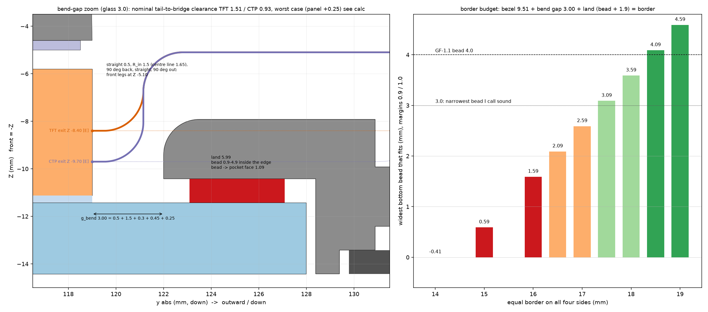
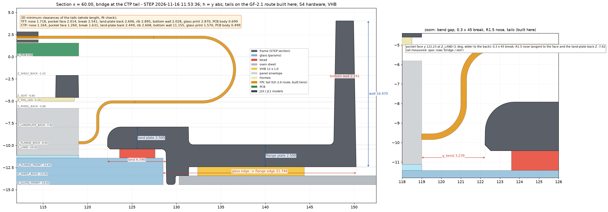
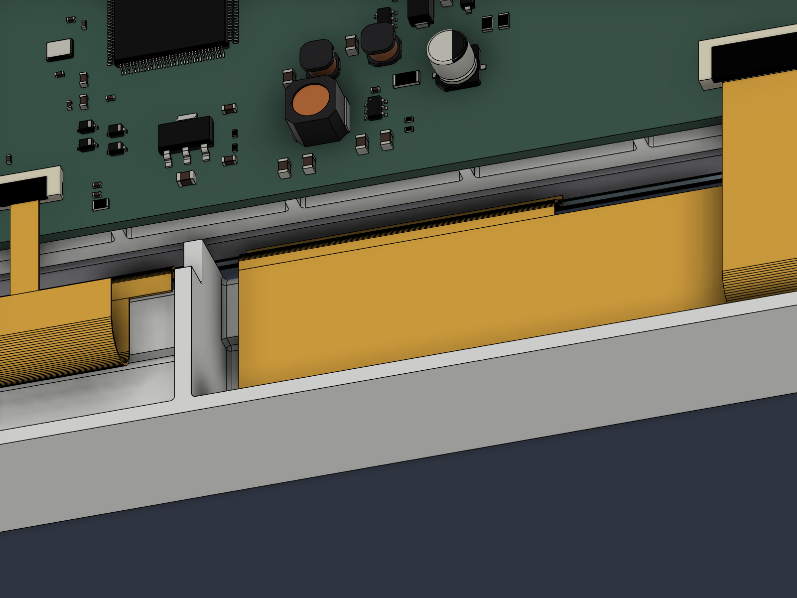
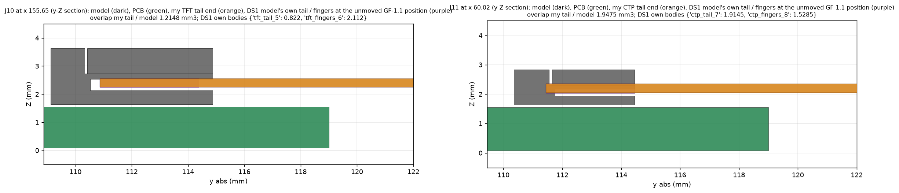
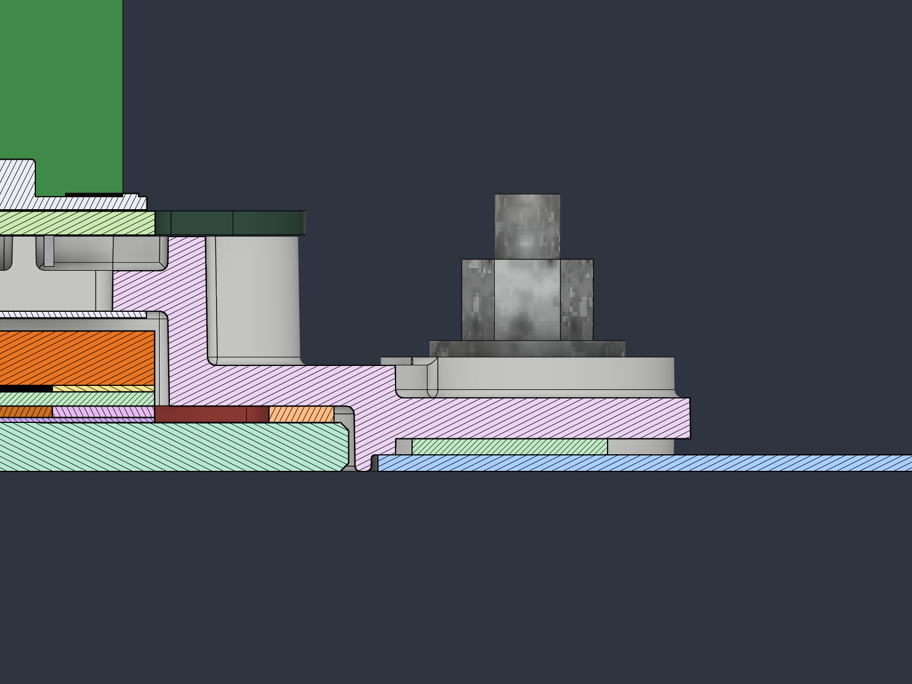
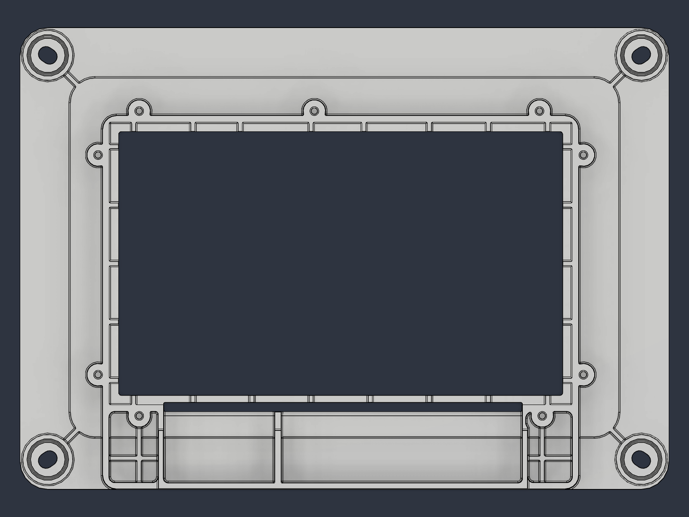
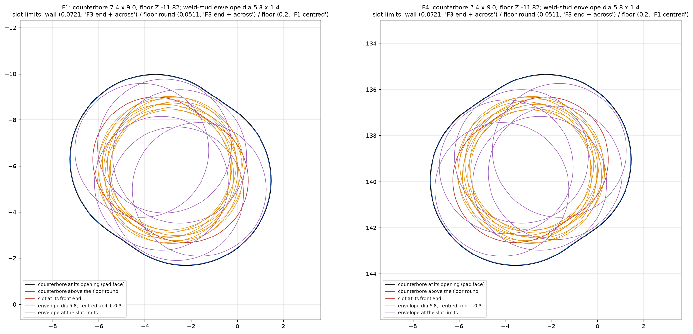
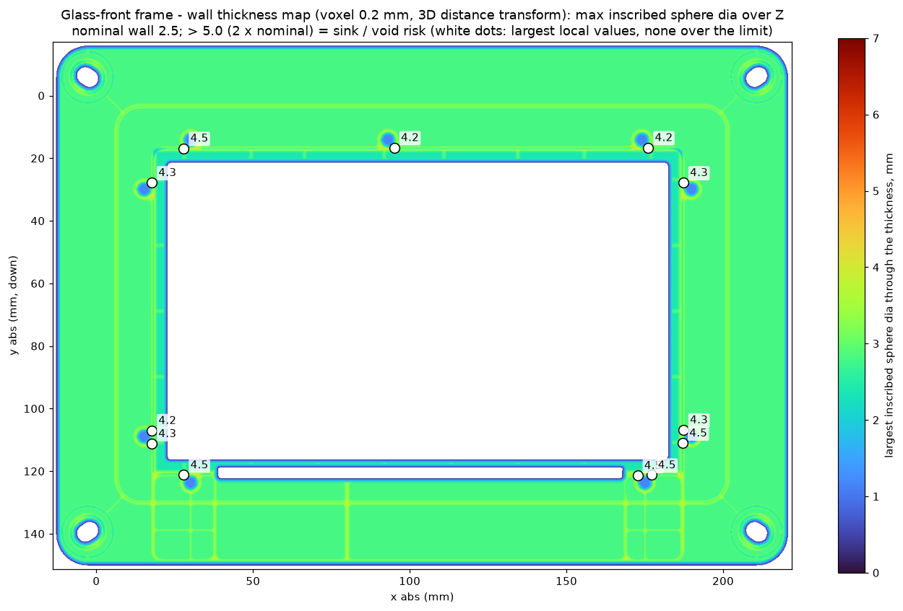

# Rev3.0 OVEN CONTROLLER — glass-front display module, revision GF-2.1 (2026-11-17)

Owner: Ömer Karaoğlu (READARK). Part family **GlassFront (GF)**: a printed, strengthened cover glass with the 7" SATOZ SAT070AT40D21 panel optically bonded behind it, bonded into a new moulded carrier frame that is fixed behind a plain laser-cut opening in the oven's steel front sheet, so that glass, frame lip and steel lie in one plane.

This is revision **GF-2.1, the design of record**: the same black border, **19.0 mm**, on all four sides, which you chose on 2026-11-16 after the independent check of GF-2.0 (18.5 mm) had left two margins at the bottom edge short. It is modelled in Fusion 360, exported, drawn (GF-D01 … GF-D50) and independently re-verified in CadQuery: **120 pass, 0 fail, 54 info**. Both former findings are closed, but with thin margins (§2.2.6), so the fold test on a real panel (§2.2.5) is still the gate before the glass, the sheet or the mould is ordered. The revision history is in §14.

Two alternatives stay valid and are not touched:
- **GF-1.1**, the earlier glass-front revision with a wide bottom border, kept complete as the fallback (§3.1). GF-2.0, the 18.5 mm version of the present design, is archived as an intermediate step, not as a fallback (§3.1);
- **frame v2** (`Rev3.0_Frame_Design.md`, display recessed behind the sheet, ten studs). §3 compares it with the glass front.

Sources:
- Master numbers: `Mechanical/Rev3.0_GlassFront/Rev3.0_GlassFront_params.json`, revision GF-2.1 (sha256 bec9e8fc…ad63), whose `change_log` records your border decision, the rebuild and the independent verification with its addendum. It is the single source of truth; this document follows it wherever sources disagree.
- Reasoning and calculations: `Design Reports/Rev3.0/tools/glassfront/concept/` — `concept_gf2.md` (the equal-border concept, worked at 18.5: border budget, tail route, bridge, S8), `concept_gf2_calc.py` and its run log `concept_gf2_calc_out.txt`; `concept.md` §11 for the values carried over from GF-1.0. The concept's figures are labelled as concept estimates where they are quoted.
- Research: `tools/glassfront/research/R1_reference_touch_bonding.md` (reference product, touch, optical bonding) and `R2_manufacturing_turkey.md` (suppliers, processes, prices).
- CAD: Fusion 360 document "Rev3.0 GlassFront" version 19 (frame + fit assembly), exports and reports in `Mechanical/Rev3.0_GlassFront/`.
- Independent verification: `tools/glassfront/verify/` (GF-2.1 outputs in `out/`, frame STEP sha256 d734683a…33d6; GF-2.0 in `out/GF-2.0/`, GF-1.1 in `out/GF-1.1/`, GF-1.0 in `out/GF-1.0/`). The GF-2.1 CAD reports were written with the GF-2.0 errata points already corrected, so there is no errata file; the GF-2.0 errata are kept in the GF-2.0 archive (§13).
- Drawings GF-D01 … GF-D50: `Mechanical/Rev3.0_GlassFront/drawings/`. Full file list in §13.

---

## 0. Summary for the owner

### 0.1 What it is, and what GF-2.1 changes

You asked for the bottom edge to be as thin as the other three, with any extra room for the bent flexible cables only on the inside. GF-2.0 did that at 18.5 mm. GF-2.1 is the same design at the border you chose, 19.0 mm:

- **One border width all round: 19.0 mm, not the 14 mm you had on three sides** (your decision of 2026-11-16). At the bottom the panel alone already takes 9.51 mm below the image, the folded cables need a 3.06 mm gap, and a sealed adhesive bead needs 6.20 mm of flat frame, counted to the edge of the small chamfer on the frame's inner edge. That adds up to 18.77 mm, so all four borders are 19.0 mm and the image sits in the centre of the glass.
- **What changed from GF-2.0, and why.** At 18.5 the independent check found two margins at the bottom edge short. The bead edge was only 0.80 mm from that chamfer edge, against a rule of at least 1.0 (the one fail). The touch cable kept only 0.239 mm from the frame in the worst case, against an intended 0.45. GF-2.1 puts the extra 0.5 mm into the gap for the folded cables (3.00 → 3.23 mm) and the bottom land (5.99 → 6.26 mm). Both margins are now met: bead edge 1.06 mm, touch cable 0.459 mm. The independent check of the rebuilt frame has **no fail** (120 pass, 0 fail, 54 info; §10).
- **The margins are met, but they are thin.** In the worst case the touch cable clears the frame by only 0.009 mm. The gap for the folded cables can grow by only 0.06 mm, and any growth comes one-to-one out of the bead margin, which is also 0.06 mm. Both rest on assumed cable dimensions. **The fold test on one real panel (drawing GF-D21) is therefore still the gate before the glass, the sheet or the mould is ordered.** It can reopen the border: 19.5 mm if the real cables need more room (§2.2.5).
- **The panel's two flexible cables ("tails") are folded back** right at the panel edge, through a 3.23 mm slot on the inside of the frame, hidden behind the black print. From the front the bottom edge looks exactly like the other three.
- **The module is 10.0 mm wider and 20.5 mm less tall** than GF-1.1: visible cut-out 195.08 × 126.92 mm, frame flange behind the sheet 233.48 × 166.07 mm. Against GF-2.0, glass and cut-out are 1.0 mm larger each way (the flange 1.0 mm wider and 0.5 mm taller). Check the width against the oven.
- **The tape-free variant S8 stays withdrawn** (since GF-2.0). Its bottom-centre stud would sit over the folded tails. You choose between S4 (four hidden studs, recommended) and R4 (four visible rivets).
- **Still not verified:** the mould's fill and warp and the stepped shut-off at the cable slot (§8.1); the tail handling in jig J2, which is a first proposal and has not been tried (§9.3); push and impact, which are beam-grid estimates, not a finite-element analysis (§7.8).
- **Cost:** practically unchanged, about 385 k TRY likely for 100 ovens (§0.3).

**How it is built.** A 191.48 × 123.32 mm cover glass sits flush in a 195.08 × 126.92 mm laser-cut opening of the oven front sheet. Behind the glass:

1. The 7" panel is **optically bonded** to the glass with a 0.30 mm silicone liquid adhesive (LOCA). This is done in-house in jig **J1**.
2. The glass is bonded to a moulded **PA6-GF30 FR frame** with an elastic 4.0 × 1.0 mm adhesive **bead**. This is done in-house in jig **J2**, a flat plate on which the glass front and the frame's lip top lie together, so they come out flush. In the same jig the panel's two tails are folded back and threaded through the **bend gap**, a 3.23 mm slot in the frame along the panel's bottom edge.
3. The frame is mounted **from behind** the sheet. Its 1.0 mm **lip** rises through the opening and fills the sheet thickness. Four strips of 3M VHB foam tape and four **hidden M4 weld studs** at the corners hold it (or four visible rivets, variant R4).

The result is no press tool, one aluminium mould, glass printed and strengthened by a supplier, and bonding and assembly done in-house.

*GF-D40 at GF-2.1 (true proportions).*
- *Panel 1: the S4 variant, nothing visible. The black border is 19.0 mm on all four sides; the dashed box is the logo zone in the bottom border.*
- *Panel 2: the R4 variant, four black large-flange rivet heads Ø14 ("K14") at the corners, 1.5–2.0 proud, head edge 9.14 from the cut-out corner arc (§2.3).*
- *Panels 3–4: the corner at 3.5:1 — steel | 0.4 shadow line | 1.0 matte black lip | 0.4 black-on-black line | glossy black glass.*
- *The UI is indicative. The logo zone is 1.25 below the window and 2.75 above the glass edge (§2.1).*

### 0.2 What it looks like

The front shows painted steel, a 0.4 mm dark line, a 1.0 mm matte-black plastic lip, a second 0.4 mm black-on-black line, and then glossy black glass.

- The visible module (the sheet cut-out) is 195.08 × 126.92 mm at border 19.0 (196.08 × 127.92 if the fold test moves it to 19.5).
- The image window is 153.48 × 85.32 mm, in the centre of the glass and of the cut-out.
- The black border is **19.0 mm on all four sides**.
- A logo zone of at most 100 × 15 mm sits in the bottom border.
- The two lines are 0.4 mm wide on the sides and about 0.5 mm at the corners.
- With the S4 variant no fastener is visible.
- All front faces lie in one plane within ±0.11 mm (statistical, RSS) / ±0.25 mm (worst case, WC). This holds when the coated sheet is as thick as the lip is high. The sheet drawings require that, but the sheet's finish is not yet chosen (§7.6).

### 0.3 What it costs (100 ovens, desk estimates, no supplier quoted)

| | low | likely | high |
|---|---:|---:|---:|
| total for 100 ovens, incl. the mould and jigs | 185 k TRY ($3.7 k) | **385 k TRY ($7.6 k)** | 721 k TRY ($14.3 k) |
| of which one-off (mould, print set-up, jigs, fold gauge, tests) | 127 k TRY | 246 k TRY | 453 k TRY |
| recurring per oven (glass, frame part, adhesives, fasteners, sheet delta) | 580 TRY ($12) | 1,390 TRY ($28) | 2,680 TRY ($53) |
| all-in per oven over the first 100 | 1,850 TRY | **3,850 TRY ($76)** | 7,210 TRY |

- Against GF-1.1, the equal-border design adds about 1–5 k TRY for the fold gauge and the J2 tail holder [A] and saves about 0.2 k TRY of tape (shorter strips). The step from 18.5 to 19.0 (1 mm more glass, tape and cut edge each way) is below the resolution of these estimates (§11.4).
- In-house labour (about 1 h per unit, my estimate) is not included.
- Frame v2 also needs a mould. Without the mould, the glass-front-specific spend is 85 k / 210 k / 421 k TRY.
- Breakdown, sources and confidence: §11.4–11.5. TRY at 50.34 TRY/USD (14 Nov 2026).

### 0.4 What you must decide (details §4)

Of the fifteen decisions in §4, **fourteen are still open** (D1, D2 and D4–D15). One is decided: **D3, the border, is 19.0** (your decision of 2026-11-16). The fold test can still reopen it (§2.2.5). The open ones that matter most:

1. **Which front (D1):** GF-2.1 (equal 19.0 border, recommended), GF-1.1 with its wide bottom border (the kept fallback, §3.1), or frame v2.
2. **Fixing variant (D4):** S4 hidden studs (recommended) or R4 visible rivets. S8 is no longer offered.
3. **Glass thickness and type (D2).** Decide this only after the touch bench test, and before the mould is cut: the thickness is built into the mould.
4. **Sheet finish and its coated thickness (D5).** The lip height must equal it, and the lip height is cut into the mould.
5. **Ink (D7):** 2K organic (recommended) or fired enamel.
6. **Bead adhesive (D8):** a ±50 % movement-class silicone for the 1.0 mm bead (recommended), or a 1.5 mm bead if only a ±25 % product is used. The bead thickness is also cut into the mould.
7. **Frame production (D9):** aluminium mould (recommended) or printed.
8. **Optical bonding (D10):** in-house (recommended) or bought from the panel maker as a custom laminated cover glass.

The other six open decisions (D6 sheet tolerance, D11 lip look, D12 logo, D13 corner gaps, D14 service concept, D15 Formex grade) are smaller; §4 gives a recommendation for each.

### 0.5 What to test first (details §2.2, §5, §6)

1. **Touch through the glass (half a day, before any order).** Lay 2, 3 and 4 mm window glass on the running panel with oil, then retune the GT911 touch controller. The design stands or falls on this (§6.3).
2. **Fold test on one real panel (GF-D21, before glass, sheet or mould is ordered).** Measure the tails at their exits and fold both over a 3.23 mm gauge with an R1.5 nose; a 0.80 feeler must pass outside each tail (tail within 2.43 of the panel edge). A pass keeps 19.0. A fail gives the new border by a fixed rule: 19.0 holds up to a 3.29 mm bend gap, 19.5 up to 3.79 (§2.2.5). Then fit the panel in a printed GF-2.1 frame with display and touch running; the same printed frame is used to try the tail handling in J2 (§9.3).
3. **A painted sheet coupon with the real cut-out**, to measure the paint build on the faces and the edge (§7.6).
4. **Glass and ink samples**, for the adhesion and ageing coupons and the 0.5 J impact test (§5).

### 0.6 Terms used in this document

| term | meaning |
|---|---|
| **GF-1.0 / GF-1.1 / GF-2.0 / GF-2.1** | design revisions. GF-2.1 is the design of record; GF-1.1 is the kept fallback; GF-2.0 (border 18.5) is archived as an intermediate (§3.1); history in §14 |
| **frame** | the moulded PA6-GF30 FR carrier (Fusion component "Frame GF"); it replaces the v2 frame |
| **lip** | the 1.0 mm wide, 1.0 mm high plastic rim that rises through the sheet opening between the glass edge and the steel |
| **seat ring** | a 1.5 mm wide ring outside the lip, at the level of the sheet's back face. The sheet's cut edge rests on it, which gives a hard stop in depth exactly where flushness is seen. Seat ring and pads form **datum A** on GF-D50 |
| **step wall** | the 2.5 mm wall under the lip and seat ring that joins the flange to the land plate |
| **flange** | the 2.5 mm plate in the plane behind the sheet; the tape sits on it. It reaches 21 mm beyond the glass edge on the top and sides and ends flush with the frame's bottom wall at the bottom (21.7 mm beyond the glass edge) |
| **pad** | a Ø18 boss on the flange front at each corner fastener F1–F4, level with the seat ring (second hard stop) |
| **counterbore** | a 7.4 × 9.0 stadium recess round each fastener slot on the sheet side; it takes the weld-stud flange |
| **coring groove** | an annular groove round each fastener tube, cut from the back to keep the plastic thin enough to mould without sink |
| **land** | the flat floor of the glass recess on which the glass is bonded; 6.26–13.87 mm wide (6.26 along the bottom over the tails, of which 5.96 is flat behind a 0.3 × 45° break on its inner edge) |
| **bead** | the elastic adhesive ring (black silicone or MS polymer) between glass and land, 4.0 wide × 1.0 thick, on all four sides |
| **pip** | one of 8 stand-off bumps Ø1.5 × 0.5 on the land; they guide the bead and never touch the glass |
| **tails, TFT, CTP** | the panel's two flexible printed circuit (FPC) cables leaving its bottom edge: the display tail (TFT, to J10) and the touch tail (CTP, to J11) |
| **bend gap** | the 3.23 × 128.8 mm slot through the frame between the panel's bottom edge and the bridge. The tails are folded back inside it. It is closed at the front by the glass and opens at the back into the tail pocket. Driving parameter `g_bend` |
| **bridge** | the bottom side of the frame ring over the 128.8 mm tail span, behind the bend gap: the bottom land plate with its step wall, lip and flange plate |
| **nose** | the R1.5 round on the bridge's back inner edge; after the bead has cured, the tails are folded over it into the tail pocket |
| **divider rib** | a 2.5 mm rib at x 79.92 between the two tails, from the bridge to the frame's bottom wall; it gives each tail its own compartment |
| **tail pocket** | the space behind the bridge (x 38.9–167.7, to y 147.7) where the tails' U-loops lie; open to the back, its floor is the bridge and the flange plate |
| **fold test** | the gate test on one real panel, drawing GF-D21: the tails are folded over a gauge that copies the bend gap and the nose (§2.2.5) |
| **g1 / g2** | the visible gaps: g1 = lip outer face ↔ steel cut edge, g2 = glass edge ↔ lip inner face. Designed 0.40 on the sides, about 0.50 on the corner diagonal |
| **s** | distance measured outward from the glass edge (glass edge s = 0, lip s 0.4–1.4, cut edge s 1.8) |
| **flush plane** | the common plane of glass front, lip top and steel front (Z −14.42 for 3.0 mm glass) |
| **F1–F4** | the four fastener positions at the corners. F1 is top-left in KiCad coordinates, top-right seen from the front. GF-2.1 has no other fastener position |
| **S4 / R4** | sheet variants. S4: 4 hidden weld studs + tape (recommended). R4: 4 visible large-flange blind rivets + tape. The tape-free S8 was withdrawn at GF-2.0 (§2.3) |
| **CD weld stud** | capacitor-discharge stud welding (ISO 13918 type PT). A threaded stud is welded to the back of the sheet in milliseconds and leaves no hole in the front |
| **VHB** | 3M "Very High Bond" acrylic foam tape (5952 class, black, 1.1 mm) |
| **LOCA / OCA** | liquid / film optically clear adhesive |
| **CTP, LCM, AA, VA** | capacitive touch panel (Fannal FN070A133, G+G, 0.7 mm cover lens, GT911 controller); LCD module; the LCD's active area (154.08 × 85.92); the CTP's printed view area (155.08 × 86.92) |
| **print window** | the clear opening in the black print, 0.30 mm inside the AA on every side |
| **J1 / J2** | jig J1 = optical-bonding alignment fixture (GF-D31); jig J2 = flush plate for bonding glass to frame, with the tail handling (GF-D30, 2 sheets) |
| **GF-D50** | the frame inspection drawing (2 sheets): datums, critical dimensions, tolerances, sections and toolmaker notes; sent with the STEP |
| **CS glass** | chemically strengthened glass (ion exchange, EN 12337-1); thermally tempered = EN 12150-1 safety glass |
| **back-stop gap** | the 0.8 mm air gap between panel back and the Formex insulator; the panel hangs on the glass and only lands on the Formex if the optical bond fails |
| **RSS / WC** | statistical (root-sum-square) / worst-case tolerance stack |
| **CTF** | critical to function: a dimension that must be held for the part to work |
| **movement class** | a sealant's rated cyclic extension/compression of a butt joint in % (ISO 11600 up to 25; ASTM C920 classes 25, 35, 50, 100/50) |
| **status of a figure** | **Independent**: measured or calculated by the separate CadQuery verification on the exported frame STEP (§10); most GF-2.1 figures in this document are of this kind. **CAD self-check**: measured by the Fusion modelling agent on its own model (Frame and Assembly reports). **Concept estimate**: calculated in `concept_gf2`, not measured on the CAD |
| **beam-grid (grillage) calculation** | glass strips resting on the frame ring, calculated as beams; used for push, strength and impact. It is not a finite-element (FEA) model |
| **open finding** | a result of the independent check left for your decision. GF-2.0 had two; both are closed at GF-2.1 (§2.2.6) |
| **[Q] [T] [E] [A] [P]** | source tags. [Q] = published on a page R2 opened; [T] = typical trade practice; [E] = R2's estimate (in §2.2 and the tail tables: estimated from the panel model); [A] = my own adjustment, estimate or assumption in this document; [P] = a tolerance proposed by the drafter on GF-D50, to be confirmed |

---

## 1. Your requests and how the design answers them

| request | how GF-2.1 answers it | honest limit |
|---|---|---|
| tempered cover glass | 191.48 × 123.32 mm. Default 3.0 mm; the CAD is valid for 1.1 / 2.0 / 3.0 / 4.0. Thermally tempered (EN 12150-1) or chemically strengthened (EN 12337-1) | the only page-verified small-part temperer (BYC, Kocaeli) starts thermal tempering at 3.2 mm. 3.0 will likely be CS glass in practice (§8.2) |
| black frame printed inside, only the active area shows | black ink on the inner face (face 2). The window is 0.30 mm inside the AA and is aligned to the lit pixels in J1 | the GUI must keep its outer 5 px black. With the display off, the window reads grey-black against the border (≈ 13 % against 4–6 % reflectance, R1 §3.5) |
| **the bottom edge as thin as the other three; any gap for the bent cables only on the inner side** | one border, 19.0 mm, on all four sides. The tails are folded back at the panel edge inside a 3.23 mm bend gap behind the black print; nothing of it shows from the front (§2.2) | 19.0, not 14: the panel's own bottom bezel is 9.51, and the bend gap and the bead need 9.26 more. The margins are thin (0.009 and 0.06 mm, §2.2.6), so the fold test (GF-D21) is still the gate before any order. The module is 10.0 mm wider than GF-1.1 |
| display optically bonded to the glass | silicone LOCA, 0.30 ± 0.03 mm, done in-house in J1 | the CTP-to-LCD air gap inside the bought module stays, so a true "dead front" is not reachable |
| glass bonded to a plastic frame | elastic bead 4.0 × 1.0 mm on the frame land, all four sides; J2 sets the flushness | the bead is the only thing that keeps the glass from moving **forward** (§5, risk 4) |
| frame fixed to the oven sheet, glass truly flush in a cut-out | rear-mounted frame. The lip fills the sheet thickness and the sheet edge rests on the seat ring. VHB tape plus 4 corner studs | flush within ±0.11 RSS / ±0.25 WC, provided the coated sheet is as thick as the lip is high (§7.6) |
| no sharp edges | lip top edges R0.3; glass arris 0.3–0.5 × 45° front and back; steel cut edge rounded R0.2–0.5 before coating | |
| no gaps | two thin lines: 0.40 on the sides, about 0.50 at the corners. One is a shadow line onto the black seat ring, the other is black on black | a literal zero gap is not possible between rigid parts with different expansion: the lines breathe between about 0.1 and 0.8 mm over −20…+70 °C. A soft silicone profile instead of the lip (concept option I) closes the gap but needs an extrusion die |
| four fasteners at the corners, or none | S4: four hidden weld studs, nothing visible. R4: four black Ø14 large-flange rivet heads at the corners | four corner fasteners alone are too soft (0.54–0.63 mm at a mid-edge under 50 N, concept estimate); the tape strips carry the push between corners |
| first batch 100, cheap, local around Çerkezköy | aluminium mould; laser sheet from Çorlu / Kapaklı; glass from Kocaeli (BYC) or a quote from SCHOTT Çerkezköy | the panel stays imported (SATOZ is a Chinese maker; Özdisan is the Turkish distributor, R2) |
| no press tool or die for the sheet | laser cut + CD studs only | |
| in-house optical bonding and assembly | two bench jigs (J1, J2), UV LED lamp, two USB microscopes, a fold gauge | about 1 h of labour per unit [A]; the bonding yield and the tail handling must be learned on a pilot run |

### 1.1 Can it just click into a plain rectangular slot?

**No, not flush and gap-free as one part.** The reasons:

1. A part pushed in from the front must be stopped at exactly flush depth. A plain laser cut offers only two things to bear on:
   - the sheet's front face, which puts a visible bezel 0.8–1.5 mm proud of the steel (concept option C1);
   - something behind the sheet that is itself fixed to the sheet, i.e. a second, rear-mounted part (option C2).
2. Snap hooks hold against pulling out, not against pushing in. A finger on a touch screen pushes in (50 N design load, 250 N strength case), so the push needs a hard stop, not a hook.
3. A 1.0 mm sheet has no edge thickness that a hidden hook could grip without showing in the gap.
4. A click-in module in a rear receiver (C2) works as a service feature. It costs:
   - a second mould;
   - a second tolerance chain (±0.16 RSS / ±0.40 WC instead of ±0.11 / ±0.25);
   - wider gaps for the snap travel (0.6–0.8 instead of 0.4).
5. A formed recess (a step pressed round the window) would give a front-inserted part a seat, but it needs a press tool. A press brake cannot fold a closed return flange round a window: that option (G) leaves open, leaking corners and ±0.2 / ±0.4 flushness.

**How GF gets flush from a plain cut instead.** The frame comes from behind. Its lip is exactly one (coated) sheet thickness high above the seat ring, so when the sheet's cut edge rests on the seat ring, lip top and steel front coincide. The glass is bonded to the frame in J2, where the glass front and the lip top lie on the same flat plate, so the glass-to-lip flushness does not depend on the glass thickness tolerance (±0.2). The only steel-side contributor left is the sheet's own thickness tolerance, including its paint (§7.6).

The other options studied (concept §2, scored out of 5):

| option | score |
|---|---:|
| A — rear frame + lip (this design) | 4.5 |
| B — no lip, glass edge facing the steel | 3.5 |
| D — rear push-on clips instead of nuts | 3.5 |
| F — tape only, no fasteners | 3.5 |
| I — soft silicone lip | 3 |
| H — stepped glass | 2.5 |
| C2 — click-in into a rear receiver | 2.5 |
| C1 — front bezel | 2 |
| E — three-layer sheet rebate | 1.5 |
| G — bent return flange | 1.5 |

### 1.2 The reference product, Samsung DA82-02711L

R1 found that DA82-02711L is Samsung's service replacement for the **refrigerator "Family Hub" cover display**. It is a ≈ 21.5" touchscreen with its own computer, not an oven-size display. No published source gives its glass thickness, bonding method or fixing; every parts site with photos refused access. It is therefore used as a styling reference only.

The documented 7" analogue that set the numbers is Riverdi uxTouch:
- 1.1 mm cover glass, R5 corners, 0.2 mm arris;
- the LCD air-bonded to the glass, not optically bonded;
- the glass tape-mounted to the housing.

If you have the Samsung part in hand, R1 §1 lists a 15-minute inspection that would answer the open construction questions.

---

## 2. What the front looks like

### 2.1 From outside in (20 °C, nominal)

| zone | width | finish |
|---|---|---|
| oven sheet front | — | the sheet's paint or brushed steel |
| g1 shadow line | 0.40 at the lip root, 0.42 at the front face (1° draft); 0.516 on the corner diagonal | you look onto the black seat ring 1 mm below |
| lip | 0.98 at the top (1.0175 at the root), R0.3 on both top edges, flat top 0.39 | matte black glass-filled PA |
| g2 line | 0.394; 0.497 on the corner diagonal | black on black, hardly visible |
| glass border | **19.0 on all four sides** (decided; the fold test can reopen it, §2.2.5) | glossy black print seen through 3 mm of glass |
| image window | 153.48 × 85.32, R0.5 | the display; its edge sits 1.6–1.7 px inside the outermost lit pixels |
| logo zone | ≤ 100 × 15 in the bottom border: 1.25 below the window, 2.75 above the glass edge (centre 10.25 above the glass bottom edge) | one colour, printed under the black |

Gap values: designed 0.40 on the sides; measured on the STEP 0.394 (g2) and 0.412 (g1) on the sides and 0.497 / 0.516 on the corner diagonals, 0.32 behind the flush plane (independent).

Overall:
- The visible module (cut-out) is 195.08 × 126.92 mm.
- The cut-out centre is the glass centre and the window centre (abs 103.85, 66.83). That is 0.14 mm below the centre of the v2 window, which is centred on the CTP view area.
- The glass (R6.25) and the cut-out (R7.55) corners are not concentric with the lip corners (R6.4 / R7.4), so both gaps widen by about 0.1 towards each corner diagonal. Corners move more with temperature than the sides; the extra width keeps them from becoming the tight spot.

**Two blacks.** The matte lip and the glossy glass read as two different blacks, i.e. a thin dark frame line round the glass. If that is unwanted, the lip can be textured (VDI 3400 Ref 24, a priced option on GF-D50), or the lip can be dropped (option B: one 0.35 line, steel edge facing the glass edge).

**Display off.** The window looks grey-black against the border. A body-tinted grey glass (transmission ≈ 60 %) would reduce the window reflectance from about 13 % to about 7 %, at the cost of brightness: 280 → ≈ 170 cd/m² (R1 §3.5, estimate).

**Print edge at the glass rim.** Screen ink does not lie on the 0.3–0.5 mm × 45° arris of face 2. The black therefore ends up to 0.5 mm inside the outline, and a thin clear rim can show in the dark g2 slot. GF-D10 asks for print to the edge on the flat face (setback 0–0.2), allows the unprinted rim on the arris (≤ 0.5 from the outline) and asks the supplier to confirm print-to-edge capability on the first samples. A smaller face-2 arris (0.1–0.2) would avoid the rim; the glass RFQ asks about it (§12.1).

**Logo zone.** The zone is at most 100 × 15 mm; the rules are at least 1.0 from the window and at least 2.5 from the glass edge. At border 19.0 the zone is centred between those two limits, so it keeps 1.25 from the window and 2.75 from the glass edge: it passes both rules with 0.25 to spare. Its centre is at abs y 118.24 (zone y 110.74–125.74). The bead and the bend gap lie behind the lower part of the zone; the black layer printed over the logo colour hides them.

### 2.2 The equal border and the bottom edge

#### 2.2.1 Why the bottom border cannot be 14.0, and why it is 19.0

The panel's two tails leave its bottom edge: the touch tail (CTP) at x 40.72–75.82 and the display tail (TFT) at x 84.02–122.62, at about Z −9.70 and −8.40 [E] (estimated from the panel model). That is exactly where the land plate that carries the glass bead has to be (Z −10.42 … −7.92). On the other three sides the panel ends 4.3–7.1 mm outside the image; at the bottom it ends **9.51 mm** outside it. The bottom border therefore has to hold three things in a row:

| | width | why |
|---|---:|---|
| panel bottom bezel (print-window edge → panel edge) | 9.51 | fixed by the panel |
| bend gap, the room in which the tails are folded back | **3.06** needed (3.23 modelled) | 0.5 free straight [A] + inner bend radius 1.5 [A] + tail 0.30 [E] + clearance 0.45 [A] + panel position 0.31 (statistical sum of five tolerances, §2.2.3) |
| land for a sealed bead | **6.20** needed (6.26 modelled) | 0.9 bead edge to the glass edge + 4.0 bead + 1.0 from the bead to the edge of the land break + the 0.3 × 45° break itself |
| **sum** | **18.77** needed; **19.00** modelled | the bend gap may grow to 3.29 before 19.0 stops holding a full bead with its 1.0 margin |

**Why the land is now counted as 6.20.** The 1.0 margin between the bead and the frame edge is measured to the edge of the 0.3 × 45° break on the land, because that is where squeeze-out would start to run into the bend gap. GF-2.0 counted the land as 5.9, measured to the face of the bridge instead, which left the 0.3 of the break out of the budget. That mismatch is exactly the GF-2.0 bead fail.

**Why the bend gap is 3.23 and not 3.06.** The extra 0.23 buys the touch tail its intended 0.45 at the full worst case: 3.23 is the smallest 0.01 step that gives it (3.22 gives about 0.44). The rest of the 19.0 goes to the land: 19.0 − 9.51 − 3.23 = 6.26. The reserves are therefore small in both directions: the modelled bend gap is 0.06 below its 3.29 limit, and the bead is 0.06 above its 1.0 margin (§2.2.6).

The concept had put the panel position at 0.25, without the ±0.2 print-to-edge tolerance of the glass; the independent check of GF-2.0 corrected it to 0.31, which is used throughout.

What fits at each equal border (my arithmetic [A], with the GF-2.1 bend gap of 3.23 and the 1.0 margin measured to the break edge; land = border − 9.51 − 3.23, widest bead = land − 0.9 − 1.0 − 0.3):

| border | land at the bottom | widest bottom bead | verdict |
|---|---:|---:|---|
| 14.0 | 1.26 | −0.94 | **impossible: no bead fits** |
| 15.0 | 2.26 | 0.06 | impossible |
| 16.0 | 3.26 | 1.06 | not sound |
| 17.0 | 4.26 | 2.06 | marginal |
| 18.0 | 5.26 | 3.06 → 3.0 bead | a narrower bottom bead; not recommended, not modelled |
| 18.5 | 5.76 | 3.56 | still a narrower bottom bead (GF-2.0 kept a 4.0 bead here only by narrowing the bend gap and the bead margin, §2.2.6) |
| **19.0** | **6.26** | 4.06 → **4.0 bead** | **the full bead on all four sides, 0.06 to spare; GF-2.1 as modelled** |
| 19.5 | 6.76 | 4.56 | the next step if the fold test needs a bend gap above 3.29 (it covers up to 3.79) |

14.0 cannot be rescued:
- Even with an aggressive bend (straight 0.3, inner radius 1.0, no clearance: bend gap 1.6) the bottom land is only 2.89 wide.
- A sealed 3.0 bead at 14.0 would need a negative bend gap, i.e. a tail bent inside the panel.
- Rejected alternatives (concept §3.2): a thin plate in front of the tails (the CTP tail is only 0.57 behind the land plane); potting the tail exits in the bead silicone (it bonds the panel edge and the cable roots into the seal, with no rework and untested stresses); no bottom bead (unsealed into the tail pocket, 0.35 mm at 50 N).

With the bottom at its minimum, the other three sides go to the same width too, so that all four borders are equal, as you asked. The window then sits in the centre of the glass and of the cut-out, and the corner fasteners lie symmetrically about it.

*Concept study for the equal border, worked at 18.5 for GF-2.0 (concept estimate, glass 3.0, nominal, drawn with the original 0.25 position term and the 5.99 land of that time). GF-2.1 has the same tail route with a 3.23 bend gap and a 6.26 land. Left: section through the bend gap — panel (orange) with the exits of the TFT (orange line) and CTP (purple line) tails, glass (blue), bead (red) on the land, bridge with its R1.5 nose (grey). Each tail goes 0.5 straight, bends back with inner R1.5, runs up and bends out at Z −5.10; the second bend is made over the nose after the bead has cured. Right: the widest bottom bead that fits at each equal border, as the concept counted it (land to the bridge face, without the break; the table above corrects this).*

#### 2.2.2 The tail route and the bridge

Seen in a section across the bottom edge (y outwards, Z towards the PCB), nominal, glass 3.0:

| feature | y (abs) | Z |
|---|---|---|
| panel edge (CTP + LCM) | 119.00 | −11.12 … −5.80 |
| **bend gap**: through-slot over x 38.9–167.7, closed at the front by the glass, open at the back into the tail pocket; its front face is the shelf end above Z −4.60, below that it is open to the panel pocket | 119.00–122.23 | from the glass back up |
| **bridge** face towards the bend gap | 122.23 (1° draft, widening to the back) | flat from the land −10.42 to −9.42, then the **nose** R1.5 to the bridge back at −7.92 |
| land (glass recess floor), with a 0.3 × 45° break on its inner edge | 122.23–128.89 (flat 122.53–128.89) | −10.42; land plate back −7.92 |
| bead 4.0 × 1.0 | 123.59–127.59 | −11.42 … −10.42 |
| glass edge / lip / seat ring / sheet cut-out edge | 128.49 / 128.89–129.89 / 129.89–131.39 / 130.29 | as on the other sides |
| VHB strip (S4 / R4) on the flange plate | 132.39–144.39 | −13.42 … −12.42 |
| flange plate = floor of the tail pocket | 131.39–147.70 | −12.42 … −9.92 |
| **divider rib** at x 79.92, 2.5 thick | 122.23–147.7 | floor → Z 0 (y < 129.0), → +4.05 beyond |
| frame bottom wall = flange edge (one flush face) | 147.70–150.20 (150.235 at the flange front) | −12.42 … +4.05 |

The route of each tail (concept route; the independent check rebuilds the tails from the master's route, which does not depend on the border):
1. 0.5 straight beyond the panel edge [A];
2. a 90° bend back towards the PCB, inner radius 1.5 [A] (TFT straight on, CTP with 1.30 of straight because it leaves 1.3 lower);
3. a 90° bend outwards over the bridge nose, made after the bead has cured; the tails then run at Z −5.10 behind the bridge, the CTP left of the divider rib and the TFT right of it (seen from the back);
4. the U-loops lie in the unchanged tail pocket (bottom face y 147.7): loop bottoms at y 145.83 (TFT, radius 3.75) and 136.70 (CTP, radius 3.65);
5. the return legs go over the PCB edge into J10 / J11 as before.

**The bend gap is on the inside only.** It lies inside the bead ring, behind the black print. The lip, the two lines and the outer border are identical on all four sides, and nothing of the slot, the bridge or the tails can be seen from the front.

**The bridge.** Over the 128.8 mm tail span the frame ring loses the pocket wall and the shelf that carry it on the other sides. On its own the bridge is a weak section: bending stiffness I = 120 mm⁴, measured on the STEP. Tied by the flange plate along its whole length to the frame's bottom wall it works as a channel: I = 1894 mm⁴, against 1194–1214 on the other sides (independent, measured). With the bottom VHB strip under it, the bottom edge moves 0.063 mm under 50 N (0.0757 if only the bridge carried it), slightly less than the 0.067 of GF-1.1 (beam-grid calculation with the measured stiffness, §7.8). The divider rib is not needed for strength (0.057 with it, concept estimate at 18.5); it feeds and holds the 128.8 mm bridge flat in the mould, and it separates the two tails.

**The glass over the bend gap.** Between the panel edge (y 119.00) and the bead (y 123.59) a 4.59 mm wide strip of glass has nothing bonded behind it. Under a 0.5 J impact it is far stiffer than the open span it replaces: safety factor 2.53 at 3.0 mm glass, or 1.35 if the whole bottom border is taken as unsupported. The window centre (1.22) is the weakest point (independent, concept method, §7.8).

*Independent CadQuery section of the GF-2.1 frame STEP at abs x 60, through the CTP tail; the tail (orange) is built from the master's route, glass, bead, VHB, sheet and panel from the master. Left: the tail leaves the panel edge, bends back in the bend gap, folds out over the R1.5 nose, forms its U-loop in the tail pocket and returns over the PCB edge into J11; land plate and flange plate 2.5, bottom wall to Z +4.05; the box lists the measured minimum clearances of both tails. Right: zoom on the bend gap, the 0.3 × 45° break and the nose.*

*The bottom edge of GF-2.1 from behind, PCB fitted (Fusion render): the tails folded over the bridge nose into their compartments, the CTP on the left and the TFT on the right of the divider rib; the frame's bottom wall in front.*

#### 2.2.3 What was assumed about the tails

| assumption | value | basis | effect if wrong |
|---|---|---|---|
| free straight beyond the panel edge before the first bend | 0.5 | [A], typical panel practice; the SAT drawing gives no number | every extra 0.1 adds 0.1 to the bend gap; 1.0 instead of 0.5 leaves the CTP tail 0.690 from the bridge (nominal panel position) |
| inner bend radius the tails accept | ≥ 1.5 | [A]: IPC-2223 static bend ≥ 6 × thickness for a single-sided flex; 1.5 is 5 × the conservative 0.30 and 10–15 × a typical 0.10–0.15 bending body | a double-layer tail needs R3.6: bend gap about 5.16 (concept estimate), border about 21 (9.51 + 5.16 + 6.20) |
| tail thickness and layer count in the bend zone | 0.30 (±0.05), single layer | [E]: CTP drawing 0.3 ± 0.05 (finger thickness), used for both | as above |
| exit heights | TFT Z −8.40, CTP −9.70 (±0.3) | [E] panel model | ±0.3 changes the clearances by less than 0.2, but the lower limit governs the CTP tail's worst case (§2.2.6); the bend gap budget does not depend on them |
| folding back towards the LCM at the exit is allowed | yes | [A]: the usual fold direction for these panels, not stated for this one. The Fannal CTP spec qualifies its tail for 90° bending, 10 times each way | if not allowed: GF-1.1 (§3.1) |
| no stiffener or component near the exits | none known | CTP spec: steel stiffener on the finger end only; TFT tail unknown | a stiffener in the bend zone needs a larger gap |
| panel edge position towards the bridge | 0.31 statistical (RSS) / 0.60 worst case | panel outline to AA 0.2 (panel datasheet), J1 alignment 0.1, print window to glass edge 0.2 (GF-D10), J2 centring 0.05, mould core shift 0.05 [A] | in the bend-gap budget; the concept's 0.25 / 0.35 left out the print-to-edge tolerance |
| return height of the tails into J10 / J11 | Z +2.40 / +2.20 | [E] panel model | must be taken from the connector datasheets (§2.2.4) |

#### 2.2.4 Tail clearances

Independent check of GF-2.1 (CadQuery, tails rebuilt from the master's route, 10 route cases):

| (mm) | TFT | CTP |
|---|---:|---:|
| to the bend zone (closest: the R1.5 nose), nominal | 1.718 | **1.164** |
| same, panel at its statistical position (+0.31) | 1.459 | **0.871** |
| same, worst case: panel +0.60, exit height ±0.3, tail 0.35 thick | 1.014 | **0.459** |
| worst case, panel position alone | 1.220 | 0.597 |
| worst case with a print-to-edge tolerance of ±0.1 instead of ±0.2 | 1.098 | 0.554 |
| free straight 1.0 instead of 0.5 / inner radius 1.8 (nominal panel position) | 1.302 / 1.583 | 0.690 / 0.965 |
| outside the bend zone: loops, pocket walls, divider rib, bottom wall, floors (≥ 1.5 required) | 1.890 | 1.781 |
| to the printed glass back (at the exit) / to the bead | 2.870 / 3.695 | 1.570 / 2.927 |
| to the PCB body model / to the component seating plane | 0.699 / 0.614 | 0.499 / 0.414 |

**Criterion** (master `tail_clearance_criteria`): in the bend zone at least 0.45 with the panel at its statistical position, and no contact at the worst case; everywhere else at least 1.5. Both tails meet it. The concept's own aim, 0.45 at the full worst case, is now met as well, but by only 0.009 for the CTP tail (0.459; the exit height at its lower limit governs). Contact with the polished R1.5 nose would not damage a tail — the tail is laid over that nose after the cure anyway — but the margin is very thin, and it rests on the assumed tail dimensions, which only the fold test checks (§2.2.5). The Fusion model's own probe of the bend zone gives the same picture (CTP about 0.46 at the calibrated full worst case, CAD self-check).

**Connector ends.** In both checks the tail ends overlap the J10 / J11 connector models (1.21 / 1.95 mm³). That is an artefact of the models, present at GF-1.1 too with the panel model's own tails: the J11 model's opening is 0.24 high, lower than a 0.30 tail, and the J10 opening leaves the top 0.015 of the tail inside its housing model. The real clearances of the tails to the PCB are 0.70 (TFT) and 0.50 (CTP) to the board body, about 0.61 and 0.41 to the plane on which the components sit. The height at which the tails return into J10 / J11 must be taken from the connector datasheets.

*Independent sections through J10 (left) and J11 (right) at the tail ends: connector models (dark), PCB (green), the GF-2.1 tail end (orange) and the panel model's own GF-1.1 tail (purple). The overlaps are the tail ends sitting in openings that the solid connector models draw too low.*

#### 2.2.5 The fold test (GF-D21) and what it settles

**When:** on one real panel, before the glass, the sheet or the mould is ordered: the glass outline, the cut-out and the frame all follow `border`. You have decided on 19.0, but its margins are thin (§2.2.6) and rest on assumed tail dimensions, so the fold test can still reopen it.

**Gauge (GF-D21):** POM-C (acetal), 152.8 × 18 mm, machined. Its end pads touch the panel edge outside the tails, so that it forms the 3.23 mm bend gap (+0.02/0) with the panel edge over the 128.8 mm tail span; the nose is R1.5 ±0.05, polished; its height 3.2 is the bridge back above the CTP front. The same gauge is the fold former in J2. A gauge made for GF-2.0 (3.00 slot) is not valid for GF-2.1.

**Test:**
1. Panel CTP face down on a clean flat plate, tails as delivered. Record at each exit the free straight, the tail thickness in the bend zone (3 points), the layer count, the exit heights above the CTP front and the panel's bottom edge to the AA.
2. Push the gauge against the panel edge; fold each tail up and back over the gauge's R1.5 edge by hand, unforced.
3. With the panel held at its nominal position by the gauge and each tail folded over the gauge nose, a **0.80 feeler** must pass between the tail's outer surface and the gauge face and nose over the whole tail width. The tail's outer surface then stays within **2.43** of the panel edge (the 3.23 slot less the 0.80 feeler). The assumed tail (straight 0.5 + inner radius 1.5 + thickness 0.30 = 2.30) passes with 0.13 to spare. Record the largest feeler that passes, in 0.05 steps.
4. Fold and unfold 3 times, leave folded 5 min, inspect at 10×: no lifting, peeling, whitening, crease or crack at the exit or its bond.
5. Ask SATOZ (via Özdisan) to confirm that folding back at the exit is allowed, and look for parts or stiffeners on the TFT tail's wide part.
6. Then fit the panel in a printed GF-2.1 frame with display and touch running.

**What the result decides** (master `fold_test`):
- **Pass** (the 0.80 feeler passes): border 19.0 stands. By the budget the tails need a gap of at most 2.43 + 0.45 + 0.31 = 3.19, inside the modelled 3.23 (0.04 to spare) and the 3.29 limit (0.10 to spare). Measured in 3D, a tail reaching up to 2.75 from the panel edge keeps at least 0.45 at the statistical panel position, and up to 2.79 it does not touch at the worst case. **A pass does not guarantee the 0.45 worst-case aim**: that holds only for a tail within 2.31. No standard feeler can test for it, because the assumed tail itself must pass.
- **Fail:** the measured tail extent is d = 3.23 − the largest feeler that passes. The needed gap is g = d + 0.45 + 0.31, and the border is 9.51 + g + 6.20. Up to g = 3.29 the border stays 19.0, with `g_bend` raised to g (the bead margin then shrinks towards its 1.0 limit). Above that the border grows: 19.5 covers g up to 3.79. A double-layer tail (inner radius 3.6) needs about 5.16, i.e. a border of about 21.
- The feeler that matches the modelled 3.23 gap exactly would be 0.758 (tail extent 2.472); 0.80 is the nearest standard leaf on the safe side.

`border` and `g_bend` are driving parameters. The Fusion model rebuilds as one healthy body at border 17.5 and 20.5 and at border 20.5 with `g_bend` 5.1 (CAD self-check, repeated at GF-2.1); the glass, cut-out, flange and sheet follow automatically. A changed border or bend gap means a new issue of GF-D01 … GF-D50 and a re-run of both checks (Fusion README, stage 5).

#### 2.2.6 Findings of GF-2.0 and how GF-2.1 closed them

The independent check of GF-2.0 (border 18.5, bend gap 3.00, bottom land 5.99) passed the frame with one exception and left two findings open (master `open_findings`). Both came from the tight bottom budget. You chose border 19.0 on 2026-11-16 to close them; GF-2.1 is that rebuild, and its independent check closes both:

| | GF-2.0 (18.5) | GF-2.1 (19.0) | requirement | margin at GF-2.1 |
|---|---:|---:|---|---:|
| **finding 1:** CTP tail to the bridge nose, full worst case | 0.239 | **0.459** | 0.45 (the concept's aim) | **0.009** |
| CTP tail to the nose, panel at its statistical position | 0.654 | 0.871 | ≥ 0.45 | 0.421 |
| **finding 2 (the GF-2.0 fail):** bead inner edge to the edge of the land break | 0.80 | **1.06** on the land plane (1.07 where the land ends) | ≥ 1.0 | **0.06** |
| bead inner edge to the bridge-face plane | 1.09 | 1.36 | — | — |

Why the bead margin failed at GF-2.0 is explained in §2.2.1: the budget counted the land to the bridge face, while the rule is measured to the edge of the 0.3 × 45° break. Squeeze-out at that edge runs over the break into the bend gap, towards the tails, so the margin matters.

**The margins left, stated plainly.**
- The CTP tail clears the nose by only **0.009 mm** when everything is at its worst at once. A tail touching the polished nose would not be damaged, but there is no reserve against the assumptions.
- The bend gap (3.23) has only **0.06 mm** of room to its limit 3.29 (19.0 − 9.51 − 6.20). Any growth of the gap beyond the modelled value comes one-to-one out of the bead margin, which is also 0.06 mm.
- No rebuild is made for this. The fold test on a real panel is the gate (§2.2.5): if the real tails need more room than assumed, its rule gives the new bend gap and border.

The other two fixes considered at GF-2.0 are not needed at 19.0: a land break of 0.09 or less, and a ±0.1 print-to-edge tolerance on the glass. The tighter print tolerance would still add reserve to finding 1 (0.554 instead of 0.459 at the worst case), if the glass printer can hold it.

### 2.3 Hidden studs or visible rivets

- **S4 (recommended):** four M4 × 16 CD weld studs on the back of the sheet; nothing visible from the front. A CD weld on 1.0 mm sheet can leave a faint ring or dimple on the face side. Under a 60–80 µm powder coat it is normally invisible, on brushed stainless it can show [T, R2]. A test coupon from the sheet supplier settles it.
- **R4:** four Ø4.8 **large-flange** blind rivets (DIN 7337 large-flange type, head "K14") with black **Ø14 heads**, set from the front through Ø5.2 holes. The heads stand 1.5–2.0 mm proud of the steel (not flush; modelled 1.6 with an R1.4 edge).
  - The rivet centres sit 9.2 mm outside the cut-out's straight edges in x and y; each head edge is 9.14 mm from the cut-out's corner arc.
  - Why Ø14: the stud counterbore (§8.7) removed most of the pad face that a standard Ø10 head would clamp the sheet against. Only 23.7 mm² remain under a Ø10 head, against 99.1 mm² under a Ø14 head.
  - The blind side bears on a DIN 9021 M5 washer on the tube top. That washer sits on the Ø12.4 seat inside the coring groove (87.4–88.3 mm², independent); centred, it does not bridge the groove.
- **S8 (eight studs and a soft gasket, tape-free) is withdrawn at GF-2.0.** Its bottom-centre stud would sit inside the tail pocket over the folded TFT tail. Without it, or with any position the frame can carry, the bottom edge moves 0.20–0.50 mm under 50 N against the 0.15 inspection limit, and the gasket lifts the bottom edge by 68–164 µm (concept estimates). Nothing is moulded at the old side-middle positions. If a tape-free serviceable front is essential, it exists only in GF-1.1 (§3.1).

---

## 3. Glass front or frame v2

| | frame v2 (accepted 2026-11-13) | glass front GF-2.1 |
|---|---|---|
| look | the display is recessed: CTP lens front 1.70 mm behind the steel front, seen through a 156.08 × 87.92 R1 laser window in the steel. The CTP's own print edge shows 0.5 mm inside the window edge | flush glass across 195 × 127 mm, 19.0 mm black border on all four sides, logo zone in the bottom border |
| visible fixings | PEM FH-M4 studs show 10 flush heads Ø5.9 (CD weld studs would show none), plus 2 peg slots 3.2 × 3.9 unless the pegs are dropped | S4: none; R4: 4 large-flange rivet heads Ø14 |
| fixing | 10 × M4 studs + nyloc nuts, 1 mm silicone sponge gasket | 4 × M4 CD studs + 4 VHB strips (S4) |
| sheet work | laser window + 10 stud holes + 2 peg slots, PEM pressing | laser cut-out + 4 CD studs |
| parts | frame, gasket, Formex | frame, glass, LOCA, bead, VHB, Formex |
| in-house work | screw assembly | optical bonding (J1), tail folding and flush bonding (J2), cure times, mounting with a pressure frame |
| touch | unchanged: factory GT911 tuning for its 0.7 mm lens | through 3.0 mm of extra glass: **marginal, must be tested** (§6) |
| impact (IEC 60335-1 cl. 21.1, 0.5 J) | not checked in the v2 document; the CTP datasheet rates its 0.7 mm lens for a 132 g ball from 25 cm (0.32 J) | 3.0 mm glass: safety factor ≈ 1.2 by estimate, must be tested |
| sealing | sponge gasket; compression spreads 0–64 % with the panel tolerance (v2 open question 1) | bead + tape, closed (sealant dabs at the corners) |
| frame | 198.4 × 165.45 mm, 55.06 cm³, 74.9 g, depth 15.07 behind the sheet | 233.48 × 166.07 mm, 84.13 cm³, 114.4 g, depth 17.47 behind the sheet |
| extra recurring cost per oven | — | glass 300–1,200 TRY [E] + adhesives ≈ 80–600 TRY [E] + ≈ 1 h labour [A] |
| extra one-off | — | jigs 15–90 k TRY, print set-up 5–25 k TRY [E], fold gauge and J2 tail holder 1–5 k TRY [A]; both designs need one mould |
| service | unscrew 10 nuts; panel replaceable on its own | cut the tape (≈ 40 min); the spare is the bonded glass + panel + frame unit |
| main open risks | gasket compression spread; moisture over the 10-stud pattern | touch, the tail fold at the exit, the thin margins at the bottom edge (§2.2.6), adhesive ageing, impact, in-house yield, sheet coating |

**If v2 is chosen,** correct its sheet hole for PEM FH-M4 studs from Ø4.22 to **Ø4.0 +0.08/−0** (PEM catalogue; 4.22 mm belongs to the inch FH-832 stud; R2 and concept §11.6). The v2 files were deliberately not edited.

**My recommendation.** Run the touch bench test (§6.3) first. It takes half a day and decides most of this.
- If 3.0 mm passes with the factory or a mildly lowered threshold, go glass front, and run the fold test (§2.2.5) before anything is ordered.
- If only 2.0 or 1.1 mm passes, the glass front is still possible, but 1.1 mm is mechanically marginal (§7.8).
- If nothing passes, choose between a custom laminated cover glass from the panel maker (route B, §8.3) and frame v2.

### 3.1 GF-1.1, the kept fallback (and GF-2.0, archived)

GF-1.1 is the earlier glass-front revision, frozen and independently verified (84 pass / 0 fail on its frame STEP, sha256 47742d2f…6e82). It has a 14.0 mm border on the top, left and right and a 44.51 mm bottom border ("chin") that carries a 100 × 20 logo zone. Its tails leave the panel edge flat, as in frame v2, and loop back to the PCB; the glass land lies beyond the tail loops. Glass 181.48 × 143.83, cut-out 185.08 × 147.43, flange 223.48 × 185.83, 111.8 g. It offers S4, R4 and the tape-free S8 (eight studs F1–F8 with a soft gasket, sheet drawing GF-D02).

**Where it is.**
- git commit 76f5b79 on branch Rev3.0;
- Fusion document "Rev3.0 GlassFront", version 14 (frame last changed in version 13);
- release files in `Mechanical/Rev3.0_GlassFront/archive/GF-1.1/` (frame, glass and assembly STEP, STL, .f3d, params, reports with errata, `drawings/` GF-D01 … GF-D50 including GF-D02, and `README.txt` with the hashes);
- this document at GF-1.1: `archive/GF-1.1/Rev3.0_GlassFront_Design_GF-1.1.md`;
- its verification: `tools/glassfront/verify/out/GF-1.1/`, renders in `Mechanical/Rev3.0_GlassFront/renders/verify/GF-1.1/` and `renders/GF-1.1/`.

**When to go back to it.**
- The fold test fails in a way no reasonable border cures (up to about 21 for a double-layer tail): the maker does not allow folding at the exit, the tails lift, crease or crack, or a stiffener sits in the bend zone.
- The 10 mm wider GF-2.1 module does not fit the oven front.
- A tape-free, serviceable front (S8) becomes a requirement.

Going back costs the asymmetric look and nothing else: GF-1.1 needs no tail folding in J2 and no bend-gap shut-off in the mould. Its glass, cut-out, frame and drawings are all different from GF-2.1; parts of the two revisions cannot be mixed.

**GF-2.0, the archived intermediate.** GF-2.0 is the present design at border 18.5 (glass 190.48 × 122.32, bend gap 3.00, bottom land 5.99). Its independent check gave 115 pass / 1 fail / 56 info, with the two findings of §2.2.6; GF-2.1 replaced it the same day. It is kept as a record only, **not as a fallback**: it carries the bead fail, and none of its glass, cut-out, frame or drawings fits GF-2.1. Where it is:
- Fusion document "Rev3.0 GlassFront", version 18 (not committed to git);
- release files in `Mechanical/Rev3.0_GlassFront/archive/GF-2.0/` (frame, glass and assembly STEP, STL, .f3d, params sha256 7439b098…6082, reports with their errata, `drawings/` GF-D01 … GF-D50, and `README.txt` with the hashes);
- this document at GF-2.0: `archive/GF-2.0/Rev3.0_GlassFront_Design_GF-2.0.md`;
- its verification: `tools/glassfront/verify/out/GF-2.0/`, renders in `Mechanical/Rev3.0_GlassFront/renders/verify/GF-2.0/` and `renders/GF-2.0/`.

---

## 4. Decisions for the owner

| # | decision | options | recommendation | what it changes downstream |
|---|---|---|---|---|
| D1 | which front | GF-2.1 (equal border) / GF-1.1 (wide bottom border, §3.1) / frame v2 / v2 now and GF later | GF-2.1 if the touch test (§6) and the fold test (§2.2.5) pass | GF: new mould, glass supply, jigs, in-house bonding. GF-1.1: its archived files. v2: fix its PEM hole |
| D2 | glass thickness and type | 3.0 thermal / 3.0 CS / 2.0 CS / 1.1 CS / custom CTP lens (route B) | decide from the bench test (§6.5). 3.0 if it passes at the factory or 60 % thresholds, otherwise 2.0 CS. Take CS if 3.0 thermal is not offered. **Do not accept 3.2 mm** unless the frame is rebuilt and re-verified for it | `glass_t` sets every level in front of the panel and is cut into the mould: freeze it before the tool. 1.1 stays mechanically marginal (§7.8). The GT911 config goes into the firmware |
| D3 | border | **decided: 19.0** (your decision of 2026-11-16). The options were 18.5 as modelled at GF-2.0 (two margins short, §2.2.6), 19.0, or more | — (decided) | GF-2.1 is built at 19.0: glass 191.48 × 123.32, cut-out 195.08 × 126.92, bend gap 3.23, bottom land 6.26. **The fold test (§2.2.5) can reopen it:** a needed bend gap above 3.29 means 19.5 (up to 3.79), or about 21 for a double-layer tail, with a rebuild, new drawings and both checks again |
| D4 | fixing variant | S4 / R4 (S8 withdrawn, §2.3) | **S4** | sheet drawing GF-D01 (S4) or GF-D03 (R4); CD welding at the sheet supplier; R4 needs large-flange rivets |
| D5 | sheet finish and coated thickness | powder-coated DKP (cold-rolled mild steel) / brushed stainless / pre-painted | choose the finish, then **measure the coated thickness on sample sheets and set `t_sheet` to it before the tool is cut**. Alternatively, choose a steel gauge so that steel + both coats = 1.00 (§7.6) | the lip height in the mould. GF-D01 and GF-D03 already say: dimensions after coating; coated thickness = lip height |
| D6 | sheet thickness tolerance | EN 10131 normal ±0.08 / restricted ±0.05 | ±0.05 | lip-to-steel step ±0.07 instead of ±0.09 RSS |
| D7 | ink | 2K organic, printed after strengthening / ceramic enamel fired during tempering | **2K organic** | enamel lowers tempered glass from 120 to 75 MPa, which takes the 0.5 J estimate below 1. Organic ink works on CS glass. The bead bonds onto the ink, so the coupon tests of §5 are mandatory |
| D8 | bead adhesive and bead thickness | movement class 50 + 1.0 mm bead (as built) / class 25 (most MS polymers, ISO 11600 25LM silicones [T]) + 1.5 mm bead / class 25 + 1.0 mm bead, accepting the bound case | **a class-50 neutral-cure silicone, 2-C if available** (§7.7) | `t_bond` sets the land depth and is cut into the mould. A 1.5 mm bead has not been rebuilt or verified; it moves the land 0.5 towards the PCB |
| D9 | frame production for the first 100 | aluminium mould / steel mould / printed (MJF, SLS) / machined | **aluminium mould**, after 2–3 printed fit samples | printed frames need wider gaps (≈ 0.6) and a thicker bond (≈ 1.5) because PA12 expands twice as much, plus an FR material and a glow-wire test on the part. That changes the glass or the cut-out (§11.3) |
| D10 | optical bonding route | in-house LOCA (J1) / route B: SATOZ supplies the panel with a custom printed lens fully laminated | in-house; ask SATOZ (via Özdisan) for a route-B quote in parallel | route B removes J1 and one glass layer (better touch), but makes the glass Chinese, 8–12 weeks, MOQ unknown. The tails stay the same, so the fold test still applies |
| D11 | lip look | plain matte / textured / no lip (B) / soft silicone lip (I) | keep the lip; ask for the texture price (GF-D50) | B or I are different frames |
| D12 | logo | artwork in the 100 × 15 zone | release the artwork: strokes ≥ 0.5, ≥ 1.0 from the window, ≥ 2.5 from the glass edge, one colour | one more screen (≈ 1.5–4 k TRY [E]) |
| D13 | corner gaps at the 70 ppm/K bounds (§7.4) | accept / add line-profile tolerances on the glass and cut-out contours (they tie each corner radius to its edges) | GF-D10 requests glass ±0.1 (±0.2 fallback). With ±0.1 glass the g2 corners do not touch at the cold bound. Accept the g1 corner case (a touch of a few hundredths, harmless), or add a profile tolerance to the cut-out if the sheet shop can inspect it | GF-D01 / GF-D03 note; GF-D10 already done |
| D14 | service concept | bonded unit as the field spare | accept | spare part = glass + panel + frame; the PCB is reused |
| D15 | Formex grade (v2 open question 2, still open) | GK-10 0.25 / GK-17 0.43 / three layers | as v2 | the pocket takes 0.4 mm as modelled |

---

## 5. Risks and the tests that retire them (priority order)

| # | risk | why it matters | test that retires it | when |
|---|---|---|---|---|
| 1 | **touch through the glass** (GT911 rated for cover glass up to 2 mm; the stack would be 0.7 + 0.3 + 3.0) | the whole concept | bench test §6.3 with loose glass and oil; then repeat on 3 bonded samples per candidate thickness | before any glass or tool order |
| 2 | **the tail bend at the exit.** Free straight 0.5, inner radius 1.5, a single-layer 0.30 tail and the exit heights are assumptions or estimates (§2.2.3). The budget needs a 3.06 bend gap; the modelled 3.23 is 0.06 below the 3.29 that border 19.0 holds with a full bead margin, and the touch tail clears the nose by only 0.009 at the full worst case (§2.2.6) | the border, the glass, the cut-out and the mould all follow it | fold test GF-D21 on one real panel (§2.2.5), then the fit in a printed GF-2.1 frame | before the glass, the sheet or the mould is ordered |
| 3 | **tail bend life and the maker's permission to fold at the exit.** The tails are bent once to install (static); the TFT tail's behaviour is unknown, the CTP tail is qualified for 90° bending 10 times each way. Folding back at the exit is usual but not stated for this panel; parts or stiffeners on the TFT tail's wide part are not known | a cracked or lifted tail kills the display or touch | written confirmation from SATOZ via Özdisan; the 3 fold cycles of GF-D21 inspected at 10×; display and touch run after the J2 trial and after the thermal cycles of risk 11 | with the fold test |
| 4 | **glass retention depends on one adhesive path.** The glass is smaller than the cut-out, so if the bead lets go (most likely at the ink-to-glass interface after heat and humidity), glass and panel come forward and hang on the FPC tails. A hidden mechanical stop in front of a flush glass is not possible | safety and field failure | ink coupons per lot: cross-cut GT0–1 dry and after 1 h in boiling water; silicone bead peel ≥ 90 % cohesive after 7 days cure and again after 7 days at 70 °C / 95 % RH and 10 cycles −20/+70 °C. Assembled units: 250 N pull on the glass after 10 thermal cycles | with the glass samples, before the series |
| 5 | **0.5 J impact, including the unbonded strip of glass over the bend gap** (IEC 60335-1 cl. 21.1): safety factor 1.22 at the window centre on 3.0 mm tempered glass (beam-grid estimate with the measured stiffness); the unbonded strip over the bend gap 2.53 (1.35 if the whole bottom border is taken as unsupported) | product safety test | spring hammer 0.5 J on 3 bonded samples per candidate glass: window centre, bottom border over the bend gap, near a corner and the edge | with the glass samples |
| 6 | **coating step and tape spring-back.** If the coated sheet is thicker than the lip height, the steel stands proud (0.12–0.16 for 60–80 µm on each face, §7.6). The 1.1 mm tape in a 1.0 mm gap pushes the sheet up to ≈ 0.1 off the seat ring until the foam relaxes | flushness limit ±0.15 | painted sheet coupon with the cut-out + a printed fit frame: coated thickness, then dial gauge at 12 points, at once and after 24 h | before the tool is cut |
| 7 | **mould: the bend-gap shut-off and the bridge.** The 3.23 × 128.8 slot is the only through-opening at the bottom. A flat shut-off at the land cannot be built: the two halves must meet in a stepped / telescopic shut-off that rises 5.52 mm across the 3.235 mm step (§8.1), and flash on it would stand in the tail path next to the bead edge. The 128.8 mm bridge carries the bond line along its inner edge (land flat within 0.1); its stiffness lies between two bounds (0.063–0.0757 mm at the bottom edge under 50 N, beam-grid with the measured stiffness). Thickest section 4.53 mm (independent); flow, warp and sink are not simulated | tail path, bond line, flatness, flushness | fill/warp simulation with the bridge and the divider rib before the steel is cut; shut-off design stated by the toolmaker; CMM on T1 to GF-D50 (bend gap, bridge face, nose, bottom land); an FEA of glass, frame and tape with the bead modelled | tool |
| 8 | **threading the tails past the fresh bead in J2.** The tails pass the bridge face about 0.9 away, with the fresh bead 1.36 behind that face and 1.06 from the edge of the land break (rule ≥ 1.0, met with 0.06 to spare; GF-2.0 open finding 2, closed), so squeeze-out could still reach the tails | bead damage, adhesive on the tails, rework | trial of the GF-D30 sheet 2 sequence on a printed frame before J2 is made; dispense volume per GF-D20 and the required squeeze-out check on the first article and every batch | before J2 is made; first articles |
| 9 | **touch-tail clearance to the bridge nose** (GF-2.0 open finding 1, closed at GF-2.1): 1.164 nominal, 0.871 at the statistical panel position, 0.459 at the worst case, 0.690 if the real tail needs a 1.0 straight (independent). The criterion (≥ 0.45 statistical, no contact at worst case) is met, and so is 0.45 at the worst case, by 0.009. **Connector ends:** the tail ends overlap the J10 / J11 models because the models' openings are too low for a 0.30 tail (also at GF-1.1); the real return height must come from the connector datasheets | a tail pressed against the nose; a tail end not seated in its connector | fit of a real panel and PCB in a printed frame; check both latches close fully on the tails; return heights from the J10 / J11 datasheets; the fold test (§2.2.5) checks the assumed tail dimensions behind the 0.009 margin | fold test, fit samples |
| 10 | **in-house optical bond yield** (dust, bubbles, alignment) | cost and rework | pilot run of 5–10 units with the inspection limits of §9.7 | before the series |
| 11 | **gap breathing.** At the 70 ppm/K bound with all tolerances at their limit the lines touch: g2 −0.040 on the sides / −0.062 at the corners when cold with the ±0.2 glass (+0.058 with the requested ±0.1 glass), g1 −0.034 / −0.036 when hot (independent) | scuffing, look | 2 assembled units, 10 cycles −20/+70 °C (sheet +50 °C): watch g1/g2, recheck flushness, both bonds and the tails | after T1 |
| 12 | **weld collar, flash and stud position.** The stud is specified to fit the counterbore: after welding, flange incl. weld collar and flash within Ø5.8 × 1.4, stud axis within ±0.3 of nominal relative to the cut-out. That envelope clears the counterbore by 0.20 within ±0.3 and 0.051 with the shank against the slot wall (independent); real collars and flash are not modelled | frame must seat on the sheet | stud drawing from the supplier; weld coupon from the sheet supplier with the flange measured after welding and painting; trial fit on a T1 or printed frame | before the sheet series |
| 13 | **the wider module.** Flange 233.48 × 166.07 behind the sheet, cut-out 195.08 wide (10.0 wider than GF-1.1) | it must fit the oven front and its inside | check the oven's internal width and anything near the cut-out (hinges, vents, other openings, stiffeners) against the flange footprint and the tape band | before the sheet drawing is released |
| 14 | **thick panel + thick glass**: back-stop gap worst case 0.08 mm | panel touching the Formex | measure the LCM+CTP thickness of 10 incoming panels; flag > 5.62 | incoming |
| 15 | **glass flatness after tempering** and the print rim at the arris | bond voids, look | measure the 5 samples on a surface plate; inspect the rim | glass samples |
| 16 | **material rating at the thinnest walls.** IEC 60335-1 cl. 30.2.3 asks for GWFI ≥ 850 °C and GWIT ≥ 775 °C (the frame is close to mains copper). The lip is 1.0 mm and the tail wall beside the H6 cell 1.1 mm, while the spec reads "V-0 at ≤ 1.5 mm" | approval | UL Yellow Card / datasheet of the delivered grade: V-0 and GWIT must be listed at ≤ 1.0 mm, or the thin spots argued separately | before the resin order |
| 17 | **R4 only: rivet setting load.** Inside the 7.4 × 9.0 counterbore the sheet is unsupported under the head and can dish during setting | look, clamp | set 4 rivets on a sheet coupon over a T1 or printed frame; measure the dishing | only if R4 is chosen |

---

## 6. Touch through the cover glass

### 6.1 The risk

- The CTP (Fannal FN070A133) is glass on glass: a 0.7 mm soda-lime cover lens, 0.175 mm OCR and the 0.7 mm ITO sensor glass, run by a Goodix **GT911**.
- Goodix specifies the GT911 for cover glass **0.55–2 mm** (datasheet Rev.10).
- The plan adds 0.30 mm LOCA and 3.0 mm glass on top of the 0.7 mm lens: 4.0 mm of glass and adhesive over the sensor.

R1's parallel-plate model (signal ∝ 1/equivalent glass thickness; R1 calls it optimistic) gives the following. Confidence in the verdicts is 70–75 % (R1).

| stack over the sensor | equivalent glass (mm) | signal vs today | R1 verdict |
|---|---|---|---|
| module as delivered | 1.01 | 100 % | — |
| GT911 datasheet ceiling (2.0 lens) | 2.31 | 44 % | — |
| + 1.1 CS glass, 0.2 OCA | 2.46 | 41 % | likely fine, minor retune |
| + 2.0 glass, 0.3 LOCA | 3.71 | 27 % | marginal |
| **+ 3.0 glass, 0.3 LOCA (plan)** | **4.71** | **21 %** | **marginal, large targets only** |
| + 4.0 glass, 0.3 LOCA | 5.71 | 18 % | reject |
| + 3.0 glass with any air gap | 6.1–7.5 | 13–16 % | reject |
| custom CTP, 2–3 mm lens laminated to the sensor (route B) | 2.3–3.3 | 30–44 % | best option, needs the panel maker |

Field evidence (R1 §2.3): Riverdi report a design where an extra 3 mm glass over a consumer controller gave either ghost touches (gain up) or touch only with a hard press (gain down). That is the failure to look for.

### 6.2 What the CAD already allows

- `glass_t` is a driving parameter. The Fusion model rebuilds healthily at 1.1 / 2.0 / 3.0 / 4.0 mm (flex test, §10.2).
- `t_opt` (bond thickness) is a driving parameter up to 1.0 mm.
- The jig J2 references the glass front, so any of these thicknesses comes out flush.
- The independent CadQuery check covers glass 3.0 only.

**But once the mould is cut, the glass thickness is fixed:** the recess depth and every level in front of the panel follow it. A 3.2 mm glass in a frame built for 3.0 thins the bond line to 0.8 nominal (0.53–1.07 worst case) and leaves the pips only ≈ 0.3 mm below the glass nominally, about zero at worst case.

### 6.3 Bench test procedure (half a day; before ordering glass)

**Material**
- The running Rev3.0 board with the panel (or the panel on any board with I²C access to the GT911), with a way to read and write I²C registers and a finger-paint screen. The screen draws a dot at every reported coordinate and shows 9 targets 5 mm inside the view area.
- Clear float glass pieces ≥ 170 × 105 mm, 2, 3 and 4 mm, from any glazier, plus 1.1 mm if available. For capacitance, annealed float glass behaves like the strengthened glass [A].
- Mineral (baby) oil or silicone oil as optical coupling. **Not water:** it is conductive and gives false results. IPA and a lint-free cloth.
- A grounded steel ring that simulates the oven sheet: 1 mm sheet with a 195 × 127 mm hole, or 15 mm aluminium tape round the glass about 1.8 mm outside its edge, connected to the board GND / protective earth as the oven sheet will be.
- Optionally a Ø8 mm copper stick (the CTP maker's own function-test tool) for repeatable strokes.

**Steps**
1. **Back up (10 min).**
   - Read the product ID at 0x8140–0x8143 ("911").
   - Read and save all **186 config bytes from 0x8047** (I²C address 0x5D or 0x14, set by INT at reset). Commit the dump to the firmware repo; it is the only way back (R1 cites a user who lost his factory config).
   - Note the values at 0x8047 (version), 0x8053/0x8054, 0x806B/0x806C/0x806E and 0x8062–0x8064.
2. **Baseline, bare panel (10 min).** 20 light taps on each of the 9 points, slow edge-to-edge strokes, one two-finger tap.
3. **Each glass with oil (15 min per thickness).**
   - Put a few drops of oil on the CTP, lay the glass on and press the bubbles out.
   - **Pulse RST with hands off**: the GT911 takes its baseline in the first 200 ms after reset.
   - Repeat step 2.
   - Then test light taps, hover (finger held 5–10 mm above for 10 s must not report), a wet fingertip and a thin glove.
4. **Dry glass (2 min).** Wipe the oil off and tap again. This shows what an air gap would do.
5. **With the steel ring and the heater switching (10 min per thickness).** Repeat step 3 with the steel ring round the glass and the oven heater (triac) and the PSU working. This is the real noise case.
6. **Retune ladder.** For each thickness that fails at the factory config, step through the settings of §6.4, one write each, then repeat steps 3 and 5.
7. **Restore** the factory dump when done, unless you keep a tuned set.
8. Repeat the deciding thickness on a **second panel** (unit-to-unit spread).

### 6.4 GT911 settings to try (Goodix GT911 Programming Guide Rev.10, as summarised in R1 §2.4)

| register | name | role | what to try |
|---|---|---|---|
| 0x8047 | Config_Version | a config is accepted only if its version is newer, or equal with changed content; writing 0x00 resets it to 'A' | **keep the factory byte unchanged** in every write, so that the factory dump can always be written back. Never write 0x00 |
| 0x8053 | Screen_Touch_Level | touch threshold | ladder step L1: 60 % of factory; L2: 40 % |
| 0x8054 | Screen_Leave_Level | release threshold | same ratio as 0x8053; always below it |
| 0x806B | Pannel_Tx_Gain | drive output R + DAC gain (0 = max … 7 = min) | L3: L1 + DAC gain one or two steps toward 0 |
| 0x806C | Pannel_Rx_Gain | PGA gain (8 levels) | L3: one step up |
| 0x806E | Drv_Frame_Control | sub-frames / accumulation count (more = better signal-to-noise, slower) | L4: L3 + more accumulation |
| 0x8052 | Noise_Reduction | 0–15 | raise only if ghosts appear |
| 0x8057 / 0x8058 | x/y_threshold | coordinate-delta reporting thresholds, **not** sensitivity | leave |
| 0x80FF | Config_Chksum | two's complement of the 8-bit sum of 0x8047–0x80FE | recompute for every write |
| 0x8100 | Config_Fresh | write 1 to apply, then wait ≥ 10 ms | — |

Write mechanics: write 0x8047…0x80FF in one burst, then 0x8100 = 1, wait ≥ 10 ms and read back. The bit layout of 0x806B/0x806C is in the Programming Guide; the factory values are not known until step 1. The config lives in the chip's flash and its write endurance is not documented, so keep the number of writes small.

### 6.5 Pass criteria and what each outcome means

**Pass** (R1 §2.6, plus the ring and noise steps) needs all of:
- ≥ 19/20 light taps at each of the 9 points;
- strokes without breaks;
- no report in the hover test;
- no ghost touch during 2 min of normal use with a busy image, the steel ring fitted and the heater switching.

"Works only with a firm press" is a **fail** (Riverdi's symptom).

| result | decision |
|---|---|
| 3.0 passes at the factory config or L1 | `glass_t` 3.0. Store the config; the firmware rewrites it only if the checksum differs at boot |
| 3.0 needs L2–L4, or ghosts with the heater on | test 2.0 the same way. Note that 2.0 gains only ≈ 30 % signal over 3.0 by the model |
| 2.0 fails too | 1.1 CS glass (inside the GT911 envelope; mechanically marginal, §7.8) or route B, or frame v2 |

### 6.6 Rules that follow for firmware and GUI

- The firmware keeps the 186-byte factory dump, compares the checksum at boot and writes the tuned set only on mismatch.
- The GUI keeps the outer 5 px black.
- If 3.0 is chosen: touch targets ≥ 12 mm and nothing interactive within 5 mm of the view-area edge (R1).
- The grounded sheet edge lies about 21 mm outside the window (19.0 border + 1.8). Some edge desensitising is expected; check it in the step-5 test.

---

## 7. The stack (reference)

### 7.1 Coordinates

As frame v2 (`Rev3.0_Frame_Design.md` §1):
- **X** = KiCad abs x.
- **Y** = −(KiCad abs y) in the 3D model.
- **Z** = 0 at the physical PCB back; −Z points to the oven front.
- Plan values in this document are KiCad abs (x, y down).
- **Front view** (what the user sees) mirrors X: u = −(x − 103.85), v = 66.83 − y, origin = glass centre = cut-out centre = window centre (abs 103.85, 66.83).
- **s** = distance outward from the glass edge.
- GF-D50 uses **datum A** = seat plane (seat ring + pads, Z −13.42) and **datum B** = centre of the recess wall = glass centre.

All levels below are for the default glass 3.0, LOCA 0.30, sheet 1.0, tape gap 1.0, bond 1.0.

### 7.2 Level table (Z, mm)

| level | Z | note |
|---|---|---|
| tail-pocket walls / frame bottom wall top / divider rib top beyond y 129 | +4.05 | v2 level; outside the board only |
| PCB back = boss, support-rib and wall tops | 0.00 | v2 |
| shelf back | −2.10 | v2 |
| shelf front = Formex back (Formex PSA-bonded) | −4.60 | v2 |
| Formex front | −5.00 | = v2 panel back |
| FPC tail legs behind the bridge (nominal route) | −5.10 | reference only, no frame feature |
| panel back (nominal; floats −5.08 … −6.52) | −5.80 | back-stop gap 0.80, worst case 0.08–1.52 |
| fastener tube tops = washer / rivet seat | −7.42 | 6.0 behind datum A |
| land-plate back = step-wall back = bridge back (top of the nose) | −7.92 | corner-cell floors, PCB-boss bases, tail-pocket floor over the bridge |
| TFT tail exit (estimated) | −8.40 | panel model [E] |
| bridge face: end of the flat part, start of the R1.5 nose | −9.42 | 1.0 above the land |
| CTP tail exit (estimated) / front of the tails | −9.70 / −9.85 | the tails reach this far forward only inside the bend gap; 1.57 behind the printed glass back |
| flange back = tail-pocket floor behind the step wall | −9.92 | |
| land (recess floor; bead) | −10.42 | all four sides, including the bottom land on the bridge |
| coring groove floor | −10.72 | 3.3 below the tube top, 2.7 above the pad face |
| pip tops | −10.92 | 0.50 below the glass back |
| CTP lens front | −11.12 | |
| glass back (printed face) | −11.42 | LOCA 0.30 in front of the CTP |
| counterbore floor at F1–F4 | −11.82 | 1.6 behind datum A, in the pad |
| flange front (tape on it) | −12.42 | parting line on the flange outline |
| sheet back = seat-ring and pad tops (datum A) | −13.42 | hard stops; tape gap 1.0 to the flange |
| **flush plane: glass front = lip top = sheet front** | **−14.42** | |

Derived values:
- Recess depth, lip top to land: 4.00 (= glass + bond), on all four sides.
- Lip height above the seat ring: 1.00 (= sheet thickness, `t_sheet`).
- Frame depth behind the sheet back: 17.47 (v2: 15.07).

For other glass thicknesses only the levels from the flange outward move (concept §11.3); the tail route does not depend on the glass:

| glass | glass front | flange back | frame depth behind the sheet |
|---|---|---|---|
| 1.1 | −12.52 | −7.92 (snaps to the land-plate back; flange 2.6) | 15.57 |
| 2.0 | −13.42 | −8.92 | 16.47 |
| 3.0 | −14.42 | −9.92 | 17.47 |
| 4.0 | −15.42 | −10.92 | 18.47 |

At glass 1.1 the floors behind the bridge stay 1.0 below the land-plate back (Z −8.92, flange 1.6 there), so that the floor always steps; the concept had them flat (Frame report, deviation 2).

Everything at Z ≥ −5.0 inside the board outline is frame v2 geometry: Formex seat, shelf, 26 PCB support ribs, 9 PCB bosses H1–H9 with blind pilots, and the tail-pocket walls. The exceptions are the tail-pocket side walls, which moved out 0.3 each, and the re-cored H6 cell (both GF-1.1), and two R0.5 rounds where the shelf end meets the tail-pocket side walls (added at GF-2.0, 0.29 mm³). The divider rib (also added at GF-2.0) stands in the tail pocket below the board edge. Against GF-2.0, the only change in this region is the divider rib's front face, which follows the bridge face to y 122.23 (2.9 mm³, independent carry-over check).

*Fusion section of the GF-2.1 assembly at abs y 66.83 (a side edge, through the glass centre; CAD render). From the left: panel (orange) on the glass, optical bond, the bead (dark red) on the land, the recess wall and lip, the seat ring under the sheet's cut edge, the VHB strip on the flange and the oven sheet (blue). The stud, washer and nyloc nut drawn above the flange are the corner fastener behind the section plane.*

### 7.3 Plan (abs, y down)

| item | x | y | size | R |
|---|---|---|---|---|
| display active area AA | 26.81–180.89 | 23.87–109.79 | 154.08 × 85.92 | 0 |
| CTP view area VA | 26.31–181.39 | 23.23–110.15 | 155.08 × 86.92 | — |
| **print window** (AA − 0.30 per side) | 27.11–180.59 | 24.17–109.49 | 153.48 × 85.32 ±0.1 | 0.5 |
| **glass** (print window + 19.0 per side) | 8.11–199.59 | 5.17–128.49 | 191.48 × 123.32 ±0.1 requested (±0.2 accepted fallback) | **6.25 +0.2/−0** |
| lip inner face (at the lip top) | 7.71–199.99 | 4.77–128.89 | 192.28 × 124.12 | 6.4 |
| lip outer face (at the root) | 6.71–200.99 | 3.77–129.89 | 194.28 × 126.12 | 7.4 |
| **sheet cut-out** (after coating) | 6.31–201.39 | 3.37–130.29 | **195.08 × 126.92 ±0.1** | **7.55 +0/−0.2** |
| seat-ring outer edge | 5.21–202.49 | 2.27–131.39 | 197.28 × 129.12 | 8.9 |
| tape band | s 3.9 … 15.9 | | 4 straight strips, 193.48 (top, bottom) and 125.32 (sides) | — |
| fastener lines F1–F4 | −2.89 / 210.59 | −5.83 / 139.49 | 213.48 × 145.32 | — |
| **flange** (at the flange front) | −12.89–220.59 | −15.83–150.235 | **233.48 × 166.07** (166.065) | 10 (top corners centred on F1 / F2; bottom corners centred 10 inside the corner, 0.745 below F3 / F4) |
| clearance pocket (panel + 0.8), at the shelf front | 19.22–185.72 | 18.20–119.80 | 166.50 × 101.60 | 0.5 |
| **bend gap** (through-slot), at the land | 38.9–167.7 | 119.00–122.23 | 128.8 × 3.23 | — |
| bridge (land plate + step wall over the tail span) | 38.9–167.7 | 122.23–131.39 | | nose R1.5 |
| tail pocket, at the land | 38.9–167.7 | 119.0–147.7 | 128.8 × 28.7 | 1.5 |
| divider rib, at its floor | 78.67–81.17 | 122.23–147.7 | 2.5 thick | — |
| logo zone | centre 103.85 | centre 118.24 (110.74–125.74) | ≤ 100 × 15 | |

The frame outlines (lip, seat ring) are offsets of the glass rectangle with corner R 6.0 + s. The glass corner (R6.25) and the cut-out corner (R7.55) differ from them on purpose (§2.1). The flange bottom edge is the outer face of the frame's bottom wall continued to the flange front (y 150.20 at the land, 150.235 at the flange front, 1° draft), so wall and flange edge form one flush face; glass + 21 would cut into that wall.

Lands, from the pocket face to the glass edge:

| side | land | bead to pocket face, at the shelf front | same, at the land |
|---|---:|---:|---:|
| abs left (front-view right) | 11.11 | 6.21 | 6.11 |
| abs right (front-view left) | 13.87 | 8.97 | 8.87 |
| top | 13.03 | 8.13 | 8.03 |
| bottom over the tail span | 6.26 | — | **1.36** to the bridge face, **1.06** to the land-break edge (1.07 where the land ends) |
| bottom outside the tail span | 8.69 | 3.79 | 3.69 |

The bead lies 0.9–4.9 inside the glass edge on all four sides. The clearance pocket is defined at the shelf front with 1° draft, so at the land it is 0.10 larger per side; the bridge face is defined at the land. The governing margin is the bottom over the tail span: 1.36 from the bead to the bridge-face plane and 1.06 to the edge of the 0.3 × 45° land break on the land plane (1.07 where the land ends, 0.01 above it), which leaves 5.96 of flat land there. That meets the 1.0 rule with 0.06 to spare (at GF-2.0 it was 0.80, the one fail of that check; §2.2.6). The values at the land are measured on the STEP (independent).

### 7.4 Gaps

Measured by the independent fit check on the GF-2.1 STEP (`verify/out/calc.md` §5, `fitcheck.txt`), 0.32 mm behind the flush plane. Glass 9 ppm/K, steel 12 ppm/K. The frame takes 50 ppm/K as design value; 70 ppm/K is the transverse bound of PA6-GF30. The frame expands about the glass centre.

**Nominal**, sides / corner diagonal (the smallest gap along a corner arc equals the side value within 0.01):

| gap | 20 °C | −20 °C, 50 ppm/K | −20 °C, 70 ppm/K | +70 °C frame / +50 °C sheet, 50 ppm/K | same, 70 ppm/K |
|---|---|---|---|---|---|
| g2 glass ↔ lip | 0.394 / 0.497 | 0.237 / 0.319 | 0.161 / 0.232 | 0.521 / 0.720 | 0.582 / 0.828 |
| g1 lip ↔ steel | 0.412 / 0.516 | 0.508 / 0.684 | 0.559 / 0.773 | 0.203 / 0.279 | 0.106 / 0.169 |

The GF-2.1 glass is 10.0 mm wider than GF-1.1, so the gaps across x breathe a little more: at the 70 ppm/K bound g2 closes 0.012 more when cold and g1 0.015 more when hot than in GF-1.1 (0.001 more than at 18.5).

**Worst case with tolerances**, sides / smallest gap along the corner arc. The g2 rows take the glass outline at its limit with the corner radius at the nominal 6.25; the g1 row takes the cut-out at −0.1 per side with its radius at the nominal 7.55 and the lip outline 0.04 large. These are the worst cases the one-sided radius tolerances allow.

| gap | 20 °C | −20 °C, 50 | −20 °C, 70 | +70/+50 °C, 50 | +70/+50 °C, 70 |
|---|---|---|---|---|---|
| g2, glass ±0.1 (requested) | 0.294 / 0.295 | 0.137 / 0.137 | **0.061 / 0.058** | 0.421 / 0.421 | 0.483 / 0.483 |
| g2, glass ±0.2 (accepted fallback) | 0.194 / 0.194 | 0.037 / 0.027 | **−0.040 / −0.062** | 0.321 / 0.321 | 0.383 / 0.383 |
| g1, cut-out ±0.1 | 0.272 / 0.275 | 0.368 / 0.372 | 0.419 / 0.422 | 0.063 / 0.066 | **−0.034 / −0.036** |

**Why the radii have one-sided tolerances** (glass R6.25 +0.2/−0, cut-out R7.55 +0/−0.2).
- With independent outline and radius tolerances, a large glass with a small radius pushes its corner further out than its sides.
- The check shows this case: glass +0.2 per side with R −0.2 gives g2 −0.043 on the sides but −0.139 at the corner at the cold bound, and the mirror case for the cut-out (−0.1 per side with R +0.1) gives g1 −0.066 at the corner when hot.
- One-sided tolerances exclude these cases. At 20 °C the corner gap is then never smaller than the adjacent side gaps: by my estimate [A] it is 0.02–0.27 larger for g2 and 0.06–0.23 larger for g1 over the tolerance ranges (the corner geometry is the same as in GF-1.1).
- **At the cold and hot bounds the corners can still be slightly tighter than the sides.**
  - **g2 with the ±0.2 fallback glass:** −0.062 against −0.040. A +0.2 glass with the nominal radius moves its corner 0.28 outwards along the diagonal against 0.20 at the sides, and the corners move more with temperature.
  - **g2 with the requested ±0.1 glass:** no touch; +0.058 at the corner.
  - **g1:** −0.036 against −0.034 at the hot bound, whatever the glass tolerance.
- A line-profile tolerance on a contour (a zone round the nominal outline), instead of separate size and radius tolerances, ties the corner radius to the edges. The check's profile cases give −0.041 for the ±0.2 glass at the cold corner (−0.040 on the sides) and −0.030 for the cut-out at the hot corner (−0.034 on the sides), i.e. the corners match the sides (D13).

**A touch is harmless:** plastic on glass or paint, self-limiting. It happens only at the 70 ppm/K bound with all tolerances at their limit.

Not included in these numbers:
- moisture uptake of the PA6: ≈ 0.09 per side (concept §5.2), slightly more across the wider glass. It closes g1 and opens g2;
- the centring in J2 and at mounting: the graded shims centre to about ±0.05 per side while the total clearance across is below 0.70 (§9.3).

### 7.5 Flushness budget

| stack | contributors | RSS | WC |
|---|---|---|---|
| glass front vs lip top (set in J2) | plate flatness 0.02, residual glass bow 0.05, cure shrinkage 0.02, spring-back 0.02 | ±0.06 | ±0.11 |
| lip top vs sheet front | lip height above the seat ring ±0.03 (one mould half), sheet thickness ±0.08, sheet seating ±0.03 | ±0.09 | ±0.14 |
| same, sheet ordered ±0.05 | | ±0.07 | ±0.11 |
| **glass front vs sheet front** | | **±0.11** | **±0.25** |
| for comparison: fixed-thickness tape instead of the jig | glass ±0.2 shows directly | ±0.24 | ±0.49 |

These sit on top of the budget:
- **coating:** a systematic offset if the coated thickness differs from the lip height (§7.6);
- **tape spring-back:** the 1.1 mm VHB pressed into the 1.0 mm gap stores ≤ 9 % strain and can hold the sheet up to ≈ 0.1 off the seat ring between the corners until the foam relaxes. Keep the pressure frame on ≥ 20 min and recheck after 24 h;
- **finger load:** 50 N moves the lip line by ≤ 0.07 (§7.8).

### 7.6 Sheet thickness and coating

**What the sources and files say.**
- The sheet is 1.0 mm to EN 10131: ±0.08 normal, ±0.05 restricted (params).
- R2 gives a typical powder coat of **60–80 µm** and warns that it pulls back from sharp edges, so the edge must be rounded before coating [T].
- The sheet drawings GF-D01 and GF-D03 state that the cut-out size, its corner radius and the gaps apply **after coating**, and that **the sheet thickness including the coating on both faces must equal the frame's lip height `t_sheet`** (1.00 as designed). Finish and coat thickness are to be agreed before the frame tool is cut.
- The oven sheet's actual finish is not specified anywhere yet.

**`t_sheet` is a model parameter that the frame follows.**
- It sets the lip height above the seat ring, the seat-ring and pad level, and every frame level in front of the panel. The glass front stays flush with the lip top.
- The Fusion flex test rebuilt the frame healthily at `t_sheet` 0.8 and 1.5.
- So the fix is simple and cheap **before** the tool is cut: coat a few sample sheets, measure the coated thickness round the cut-out, and set `t_sheet` to it (e.g. 1.14). Alternatively, choose a steel gauge so that steel + both coats = 1.00.
- After the tool is cut, the lip height can only be changed by re-machining the steel.

**What happens if it is not done** — my estimate [A], assuming 60–80 µm on each face and 30–60 µm on a cut edge rounded R0.2–0.5:

| case | steel front vs lip top | g1 per side | consequence |
|---|---|---|---|
| 1.0 mm steel coated on both faces, `t_sheet` left at 1.0 | steel **0.12–0.16 proud** (+ sheet tolerance → about +0.04 … +0.24) | 0.40 if the laser path is corrected for the edge build; ≈ 0.34–0.37 if not | many units would fail the ±0.15 inspection |
| back face masked in the seat-ring/tape zone | 0.06–0.08 proud | as above | bare steel behind the lip rusts on DKP; the tape bonds to bare steel |
| **`t_sheet` = measured coated thickness, cut-out after coating (as now drawn)** | ≈ 0 ± coat scatter (≈ ±0.03) | 0.40 | recommended (D5) |
| brushed stainless, no coat | 0 | 0.40 | studs A2; weld witness more visible |

- A vitreous-enamel finish would be thicker still (typically 150–300 µm per face, my assumption) and is handled the same way.
- The tape-spring-back offset (§7.5) has the same sign: the steel stands proud.

### 7.7 Thermal budget and joints

Assumptions:
- Assembled at 20 °C.
- Extremes −20 °C (storage) and +70 °C frame / +50 °C sheet. The board is declared for 0…60 °C ambient and the panel for −20…70 °C.
- Frame coefficient of linear thermal expansion: 30 ppm/K along the flow, 50 ppm/K design value, 70 ppm/K transverse bound.

All values in this table are from the independent check (`verify/out/calc.md` §4, §6).

| joint | area | dead load | 250 N push or pull | thermal shear | requirement |
|---|---|---|---|---|---|
| bead glass → frame (4.0 × 1.0) | 2402.6 mm² (2388.5 with the 8 pip holes) | 1.54 kPa | 0.104 MPa mean | see below | movement class 50 for the 1.0 mm bead (below) |
| LOCA panel → glass | 16,490 mm² | 0.12 kPa | — | — | — |
| VHB flange → sheet | 7651.2 mm², all of it on the flange face | 1.00 kPa (module 7.66 N) | 32.7 kPa | 29.1 % / 42.7 % of the tape thickness (50 / 70 ppm/K); up to ≈ 85 % with moisture [A] | 3M allows slow shear up to 300 % of the thickness (R1) |
| DIN 9021 M4 washer on the cored tube top | 80.7 mm² centred; 80.0 with the stud anywhere within ±0.3; 76.8 at 0.6 off centre; 65.8 at the slot end | 6.2 / 6.3 / 6.5 / 7.6 MPa at 500 N (nyloc 0.6 Nm) | — | — | creep allowance 15 MPa |
| stud in the radial slot | — | — | reaction ≤ 12 N | radial move 0.245 / 0.374 at r 129.12 against 1.20 float along the slot | ok |

**Bead movement capability.**
- A sealant's movement class (ISO 11600, ASTM C920) is defined on a butt joint cycled in extension and compression.
- In this bead the frame moves parallel to the glass, so the bead is sheared. A fibre that was perpendicular to both faces becomes the hypotenuse: its length goes from t to √(t² + d²).
- The equivalent extension is therefore ε = √(1 + (d/t)²) − 1, and the shear displacement a class-ε sealant can take is **d_allow = t · √(2ε + ε²)**.

| bead thickness t | class 25 (ε = 0.25) | class 50 (ε = 0.50) |
|---|---|---|
| 0.73 (thinnest worst-case line, glass 3.0 ±0.2) | 0.55 mm | 0.816 mm |
| 1.00 (nominal) | 0.75 mm | 1.12 mm |
| 1.23 (thinnest line of a 1.5 mm bead) | 0.92 mm | 1.38 mm |

Demand at the bead corner (r 109.9 from the glass centre; independent check). Moisture swelling of the frame is 0.1 % (implied by concept §5.2) to 0.3 % (v2 §3, R1), i.e. 0.11–0.33 mm at that radius:

| case | displacement d | t | equivalent extension |
|---|---|---|---|
| design: 50 ppm/K, +70 °C | 0.225 | 1.00 / 0.73 | 2.5 % / 4.7 % |
| thermal bound: 70 ppm/K, +70 °C | 0.335 | 0.73 | 10.0 % |
| design + 0.1 % moisture | 0.335 | 0.73 | 10.0 % |
| **bound + 0.3 % moisture** | **0.665** | 0.73 / 1.00 | **35.2 %** / 20.1 % |
| same with a 1.5 mm bead | 0.665 | 1.23 | 13.7 % [A] |

What follows:
- Thermal movement alone stays at or below about 10 % equivalent extension; any elastic silicone or MS polymer covers it.
- Only the combination of the 70 ppm/K bound, full moisture uptake, the hottest case and the thinnest bond line needs class 50. Heat dries the part, so this combination is a bound, not a prediction.
- **Selection criterion for the bead adhesive: a declared movement capability of ±50 % (ASTM C920 Class 50 or equivalent) for the 1.0 mm bead.** It covers the bound case at the thinnest line (0.665 < 0.816).
- A class-25 product (most MS polymers and ISO 11600 F 25LM silicones [T]) covers the bound case only at the nominal line (0.665 < 0.75), not at the thinnest (0.55). With such a product, use the **1.5 mm bead**: `t_bond` 1.5, land 0.5 deeper (0.92 > 0.665). It is a driving parameter but has not been rebuilt or verified.
- Ageing coupons (risk 4) are needed in either case.

### 7.8 Push, load and glass strength

**Method.** A beam-grid (grillage) calculation, not a finite-element model: glass strips on the frame ring, with panel, LOCA and PCB stiffness not counted (conservative). The independent check ran the concept's grillage (validated against the GF-1.1 concept to 0.0015 mm) with the ring stiffness it measured on the STEP:
- top and sides: I = 1194–1214 mm⁴ (0.97 × the concept's rectangles);
- bottom over the tail span, bridge alone: 120 mm⁴; bridge, flange plate and bottom wall as a channel: 1894 mm⁴ (0.88 × concept); at the divider rib 8823 mm⁴; outside the tail span 1700 mm⁴; at a corner apex 2694 mm⁴.

The flange plate ties the bridge to the bottom wall along its full length, so the truth lies close to the channel; both bounds are given. Push and impact remain estimates until tested.

| 3.0 mm glass, S4 / R4 (4 studs + tape), bottom as a channel | result |
|---|---|
| 50 N at the window centre | 0.124 mm dish, 0.040 at the lip line (12 µm at 5 N) |
| 50 N at a top / side edge middle | 0.066 / 0.065 |
| 50 N at the bottom edge middle | **0.063** (0.0757 if the bridge alone carries it; 0.057 with the divider rib, concept estimate at 18.5) |
| 50 N on the bottom border over the bend gap | 0.067, 0.061 at the lip line (bridge alone 0.076 / 0.071) |
| 250 N, worst of 6 points | glass 63 MPa at the window centre (SF 1.91 on 120 MPa), ring ≤ 13.5 MPa, stud ≤ 12 N |
| 250 N, bridge-alone bound | glass 88 MPa on the bottom border over the CTP tail (SF 1.36) |
| same with 4 corner studs only, no tape | 0.54 mm at the bottom edge middle and 0.63 at the top middle under 50 N (concept estimate); fails "no visible movement" |

With the bottom as a channel every load point at 3.0 mm is equal to or better than GF-1.1. The largest lip-line movement on an edge under 50 N is 0.111 mm for glass 2.0–4.0 (both bottom bounds), inside the 0.15 flushness limit; at 1.1 mm it is 0.226, outside it. The VHB strip along the bottom makes the bridge stiffness almost irrelevant for S4 / R4; no extra tape and no extra fastener is needed there.

Glass per thickness (independent, bottom as a channel; bridge-alone bound in brackets where it differs; impact by the concept method, **impact must be tested**):

| glass | mass | 50 N centre / lip line | 50 N bottom edge | 250 N, worst point | 0.5 J SF, window centre | 0.5 J SF, strip over the bend gap (whole border free) |
|---|---|---|---|---|---|---|
| 1.1 CS (250 MPa) | 65 g | 1.24 / 0.15 mm | 0.115 (0.194) | 412 MPa (SF 0.61) | 1.07 | 1.23 (0.74) |
| 2.0 CS (250 MPa) | 118 g | 0.33 / 0.07 | 0.079 (0.111) | 137 MPa (SF 1.82) | 1.82 | 2.77 (1.58) |
| **3.0 tempered (120 MPa)** | **177 g** | **0.124 / 0.040** | **0.063 (0.0757)** | **63 MPa (88 MPa), SF 1.91 (1.36)** | **1.22** | **2.53 (1.35)** |
| 4.0 tempered (120 MPa) | 236 g | 0.066 / 0.030 | 0.052 (0.058) | 37 MPa (61 MPa) | 1.58 | 4.26 (2.12) |

- The glass with nothing bonded behind it is the 4.59 mm strip over the bend gap, between the panel edge and the bead. Its first value takes the strip as the free span; the bracketed value takes the whole border as free, which is conservative. The window centre governs at every thickness.
- At 1.1 mm the 250 N case reaches 412 MPa at the window centre without any credit for the bonded panel, above the 250 MPa of CS glass, and the 50 N edge movement exceeds 0.15: 1.1 mm is mechanically marginal.
- Fired enamel lowers tempered glass to 75 MPa (EN 12150-1) and takes the 3.0 mm safety factors to ≈ 0.8. That is why the 2K organic ink is preferred.
- 3.0 mm CS glass (250 MPa) roughly doubles the margins, but CS glass breaks into large shards rather than dice. With the panel bonded behind the window, the fragments stay in place.
- A broken bottom border opens into the tail pocket (FPC tails, safety extra-low voltage only); no live part becomes accessible.

---

## 8. Parts

### 8.1 Frame (GF-D50 inspection drawing + STEP)

The **STEP is the geometry master** (`Rev3.0_GlassFront_Frame.step`, sha256 d734683a…33d6, exported 2026-11-16 11:53:36 from Fusion version 19). **GF-D50** (2 sheets) gives:
- the datums;
- the critical dimensions and their tolerances;
- sections E-E (side edge), F-F (corner fastener), G-G (bridge and bend gap), H-H (divider rib) and detail Y (bridge face, nose and land break);
- the moulding notes, the bend-gap shut-off and the exclusion zones;
- a check of the STEP against the params.

Everything not listed on GF-D50 follows the STEP within ISO 20457 TG5. Tolerances marked [P] on GF-D50 are the drafter's proposals, to be confirmed with the toolmaker.

**Material.** PA6-GF30, heat-stabilised, halogen-free flame-retardant, UL94 V-0, GWFI 960 °C, GWIT ≥ 775 °C, RTI ≥ 105 °C, black. Example: Lanxess Durethan BKV30FN04 or equivalent. Same material as v2 §3, because the frame sits 1.21 mm from mains copper (IEC 60335-1 cl. 30.2.3). **Confirm on the UL card that the ratings hold at the thinnest walls:** the lip is 1.0 mm and the tail wall beside the H6 cell 1.1 mm (risk 16).

**Process.**
- Injection moulding in a single-cavity, two-plate tool, one pull along Z, no slides or lifters.
- Parting line on the flange outline in the flange-front plane (Z −12.42).
- Formed in the fixed half (A): the lip, seat ring, pads, counterbores, glass recess, pips and the 0.3 land break along the bridge. Everything else in the moving half (B), including the tail pocket with its floor, the bridge nose and the divider rib.
- **Bend-gap shut-off.** The 3.23 × 128.8 bend gap is the only through-opening at the bottom, so the fixed half (A, recess core) and the moving half (B, tail-pocket core) must meet inside it. They cannot meet in a flat face at the land level: that would make the 0.3 land break an undercut for B, with a 45° knife edge. The parting runs on the bridge side at the top of the land break (y 122.235, Z −10.12) and on the front side at the shelf corner (y 119.00, Z −4.60), so it rises 5.52 mm across a 3.235 mm step. (The step is 0.005 wider than the 3.23 slot because the bridge face, defined at the land, leans back 1° over the 0.3 height of the break.) Buildable form (master `cad_rules`, checked independently on the GF-2.1 STEP at x 60 and x 130): an A-side ledge 3.235 × 0.3 across the slot at the break level, then a telescopic shut-off face along y 119.00 rising to Z −4.60, drafted at least 3° (up to 30.4° fits in the slot). The steel angles at the break top are then 91° (B) and 135° (A), with no knife edge; a straight shut-off from the break top to the shelf corner would leave a 31.4° knife edge on the B steel. The toolmaker states the final shut-off design (GF-D50 sheet 2). No flash is allowed on it: it would stand in the tail path next to the bead edge. Mould filling and this shut-off are not verified (§10.3).
- **Bridge.** Its inner edge carries the bond line over 128.8 mm; the bottom land is part of the land flatness (0.1). The toolmaker proposes gating and venting so that the bridge and the divider rib fill without weld lines on the land and the bridge stays straight.
- Gates and ejectors on the B side, as v2 §7: sub-gates into the wall tops, ejectors on the tail-pocket floor, not on the land; weld lines kept off the bosses and tubes.
- **Exclusion zones:** no gate, ejector mark, parting line, vent witness or flash on the lip top, the lip's inner and outer faces, the seat ring, the four pad faces, the land including the bottom land on the bridge (bead band) or the pip tops.
- **Venting:** the lip ring (about 621 mm round) fills last and needs venting. Because the lip top is an exclusion zone, a vent witness there is allowed only if it is flush within 0.02. The toolmaker proposes the venting, and it is agreed on T1 (first shots).
- Shrinkage 0.3 % along the flow / 0.5 % transverse.
- Run a fill/warp simulation with the bridge before the steel is cut.
- Marking `>PA6-GF30 FR<` and the cavity number on the flange back.

**Size and mass.** 233.48 × 166.07 × 18.47 mm (Z −14.42 … +4.05); 84.13 cm³, 114.4 g at 1.36 g/cm³; one valid solid, 889 faces (CAD self-check and independent; GF-1.1: 82.19 cm³, 111.8 g).

**Critical-to-function features** (GF-D50 sheet 1, nominal for glass 3.0)

| feature | value | tolerance | why |
|---|---|---|---|
| seat plane A (seat ring + pads F1–F4) | Z_SHEET_BACK | coplanar 0.05 | hard stops: tape gap, sheet seating |
| lip top above A (lip height = `t_sheet`) | 1.00 | ±0.03 | lip-to-steel step |
| land below the lip top (recess depth = `glass_t` + `t_bond`), all four sides incl. the bottom land on the bridge | 4.00 | ±0.05; land flat within 0.1 | bond-line range 0.73–1.27 |
| recess wall = lip inner face, at the lip top | 191.28 × 123.12, R6.4, 1° | ±0.1, R ±0.1 [P] | g2 |
| lip outer face, at the root (A) | 193.28 × 125.12, R7.4, 1° | ±0.1, R ±0.1 [P] | g1 |
| lip width | 1.0 at mid-height (1.0175 root / 0.9825 top as designed); R0.3 top edges, R0.2 root | ±0.05 [P] | look |
| seat-ring outer edge | 196.28 × 128.12, R8.9 | TG5 | sheet overlap 1.1 |
| fastener slots F1–F4 | stadium 5.4 × 7.0 at the flange front, 0.5° draft wider to the back, long axis to datum B | +0.1/0 × ±0.1; position ±0.1 [P] / master | location; thermal float |
| counterbores F1–F4 | stadium 7.4 × 9.0 at datum A, coaxial with the slot (slot + 1.0 per side), 1° draft narrowing with depth, floor round R0.3; floor 1.6 behind A (Z −11.82) | size +0.2/0, floor +0.2/0 [P] | the weld-stud flange must never touch (§8.7) |
| tube tops (washer / rivet seats) | Ø18, 6.0 behind A | ±0.1 [P] | stack height for the nut and rivet grip |
| coring grooves round the 4 tubes | r 6.2–7.5 at the tube top, 3.3 deep, floor R0.4, 1° | r_in +0/−0.1 [P] | thickest section ≤ 5.0; a larger r_in would shrink the washer seat below 80 mm² |
| pips P1–P8 (P2 / P4 on the bottom land) | Ø1.5 × 0.5 above the land | height ±0.05 | never touch the glass (worst-case clearance +0.13) |
| panel clearance pocket, at the shelf front | 166.50 × 101.60, R0.5, 1° | TG5 | 0.8 round the panel |
| **bend gap** = `g_bend`: panel edge line (shelf end, y 119.00) → bridge face, over x 38.9–167.7 | 3.23 | from the bridge-face tolerance and TG5 (shelf end) | room to fold the tails |
| **bridge face** at the land, flat 1.0 to the nose, 1° widening to the back | y 122.23 | ±0.05 [P] | +0.05 brings the bead to 1.31 from the face and 1.01 from the break edge; −0.05 takes 0.05 off the tails' clearance |
| **nose** on the bridge back × bridge face (B side) | R1.5 | +0.2/0 [P] (never smaller) | a pulled tail must never be bent tighter than R1.5 |
| **bottom land** over the tail span, with the break on its inner edge (A side) | 6.26; break 0.3 × 45°; 5.96 flat | break **0.3 +0.05/−0.10** [P], proposed for you and the toolmaker to confirm: a symmetric ±0.1 would let the bead come to 0.96 from the break edge, below the rule; land as above | bead 1.06 from the break edge (≥ 1.0, 0.06 to spare; §2.2.6) |
| tail pocket at the land; floor = bridge back (Z −7.92) + flange plate (Z −9.92) | x 38.9–167.7, to y 147.7, R1.5 | TG5 | tail clearances (§2.2.4) |
| divider rib | x 79.92, 2.5 thick at its floor, 1° both sides; top Z 0 for y < 129.0, +4.05 beyond; front face = bridge face | position ±0.2 [P]; TG5 | 2.85 to each tail edge |
| PCB boss tops H1–H9 | 13.42 behind A (Z 0) | coplanar 0.1, ±0.1 [P] | PCB seat (v2 geometry) |
| flange | 233.48 × 166.07, R10, t 2.5; bottom edge = bottom-wall outer face, flush | flatness unclamped 0.3 | the bonded glass flattens the frame in J2 |
| all other dimensions | STEP | ISO 20457 TG5 | |

Other details:
- **H6 corner cell:** jogged cell wall with an R2.5 corner into the boss, no solid fill. The tail wall beside the jog is 1.1 at Z 0, the thinnest wall outside the lip.
- **Tail walls:** 0.3 thinner since the pocket widened at GF-1.1 (≈ 1.84 at Z 0 beside the cells, ≈ 1.69 at the trough top).
- **Behind the bridge:** the tail pocket and the H6 / H7 corner cells beyond the step wall have their floor on the flange plate (Z −9.92); the cell ribs there stand on that floor.
- **Bottom wall:** y 147.7–150.2 from the flange front to Z +4.05; it is the frame's outer wall and closes the tail pocket.
- **Shelf-end corners:** R0.5 vertical rounds in the two inside corners where the shelf end meets the tail-pocket side walls (Z −4.60 … −2.10).
- **Counterbore floor ledges:** 0.67 wide between slot and floor round, a fine core-pin detail.

Inside corners left sharp on purpose (Fusion README); the toolmaker may break them ≤ 0.2:
- the 8 pip roots;
- the 4 pad roots and the seat-ring root on the flange front (the tape needs a flat face to the edge);
- the two shelf-back corners at the pocket wall (v2);
- the pilot floors.

*Fusion render of the GF-2.1 frame from the back (CAD render).*
- *The flange with the four corner fastener tubes, each with its coring groove round the washer seat.*
- *The step wall, the PCB bosses and support ribs carried over from v2, and the corner cells.*
- *At the bottom: the bend gap (the dark slot under the panel opening), and behind it the bridge and the two tail compartments of the tail pocket, separated by the divider rib (CTP left, TFT right, seen from the back).*

### 8.2 Glass and print (GF-D10 glass, GF-D11 print artwork 1:1)

- **Base glass:** clear float, EN 572-2, low-iron preferred.
- **Thickness, strengthening and strength:**

  | glass | strengthening | characteristic strength |
  |---|---|---|
  | 3.0 ±0.2 (default) | thermal, EN 12150-1, with fragmentation test; CS (EN 12337-1, CS ≥ 450 MPa, DOL ≥ 10 µm) if the supplier cannot temper below 3.2 | 120 MPa thermal; 250 MPa CS |
  | 2.0 ±0.2 / 1.1 ±0.1 | CS | 250 MPa |
  | 4.0 ±0.2 | thermal | 120 MPa |

  One glass lot per batch. Mass at 3.0 mm ≈ 177 g (independent).
- **Outline:** 191.48 × 123.32, CNC-ground. **±0.1 requested; ±0.2 is the accepted fallback**, and the supplier states which in the quotation. The Turkish trade norm of ±1 is not acceptable. No holes, no notches. The outline is confirmed only by the fold test (§2.2.5): if it moves the border to 19.5, the glass becomes 192.48 × 124.32.
- **Corners:** **R6.25 +0.2/−0**, checked with a corner template: the corner must not stand outside an R6.25 template. A larger radius is accepted, a smaller one rejected, because a smaller radius on a large glass would close the corner gap (§7.4).
- **Edge:** flat-polished (C-edge allowed), arris 0.3–0.5 × 45° front and back. No frosted arris: it shows as a white line in g2.
- **Flatness:** ≤ 0.15 over the 165 × 100 bond zone, ≤ 0.2 over the pane (params). The concept text asks ≤ 0.1; the params win.
- **Print, face 2 (inner, bonded face):**
  - order: 1) logo colour in the logo zone, 2) black everywhere except the window;
  - 15–30 µm in total, black RAL 9005 / Pantone Black 6 C, optical density ≥ 4 at 550 nm, no pin-holes on a 1000 lx light box;
  - window 153.48 × 85.32 ±0.1, R0.5, borders 19.0 ±0.2 to the edges on all four sides;
  - **the window is aligned to the display at bonding, not to the glass edges;**
  - logo zone ≤ 100 × 15 in the bottom border, ≥ 1.0 from the window and ≥ 2.5 from the glass edge, strokes ≥ 0.5;
  - the black runs to the arris line. An unprinted rim ≤ 0.5 on the face-2 arris is allowed (GF-D10 note 10; §2.1).
- **Ink: 2K organic (epoxy/PU) screen ink, printed after strengthening**, cured per its TDS (e.g. 140 °C / 30 min). Fired enamel is the alternative, only with thermal tempering and with the strength penalty of §7.8.
- **Ink tests per ink lot:**
  - cross-cut ISO 2409 (1 mm grid) GT0–1, dry and after 1 h in boiling water;
  - silicone bead peel coupon ≥ 90 % cohesive failure after 7 days cure and again after 7 days at 70 °C / 95 % RH;
  - LOCA cure-inhibition coupon (fully cured, tack-free);
  - 5 printed coupons per ink lot supplied.
- **Face 2** carries no silicone, release agent, tape or film. Face 1 may have a protective film.
- **Cosmetics** (GF-D10): window — no visible scratch, points ≤ 0.10 ignored, 0.10–0.20 max 2; border — no pin-hole; window edge raggedness ≤ 0.10; edge chips ≤ 0.3 seen from the front.
- **Quantity:** 110 pieces (100 + 10 %), first 5 samples.

### 8.3 Optical bond (in-house, J1)

- **Process:** silicone LOCA, either dual-cure UV + moisture (Loctite 5192 type) or 2K addition-cure gel (Wacker LUMISIL 100 type, if an inhibition coupon on the printed glass passes). A dual-cure acrylic LOCA is the second choice. Dry OCA film is rejected: it cannot be re-aligned, needs an autoclave and bridges tempered-glass bow poorly (R1 §3.2).
- **Thickness:** 0.30 ±0.03, set by hard stops in J1.
- **Volume:** 4.95 mL nominal, ≈ 5.2 mL dispensed in a dog-bone pattern.
- **Cure:**
  - the perimeter under the two black prints is in UV shadow, so it needs moisture (≥ 72 h at room temperature, 50 % RH) or heat (2K: 1–4 h at ≤ 60 °C, below the panel's 70 °C limit);
  - UV tack through the window, 395 nm, 1–2 J/cm² per the adhesive TDS.
- **Why in-house works:** the LCD stays air-gapped behind the CTP inside the module, so only the CTP glass is loaded and there is no LCD mura risk. Rework is possible: silicone separates with a wire at room temperature (R1 [P]).
- **Route B (alternative):** SATOZ advertises full lamination and custom cover glass for 7–10" modules (R2 §5.2). A quote through Özdisan would cover glass, print and lamination as one bought part. MOQ and NRE are unknown.

### 8.4 Bead (glass → frame)

- **Adhesive:** black elastic neutral-cure silicone, **movement class 50 (±50 %, ASTM C920 Class 50 or equivalent) for the 1.0 mm bead (§7.7).**
  - A class-25 product (MS polymer, ISO 11600 F 25LM silicone) only with the 1.5 mm bead (D8).
  - 2-C is preferred for jig turnover.
  - Primer on the PA and on the ink per qualification.
  - **Never acetoxy silicone** (its acetic acid attacks ink and copper).
- **Geometry:** 4.0 wide × 1.0 thick after squeeze, 0.9–4.9 inside the glass edge on all four sides, ≥ 1.0 to every pocket face. The tightest place is over the bridge: 1.36 to the bridge face and 1.06 to the edge of the land break, 0.06 above the rule (§2.2.6). Area 2402.6 mm². Bond-line worst case 0.73–1.27 (glass 3.0 ±0.2).
- **Dispense:** a triangular nozzle, bead ≈ 3.6 × 2.4 along the bead centre line. Path ≈ 600.6 mm (bead area / width), ≈ 2.40 mL after squeeze. Along the bridge dispense on the centre line only. **Required check, on the first article and on every bonding batch** (GF-D20): no adhesive may reach the break edge or the bend gap anywhere along the 128.8 mm, where the tails pass; reject otherwise.
- **Candidates:**
  - DOWSIL 7091 class (R1: −40…+180 °C, 680 % elongation, unprimed on glass and enamel). Check its declared movement class against the criterion;
  - locally at retail: Akfix 900N, Selsil 06 (neutral silicone), Akfix MS757, Soudal Fix All High Tack (MS) [Q, R2].
  - None of the retail products publishes a movement class or primer system for PA6-GF30 in R2's sources; they must show the class and pass the coupons.
- The params (`bead.adhesive`) and GF-D20 state the same requirement: ±50 % for the 1.0 mm bead, or a 1.5 mm bead (a `t_bond` change before the tool) with a class-25 product.

### 8.5 Tape (frame → sheet, S4 and R4)

- **Tape:** 3M VHB 5952 (black, 1.1 mm) or equivalent, 12 mm roll.
- **Strips:** four straight strips on the flange front at s 3.9–15.9, 193.48 long (top/bottom) and 125.32 long (sides), 7651 mm² in total. The 1.0 mm gap between the hard stops gives 9 % compression. The bottom strip lies on the flange plate in front of the tail pocket.
- **Corner seal:** the strips end 1.0 before the corner pads. A dab of bead adhesive on each of the 8 strip ends (two per corner) closes the leak path.
- **Primer:** 3M Primer 94 on PA6 and on powder coat (confirm with the coater).
- **Die-cut option:** a die-cut ring with pad cut-outs would seal without dabs (Ulus Bant, Esenyurt; Nordem, Bursa [Q]).
- **Handling strength** at once, ≈ 50 % at 20 min, 90 % at 24 h, 100 % at 72 h; ≥ 100 kPa application pressure; apply above 10 °C (3M, R1).

### 8.6 Oven sheet cut-out (GF-D01 S4, GF-D03 R4; DXF 1:1 front view)

Common to both variants:
- **Cut-out:** 195.08 × 126.92 ±0.1 on size and position to the datum (cut-out centre = glass centre = window centre). **Corners R7.55 +0/−0.2**, checked with a radius gauge: the cut corner must not come inside an R7.55 gauge. A smaller radius opens the corner gap and is accepted; a larger one is rejected.
- **Finished part:** cut-out size, corner radius and gaps apply **after coating**; the laser path is corrected for the edge build. The coated sheet thickness must equal the lip height `t_sheet` (§7.6).
- **Visible edge:** no pierce point, lead-in or micro-joint on it. Cut with the cosmetic face up; deburr both faces and round the edge R0.2–0.5 **before coating**.
- **Sheet:** 1.0 mm steel, ±0.05 preferred (±0.08 normal). Flatness 0.3 round the window.
- **Tape band** on the back clean and free of silicone and release agent.
- **Footprint behind the sheet:** the flange covers 233.48 × 166.07 round the cut-out; check it against the oven's inside (risk 13).

| variant | sheet features | frame side | sealing |
|---|---|---|---|
| **S4** (recommended) | 4 × M4 × 16 CD weld studs ISO 13918 on the back at F1–F4, welded **before** coating, threads masked. After welding: flange incl. weld collar and flash within **Ø5.8 × 1.4**; stud axis within **±0.3 of nominal relative to the cut-out** (the only position tolerance; a welding template locating on the cut-out to ±0.2 is the recommended means); perpendicular within 1° [P] | 4 VHB strips + 8 corner dabs; DIN 9021 M4 washers + ISO 10511 M4 nylocs at 0.6 Nm | tape |
| R4 (visible rivets) | 4 holes **Ø5.2 +0.1/0** at F1–F4, after coating, deburred both sides | Ø4.8 large-flange blind rivets (DIN 7337 type, Ø14 black head); DIN 9021 M5 backing washers on the tube tops; 4 VHB strips | tape |

The tape-free S8 variant (drawing GF-D02) is withdrawn at GF-2.0 (§2.3).

Fastener centres in front view (u right, v up, from the datum):

| | u | v | to the cut edge |
|---|---|---|---|
| F1 | 106.74 | 72.66 | 16.14 |
| F2 | −106.74 | 72.66 | 16.14 |
| F3 | −106.74 | −72.66 | 16.14 |
| F4 | 106.74 | −72.66 | 16.14 |

### 8.7 Fasteners

| use | part | qty / oven | note |
|---|---|---|---|
| S4 studs | M4 × 16 CD weld stud, ISO 13918 PT, Cu-plated steel (A2 on stainless). **After welding: flange incl. weld collar and flash within Ø5.8 × 1.4; stud axis within ±0.3 of nominal relative to the cut-out; perpendicular within 1° [P]** | 4 | leaves 4.0 mm of thread beyond the nut (≥ 1.5 needed; CD welding shortens ≈ 0.3) |
| washer | DIN 9021 M4 (Ø12 × 1.0), A2 | 4 | sits on the Ø12.4 seat inside the coring groove: 80.7 mm² centred, 80.0 anywhere within the ±0.3 stud tolerance, 76.8 at 0.6 off along the slot, 65.8 at the slot end → 6.2–7.6 MPa at 500 N |
| nut | ISO 10511 M4 nyloc, A2, 0.6 Nm | 4 | a Ø12 socket reaches every nut: ≥ 9.18 to every board body and no overlap with the frame (independent) |
| R4 rivets | Ø4.8 large-flange blind rivet, DIN 7337 type, head Ø14 ("K14"), tri-fold / bulb, Al/Al, black head; grip 8.2 (range 7.8–8.6, confirm on the maker's table) | 4 | 99.1 mm² of pad face under the head; the blind side forms on the steel backing washer, 1.2 clear of the plastic |
| R4 backing washer | DIN 9021 M5 (Ø15 × 1.2) on the tube top | 4 | 87.4–88.3 mm² on the seat inside the coring groove; centred it does not bridge the groove |

**Stud flange and counterbore.**
- An ISO 13918 PT M4 stud has a weld flange of Ø5.5 (5.3–5.7) × 0.7–1.4 mm at its base. It sits in a stadium counterbore round each slot on the sheet side: **7.4 × 9.0 at datum A** (slot + 1.0 per side), 1° draft, floor round R0.3, floor 1.6 behind A in the F1–F4 pads (Z −11.82). The slot stays 5.4 so that a Ø4.8 rivet is still located.
- **Requirement on the stud (the counterbore is fixed, so the stud is specified to fit it).** After welding, the flange including weld collar and flash must lie within **Ø5.8 × 1.4 high**, and the stud axis within **±0.3 of its nominal position relative to the cut-out** (RFQ §12.2, §12.4). Paint on the flange counts, because the studs are welded before coating.
- **Clearances with that envelope (independent check, F1–F4):**
  - stud centred, and anywhere within ±0.3: ≥ 0.477 to the counterbore wall, ≥ 0.267 to the floor round, 0.20 to the floor; shank ≥ 0.405 to the slot;
  - stud pushed to the extreme, shank against the slot wall or end (7 positions per stud): 0.072 to the wall and **0.051** to the floor round (at F3), 0.20 to the floor; no overlap anywhere.
  - A clean Ø5.7 × 1.4 flange keeps 0.096 at the extreme positions.
- A Ø5.9 × 1.5 envelope was modelled at GF-1.1 and rejected: with the stud against the slot wall it touches the floor round (overlap ≤ 0.0025 mm³, ≈ 0.04 deep). The F1–F4 counterbores are unchanged since.
- **R4:** the Ø4.8 rivet does not touch the frame at any position (centred, ±0.3, slot limits); its Ø14 head clamps the sheet on 99.1 mm² of pad face; the head edge stays 9.14 from the cut-out arc (8.84 at the worst ±0.3 position); grip 8.20.
- **Pad face** left round each counterbore: 198.6 mm², annulus 4.5 along / 5.3 across the slot.

*Independent plan of the counterbores at F1 (left) and F4 (right), floor Z −11.82: the 7.4 × 9.0 counterbore at its opening and above the floor round (black / blue), the slot (red), the Ø5.8 stud envelope centred and at ±0.3 (orange) and at the slot limits (purple). The tightest case is 0.051 to the floor round with the stud at a slot limit.*

### 8.8 Formex insulator

- 0.4 mm flame-retardant PP sheet, outline = panel − 0.5 per side, R1 (v1/v2 data). PSA-bonded onto the shelf front face of the frame before the panel goes in.
- In GF the panel no longer rests on it: the 0.80 back-stop gap (worst case 0.08–1.52) stays open unless the optical bond fails.
- Creepage mains copper → frame → panel metal 7.95 ≥ 6.4 mm (copper to the frame 1.21 at J4.1, then 6.74 along the frame); clearance 6.70 ≥ 4.0 mm (back-stop case; independent check, v2 formula). In the nominal case the panel touches no frame face at all.
- **v2 open question 2 (grade and layer count; GK-10 is 0.25, GK-17 is 0.43) is still open.** No Turkish converter is verified (R2).

### 8.9 Jigs and bonding aids

The jig sheets GF-D30 and GF-D31 replace the jig text in concept §6. For example, the pins are Ø5.2 in the radial slots (not "Ø6 holes"), the centring shims are a graded set (not a single 0.40), and the glass stops are removable.

- **J1, optical-bonding alignment fixture (GF-D31).**
  - Aluminium base with an XY-θ panel carrier on PTFE pads (travel ±1.5 mm / ±1°), moved by three micrometer heads (0.01 mm).
  - Top plate holding the glass by vacuum on face 1 against stops S1–S3, sliding on 4 × Ø12 guide pins onto 4 height stops that set the 0.30 ±0.03 LOCA gap. The stops follow the GF-2.1 glass outline; plates and guide pins are unchanged.
  - Opening = window + 3 mm, for viewing and UV.
  - Two USB microscopes (≥ 50×) over opposite window corners.
  - Top plate parallel to the base within 0.02.
  - The tails stay flat in J1.
- **J2, flush plate (GF-D30, sheet 1).**
  - Aluminium tooling plate EN AW-5083, 290 × 250 × 20. The working face is the flush plane: flatness 0.02, Ra ≤ 0.8. It takes the 233.48 × 166.07 flange.
  - 4 pins Ø5.2 h6, 6.0 proud, at F1–F4 (213.48 × 145.32 pattern; rough location in the slots).
  - 3 removable stop pins Ø4 h8 (S1–S3) for the glass.
  - PTFE centring shims 10 × 15 in a graded set 0.15 / 0.20 / 0.25 / 0.30 (8 of each), stood in g2 (2 per side). Rule: **use the thickest size that enters on all four sides, and the same size on all four sides.** The set covers the ±0.2 fallback glass; a single 0.30 shim would only enter at about ±0.1.
  - 5 kg ring weight on the flange back.
  - A hole TH for the tail-holder post, on the tail side 15.0 beyond the flange bottom edge.
- **J2 tail handling (GF-D30, sheet 2) — a first proposal, not yet tried.**
  - The GF-D21 fold gauge as the fold former.
  - Tail holder TH: a steel post Ø12 g6, about 160 long, with a swing arm and a spring clip with PTFE-faced jaws, 100–140 above the plate.
  - Guide cards: PET (or PEEK), 0.25 × 120 × 91 high, edges deburred (2 off); polyimide (Kapton) tabs 6 wide, 4 per module.
  - The sequence is in §9.3. It must be trialled on a printed GF-2.1 frame with a real panel before J2 is made.
- **Tail fold gauge (GF-D21).** POM-C, 152.8 × 18 mm, slot 3.23 +0.02/0 (= `g_bend`), nose R1.5 ±0.05 polished, height 3.2 ±0.05, base flat 0.02; checked with a 0.80 feeler leaf (tail within 2.43 of the panel edge). Used for the fold test (§2.2.5) and in J2. A gauge made to the GF-2.0 slot (3.00) is not valid.
- **Bonding aids (GF-D20).** 1:1 frame front plan for dispensing and tape placement: land, bead band, pips, strips, the 8 corner dabs, slots and counterbores, the bend gap, Formex outline. It also gives the five land rows, the dispensing and assembly notes with the tail steps, the graded mounting shims (0.20 / 0.25 / 0.30) and the gap acceptance table used in §9.7.
- **Not drawn:** the pressure frame for mounting (≈ 0.8–1 kN on the tape band, ≈ 100 kPa) and the dial-gauge bridge.

---

## 9. In-house process

### 9.1 Flow and time

| station | what | jig | time per unit [A] | waiting |
|---|---|---|---|---|
| 0 | incoming inspection | — | — | — |
| 1 | optical bond panel → glass | J1 | ≈ 20 min | UV tack at once; full cure 72 h (moisture) or 1–4 h at ≤ 60 °C (2K) |
| 2 | frame prep: Formex, primer on land and tape band | — | ≈ 5 min | primer flash-off per TDS |
| 3 | bead; fold the tails and thread them through the bend gap; flush bond glass → frame | J2 + GF-D21 gauge + tail holder | ≈ 20 min | 2-C: 1–2 h in the jig (1–2 jigs for 100); 1-C: 24 h (≈ 5–6 jigs) |
| 4 | fold the tails over the nose; tape strips on the flange (liner on) | GF-D20 | ≈ 5 min | — |
| 5 | PCB on 9 bosses, tails into J10/J11, function and touch test | — | ≈ 10 min | — |
| 6 | mounting into the oven sheet | pressure frame | ≈ 10 min | pressure frame ≥ 20 min; tape 90 % at 24 h |
| 7 | inspection | bridge + dial gauge | ≈ 10 min | recheck flushness after 24 h |

About 1 h of hands-on work per unit [A]. Keep silicone dispensing (station 3) physically apart from the optical bonding (station 1): silicone residue kills ink and LOCA adhesion.

### 9.2 Optical bonding in J1, step by step (R1 §3.3)

1. **Incoming.** Glass flatness ≤ 0.15 over the bond zone; print on a light box. Panel function-tested, protective film still on.
2. **Clean** glass face 2 and the CTP top with IPA, a lint-free wipe and an ionising blower, under a HEPA hood or laminar-flow box (≈ 600 × 600 mm is enough). Gloves, no powder.
3. **Mask** the CTP edge face along the FPC exit (bottom edge) and the PU tape edge with Kapton.
4. **Coupon** once per ink lot: a drop of LOCA on a printed offcut must cure fully and tack-free.
5. **Dispense** ≈ 5.2 mL on the CTP face in a dog-bone pattern (2K: degas the mixed batch first).
6. **Lower the glass** (held face 2 down in the top plate) slowly, ≤ 1 mm/s near contact, onto the stops. The gap is 0.30 ±0.03: stop height = CTP surface height measured in the nest + 0.30 + measured glass thickness. Let it wet out for 1–3 min.
7. **Align** with the panel powered, showing a 1-px white frame on the outermost AA pixels and a mid-grey field.
   - Move the carrier with the micrometers until the window edge sits **1–3 px inside the lit border on all four sides**, sides equal ±1 px.
   - Scale: 1 px = 0.1926 mm horizontally, 0.179 mm vertically.
   - Nominal: 0.30 mm = 1.56 px horizontally / 1.68 px vertically.
8. **Tack** with UV LED through the window (395 nm, 1–2 J/cm² per the TDS) and side-cure the exposed edge fillet.
9. **Clean** the squeeze-out with IPA on a swab before it skins; remove the masking.
10. **Secondary cure:** ≥ 72 h at room temperature and 50 % RH (moisture grades) or per TDS at ≤ 60 °C (2K).
11. **Inspect** (§9.7).

### 9.3 Frame bonding in J2, tail handling and cure

**The tail handling in steps 5–9 and 12 is a first proposal (GF-D30 sheet 2). It has not been tried. It must be trialled with a real panel on a printed GF-2.1 frame before J2 is made, and GF-D30 corrected after the trial.**

1. Bond the Formex (PSA) onto the shelf front face of the frame.
2. Prime the land (primer per the adhesive maker). Dispense the bead on the land along the bead centre line with a triangular nozzle, ≈ 3.6 × 2.4; along the bridge on the centre line only. The frame stays bead up until step 7.
3. Lay glass + panel **face 1 down** on the J2 plate (no film, or one film of constant thickness under both glass and lip), against the stop pins S1–S3, vacuum on if fitted. **Pull the stop pins.** The tails are still flat and untouched since J1.
4. Stand 8 PTFE shims in g2 against the glass edges (2 per side), from the set 0.15 / 0.20 / 0.25 / 0.30: the thickest size that enters on all four sides, the same size on all four sides. This centres the glass to about ±0.05 per side while the total clearance across is below 0.70 (2 × 0.30 + 0.10). With a ±0.2 glass the clearance can exceed that; then centre by eye. The 0.60 acceptance limit (§9.7) catches a glass left off centre.
5. **Fold.** Hold the GF-D21 gauge against the panel edge (end pads outside the tail span) and fold each tail up over its R1.5 edge: about 0.5 free straight, inner radius ≥ 1.5, tail vertical. Never crease, never pull. Remove the gauge.
6. **Guide card.** Stand the 0.25 mm guide card on the **panel side** of both tails, its bottom 9 above the plate (above both bends), its top 100 above the plate. Tack each tail to it with 6 mm Kapton tabs, all at least 25 above the plate (above the frame back, which will be 18.47 above the plate). Clip the card top in the tail holder TH: the tails now stand vertical on the slot line, 2.15 from the panel edge.
7. **Thread.** Open the clip and swing the arm away, holding the card top by hand. Hold the frame bead **down** over the pins and lower it until the card top has passed through the 3.23 × 128.8 bend gap from the front; the stiff card finds the slot. Swing the arm back and clip the card top again above the frame.
8. **Lower** the frame on the 4 pins until the **lip top lands on the plate** all round. Card and tails slide through the slot about 0.93 from the bridge face, with the bead a further 1.36 behind that face: nothing touches the bead. Watch through the open tail pocket. Put the 5 kg ring weight on the flange back.
9. Open the clip, peel the Kapton tabs from behind, pull the card out upwards and remove the post.
10. Cure: 2-C 1–2 h in the jig; 1-C 24 h. Full strength before stressing: 24 h (2-C) to 2–3 days (1-C).
11. Check before removal (§9.7): a 0.05 feeler must not enter between lip top and plate at 8 points; g2 by feeler; and the required check at the bridge: no adhesive on the land-break edge or in the bend gap (GF-D20).
12. **After the cure:** fold each tail over the R1.5 bridge nose into its compartment (seen from the back: CTP left of the divider rib, TFT right), never tighter than the nose.
13. Apply the four tape strips on the flange (Primer 94 first), liner left on.

**Stop rule:** if a tail or the card touches the land edge or the bead during steps 7–8, lift the frame straight up, clean the land, re-dispense and start again at step 5 (GF-D30).

### 9.4 PCB and tails (as v2 §7)

- PCB on the 9 bosses; **Q1 leads trimmed to ≤ 2.5 mm below the PCB back** (mandatory: untrimmed they reach Z −8.12, through the Formex into the LCM); 9 × ST2.9 at 0.3–0.4 Nm.
- The tails lie in their compartments behind the bridge. Lay the return legs over the PCB edge into J10/J11 with the U-loops slack (radius about 3.75 TFT, 3.65 CTP by the concept route); do not tug. Close both latches and check that they close fully on the tails (risk 9); the height at which the tails enter J10 / J11 follows the connector datasheets.
- Function test with the tuned GT911 config.

### 9.5 Mounting into the oven sheet

With the sheet or front panel face down on a felt-covered flat table, preferably before it goes on the oven body:

1. IPA-wipe the sheet back. Tape primer on powder coat if the coater asks for it.
2. Remove the tape liner. Put a dab of bead adhesive on each of the 8 strip ends.
3. Lower the module from behind: lip into the cut-out, studs through the slots (the stud flanges drop into the counterbores).
4. Centre with **8 PTFE shims** in g1, from the set 0.20 / 0.25 / 0.30 (8 of each): the thickest size that enters on all four sides, the same size on all four sides. A single 0.30 size would have no play at the low end of the cut-out tolerance.
5. Press the flange with the pressure frame (≈ 0.8–1 kN on the tape band) for 30 s.
6. Fit washers and nyloc nuts crosswise at 0.6 Nm. Remove the shims.
7. **Leave the pressure frame on ≥ 20 min** (tape spring-back).
8. Then wire J20 etc.

### 9.6 Rework and service

| stage | defect | rework |
|---|---|---|
| J1, before UV tack | misalignment, bubble | lift the glass, clean, repeat |
| J1, after cure | bubble or dust in the window | separate the silicone LOCA with a wire / thin blade at room temperature (R1 [P]); clean both faces completely; rebond. Panel and glass reused |
| J2, while threading the tails | a tail or the card touches the land edge or the bead | lift the frame straight up, clean the land, re-dispense, start again at the fold (§9.3) |
| J2, before cure | lip-top feeler fails | lift the frame, wipe off the bead, repeat (the tails go back out through the bend gap) |
| J2, after cure | flushness out | unfold the tails from the nose, cut the bead with a wire, thread the tails back out; recover glass + panel only if undamaged; remove every silicone trace before rebonding. Not tried yet |
| mounting, before the tape touches | position | lift and retry |
| mounting, after | any | remove the 4 nuts, warm the front round the cut-out to ≈ 60 °C, cut the tape from behind with a plastic wedge or fishing line, clean the sheet back with adhesive remover + IPA, new strips (≈ 40 min) |
| field | broken glass | replace the bonded unit (glass + panel + frame); the PCB is reused (unplug the tails, 9 screws) |

### 9.7 Inspection points and accept limits

| point | what | how | accept |
|---|---|---|---|
| incoming glass | outline, corner radius | go/no-go gauge and R6.25 corner template, every piece | 191.48 × 123.32 ±0.1 (±0.2 if the supplier quoted the fallback); corner not outside the R6.25 template |
| | thickness, flatness | 5 per lot, surface plate and feeler | ±0.2; ≤ 0.15 bond zone, ≤ 0.2 pane |
| | print | light box 1000 lx | no pin-hole; window 153.48 × 85.32 ±0.1; borders 19.0 ±0.2 |
| | ink | coupons per ink lot | GT0–1; LOCA tack-free; peel ≥ 90 % cohesive |
| incoming frame (T1 to the full GF-D50 table, 3 parts; then a sample per lot) | lip above A; land below the lip top; seat plane A coplanar; flatness; lip outlines; slots; counterbores; tube tops; pips; bend gap; bridge face; nose; bottom land and break | CMM, frame free, then clamped on A | 1.00 ±0.03; 4.00 ±0.05; 0.05; ≤ 0.3 unclamped; ±0.1; ±0.1; 7.4 × 9.0 +0.2/0, floors +0.2/0; ±0.1; 0.50 ±0.05; 3.23; y 122.23 ±0.05; R1.5 +0.2/0; 6.26, break 0.3 +0.05/−0.10 [P]; no flash at the bend gap |
| incoming sheet | cut-out size, R, position (after coating); coated thickness at 8 points round the cut-out; edge; studs; front marks | caliper, micrometer, R7.55 radius gauge, template | ±0.1; cut corner not inside the R7.55 gauge; thickness = `t_sheet` ±0.05; no pierce mark; stud axis ±0.3 to the cut-out, flange (with collar, flash and paint) within Ø5.8 × 1.4; nothing visible on the front |
| incoming panels | LCM + CTP thickness, 10 per lot; the tail exits | micrometer; look at the exits | flag > 5.62 (back-stop gap); exits as on the GF-D21 record (no new glue bead, stiffener or coverlay change) [A] |
| after J1 | inclusions in the window | loupe, light | ≤ 0.2 ignore; 0.2–0.5 max 5 at ≥ 10 mm spacing; > 0.5 reject (CTP maker's own limits) |
| | alignment | lit 1-px border | window edge 1–3 px inside on all four sides |
| | touch | 9 points + strokes | §6.5 |
| after J2 | lip top on the plate | 0.05 feeler at 8 points | must not enter |
| | g2 (glass edge ↔ lip inner face), 20 °C | feeler, every side and corner | sides **0.20–0.60**; corners **not smaller than the adjacent sides, at most 0.80** |
| | squeeze-out at the bridge (required: first article and every bonding batch, GF-D20) | look along the 128.8 mm through the tail pocket | no adhesive on the land-break edge, in the bend gap or on the tails; bead not disturbed; reject otherwise |
| after the fold over the nose | tails | look | each tail in its compartment, no crease, not tighter than the nose |
| after mounting | flushness | dial gauge on a bridge, 12 points round the cut-out | glass and lip vs steel within ±0.15 |
| | g1 (lip outer face ↔ cut-out edge), 20 °C | feeler, every side and corner | sides **0.30–0.55**; corners **not smaller than the adjacent sides, at most 0.80** |
| after 24 h | flushness at the 4 mid-edges | dial gauge | ±0.15 (tape spring-back) |

The gap limits are those of GF-D20 (the sheet that goes to the bench); they apply at 20 °C only.
- **How the drafter derived them.** With the part centred:
  - g2 = 0.40 ± (glass + lip outline tolerance)/2, i.e. 0.30–0.50 with a ±0.1 glass and 0.25–0.55 with the ±0.2 fallback;
  - g1 = 0.40 ± (cut-out + lip outline tolerance)/2 = 0.30–0.50 (lip outline ±0.1 is the GF-D50 proposal [P]);
  - the limits add the centring.
- **The corner rule** follows from the one-sided radius tolerances (§7.4): within tolerance the corner diagonal is wider than the adjacent sides. A corner tighter than its sides means a radius out of tolerance or a mis-centred part.
- **Caveat 1 (g2).** With a ±0.2 glass the total clearance across can exceed 0.70. The graded shims then no longer centre and the glass must be centred by hand; the 0.60 limit catches a glass left off centre.
- **Caveat 2 (g1).** At the extreme g1 stack only the 0.25 mounting shim enters, so a side can read 0.25, below the 0.30 limit. The part is then at the edge of the cut-out tolerance, and the sheet (cut-out size and position after coating) is the thing to check.

---

## 10. Verification status

### 10.1 Methods and totals

- **CadQuery (separate agent) — "independent":** reads the exported frame STEP and the master params only, models nothing of the frame, builds its own tails from the master's `tail_route` and does not read the Fusion reports. Checks A–E: spec against the params, mouldability (draft, undercut by rays, thin and thick sections, the bend-gap shut-off), carry-over against v2 and against the GF-2.0 frame, fit against its own assembly (gaps over temperature and tolerance, bead, tape, tails in 10 route cases, connector ends, studs, rivets, board, creepage), and calculations with the ring sections it measured (beam-grid push, impact, bead, tape, studs, bend-zone criterion, bend-gap budget).
  - **Result on the GF-2.1 frame STEP (sha256 d734683a…33d6): 120 PASS / 0 FAIL / 54 INFO** (`verify/out/summary.json`, one complete run).
  - **No FAIL and no open finding.** The two findings of GF-2.0 were re-judged against the unchanged rules and both are closed, with thin margins (§2.2.6): the bead is 1.06 from the land-break edge (rule ≥ 1.0), and the touch tail keeps 0.459 from the bridge nose at the full worst case (aim 0.45).
  - GF-2.0 run (frame STEP sha256 7831768c…a82ad): 115 PASS / 1 FAIL / 56 INFO, archived in `verify/out/GF-2.0/`. GF-1.1 run (frame STEP sha256 47742d2f…6e82): 84 PASS / 0 FAIL / 38 INFO, in `verify/out/GF-1.1/`. GF-1.0: `verify/out/GF-1.0/`.
- **What the verification wrote into the master.** The rebuild entered the border decision and the GF-2.1 values; the verification then replaced the CAD-side values with its own and recorded them in the `change_log` (`independent_verification_GF-2.1_2026-11-16` and its addendum): the closed findings with the plain statement of the two margins, the tail-clearance results, the fold-test rule at 3.23 / 0.80 / 2.43, push and impact with the measured stiffness, the gap and bead notes, and the shut-off rule at the GF-2.1 figures. No geometry value changed. A last text-only update of the state notes (2026-11-17) gives the current master, sha256 bec9e8fc…ad63.
- **Fusion 360 (modelling agent) — "CAD self-check":** dimension and level checks; draft, undercut, sliver and thin-strip scans; the toolchain's thickness check on the exported STEP; a parametric flex test (10 cases, repeated at GF-2.1); a probe of the bend zone (CTP about 0.46 at the calibrated full worst case); a fit assembly with the board STEP, all parts and the tail solids. Reports: `Rev3.0_GlassFront_Frame_report.json`, `Rev3.0_GlassFront_Assembly_report.json`, rebuilt for GF-2.1 with the points of the GF-2.0 errata already corrected, so there is no errata file at GF-2.1 (the GF-2.0 one is archived with GF-2.0).
- **Concept study — "concept estimate":** `concept_gf2_calc.py`, worked at border 18.5; its values are used in this document only where the independent check has nothing (the divider-rib push case, the four-studs-only case, the double-layer tail), and are labelled.
- **Drawings self-check:** GF-D50 measures points of the STEP against the params (`drawings_report.json`).

### 10.2 Results (GF-2.1 frame STEP, sha256 d734683a…33d6; independent unless noted)

| check | measured | limit | verdict |
|---|---|---|---|
| body, levels, lip, plan, pips, fasteners, counterbores, coring, bosses, ribs, tape band, H6 cell, bridge / slot, divider rib, flange outline, nothing at F5–F8 against the params | max deviation ≤ 0.0087 mm per group (H6 cell 0.0105; land-break angle 44.5° against 45°, within 1°) | 0.01 mm / 0.05° | pass |
| volume / mass | 84.128 cm³ / 114.4 g | — | info |
| flush plane | glass front, lip top and sheet front at −14.42 | one plane | pass |
| equal border, centres | 19.00 on all four sides; glass centre = window centre (103.85, 66.83) | params | pass |
| slivers | 0 design faces (83 blend patches, max 0.443 mm²) | 0 | pass |
| draft along the pull | 0 faces flagged of 889 | ≥ 0.25° | pass |
| undercuts | 0 (620 176 vertical rays; face visibility A 142 / B 747) | 0 | pass |
| thin walls | only the 1.0 lip (and the 1.1 H6 tail wall below 1.2, by design) | ≥ 1.0 | pass |
| thin gaps / knife edges in the tool steel | 0 slots, 0 acute corners; 4 wedges are the raster ends of the lip at its corners | 0 | pass |
| **thick sections** | **4.53** (PCB bosses), none over 5.0; v2 by the same method 4.87 | ≤ 5.0 | pass |
| bend-gap shut-off (measured at x 60) | parting from the break top (y 122.235, Z −10.12) to the shelf corner (y 119.00, Z −4.60): rises 5.52 over the slot. A flat shut-off at the land is not buildable; a straight one leaves a 31.4° knife edge; the stepped / telescopic form gives steel angles 91° / 135°, no knife edge (§8.1) | buildable | info |
| carry-over Z ≥ −5 vs v2 and vs GF-2.0 | vs v2 every difference explained (tail pocket, divider rib, pocket wall, cells, v2 studs removed, H6 cell, R0.5 shelf-end rounds); vs GF-2.0 only the divider rib's front face (2.9 mm³), which follows the bridge face | all explained | pass |
| g2 / g1 at 20 °C | 0.394 / 0.412 sides; 0.497 / 0.516 corner diagonals | 0.40 sides, ≥ 0.40 corners | pass |
| gaps over temperature and tolerance | §7.4; nominal > 0 everywhere; touches only at the 70 ppm/K bound with all tolerances at their limit | > 0 nominal | pass |
| **bead to where the land ends** | over the bridge 1.06 to the land-break edge on the land plane (1.07 where the land ends), 1.36 to the bridge-face plane; ≥ 3.69 on every other side | ≥ 1.0 | **pass, 0.06 to spare** (GF-2.0: 0.80, fail) |
| bend-gap budget | 3.06 needed; 3.23 modelled; limit 3.29 at border 19.0 with the land counted to the break edge (6.20) | ≤ limit | pass, 0.06 of room |
| pips to the glass | 0.50 | > 0 | pass |
| panel to pocket / back-stop gap | 0.821 / 0.80 | ≥ 0.8 | pass |
| frame vs 145 board models / PCB | 0 overlaps; closest F3 fuse clip 1.364; PCB 0.080 (missing copper + mask = contact) | 0 | pass |
| contact faces vs B.Cu pads | 1.206 at J4.1 (rib) | ≥ 1.0 | pass |
| mains creepage / clearance to the panel metal | 7.95 / 6.70 | ≥ 6.4 / ≥ 4.0 | pass |
| frame above Z 0 inside the board outline + 1 mm | 0 mm³ | 0 | pass |
| tails outside the bend zone | TFT 1.890, CTP 1.781 | ≥ 1.5 | pass |
| tails in the bend zone, statistical / worst case | TFT 1.459 / 1.014; CTP 0.871 / **0.459** | ≥ 0.45 / > 0 | pass; the 0.45 aim at the worst case is met by 0.009 |
| tails vs glass print, LOCA, bead, Formex | ≥ 1.57 / 1.27 / 2.93 / 2.84 | > 0 | pass |
| tails vs PCB body; tail ends in J10 / J11 | 0.699 / 0.499; overlaps 1.21 / 1.95 mm³ with the connector models (model artefact, §2.2.4) | > 0 | info |
| weld-stud envelope Ø5.8 × 1.4, within ±0.3 / at the slot limits | 0.20 / 0.051; no overlap | no contact | pass |
| M4 washer on the cored tube top | 80.7 centred, 65.8 at the slot end → 6.2 / 7.6 MPa at 500 N | creep 15 MPa | pass |
| R4 rivet, head, backing washer, blind side, grip | no overlap; 99.1 mm² under the head; head edge 9.14 (8.84 worst) from the cut-out; washer seat 87.4–88.3 mm²; blind side 1.2 clear; grip 8.20 | — | pass |
| Ø12 socket access F1–F4 | ≥ 9.18 to every board body; no overlap with the frame | no overlap | pass |
| tape strips | 7651.2 mm², all on the flange face; each end 1.00 from its pad | — | pass |
| ring bending stiffness I | 1194–1214 top / sides; bottom 120 (bridge alone) – 1894 (channel) | — | info |
| push 50 N, strength 250 N, impact 0.5 J | §7.8 (beam-grid calculation with the measured I; not finite elements) | lip line ≤ 0.15 at 50 N for glass 2.0–4.0 | pass (1.1 mm: 0.226) |
| bead shear, bound case | 0.665 against 0.816 allowable at class 50 | ≤ allowable | pass |
| parametric robustness | flex test 10 / 10 healthy, one body each: glass 1.1 / 2.0 / 4.0, `t_sheet` 0.8 / 1.5, `t_opt` 1.0, border 17.5 / 20.5, border 20.5 + `g_bend` 5.1 | — | CAD self-check |

*Independent thickness map of the GF-2.1 STEP (largest inscribed sphere through the thickness). The white dots mark the largest local values: 4.2–4.5 mm at the PCB bosses, none over the 5.0 limit. The bend gap is the long white slot under the panel opening.*

### 10.3 Not verified at all

- **Mould filling, warp, weld lines and gate positions,** including the bridge and the bend-gap shut-off. Only the geometric thickness and the shut-off geometry were checked. The ≤ 0.3 flatness, the 0.1 flatness of the bottom land and the weld-line positions need a simulation before steel.
- **FEA** of glass + frame + tape with the bead modelled. Push, strength and impact are beam-grid estimates without panel and PCB stiffness; the bridge lies between two bounds.
- **The real tails:** free straight, thickness and layer count in the bend zone, exit heights, the maker's permission to fold at the exit, bend life. Assumed or estimated; the fold test (GF-D21) settles them. The two thin margins of §2.2.6 (0.009 and 0.06 mm) rest on these assumptions. The J2 tail handling (GF-D30 sheet 2) has not been tried.
- **The real connector geometry:** the J10 / J11 models are too low for a 0.30 tail; the tails' return height has to come from the datasheets.
- **Glass thicknesses other than 3.0 on the geometry:** the independent check ran at 3.0 only (its push and impact tables cover 1.1–4.0); the Fusion flex test rebuilt the other thicknesses.
- **Any border other than 19.0** (the flex test rebuilt 17.5 and 20.5, but only 19.0 is verified) and **the 1.5 mm bead** (`t_bond` 1.5): not verified.
- **The land-break tolerance** 0.3 +0.05/−0.10 is a proposal (§8.1), not a verified value.
- **Weld collar and flash** on real studs (the Ø5.8 × 1.4 envelope is a requirement, not a measurement); CD welding on the real sheet (face marks); **R4 rivet setting load** and sheet dishing into the counterbore.
- **Tests:** real touch performance (§6); the 0.5 J impact and the 250 N strength case; thermal cycling of the assembly; adhesive ageing at oven-front temperature and humidity (bead on ink, ink on glass, tape on PA6 and on paint, LOCA).
- **Moisture swelling** of the frame on the gaps and on the bead and tape shear (estimated in §7.7 only).
- **The sheet coating** on flushness and g1; **tape spring-back**.
- **Material rating** (V-0, GWFI/GWIT) of the delivered grade at 1.0–1.1 mm; **creepage with the final Formex grade** (v2 open question 2).
- **Optical look:** dead front, reflections, the print rim at the arris. Estimates only.
- **ESD** (IEC 61000-4-2) on the finished front.

---

## 11. Making it in Turkey (around Çerkezköy, 100 units)

All prices and most capabilities are from desk research (R2, 2026-11-15). **No supplier was contacted, no RFQ was sent.** Tags as in §0.6.

### 11.1 Who makes what

| part | process | candidates (R2 status) | where | note |
|---|---|---|---|---|
| cover glass | CNC edging, chemical or thermal strengthening, screen print | **BYC Group** — verified on their pages: CS 0.5–19 mm, thermal 3.2–10 mm from 20 × 20 mm, CNC ±0.1, screen printing with organic or ceramic ink, display-glass reference (Vestel smart boards) | Köseköy, Kocaeli (≈ 200 km) | best fit; MOQ not stated |
| | | **SCHOTT Orim** — verified capability incl. display glasses and printed panels | Çerkezköy OSB | white-goods OEM supplier; expect a high MOQ [E]; ask for a prototype lot |
| | | Yorglass (to check: what the Çerkezköy plant makes) | Çerkezköy | OEM scale |
| | | Temiz Serigrafi (glass control panels for Arçelik, Bosch, Vestel…; to check) | Manisa | |
| | | Desiprint (UV print on tempered glass; print only) | Ümraniye, İstanbul | |
| | | not suitable: Astro (temper from 4 mm, min 200 × 400), Saraycam (3 mm min 300 × 400) | Çerkezköy / İstanbul | part too small |
| oven sheet | laser cut, deburr, powder coat; CD studs | Airsan Metal (laser, white-goods sub-supplier, "±0.05, burr-free" claim [Q]) | Çorlu | |
| | | KOZMETAL (laser, press brake, powder coat, welding [Q]) | Kapaklı | |
| | | Tekniksat (turret punch, laser, powder coat [Q]) | Esenyurt | |
| CD weld studs | ISO 13918 PT | Promsis (M3–M8, steel Cu / A2 / Al [Q]); Star Bağlantı; Onurfix | Perpa Şişli / Ataşehir / Ümraniye | |
| rivets (R4) | Ø4.8 large flange, black heads | Micro Perçin (large flange "geniş başlı" LKS types, coloured heads [Q]); Star Bağlantı | İzmir / İstanbul | Ø14 head in black: to check |
| frame mould + moulding | aluminium tool, PA6-GF30 FR | **R2 named no toolmaker**; prices from the published lists of İmalat Rehberi and MARG Mühendislik | ask in Çerkezköy / Çorlu OSB | |
| resin | halogen-free PA6-GF30 FR, GWIT ≥ 775 | Aydın Plastik lists FR PA6 (a halogenated grade in the search index); halogen-free grade to confirm | Bayrampaşa, İstanbul | one 25 kg bag ≈ 200 frames |
| VHB tape, die-cutting | | 3M Türkiye; Ulus Bant (die-cut / kiss-cut VHB [Q]); Nordem | İstanbul / Bursa | 12 mm × 33 m ≈ 2,375 TRY retail [Q] |
| bead adhesive, primers | | Akfix, Selsil, Soudal at retail [Q]; Dow / Sika via distributors (prices not checked) | | class 50 must be declared (§8.4) |
| LOCA | | retail TP-2500F (repair grade, ≈ 300 TRY / 50 mL [Q]); production silicone LOCA (Loctite 5192 type, Wacker LUMISIL) — availability to check | | |
| printed fit samples | MJF PA12 (not FR) | T3Dizayn, Başaran, Printly, MARM, Xometry TR | İstanbul | 2–6 days |
| Formex GK-17 | die-cut | no Turkish converter verified; ask Ulus Bant / Nordem to cut supplied sheet | | |
| panel, route B | custom lens + lamination | SATOZ (Shenzhen / Dongguan) via Özdisan | — | MOQ / NRE unknown |

No supplier states an MOQ. The OEM glass houses (SCHOTT, Yorglass) are expected to have high ones [E].

### 11.2 Lead times

| track | weeks | basis |
|---|---|---|
| touch bench test | ≈ 0.1 | in-house |
| fold gauge (POM, machined) + fold test on one panel | ≈ 0.5 | [A] |
| printed fit samples (also for the J2 tail-handling trial) | 0.5–1 | [Q] |
| glass RFQ → samples | 3–5 | [E] |
| glass series after sample approval | 2–4 | [E] |
| aluminium mould to T1 (+1 for T2) | 4–6 (+1) | [Q]/[E] |
| steel mould | 8–12+ | [Q] |
| halogen-free FR resin, one bag | 1–4 | [E], check stock |
| sheet incl. CD studs and powder coat | 1–2 | [Q]/[E] |
| rivets, studs, tape, adhesives, LOCA | days | stock |
| route B (SATOZ lamination) | 8–12 | [E] |
| **critical path** | **≈ 7–8 from design freeze** (mould + T1 ≈ 6–7 with glass samples in parallel) | R2 |

The freeze needs four values that are cut into the mould or set the glass and the cut-out: the border (decided at 19.0, D3, but the fold test can reopen it), the glass thickness (D2), the coated sheet thickness (D5) and the bead thickness (D8). The touch test, the fold test, a painted sheet coupon and the adhesive choice therefore come first.

Suggested order:
1. touch test + fold test; RFQs out (the sizes are for border 19.0, subject to the fold test, §12);
2. glass samples (impact, ink coupons) in parallel with printed fit samples (fit with a real panel, J2 tail-handling trial) and a painted sheet coupon;
3. confirm `border` 19.0 with the fold test and freeze `glass_t`, `t_sheet` and `t_bond`; rebuild the model and re-run both checks only if one of them changes;
4. cut the mould; make J2.

If the 0.5 J test later fails on thermal 3.0, switching to CS glass of the **same** thickness doubles the strength without touching the mould.

### 11.3 Moulded or printed frame for the first batch

| route | one-off | per frame (GF size ≈ 114 g) | lead | fire rating |
|---|---|---|---|---|
| **aluminium mould** | 100–300 k TRY (likely 175 k) [Q scaled, E] | 60–150 TRY [E] | 4–6 wk | any grade, e.g. Durethan BKV30FN04 |
| steel mould | 300–500 k TRY [E] | 60–150 TRY | 8–12+ wk | any |
| MJF PA12, not FR (İstanbul) | — | 10–30 TRY/g [Q] → ≈ 1,100–3,400 TRY [A] | 2–6 days | **not FR: fails IEC 60335-1 cl. 30** |
| MJF PA12 FR (EU bureaus) | — | R2: €40–80 for a 56 g part → ≈ €80–160 ≈ 4,400–8,900 TRY for GF [A] | 1–2 wk + shipping | V-0 at 2.5 mm; GWFI/GWIT not published → glow-wire test on the part (≈ 5–15 k TRY [E]) |
| CNC from FR4 / PC-FR plate | 5–15 k TRY | > 2,500–6,000 TRY (R2 for the smaller v2 part) | 1–3 wk | FR4 can meet GWFI 960 |

**Break-even.** The aluminium mould beats FR-printed frames above ≈ 27 parts [A] (R2: ≈ 55 for the smaller v2 part), and machined frames above ≈ 40–70 parts. Below 100 parts, printing is cheaper only with a non-FR material, which is not allowed here.

**Printing also changes the design.** PA12 expands about twice as much as PA6-GF30, so g1 and g2 must grow to ≈ 0.6 and the bond line to ≈ 1.5 (concept §4.4). That changes the glass size or the sheet cut-out, so printed and moulded frames would not be interchangeable on the same sheets. PA12 FR is V-0 only at 2.5 mm, while the lip is 1.0 mm. Printed non-FR frames at the moulded geometry are still the right tool for the fit and the J2 tail-handling trial.

**Recommendation:** 2–3 printed non-FR fit samples (one week), then an aluminium single-cavity mould from the GF-2.1 STEP and GF-D50, moulding 110–300 parts in one run.

### 11.4 Cost roll-up (100 ovens, 110 glass sets)

R2's roll-up adjusted to GF-2.1 [A]:
- 4 studs instead of the v2 pattern's 10;
- printed fit samples at the GF frame mass;
- touch and impact glass samples added;
- the fold gauge and the J2 tail holder added;
- the adhesives line corrected for the shorter tape strips.

TRY at 50.34 TRY/USD.

| item | low TRY | likely TRY | high TRY | basis |
|---|---:|---:|---:|---|
| glass, 110 pcs, printed, strengthened | 33,000 | 66,000 | 132,000 | 300 / 600 / 1,200 TRY/pc [E]. R2 priced a piece of about 185 × 150 mm. The GF-2.1 glass has 9.5 % less area and 3.3 % less edge length than GF-1.1, which can only lower the price; not rescaled [A] |
| print screens, CNC program, first articles | 5,000 | 12,000 | 25,000 | [E] |
| frame mould, aluminium, single cavity | 100,000 | 175,000 | 300,000 | published prices scaled [Q/E]. The GF frame (233 × 166 mm, 84 cm³) is larger than the part R2 scaled from (v2, 55 cm³), and the equal-border design adds the bend-gap shut-off, the bridge and the divider rib: expect the upper half |
| frame parts 110 + resin + T1 sampling | 11,600 | 26,200 | 52,500 | 60 / 120 / 250 TRY/pc [E]. 114.4 g instead of 111.8 g adds about 2.6 g of resin per part (≈ 0.02 € at €6–9/kg); one 25 kg bag still covers ≈ 200 frames incl. runners [A] |
| prototypes and tests (3 printed fit samples, glow-wire on a part if ever needed, touch/impact glass samples) | 5,000 | 15,000 | 30,000 | [A] |
| fasteners S4 (4 CD studs + washers + nylocs per oven) | 2,400 | 3,600 | 5,600 | R2's 6 / 9 / 14 TRY per point × 4 [A] |
| adhesives: LOCA, bead, primers, tape, 110 sets | 8,600 | 37,800 | 65,800 | [Q]/[E]. Tape 0.638 m per oven instead of 0.659 m at the retail 12 mm × 33 m roll (2,375 TRY [Q]): −0.2 k TRY for 110 sets [A]. Bead 2.40 instead of 2.49 mL: −10 mL in all, ≈ −10 TRY |
| sheet-metal delta (precise cut-out, deburr, program) | 3,000 | 7,000 | 15,000 | [E] |
| jigs and equipment (J1 incl. XY-θ stage, 2 USB microscopes, UV LED; J2 plate; pressure frame) | 15,000 | 40,000 | 90,000 | [E] |
| fold gauge GF-D21 (machined POM) and J2 tail holder, guide cards (GF-D30 sheet 2) | 1,000 | 2,500 | 5,000 | [A], no quote |
| **total** | **184,600** | **385,100** | **720,900** | |
| total, USD | 3,667 | 7,650 | 14,321 | |
| per oven over the first 100 | 1,846 | 3,851 | 7,209 | |
| one-off part (mould, set-up, tests, jigs, fold gauge, programs) | ≈ 127,000 | ≈ 246,500 | ≈ 453,000 | |
| recurring per oven | ≈ 580 | ≈ 1,390 | ≈ 2,680 | |
| without the mould (v2 needs one too) | 84,600 | 210,100 | 420,900 | |

The step from GF-2.0 (18.5) to GF-2.1 (19.0) — 1 mm more glass and cut edge each way, about 1 g more resin and 4 mm more tape per oven — is below the resolution of these estimates; the totals are unchanged.

Not included:
- in-house labour (≈ 1 h per unit [A]);
- the panel and PCB (unchanged);
- the R4 rivet variant, which costs a few thousand TRY per 100 ovens plus a hand riveter instead of the stud line [E]. Large-flange black rivets were not priced;
- a real panel sacrificed in the fold test, if the test damages it.

**Route B** (SATOZ lamination via Özdisan) would replace glass, print set-up, LOCA and J1 (≈ $2,700 of the likely total) by ≈ $1,300–4,000 for 100 units plus NRE, if the MOQ fits [E].

### 11.5 How confident the research is

- **Not checked with any supplier:** every glass, mould, CD-welding, jig and test price is R2's estimate. Read them as ±50 % or worse.
- **Mould prices:** published Turkish price lists (MARG 2026-09-01, İmalat Rehberi), scaled by judgement.
- **Consumables:** retail listings (Akakçe, November 2026), i.e. quoted but retail.
- **Capabilities marked "verified":** stated on a page R2 opened (BYC tempering ranges, CNC ±0.1, Astro/Saraycam size limits, Airsan ±0.05, Promsis stud range, GESIPA rivet data, PEM hole).
- **Still open:** MOQs, BYC's 3.0 mm thermal ability, print registration and flatness figures, what the Yorglass Çerkezköy plant makes, halogen-free FR resin stock, and black Ø14 large-flange rivets in the required grip.
- **R1's touch verdict:** confidence 70 % (3.0 mm marginal) and 75 % (1.1 mm fine). Its model is optimistic by its own statement.

---

## 12. RFQ texts (Turkish, ready to send)

Fill in the company and contact fields. Attach the files listed. All drawings are in `Mechanical/Rev3.0_GlassFront/drawings/`; send the GF-2.1 issue. The sizes are for border 19.0, as decided and modelled. They are still subject to the fold test (§2.2.5): if it moves the border to 19.5, the glass and the cut-out grow by 1.0 in each direction (about 4 for a double-layer tail, border about 21). The texts say so, and the size is confirmed with the supplier before the order.

### 12.1 Glass

> **Konu: Fiyat ve termin teklifi talebi — serigrafi baskılı, sertleştirilmiş ekran ön camı (numune + 110 adet)**
>
> Firma: ______________________  İlgili kişi: ______________________  Tarih: ____________
>
> Merhaba,
>
> Fırın kontrol paneli için aşağıdaki ön camın fiyat ve termin teklifini rica ederiz.
>
> **Ekler:**
> - GF-D10 — cam teknik resmi (`GF_Glass.pdf`) ve 1:1 DXF (`GF_Glass.dxf`, ön görünüş)
> - GF-D11 — baskı dosyası 1:1 (`GF_Glass_Print_1to1.pdf`, 2. yüzden görünüş, ayna/ters)
> - GF-D40 — görünüm resmi (`GF_Appearance.pdf`, bilgi amaçlı)
>
> **Teknik özet:**
> - Ölçü 191,48 × 123,32 mm, CNC rodaj: boy ve ende **±0,1 mm istenir**; ±0,1 veremiyorsanız ±0,2 kabul edilir — teklifinizde hangisini verdiğinizi belirtiniz. Sektörel ±1 mm kabul edilemez. Ölçü, ekranın esnek kablolarıyla yapacağımız bir katlama deneyinden sonra kesinleşecektir. Ölçünün değişmesini beklemiyoruz; değişirse her iki yönde 1 mm büyür (en fazla yaklaşık 4 mm). Sipariş öncesi ölçüyü yazılı olarak teyit edeceğiz.
> - Köşe radyüsü **R6,25 +0,2/−0** (tek yönlü): köşe, R6,25 köşe şablonunun dışına taşmayacaktır. Daha büyük radyüs kabul, daha küçük radyüs red (büyük ölçülü camda küçük radyüs köşedeki boşluğu kapatır). Delik ve çentik yok.
> - Kalınlık / sertleştirme — her seçenek için ayrı fiyat veriniz:
>   - a) 3,0 mm ısıl temperli, EN 12150-1, kırılma (parçacık) testi ile;
>   - b) 3,0 mm kimyasal temperli, EN 12337-1, CS ≥ 450 MPa, DOL ≥ 10 µm;
>   - c) 2,0 mm kimyasal temperli (aynı değerler);
>   - d) 4,0 mm ısıl temperli.
>
>   Kalınlık toleransı ±0,2 mm; bir siparişte tek cam partisi. 3,0 mm ısıl temper yapamıyorsanız lütfen belirtiniz; 3,2 mm cam bizim çerçevemizde değişiklik gerektirir, bu nedenle kendiliğinden 3,2 mm teklif etmeyiniz.
> - Düzlemsellik: 165 × 100 mm yapıştırma bölgesinde ≤ 0,15 mm, tüm camda ≤ 0,2 mm. Ulaşabildiğiniz değeri ve ölçüm yönteminizi belirtiniz.
> - Kenar: düz rodaj parlak (C rodaj olabilir), iki yüzde 0,3–0,5 × 45° pah; buzlu (mat) pah görünmemeli.
> - Baskı 2. yüze (iç yüz, ters baskı):
>   - önce logo rengi (1 renk; alt kenar boşluğunda en fazla 100 × 15 mm alan, pencereden en az 1,0 mm, cam kenarından en az 2,5 mm uzakta; çizim ayrıca gönderilecek, bir elek fiyatı ayrıca);
>   - sonra siyah çerçeve, RAL 9005 / Pantone Black 6 C, 550 nm'de optik yoğunluk OD ≥ 4, 1000 lux ışık masasında iğne deliği görünmeyecek;
>   - toplam kalınlık 15–30 µm;
>   - pencere 153,48 × 85,32 ±0,1 mm, köşe R0,5; dört kenarda da pencere–cam kenarı mesafesi 19,0 ±0,2 mm.
>
>   Siyah baskı düz yüzeyde pah çizgisine kadar kesintisiz olmalıdır; 2. yüzdeki pah üzerinde en fazla 0,5 mm baskısız şerit kabul edilir. 2. yüzde 0,1–0,2 mm pah veya pah üzerine baskı mümkün mü?
> - Boya: tercihimiz sertleştirme SONRASI basılan 2K organik (epoksi/PU) cam boyasıdır. Seramik (emaye, temperde fırınlanan) boya için de ayrı fiyat veriniz.
> - Boya testleri (her boya partisi için):
>   - ISO 2409 çapraz kesim (1 mm), kuru ve 1 saat kaynar su sonrası GT0–1;
>   - her boya partisinden 5 adet baskılı numune parça (yapıştırıcı testlerimiz için).
> - 2. yüz yapıştırma yüzeyidir: silikon, kalıp ayırıcı, bant veya koruyucu film olmayacak. 1. yüzde koruyucu film olabilir.
> - Kozmetik kabul: GF-D10 notlarına göre.
> - Adet:
>   - önce numune: seçilen kalınlıkta 5 adet; mümkünse 2,0 ve 3,0 mm'den 5'er adet;
>   - sonra 110 adet seri.
> - Paketleme: ara kâğıt veya köpük, kenar koruması; etikette kalınlık, cam partisi ve boya partisi.
>
> **Lütfen belirtiniz:**
> 1. Her seçenek için birim fiyat (110 adet) ve numune fiyatı.
> 2. Tek seferlik bedeller: elek/film, CNC programı, ilk numune.
> 3. Numune termini ve seri termini.
> 4. Minimum sipariş adedi.
> 5. Isıl temperde en küçük kalınlık ve en küçük parça ölçüsü — 191 × 123 mm parça temperlenebiliyor mu?
> 6. Düzlemsellik (sehim) değeriniz; dış ölçü ve köşe radyüsünde ulaşabildiğiniz tolerans.
> 7. Önerdiğiniz boya tipi ve ürün adı; boya üzerine silikon veya MS polimer yapıştırma referansınız var mı?
> 8. Opsiyon: ön yüze AG (yansıma önleyici) veya AF (parmak izi önleyici) kaplama fiyatı.
>
> Teşekkürler,
> ______________________

### 12.2 Oven front sheet (note to add to the sheet drawing, and RFQ)

**Note block for the oven front sheet drawing** (GF-D01 for S4; use GF-D03 for R4):

> **EKRAN PENCERESİ — GF-D01 (S4) resmine ve DXF'ine göre**
> 1. Pencere: lazer kesim 195,08 × 126,92 mm, ölçü ve konum toleransı ±0,1 mm; köşeler **R7,55 +0/−0,2** (tek yönlü): kesim köşesi R7,55 radyus mastarının içine girmeyecektir — daha küçük radyus kabul, daha büyük radyus red. Merkez = GF-D01 DATUM (cam merkezi = ekran penceresi merkezi).
> 2. Pencere ölçüsü, köşe radyüsü ve çerçeve dudağına olan boşluklar **BOYA SONRASI** ölçülerdir; lazer yolunu kenardaki boya kalınlığına göre düzeltiniz.
> 3. **Boyalı sac kalınlığı (iki yüzdeki boya DAHİL) çerçevenin dudak yüksekliğine eşit olmalıdır** (şu an 1,00 mm). Boya tipi ve kalınlığı, çerçeve kalıbı yapılmadan önce mutabık kalınacaktır; boyalı numune saclarda kalınlık ölçülüp bildirilecektir.
> 4. Görünür kesim kenarında delme noktası, giriş/çıkış izi, mikro bağlantı veya köprü olmayacak. Delme ve giriş hurda (iç parça) tarafında yapılacak.
> 5. Kesim ön (görünür) yüz üstte yapılacak; çapak ve cüruf arka yüzde kalacak. Boyadan ÖNCE iki yüzün çapağı alınacak, pencere kenarı R0,2–0,5 yuvarlatılacak.
> 6. Sac: çelik 1,0 mm, kalınlık toleransı ±0,05 (EN 10131 dar tolerans); mümkün değilse ±0,08.
> 7. Pencere çevresinde düzlemsellik 0,3 mm.
> 8. 4 adet M4 × 16 kondansatör deşarjlı (CD) kaynak saplaması, ISO 13918 PT:
>    - ARKA yüzde, F1–F4 konumlarında (pencere merkezine göre ±106,74 / ±72,66 mm); kaynak sonrası saplama ekseni, pencereye göre ölçülerek nominal konumdan en fazla **±0,3 mm** sapacak (tek konum toleransı budur; önerilen yöntem: pencereye dayanan, ±0,2 hassasiyetli kaynak şablonu);
>    - saplama saca dik olacak, en fazla 1° sapma (önerilen değer);
>    - boyadan ÖNCE kaynak; dişler boyada maskelenecek;
>    - kaynak sonrası saplama flanşı, kaynak yakası (taşması), çapak ve boya dahil **Ø5,8 mm çap × 1,4 mm yükseklik** zarfın içinde kalacak (çerçevedeki 7,4 × 9,0 mm havşaya oturur);
>    - ön yüzde iz görünmeyecek; seri öncesi aynı sac ve aynı boya ile deneme numunesi onaylanacak.
> 9. Arka yüzde bant bölgesi (pencere kenarından 2,1–14,1 mm arası) düz, temiz, silikon ve kalıp ayırıcıdan arınmış olacak.
> 10. Boya: tip ______, renk ______; ön yüz ____ µm, arka yüz ____ µm. Boyalı sac kalınlığı pencere çevresinde 8 noktada ölçülüp raporlanacak.
> 11. Toleransı belirtilmemiş ölçüler ISO 2768-mK. Resimden ölçü almayınız; DXF dosyasını kullanınız.

**RFQ:**

> **Konu: Fiyat teklifi talebi — fırın ön sacı, ekran penceresi (lazer kesim + CD saplama + toz boya), 100 adet**
>
> Firma: ______________________  İlgili kişi: ______________________  Tarih: ____________
>
> Merhaba,
>
> Mevcut fırın ön sacımıza bir ekran penceresi ve arka yüze 4 adet kaynak saplaması eklenecektir.
>
> **Ekler:**
> - fırın ön sacı mevcut resmi;
> - GF-D01 (`GF_Sheet_S4.pdf` + `GF_Sheet_S4.dxf`);
> - yukarıdaki not bloğu.
>
> Pencere ölçüsü (195,08 × 126,92 mm), ekranın esnek kablolarıyla yapacağımız bir katlama deneyinden sonra kesinleşecektir. Ölçünün değişmesini beklemiyoruz; değişirse her iki yönde 1 mm büyür (en fazla yaklaşık 4 mm) ve saplama konumları da buna göre değişir. Sipariş öncesi ölçüleri yazılı olarak teyit edeceğiz.
>
> **Lütfen belirtiniz:**
> 1. Mevcut sac fiyatına ek birim fiyat (pencere kesimi, çapak alma ve kenar yuvarlatma, 4 saplama) ve tek seferlik program bedeli.
> 2. CD saplama kaynağını kendi bünyenizde mi yapıyorsunuz? Değilse kim yapar? Kaynak şablonunu kim hazırlar?
> 3. 1,0 mm sacta, boya altında ön yüzde kaynak izi kalır mı? Aynı sac ve boya ile 3 adet M4 saplamalı deneme numunesi gönderebilir misiniz? Numunede saplama flanşının (kaynak yakası, çapak ve boya dahil) çapını ve yüksekliğini ve saplama ekseninin konumunu ölçebilir misiniz? Sınır: Ø5,8 × 1,4 mm, konum ±0,3 mm.
> 4. Toz boya kalınlığı: ön yüz, arka yüz ve kesim kenarında (µm) ve toleransı; boyalı toplam sac kalınlığı ve dağılımı.
> 5. Pencere ölçüsünü ve köşe radyüsünü boya sonrası ±0,1 mm / R7,55 +0/−0,2 tutturabilir misiniz?
> 6. 1,0 mm ±0,05 toleranslı sac temin edebilir misiniz? Fiyat farkı nedir?
> 7. Numune ve seri termini.
>
> Teşekkürler,
> ______________________

### 12.3 Mould and moulding

> **Konu: Fiyat teklifi talebi — plastik enjeksiyon kalıbı ve parça üretimi, PA6-GF30 FR, ekran taşıyıcı çerçeve**
>
> Firma: ______________________  İlgili kişi: ______________________  Tarih: ____________
>
> Merhaba,
>
> Aşağıdaki parça için kalıp ve parça üretimi teklifinizi rica ederiz.
>
> **Ekler:**
> - 3D model `Rev3.0_GlassFront_Frame.step` (revizyon GF-2.1; geometri esası budur);
> - GF-D50 — çerçeve kontrol resmi (`GF_Frame_Inspection.pdf`, 2 sayfa): datumlar, kritik ölçüler ve toleranslar, kesitler (E-E, F-F, G-G köprü, H-H ayırıcı kaburga, detay Y büküm yuvası), kalıp notları;
> - GF-D20 (`GF_BondingAids.pdf`, bilgi amaçlı);
> - GF-D40 (`GF_Appearance.pdf`, bilgi amaçlı).
>
> **Teknik özet:**
> - Parça: 233,5 × 166,1 × 18,5 mm, hacim 84,1 cm³, 114,4 g.
> - Malzeme: PA6-GF30, ısıl stabilize, halojensiz alev geciktirici, UL94 V-0, kızgın tel GWFI 960 °C, GWIT ≥ 775 °C, RTI ≥ 105 °C, siyah. Örnek: Lanxess Durethan BKV30FN04 veya eşdeğeri. UL kartında bu değerlerin 1,0 mm et kalınlığında da geçerli olduğu teyit edilmelidir (dudak 1,0 mm, en ince duvar 1,1 mm).
> - Kalıp:
>   - tek gözlü, iki plakalı, sürgüsüz, tek açılma yönü (Z);
>   - ayırma çizgisi flanş ön yüzü düzleminde, flanş dış çevresinde;
>   - sabit yarıda: dudak (1,0 mm genişlik × 1,0 mm yükseklik), oturma halkası, 4 köşe pabucu, saplama havşaları, cam yuvası, 8 adet mesafe pimi ve köprü kenarındaki 0,3 × 45° pah;
>   - hareketli yarıda: kuyruk cebi ve tabanı, köprü burnu R1,5, ayırıcı kaburga ve diğer her şey.
>   - Tercih: alüminyum kalıp (ilk 300 parça için). Karşılaştırma için çelik kalıp fiyatı da isteniyor. Cam elyaf aşındırıcıdır: yolluk girişi, ince maçalar (yuva pimleri, havşa maçaları) ve büküm yuvası kapama yüzeyi için çelik insert önerinizi belirtiniz.
> - **Büküm yuvası (3,23 × 128,8 mm, boydan boya açıklık) ve kapaması:** parçanın alt kenarındaki tek boydan boya açıklıktır; ekranın esnek kabloları buradan geçer. Sabit yarı (cam yuvası maçası) ile hareketli yarı (kuyruk cebi maçası) bu açıklığın içinde birbirine kapanmak zorundadır; ancak cam yuvası tabanı seviyesinde düz bir kapama yapılamaz: o zaman 0,3 × 45° pah hareketli yarı için ters açı olur ve 45°'lik bıçak ağzı çelik kalır. Kapama çizgisi köprü tarafında pahın üst kenarında (y 122,235, Z −10,12), ön tarafta rafın köşesinde (y 119,00, Z −4,60) bulunur; yani 3,235 mm'lik basamak genişliği boyunca 5,52 mm yükselir (köprü yüzü 1° çıkma açılı olduğundan basamak, 3,23 mm'lik yuvadan 0,005 mm geniştir). Önerdiğimiz yapılabilir biçim **kademeli / teleskopik kapamadır:** sabit yarıda pah seviyesinde yuva boyunca 3,235 × 0,3 mm'lik bir basamak, ardından y 119,00 hattı boyunca Z −4,60'a kadar yükselen teleskopik bir kapama yüzeyi; bu yüzeyde en az 3° çıkma açısı (yuvaya 30,4°'ye kadar sığar). Pahın üst kenarında çelik açıları hareketli yarıda 91°, sabit yarıda 135° olur; bıçak ağzı kalmaz. (Pahın üst kenarından raf köşesine düz bir kapama, hareketli yarıda 31,4°'lik bıçak ağzı bırakır.) Son kapama tasarımını siz belirleyiniz. **Bu kapamada çapak OLMAYACAKTIR:** çapak, yapıştırma kordonunun hemen yanında kabloların yolunda kalır. Aşınmaya karşı önerinizi de belirtiniz. Yuva genişliği 3,23 mm (köprü yüzü y 122,23 ±0,05 [P]), köprü burnu R1,5 +0,2/0 [P], pah 0,3 +0,05/−0,10 × 45° [P] (GF-D50). Pah toleransı önerimizdir: simetrik ±0,1 toleransta kordon pah kenarına 0,96 mm'ye kadar yaklaşır, oysa en az 1,0 mm gerekir.
> - **Köprü ve ayırıcı kaburga:** köprü, büküm yuvasının arkasında 128,8 mm boyunca uzanan alt kenardır (cam yuvası tabanı + basamak duvarı + flanş). İç kenarı yapıştırma kordonunu taşır; alttaki yapıştırma yüzeyi 6,26 mm genişliğindedir ve öteki kenarlarla birlikte 0,1 mm içinde düz olmalıdır (GF-D50). x 79,92'deki 2,5 mm ayırıcı kaburga köprüyü ortadan parçanın alt duvarına bağlar ve iki kabloyu ayırır. Köprü ve kaburganın, yapıştırma yüzeyinde kaynak izi olmadan dolmasını ve köprünün düz kalmasını sağlayacak yolluk ve hava tahliyesi önerinizi bekliyoruz. İticiler kuyruk cebi tabanında olmalı, yapıştırma yüzeyinde değil.
> - Kritik ölçüler ve toleranslar GF-D50 sayfa 1'deki tablodadır. [P] işaretli toleranslar bizim önerimizdir; görüşünüzü bekliyoruz.
> - **Yasak bölgeler:** dudak üstü, dudağın iç ve dış yüzleri, oturma halkası, dört pabuç yüzü, cam yuvası tabanı (köprü üstündeki alt yapıştırma yüzeyi dahil yapıştırma bandı) ve pim tepeleri üzerinde yolluk, itici izi, ayırma çizgisi, hava tahliyesi izi veya çapak OLMAYACAKTIR.
> - **Hava tahliyesi:** 1,0 mm dudak halkası en son dolar ve tahliye ister. Dudak üstünde tahliye izi ancak dudak üstüyle 0,02 mm içinde aynı düzlemde ise kabul edilir. Tahliye çözümünüzü önermenizi, T1'de birlikte onaylamayı rica ederiz.
> - Kalıp işlenmeden önce, köprü ve ayırıcı kaburga dahil kalıp akış ve çarpılma analizi (Moldflow veya eşdeğeri):
>   - serbest haldeki düzlemsellik ≤ 0,3 mm; köprü iç kenarının (128,8 mm) düzlüğü ayrıca raporlanacak;
>   - kaynak çizgileri vida boslarının, bağlantı tüplerinin ve yapıştırma yüzeyinin üzerine gelmemeli;
>   - çökme / boşluk riski (en kalın kesit 4,53 mm olarak tasarlanmıştır, sınır 5 mm).
> - Çekme payı: akış yönünde yaklaşık %0,3, dik yönde %0,5.
> - Adet: T1 numune 5 adet (3 adedi GF-D50 tablosuna göre CMM ölçüm raporlu; büküm yuvası, köprü yüzü, burun ve alt yapıştırma yüzeyi dahil), ardından 110 adet (opsiyon 300).
>
> **Lütfen belirtiniz:**
> 1. Alüminyum kalıp fiyatı ve T1 termini; çelik kalıp fiyatı ve termini.
> 2. Bu malzemeyle alüminyum kalıbın beklenen ömrü (baskı adedi).
> 3. Parça birim fiyatı, malzeme dahil (110 ve 300 adet).
> 4. Malzemeyi siz mi temin edersiniz? Halojensiz, GWIT ≥ 775 °C sınıfında hangi PA6-GF30 FR stokta var? UL kartını gönderebilir misiniz?
> 5. Akış analizi fiyata dahil mi?
> 6. 1,0 × 1,0 mm dudağın dolumu ve hava tahliyesi için öneriniz veya gördüğünüz risk.
> 7. Büküm yuvası kapaması için tasarımınız; çapaksız tutulabilir mi, bakımı nasıl yapılır?
> 8. Köprü ve ayırıcı kaburga için yolluk ve hava tahliyesi öneriniz; analizde köprünün çarpılması.
> 9. GF-D50'deki [P] toleransları tutturabilir misiniz? Değiştirmek istedikleriniz?
> 10. Opsiyon: dudak ön yüzüne doku (VDI 3400 Ref 24) fiyatı.
>
> Not: Parçanın dış ölçüsü, ekranın esnek kablolarıyla yapacağımız bir katlama deneyinden sonra kesinleşecektir. Ölçünün değişmesini beklemiyoruz; değişirse çerçeve her iki yönde 1 mm büyür (en fazla yaklaşık 4 mm). Kalıp işlenmeden önce son STEP dosyasını göndereceğiz.
>
> Teşekkürler,
> ______________________

### 12.4 Weld studs (and small hardware)

> **Konu: Fiyat teklifi talebi — M4 × 16 CD kaynak saplaması (ISO 13918 PT) ve bağlantı elemanları**
>
> Firma: ______________________  İlgili kişi: ______________________  Tarih: ____________
>
> Merhaba,
>
> **Ekler:** GF-D01 (`GF_Sheet_S4.pdf`, saplama konumları); GF-D50 sayfa 2, kesit F-F (karşı parçadaki havşa).
>
> **İstenen:**
> - Tip: ISO 13918 PT, uç ateşlemeli kondansatör deşarjlı (CD) kaynak saplaması, M4 × 16.
> - Malzeme: bakır kaplı çelik (1,0 mm DKP sac için). Alternatif fiyat: A2 paslanmaz (paslanmaz sac için).
> - Adet: 500 adet (110 × 4 + yedek). Alternatif fiyat: 1000 adet.
> - **Flanş ölçüsü kritiktir:** karşı parçada 7,4 × 9,0 mm, 1,6 mm derin bir havşa vardır. Kaynak sonrası flanş, kaynak yakası (taşması) ve çapak dahil **Ø5,8 mm çap × 1,4 mm yükseklik** zarfın içinde kalmalıdır. Lütfen flanş çapı, yüksekliği ve toleranslarını gösteren teknik resmi gönderiniz.
>
> **Lütfen belirtiniz:**
> 1. 500 ve 1000 adet için birim fiyat; stok ve termin.
> 2. Flanş çapı, flanş yüksekliği ve toleransları (teknik resim); 1,0 mm sacta kaynak sonrası tipik yaka/taşma çapı ve yüksekliği. Ø5,8 × 1,4 mm sınırını sağlayan bir saplama ve kaynak ayarı önerebilir misiniz?
> 3. 1,0 mm DKP sacta (boyadan önce) kaynak için önerilen makine ve ayarlar; ön yüzde iz kalır mı?
> 4. Kaynak makinesi ve tabanca kiralama veya fason kaynak hizmetiniz var mı? Sacımız üzerinde deneme kaynağı yapabilir misiniz?
> 5. Aynı siparişe eklenebilir mi:
>    - DIN 9021 M4 geniş pul (A2), 500 adet;
>    - ISO 10511 (DIN 985) M4 fiberli somun (A2), 500 adet;
>    - R4 seçeneği için Ø4,8 geniş başlı kör perçin (DIN 7337 geniş baş tipi, baş çapı 14 mm "K14"), Al/Al, siyah baş, kavrama aralığı 8,2 mm'yi kapsayan, 500 adet, ve DIN 9021 M5 pul, 500 adet.
>
> Teşekkürler,
> ______________________

---

## 13. Files and regeneration

**Fusion 360** (hub1 › project Oven › folder "Rev3.0 OVEN CONTROLLER"):
- **"Rev3.0 GlassFront"**, version 19 = GF-2.1: the parametric frame (component "Frame GF", Z levels as expressions, automatic level snap at glass 1.1; `border` and `g_bend` drive the glass outline and the bridge; every equal-border change is a user parameter and a named feature) and the fit assembly. Timeline 204 features, all healthy. GF-2.1 changed parameters only (border 19.0, `g_bend` 3.23, the logo-zone centre; script 87); the topology is that of GF-2.0.
  - The fit assembly holds the glass with print layer, the optical bond, Formex, bead, tape strips and the oven sheet with the S4 body and a hidden R4 body.
  - Also: S4 studs, washers and nuts, R4 rivets with M5 washers (hidden), socket check cylinders (hidden), the board STEP with DS1 moved −0.80, and the component "Tails GF-2.0 (bent-back route)" with both tails swept along the bent-back route, which does not depend on the border and is unchanged at GF-2.1. DS1's own tail bodies are hidden and kept as the GF-1.1 reference.
- Version history: v9 = GF-1.0, v10–v14 = GF-1.1 (v13 final frame, v14 final GF-1.1 document), v15 S8 removed, v16 border and bridge, v17 tail solids, v18 = GF-2.0 final with all exports, v19 = GF-2.1 with all exports.
- Guard attribute `gf/doc = 'Rev3.0 GlassFront'`.
- To change `border` or `g_bend` later, follow the Fusion README, stages 4 and 5 (stage 5 is the GF-2.1 rebuild, with the bend-zone probe that derived `g_bend`). The tail solids do not follow `g_bend` and must be re-swept for another bend.

**Exports** `Mechanical/Rev3.0_GlassFront/`:
- `Rev3.0_GlassFront_params.json` (sha256 bec9e8fc…ad63): master parameters, revision GF-2.1, with the independent verification's results. It holds:
  - `change_log` GF-2.0 → GF-2.1 with your border decision, the split of the extra 0.5 between bend gap and land, every changed and measured value, `independent_verification_GF-2.1_2026-11-16` and its addendum; the earlier logs under `previous_revisions`;
  - `open_findings` (the two GF-2.0 findings, closed, with the margins note of §2.2.6), `tail_clearance_criteria` and `fold_test` (the GF-2.1 rule of §2.2.5);
  - `as_modelled_GF-2.1` (volume, mass, flex test, gaps, tail clearances, fasteners, thickness), `tail_route` (both tail centre lines), `to_be_reverified_at_GF-2.1`;
  - `jig_and_mounting_shims`, `material`.
  - Its sha256 history at GF-2.1: 7439b098 (GF-2.0) → 91ed2723 (rebuild) → 6bb527b0 (verification) → a019e9ae (addendum) → bec9e8fc (text-only state notes, 2026-11-17).
- `Rev3.0_GlassFront_Frame.step` (sha256 d734683a…33d6, 2026-11-16 11:53:36, 1 585 816 bytes) and `.stl`, exported from version 19; the frame has not changed since.
- `Rev3.0_GlassFront_Glass.step`, `Rev3.0_GlassFront_Assembly.step` (S4 as visible, with the tail solids), `Rev3.0_GlassFront.f3d` (version 19).
- `Rev3.0_GlassFront_Frame_report.json` and `Rev3.0_GlassFront_Assembly_report.json` (CAD self-check, Fusion version 19), written so that the points corrected by the GF-2.0 errata are already right; there is no errata file at GF-2.1 (the GF-2.0 one is in `archive/GF-2.0/`).
- `drawings/`, revision GF-2.1 (taken from the params; every title block carries the revision note):

  | drawing | files |
  |---|---|
  | GF-D01 sheet S4 | `GF_Sheet_S4.pdf/.png/.dxf` |
  | GF-D02 sheet S8 | **withdrawn**; the GF-1.1 issue is kept in `archive/GF-1.1/drawings/` |
  | GF-D03 sheet R4 | `GF_Sheet_R4.*` |
  | GF-D10 glass | `GF_Glass.*` |
  | GF-D11 print artwork 1:1, mirrored | `GF_Glass_Print_1to1.pdf` |
  | GF-D20 bonding aids | `GF_BondingAids.*` |
  | **GF-D21 tail fold gauge and fold test** | `GF_TailFoldGauge.pdf/.png/.dxf` |
  | **GF-D30 J2, 2 sheets** (sheet 2: tail handling) | `GF_Jig_J2.pdf/.dxf`, `GF_Jig_J2_p1.png`, `GF_Jig_J2_p2.png` |
  | GF-D31 J1 | `GF_Jig_J1.*` |
  | GF-D40 appearance | `GF_Appearance.pdf/.png` |
  | **GF-D50 frame inspection, 2 sheets** | `GF_Frame_Inspection.pdf/.dxf`, `_p1.png`, `_p2.png` |

  Plus `drawings_report.json` and `previews/`.
- `renders/`:
  - Fusion screenshots `Fusion_FrameGF_*` and `Fusion_Assembly_*` (views, R4, exploded, sections at the bridge, a side edge and the F1 slot axis);
  - `Fusion_GF21_*` (front S4 / R4, back, the bridge and tails from the front and back, the nose close-up, sections at x 60 (CTP tail), 79.92 (divider rib), 103.85 and 150 (TFT tail));
  - `renders/GF-2.0/` and `renders/GF-1.1/`: the Fusion renders of those revisions;
  - `renders/verify/`: the independent verification's GF-2.1 renders and plots (frame, assembly, bridge and tail sections, counterbores, connector ends, thickness and draft maps); GF-1.0, GF-1.1 and GF-2.0 in their own subfolders.
- `archive/GF-2.0/`: the complete GF-2.0 release (frame, glass and assembly STEP, STL, .f3d version 18, params sha256 7439b098…6082, Frame and Assembly reports with the GF-2.0 errata, `drawings/`, `README.txt` with the hashes) and this document at GF-2.0 (`Rev3.0_GlassFront_Design_GF-2.0.md`).
- `archive/GF-1.1/`: the complete GF-1.1 release (frame, glass and assembly STEP, STL, .f3d version 14, params, Frame and Assembly reports with the errata, `drawings/` incl. GF-D02, `README.txt` with the hashes) and this document at GF-1.1 (`Rev3.0_GlassFront_Design_GF-1.1.md`).

**Scripts** `Design Reports/Rev3.0/tools/glassfront/`:

| folder | content | regenerate |
|---|---|---|
| `concept/` | `concept.md`, `concept_calc.py`, `concept_calc_out.txt`, `concept_params.json` (GF-1.0); `concept_gf2.md`, `concept_gf2_calc.py` → `concept_gf2_calc_out.txt`, `concept_gf2_params.json` and the three figures `concept_gf2_section_bottom.png`, `concept_gf2_bend_zoom.png`, `concept_gf2_plan_bottom.png`; `concept_gf2_measure.py` → `concept_gf2_measured.json`, `concept_gf2_measure_out.txt` (the equal-border concept, worked at 18.5) | `python -B concept_gf2_calc.py` (numpy + matplotlib). **Never run or import `concept_calc.py`**: its last section rewrites the master params file with GF-1.0 values |
| `research/` | `R1_reference_touch_bonding.md`, `R2_manufacturing_turkey.md` | — |
| `fusion/` | `01_…` to `47_…` (GF-1.0), `48_…` to `65_…` (GF-1.1), `66_…` to `85_…` (GF-2.0: S8 removal, border and bridge, late block, divider rib, tails, flex test, fixes, scans, fit checks, fasteners, renders, save and export), `86_gf21_bend_zone_probe` and `87_gf21_params` (GF-2.1), `gflib.py`, `gfasm.py`, `gf11_*`, `gf20_params_update.py`, `gf20_thickness_check.py`, `build_gf20_reports.py`, `diag_gf20_*`, `gf21_archive_gf20.py`, `gf21_params_update.py`, `build_gf21_reports.py`; README with the rebuild order, run logs and the stage-3 to stage-5 sections | each script runs through the Fusion MCP with the `def run(_context)` runner in the README. The params scripts refuse a second run |
| `drawings/` | `make_all.py`, `make_sheet.py`, `make_glass.py`, `make_bonding.py`, `make_tailgauge.py` (GF-D21), `make_jigs.py`, `make_appearance.py`, `make_frame.py` (GF-D50), `gf_common.py`, `gf_geom.py`, `gf_draft.py`, `selfcheck.py`, `drafting_choices.json` (jig, fold gauge, inspection and [P] values not in the master) | `<venv>\Scripts\python.exe -B make_all.py` (≈ 70 s; venv with ezdxf + matplotlib + CadQuery for GF-D50, README) |
| `verify/` | `run_verify.py`, `spec_check.py`, `mould_check.py`, `carryover.py`, `fit_check.py`, `tails_gf2.py`, `calc_gf.py`, `grillage_port.py`, `render_gf.py`, `sections_gf.py`, `vcommon.py`; the one-off master updates `params_gf20_post_verification_fix.py`, `params_gf20_post_verification_addendum.py` (GF-2.0), `params_gf21_verification_update.py`, `params_gf21_addendum.py` and `params_gf21_addendum2.py` (GF-2.1); outputs in `out/` (`summary.json`, `cadcheck.json`, `fitcheck.json/.txt`, `calc.json/.md`, and the `params_*` backups and numeric diffs of the master updates), GF-2.0 outputs in `out/GF-2.0/`, GF-1.1 in `out/GF-1.1/`, GF-1.0 in `out/GF-1.0/` | `<venv>\Scripts\python.exe run_verify.py` (venv with cadquery 2.8, OCP, VTK, scipy, matplotlib, ezdxf, README). It records the STEP's sha256, warns if the STEP changed and lists the changes against the previous run |

**Frame v2** (unchanged, alternative): `Design Reports/Rev3.0/Rev3.0_Frame_Design.md`, `Mechanical/Rev3.0_Frame/`, `tools/frame_v2/`.

---

## 14. Revision history

### GF-2.1 (2026-11-16; this document issue 2026-11-17) — border 19.0, both GF-2.0 findings closed

**Decision (owner, 2026-11-16).** Border 19.0 on all four sides, released as GF-2.1, to close the two findings of the GF-2.0 check. The fold test on a real panel stays the gate before any order and can reopen it.

**What changed.**
- Border 18.5 → 19.0 on all four sides. At the bottom the extra 0.5 is split between the bend gap, `g_bend` 3.00 → 3.23 (the smallest 0.01 step that gives the CTP tail 0.45 at the full worst case), and the bottom land, 5.99 → 6.26 (bead to the break edge 0.80 → 1.06).
- The border budget now counts the land to the edge of the land break (6.20 instead of 5.9), which is how the 1.0 bead rule is measured (§2.2.1).
- Glass 190.48 × 122.32 → 191.48 × 123.32; cut-out 194.08 × 125.92 → 195.08 × 126.92; flange 232.48 × 165.57 → 233.48 × 166.07; fastener pattern 212.48 × 144.32 → 213.48 × 145.32 (front view ±106.74 / ±72.66); bridge face y 122.00 → 122.23.
- Logo zone centre abs y 117.99 → 118.24: the zone now sits centred between its two rules, 1.25 from the window and 2.75 from the glass edge.
- Lands, pips, bead (2386.6 → 2402.6 mm²) and tape (7603.2 → 7651.2 mm², strips 193.48 / 125.32) follow the new glass.
- Frame 83.48 → 84.13 cm³ (113.5 → 114.4 g); thickest section unchanged at 4.53. Parameters only: the Fusion timeline (204 features) and the topology (889 faces) are unchanged.
- Fold-test rule: gauge slot 3.23, feeler 0.80, tail within 2.43 of the panel edge (GF-2.0: 3.00 / 0.70 / 2.30; a gauge made to that slot is not valid for GF-2.1).
- Bend-gap shut-off: step 3.235 × 0.3, telescopic face up to 30.4°, a straight shut-off would leave a 31.4° knife edge (GF-2.0: 3.00, 28.6°, 29.6°).
- Unchanged: all Z levels, the tail route and the tail pocket, the gaps g1 / g2, corner radii, slots, counterbores, stud envelope and position tolerance, shims, and the three values cut into the mould (`glass_t`, `t_sheet`, `t_bond`).

**Verification (2026-11-16).** The independent CadQuery check of the frame STEP (sha256 d734683a…33d6) gave **120 PASS / 0 FAIL / 54 INFO**. Both GF-2.0 findings are closed, with thin margins: 0.009 mm for the CTP tail at the full worst case, and 0.06 mm for the bead to the break edge, which is also all the room left for the bend gap to grow. The verification wrote its results into the master (params sha256 91ed2723 → 6bb527b0 → a019e9ae); a text-only update of the state notes followed on 2026-11-17 (→ bec9e8fc…ad63).

**Records.** Master `change_log` (decision, split, measured values, verification and its addendum); Fusion version 19, README stage 5, scripts 86, 87, `gf21_*` and `build_gf21_reports.py`; verify scripts `params_gf21_*`; GF-2.0 archived in `archive/GF-2.0/` with its renders in `renders/GF-2.0/` and `renders/verify/GF-2.0/` and its verification outputs in `verify/out/GF-2.0/`; the GF-2.0 errata file removed from the live folder (kept in the archive); drawings reissued at GF-2.1; this document revised from the GF-2.0 issue, which is kept in `archive/GF-2.0/`.

### GF-2.0 (2026-11-16) — equal border, tails folded back, S8 withdrawn

**Request (owner).** Make the bottom edge of the frame the same width as the other three; the flexible cables can be bent back, and any room needed for the bend should be on the inner side only, so that the outer look of all four edges is the same.

**What changed.**
- Border 18.5 on all four sides instead of 14.0 on the top and sides with a 44.51 bottom border ("chin"). 14.0 at the bottom is impossible (§2.2.1: 9.51 + 3.00 + 5.90 = 18.41), so all four went to 18.5.
- Glass 181.48 × 143.83 → 190.48 × 122.32; cut-out 185.08 × 147.43 → 194.08 × 125.92; flange 223.48 × 185.83 → 232.48 × 165.57. Glass centre = cut-out centre = fastener-pattern centre = window centre (abs y 82.085 → 66.83); the print window is unchanged.
- The tails fold back at the panel edge through the new 3.0 × 128.8 bend gap (`g_bend` 3.00) behind the bridge, with the R1.5 nose and the 0.3 land break; the tail pocket got a floor (bridge + flange plate), the bottom wall became the outer wall flush with the flange edge, and a divider rib at x 79.92 was added. The tail pocket's plan (x 38.9–167.7, bottom face 147.7) is unchanged.
- S8 withdrawn (its bottom-centre stud F7 would sit over the tails); F5–F8 are no longer moulded; GF-D02 withdrawn. S4 and R4 unchanged at F1–F4 (front view ±106.24 / ±72.16).
- Logo zone 100 × 20 in the chin → 100 × 15 in the bottom border, 1.0 from the window and 2.5 from the glass edge (first set in the middle of the border, then moved 0.75 towards the window to meet its own distance rules).
- Lands, pips, bead (2486.7 → 2386.6 mm²), tape (7903 → 7603 mm², strips 183.48 / 145.83 → 192.48 / 124.32) follow the new glass.
- Frame 82.19 → 83.48 cm³ (111.8 → 113.5 g); thickest section 4.60 → 4.53.
- New drawing GF-D21 (tail fold gauge and the real-panel fold test that gates the border); GF-D30 gets sheet 2 (tail handling in J2, a first proposal).
- Unchanged: all Z levels, the gaps g1 / g2, corner radii, slots, counterbores, stud envelope and position tolerance, shims, and the three values cut into the mould (`glass_t`, `t_sheet`, `t_bond`).

**Verification and corrections (2026-11-16).** The independent CadQuery check of the frame STEP (sha256 7831768c…a82ad) gave 111 PASS / 3 FAIL / 56 INFO on the full run. The master was then corrected without changing the frame (params sha256 2d181047…a496 → 662d8380…05c4): the bend-gap budget's position term 0.25 → 0.31 (the print-to-edge tolerance had been left out), new tail-clearance criteria (≥ 0.45 at the statistical position, no contact at the worst case, 1.5 outside the bend zone), the buildable stepped shut-off instead of a flat one, the R0.5 shelf-end rounds that were already in the model, the verified gap, push and impact values, the logo-zone centre, and the two open findings. The re-run gave **115 PASS / 1 FAIL / 56 INFO**; the FAIL and finding 1 are described in §2.2.6. The CAD report statements it corrected are in `Rev3.0_GlassFront_Frame_report_errata.json` (now in `archive/GF-2.0/`). A notes-only addendum followed (params sha256 → 7439b098…6082): the bead-to-break wording (0.80 where the land ends, 0.79 on the land plane), open finding 2 quoting the common fix 3.23 / 6.26 / 1.06, the drawings marked as regenerated, and the `fold_test` block (gauge 3.00, feeler 0.70, tail within 2.30 of the panel edge), which replaces the concept's 0.45-feeler line. 18.5 stayed the modelled border until GF-2.1.

**Records.** Concept `tools/glassfront/concept/concept_gf2.md`; master `change_log` (design decisions 1–6, post-verification corrections); Fusion versions 15–18, scripts 66–85; drawings regenerated 2026-11-16; this document revised from the GF-1.1 issue, which is kept in `archive/GF-1.1/`.

### GF-1.1 (2026-11-15) — fixes from the GF-1.0 checks

Frame STEP sha256 47742d2f…6e82, independently verified 84 pass / 0 fail / 38 info (`verify/out/GF-1.1/`). Fusion versions 10–14.

| # | GF-1.0 finding | GF-1.1 change | verified result |
|---|---|---|---|
| 1 | weld-stud flange cannot pass the 5.4 slot; the frame cannot seat on the sheet (Fusion F1) | stadium counterbore 7.4 × 9.0 at datum A round each slot, floors 1.6 (F1–F4) / 2.0 (F5–F8), R0.3, 1°; slot stays 5.4 × 7.0; stud specified to Ø5.8 × 1.4 incl. collar and flash, axis ±0.3 to the cut-out | a clean Ø5.7 × 1.4 flange clears by ≈ 0.10 and the full Ø5.8 × 1.4 envelope by ≥ 0.053 at every extreme stud position; the pads seat |
| 2 | thickest sections 6.0 (F1–F4, H6) and 5.2 (F5–F8) > 5.0; 21 mm³ unexplained at H6 | coring groove r 6.2–7.5, 3.3 deep, round all eight tubes; H6 cell re-cored (jogged wall, R2.5 corner, no solid fill) | thickest 4.60; carry-over explained |
| 3 | tail clearance 1.53, margin 0.03 | tail pocket 0.3 wider each side (x 38.9–167.7) | 1.83 to the side walls, 1.763 minimum |
| 4 | corners move about 25 % more than the sides; corner worst case −0.08 / −0.09 | glass R 6.0 → 6.25, cut-out R 7.8 → 7.55 (lip radii unchanged), with one-sided radius tolerances | corner diagonals 0.497 / 0.516 |
| 5 | V-notch (0.30) where the side tubes meet the step wall | blend R1.2 (0.75 at glass 2.0, 0.5 at 1.1) | no steel wedge |
| 6 | S8 spacer DIN 9021 M4 sits on the stud flange (Fusion F2) | DIN 988 7 × 13 × 1.0 shim (6 × 12 in the first GF-1.1 build) | 0.60 radial over a Ø5.8 flange; 78.3 mm² on the flange front |
| 7 | bookkeeping: lip width check, two R4 hole sizes, ink | params record lip 1.0175 / 0.9825; rivet hole Ø5.2 +0.1/0; 2K organic ink preferred | the lip-width fail rows are cleared |
| — | the counterbore removed most of the pad face under a Ø10 rivet head (found in the GF-1.1 check) | R4 uses a large-flange Ø14 head (DIN 7337 type) | 99.1 mm² of pad face under the head (Fusion model) |
| — | no 2D drawing for the toolmaker | GF-D50 frame inspection drawing, 2 sheets | STEP-vs-params check on the sheet: all rows ok |

### GF-1.0 (2026-11-15) — first model

First Fusion build from the frozen concept values (`concept.md` §11, Fusion version 9). Independent check 74 pass / 10 fail / 32 info (`verify/out/GF-1.0/`); the fails led to GF-1.1.
